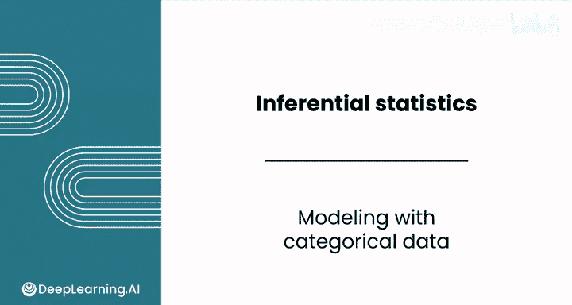
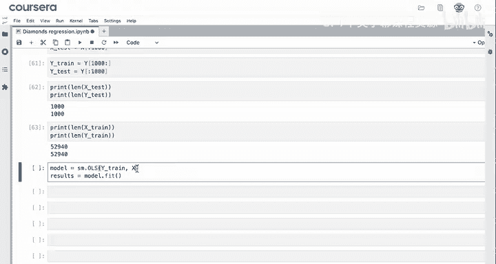
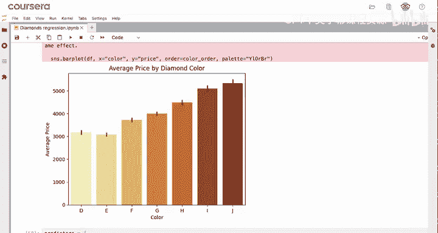
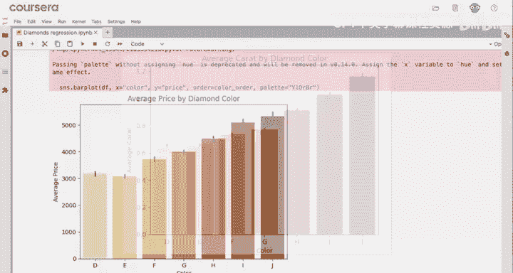
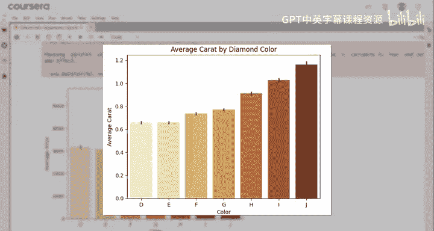
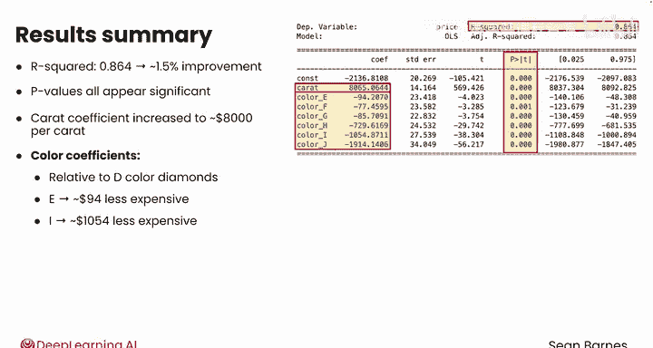
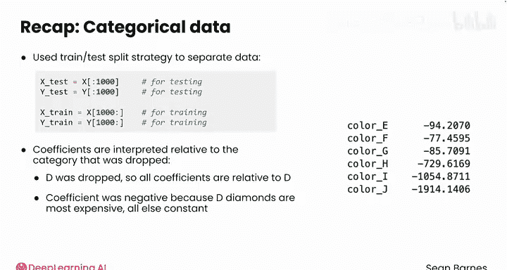

# 吴恩达《Python数据分析（数据分析第3课）｜Python for Data Analytics》中英字幕 - P77：76_类别数据建模.zh_en - GPT中英字幕课程资源 - BV1rp5yzjEgn

After encoding your categorical variable as dummies。

 you can incorporate it as a predictor in your linear regression model then you'll need to spend time interpreting the results to recap you've imported your modules read in your data as Df and youve also just encoded diamond color using P get dummies you left off with this data frame that includes carrot and the encoded dummy variables for color Now you can construct your model it's common to set aside some of your x data to test the model later say 1 thousand diamonds you can use these diamonds to see how well your model performs on new data since you know their true price already split your data into xtrain and x test x test is the data you're setting aside you can slice rows of your data frame from 0 to10 if you leave off a value before the colon this slice will start at the beginning of your data frame then for xtrain the slice you'll use to train your model use a thousand colon Since you don't have an n value the slice will go from row 1 thousand to the end split your y data in the same way Y test as the first thousand values and Y train as the rest make sure you select the same。

Otherwise the rows won't line up properly， you want to make sure you have the price and features of the same set of guidance What do you expect should be the length of X test and Y test。

They should both be of length 1000。 Great X train and Y train should be the same length as well。

 somewhere around 53000。Perfect。And now you can use the same code as before to fit the model。

Just replace Y as Y train and X with Xtrain， you'll use Y test and X test in the next video。

 so take a look at the R squared value。

You improve your model by about 1。5% compared with the previous one again。

 looking at each coefficients P value， they all appear significant。

 so you can move forward with your interpretation。 These coefficients are quite interesting。

 The coefficient for carrot went up the coefficient for carrot is now $8000 per carrot。

 all else being equal Now interpreting the coefficients for these dummy variables can get a little tricky Each color coefficient is expressed in relative terms to the category you left out。

 notice there was no coefficient for D because it was dropped with drop first equals true。

 so the coefficient for each color category is relative to de coloror diamonds。 For example。

 e color diamonds are about $94 less expensive on average。

 All else being constant compared with de colorored diamonds。

 I color diamonds are about $1054 less expensive， All else being constant these coefficients are all negative because on average。

 deco colored diamonds are the priciest as long as the carrot of the diamond is the same Looking again at the bar graph of color and price。

 It originally appeared like these IJ diamonds are worth more just because of their color however。

What you may be able to guess is that these diamonds with a less desirable color tend to be larger。

 so they are a higher price on average， but it's not because of their color for two diamonds of the same carrot。

 one with a color D and one with a color J the D color diamond would be more valuable if you look at a cborn bar plot of color on the x axis and carrot on the y axis with the color in order and the same yellow to brown palette as before you can see that the size of a diamond increases with the yellower colors。

 these regression results helped explain an interesting and surprising pattern in your data。

 So take a look at the r squared value you improve your model by about 1。

5% compared with the previous one again， looking at each coefficients P value they all appear significant so you can move forward with your interpretation these coefficients are quite interesting the coefficient for carroatt went up so now it's about $8000 per carrot all else being equal Now interpreting the coefficients for these Wmy variables can get tricky each color coefficient is expressed and relative terms to the category you left out notice there was no coefficient for D because it was dropped with drop first equals true。

😊。

So the coefficient for each color category is relative to de colorored diamonds。 For example。

 Ecolored diamonds are about $94 less expensive on average， all else being constant。

 compared with de colorored diamonds， I colorored diamonds are about $1054 less expensive All else being constant。

 these coefficients are all negative， because on average， decolored diamonds are the priciest。

 as long as the carrot of the diamond is the same。 looking again at the bar graph of color and price。

 it originally appeared like these I and J diamonds are worth more just because of their color。

 However， what you may be able to guess is that these diamonds with the less desirable color tend to be larger。

 So they are a higher price on average， but it's not because of their color for two diamonds of the same carrot。

 one with the color D and one with the color J。 the decolored diamond would be more valuable。

 if you look at a seaborn bar plot of color on the X axis and carrot on the Y axis with the colors in order and the same yellow to brown palette as before。

 you can see that the size of a diamond increases with the yellower colors。

 these regression results help explain an interesting。😊。

And surprising pattern in your data To recap， you used a strategy called Tra test split to separate out training and testing data。

 you sliced the first thousand rows of data for testing and kept the rest of your data for training the model It's good practice to reserve some of your data so it's brand new to the model during testing After all。

 if you're giving someone a test you don't want them to have seen the answers yet you also saw that the coefficients for dummy variables are interpreted relative to the category that was dropped In this case the decolor category was dropped and you interpreted all your coefficients relative to D diamonds Each of the remaining coefficients was negative because de colorored diamonds are the most expensive on average holding carrot constant。

You've seen how to improve your model using a categorical variable like color。

 which can also help you discover unexpected insights about your data In the next video。

 you'll use your new and improved model to predict the prices of new diamonds。

