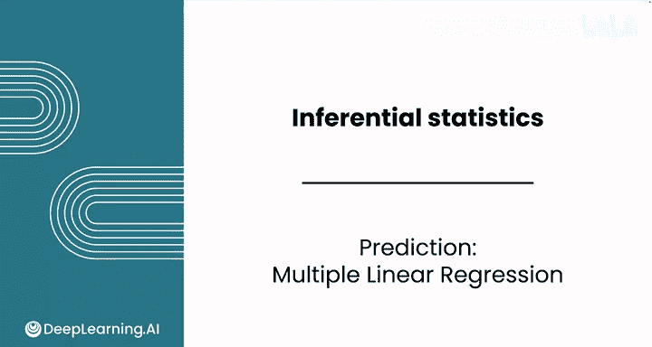
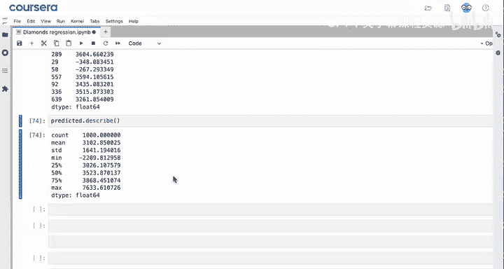
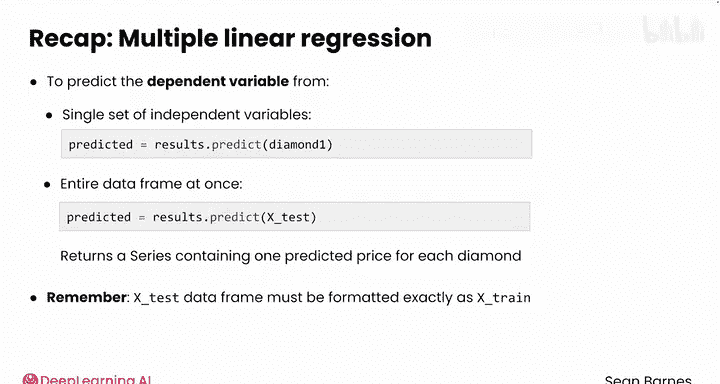

# 吴恩达《Python数据分析（数据分析第3课）｜Python for Data Analytics》中英字幕 - P78：77_多元回归预测.zh_en - GPT中英字幕课程资源 - BV1rp5yzjEgn

Once you've developed an improved model， you can use it to predict the dependent variable for new data points。

 Pick up where you left off。 you imported your modules， read a new data。

 and then developed a linear regression model using carrot and color to predict diamond price。

 You encoded the color variable using PD git dummies。

 You reserve 1 thousand rows of your data for testing in the variable X test Now you can use results do predict to predict the price for a new diamond Check out the first diamond in your X test variable Use x test lo0 to save it into a new variable diamond 1 and view it。

 Can you tell what type of diamond this is。

It's a 0。23 caratt E color diamond。 It's pretty small and pretty clear， but not the clearest。

 Use results that predict of diamond 1， and you get negative $364。 That's a low low price。 remember。

 the model struggle somewhat with very small diamonds。

 So even though this is overall an excellent model。

 a small diamond like this one will be under predicteddic。 check out y test low0 for its real price。

$326。 So the model was off by about $600 in the context of diamonds worth tens of thousands of dollars。

 It's not a lot。 but for this one， it's a pretty significant error。

 You'll evaluate the accuracy of your model further in the upcoming video。

 you can also predict new prices for all thousands diamonds at once。

 say predicted equals results that predict of X test。That's it Now take a look at predicted。

What type do you expect？It's a series。 Just one column of values， predicted prices。

 If you sample 10 rows， you can see the variety of prices the model predicted。

 You can see here there's a diamond predicted around $4000 is's another one around $3600 and then you see a couple of negative predictions probably again for very small diamonds。

 you can also use predicted described to learn more about this series。

 there are 100 values as expected with the mean price around $3100 and the highest diamond is predicted around $7600 to recap。

 you can use model predict to predict the dependent variable from a single set of independent variables like one row of your x test data frame or you can use model do predict on an entire data frame like all of xt at once then you'll get back a series containing one predicted price for each diamond。

 remember the key to making all this work is that your x test data frame must be formatted in exactly the same way as the data that was used to train the model which in this case was xtrain。

 If not you may get some unexpected results or stats models may generate an error when you make predictions。

You saw a moment ago that your model doesn't perform well for some values。

 follow me to the next video to explore how to evaluate your multi linear regression model once you've created it。

