# 吴恩达《Python数据分析（数据分析第3课）｜Python for Data Analytics》中英字幕 - P79：78_模型评估.zh_en - GPT中英字幕课程资源 - BV1rp5yzjEgn

Once you've created a multiple linear regression model， you'll need to evaluate it。

 you already know how to interpret the result summary。

 but what other tools can you use when evaluating your model。

 you'll need to consider metrics beyond R square。 a common technique is to compare the predicteds made by your model with the actual values。

 That way you can see how your model is deviating from reality。

 you can visualize the relationship between predicted and actual values using a scatterpl。

 This technique is particularly valuable for multiple linear regression since you can't just look at a scatterpl between your independent and dependent variables to assess the model' fit。

 Once you have3，4，5 or more variables， you start to get into hyperdimensional space。

 In addition to creating a scatterplot， you can also calculate a correlation between your predicted and actual values called multiple R。

 Multi R is typically a number between0 and1， reflecting the strength of the predictive power of your model and a higher value is better。

 Next， you can calculate the residuals。 The actual price minus the predicted price。 For example。

 if a diamond was actually priced at 1000。 but your model predicted a price of $1100。

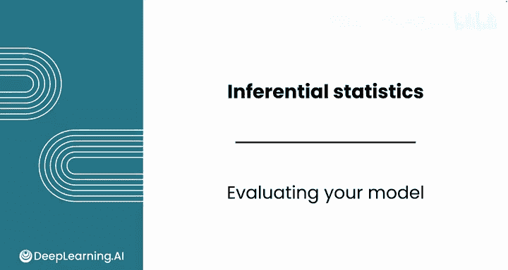

The residual for that value would be negative $10。 It's negative since the actual price was lower than what the model predicted。

 the model can also over predictdict the price， leading to a positive value for the residual If the diamond was actually $1000 and the model predicted its price at $900。

 The residual would be positive $100 you can think of the residual as how much the model would need to adjust its prediction to be correct。

 Once you've calculated your residuals， you can calculate the mean absolute error or MAe。

 the average size of the errors in your predictions。

 MAE is in the same units as your data in this case dollars so it's highly interpretable。

 Let's get into it。 recall that you've already imported your modules and trained a linear regression model for diamond price using color and carrot Next。

 you can use the residuals to better understand the fit of this model。

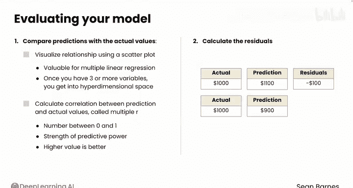

First， save the Y predictions in a Y_ PRD variable that's model got Preict X test。

The first five values are negative， which seems wrong since diamond prices can't be negative。

 however， you previously saw your model doesn't work well for small diamonds。

 so these results seem consistent with that finding then create a new variable called Y actual。

 which is just the same as Y test those are all your actual prices， No negatives there。

Now create a plot of predicted versus actual values， you can use SNS S Regplot。

 which is a scatter plot with a line of best fit you can use this line of code to set the line color into black。

 Don't worry too much about it remember you can always ask your LLM for help adjusting visualizations So on the X axis you have the predicted values diving prices from negative 2500 or so all the way up to 27。

000 or so and on the Y axis you have the actual values from around 0 to 20000。

 What do you think is the ideal relationship between the predicted and actual values。

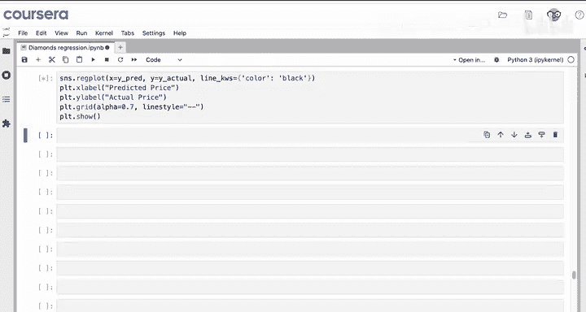

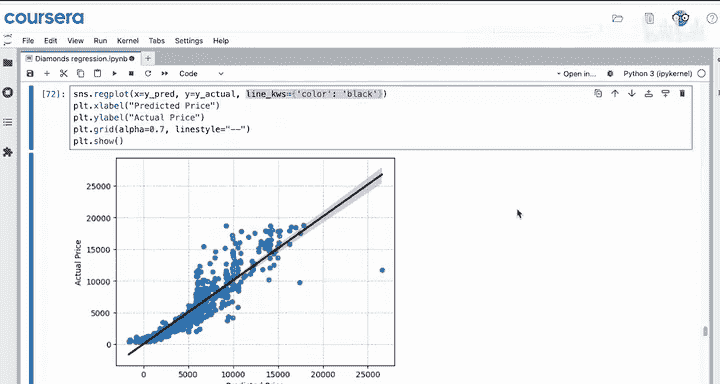

In an ideal world， there would be perfect positive correlation between the predicted and actual values if the actual price was $10。

000， the predicted value should be $10，000。 If this relationship were true。

 this graph would just be a perfect line at y equals x。

 Let's ask the LLM to add a perfect y equals x line to this plot。

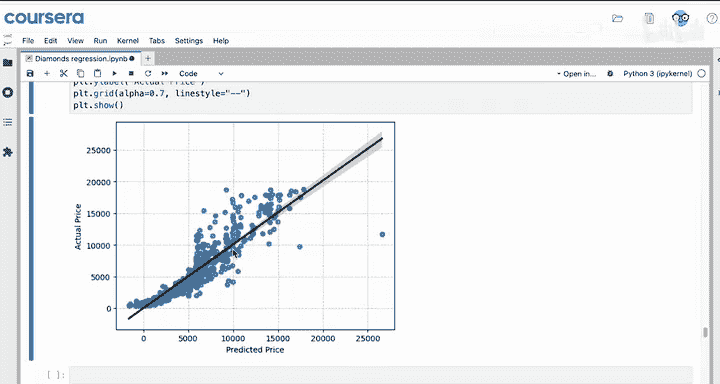

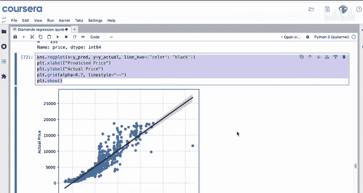

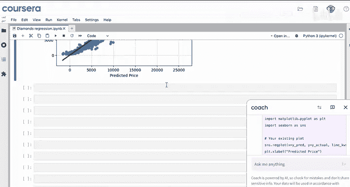

Great， add this line of code， which plus the perfect line in a red dash style。

 This line is super close to the Russian line。 The line of best fit。 However。

 notice that there is a lot of deviation around this line。

 The relationship between the predicted and actual values doesn't look linear either。

 there's a systematic deviation from this y equals x line Since very low and very high actual prices are under predicteddicted。

 they appear mostly above this ideal line。 and middling prices are over predicteddicted。

 they appear mostly below it。 the fact that this relationship is nonlinearar tells you that you may be able to get better results by using some kind of nonlinearar model。

 That technique is out of scope for this course， but it's something you can explore with your Ln if you're curious。

 you already know that predicted in actual prices are highly correlated。

 but you can calculate multiple r to quantify this relationship。 Both ypre and y actual or serious。

 So you can use the line of code Ypre core Y actual to get the correlation coefficient。

 you get a value of around 0。93 So despite being nonlinearly related。

 these values are highly correlated with one another next。😊。

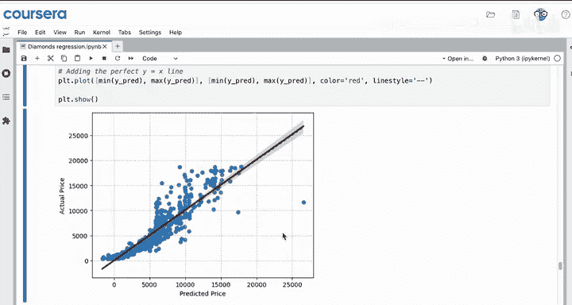

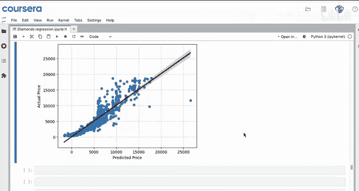

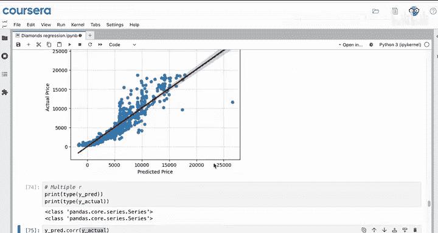

Cculate the residuals with y actual minus y pre， which gives you the difference between the actual price and the predicted price For the first diamond。

 the actual price was higher than the predicted price by about $700。 Finally。

 calculate the mean absolute error using your residuals， so you can say residuals ABS。

 which takes the absolute value， so all the errors become positive essentially。

 then take the mean of those absolute values of the residuals。

Print out the result and you get that your predictions are on average off around $992 I that a lot？

Well $1000 seems like a lot， but it depends on your use case。

 since your model is intended to act as a starting point for a professional estimate。

 this amount of error may be fine。Regardless， you can present this metric to your stakeholders to help them understand the kinds of errors your model makes Excel work。

 evaluating your model's residuals。 ploting the residuals and calculating error metrics will provide even more insights about whether your model is performing well enough to be useful。

 followow me to the next video to learn how to collaborate with an LLM to improve your model。

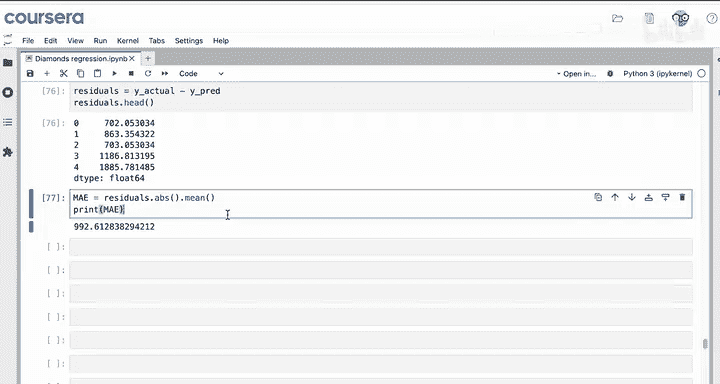