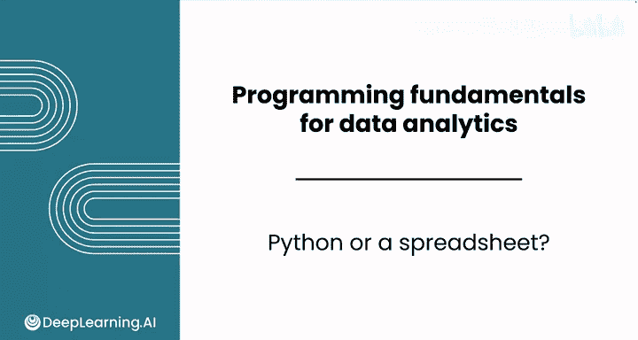
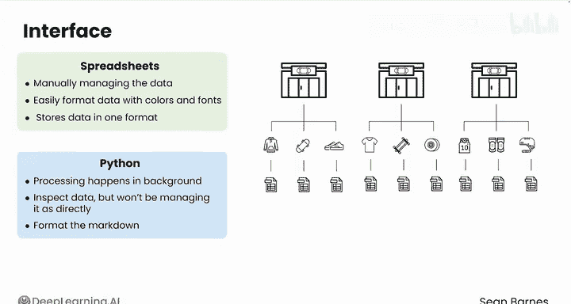
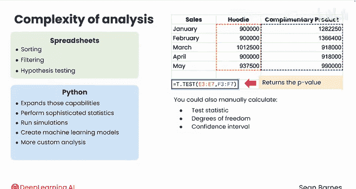
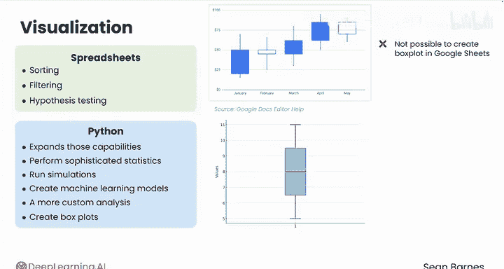
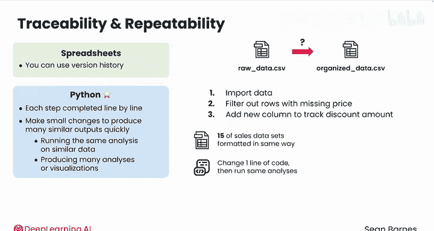
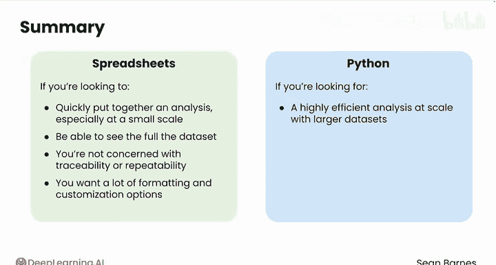

# 吴恩达《Python数据分析（数据分析第3课）｜Python for Data Analytics》中英字幕 - P7：6_Python与电子表格的选择.zh_en - GPT中英字幕课程资源 - BV1rp5yzjEgn

Python and spreadsheets are both digital tools， making them highly efficient and consistent。 However。

 they differ in a few key ways， giving each its niche。

 Let's take a look at why you might pick one over the other。

 One major difference between Python and spreadsheets is the interface。

 As you've seen with the spreadsheet， you're manually managing all the data here。

 when you want to duplicate a column， you have to choose where that column is going to go。

 and manually add the references to other cells。 when you're working with Python code。

 this processing typically happens in the background。 you can inspect the data。

 but you won't be managing it as directly relatedly in a spreadsheet。

 you can easily format your data with colors and font styles。

 encouraging stakeholders to explore and Jupyter notebook， you can format the markdown。

 but your capabilities for making the notebook pretty are more limited。 Still。

 these are both formats intended to be shared and explored to explain data not just show it in its raw format。

 Spsheets also essentially store data in one specific format。 A table of rows and columns。😊。

So data aren't best represented in this way。 you learned previously that unstructured data like text and video doesn't fit neatly into rows and columns。

 Here's another example。 say you're dealing with the information that has multiple levels or layers。

 So if you own several skateboard shops。 Each skateboard shop might have a set of brands it sell and each brand has different products。

 that organization becomes complex to model with a spreadsheet ultimately。

 you'll need multiple sheets to model these relationships。

 The complexity of analysis available to you is also different。

 you have a lot of capabilities in a spreadsheet from sorting and filtering to performing hypothesis testing Python expands on those capabilities。

 you'll be able to perform more sophisticated statistics run simulations and even create machine learning models Similarlyly。

 if you need a more custom analysis， you'll have an easier time in Python Here's an example in the previous course you conducted hypothesis testing using the T test function and Google sheets。

 that function returns the P value associated with the test。

 you could also manually calculate the test。

degrees of freedom and even a confidence interval but in Python。

 you can perform each of these tasks with a single line of code as well as calculate additional statistics for more complex scenarios。

 Python's advantage and available complexity applies to visualizations as well you may recall that it's not possible to create a true box plot in Google sheets that's frustrating considering how useful the box plots are in Python you can create box plots with just a few lines of code you can also customize every aspect of your plots apply unique color schemes and create several plots at once when it comes to traceability and repeatability Python is the superior choice If you want to track the steps you took in your analysis in a spreadsheet。

 you can use the version history and that's kind of it your python code on the other hand will contain each step you completed line line Here's an example say you have a raw data file of skateboard sales and a second version of the file that contains more organized data but what did you do to organize the data It's like playing spot the difference If instead you have the python notebook you use to clean the data you can examine the steps。

One by one for example， you might see that you imported the data。

 filtered out rows with a missing price value and then added a new column to track the discount amount on sale items Repeatability in Python goes beyond just reproducing pass analyses you can also make small changes to produce many similar outputs quickly some common use cases for this strategy are running the same analysis on similar data or producing many analyses or visualizations to see which one works best For example。

 if you're working with a shop owner who has 15 of these sales data sets all formatted in the same way。

 you could change one line of code wherever you import the data。

 then run the same analyses as before with one click or if you have a data set with 20 features。

 you could construct 95% confidence intervals for each feature using minor tweaks to the same command so to sum up all these differences spreadsheets are the way to go if you're looking to quickly put together an analysis especially at small scale you want to be able to see the full data you're not much concerned with traceability or repeatability and you want a lot of formatting and customization options。

The data Python will be the stronger choice if you're looking for a highly efficient analysis at scale that is with larger and larger data sets。

 complex or customized analysis or visualization， and a traceable process that makes it easy to repeat tasks across different data sets or features。

Awesome， so far， you've seen the fundamentals of Python programming。

 plus why you'd want to use Python in the first place。

 Once you've completed the practice assessment for this lesson。

 join me the next one to get hands on with coding。 I'll see there。😊。

