# 吴恩达《Python数据分析（数据分析第3课）｜Python for Data Analytics》中英字幕 - P80：79_使用LLM迭代模型.zh_en - GPT中英字幕课程资源 - BV1rp5yzjEgn

You're never alone when developing a linear regression model。

 you can always ask an LLM for input on how to iterate on and improve your model。 Let's use chatgpt4。

 Remember， you may have a more advanced model available to you using this model interface allows you to upload images and datasets directly for the LLM to use。

 Start off by giving the model some context。 I created a multiple linear regression model to predict diamond price using both carrot and color and this data set of diamonds。

 I encoded the color using PDd do gett dummies。 Here's a screenshot of the regression summary table provide three simple recommendations for improving the model and explain your reasoning behind each。

 So you're giving the model a lot of context about what problem you're trying to solve。

 just like you would give to a colleague and you're asking for some recommendations to improve it。

 notice that in this case， you intend to provide the model with both the data set and the screenshot of the summary table。

 So first you can screenshot the summary table and you'll also need to upload the dataset。😊。

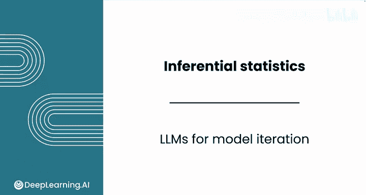

Okay so the model gives three suggestions first it suggests including interaction terms。

 saying that the relationship between carrot and price might depend on the color of the diamond。

 then it suggests checking for multicollinearity The last suggestion is that it tells you to consider transformations or nonlinearar relationships and it specifies that the relationship between carrot and price may not be strictly linear and that you could try polynoial terms like adding carrot squared or log transformations to capture potential nonlineararities。

 This last option might appeal to you because you already notice based on the residuals and the plot between actual and predictive values that there did seem to be some kind of nonlinearar relationship happening so you could use a polynoial term for carrot like carrot squared。

 Here's a potential follow-up prompt。 Here's my model code。

 please help me modify it to include the carrot squared in the model rather than just carrot and then give it the code that you use to create x and Y as well as to fit the model。

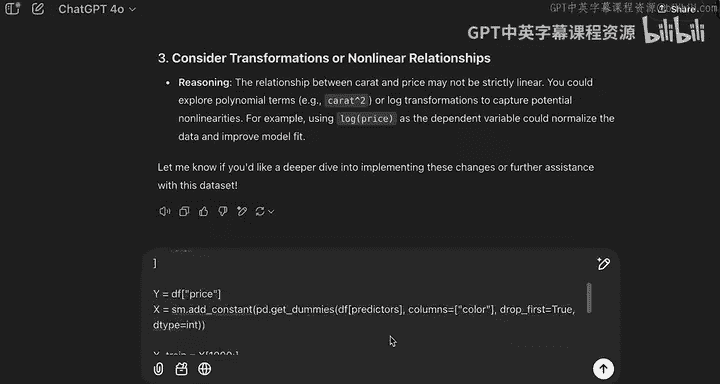

So the change looks relatively straightforward， the LLM recommends adding this DF carrot squared term in a new column。

 and then just running the regression is normal， you can copy the code and try implementing it。

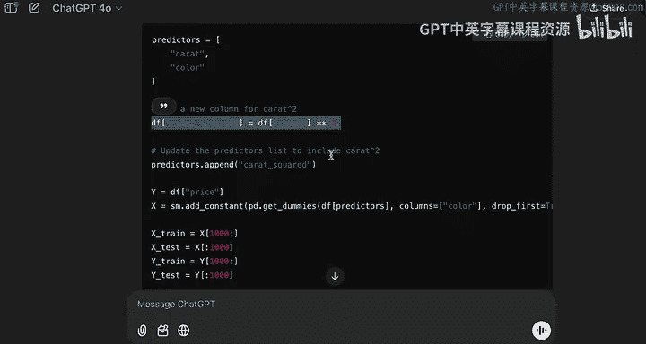

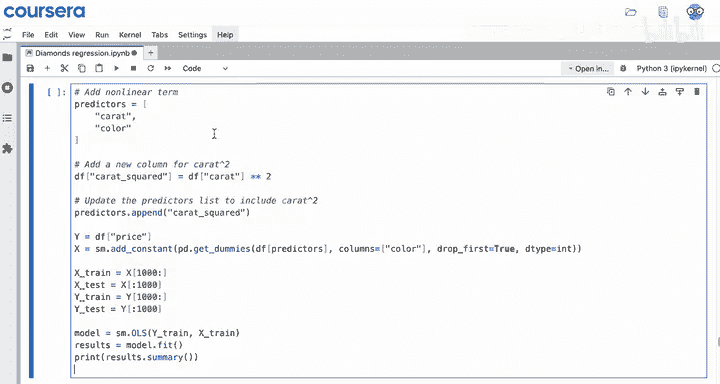

So just looking at this regression table， r squared is a tiny bit higher，0。867， rather than the 0。

864 it was previously， which is a pretty marginal result。 you can still aim higher。

 One thing you may be curious about is that carrot and carrot squared seem like they might overlap in what they explain Since carrot squared is calculated using carrot so you may just want to ask。

 is it okay to have both carrot and carrot squared in the x data frame。So it says yes。

 it's perfectly acceptable and often necessary to include both the original variable in the square turn。

 It allows the model to account for both linear and nonlinearar relationships between carrot and the price。

 You may want to follow up by asking this approach didn't significantly improve my model。

 Can you help explain why， because the R square only went up by a few tenthts of a percentage point。

So it essentially agrees with you that the squared term only captures a small additional portion of the variance in price。

 Then it suggests some reasons why that may be happening。

 It highlights that the nonlinearity might be subtle or limited。

 so maybe the carrot squared term is not the best way to capture that behavior there already highlights that carrot is a strong predictor。

 so maybe theres not additional value and other forms of the carrot variable。

 and then it also highlights that there might be more to gain by including other predictors like color query cut。

 etc ce。 if there are not already capturing your model。 So lastly。

 it gives you some suggestions for further analysis including inspecting the residuals。

 performing more feature engineering or exploring nonlinear models beyond linear regression So in order to investigate further。

 you might want to share this plot of the predicted and actual values from your earlier model you can just take a screenshot of this and ask the LLM to interpret it。

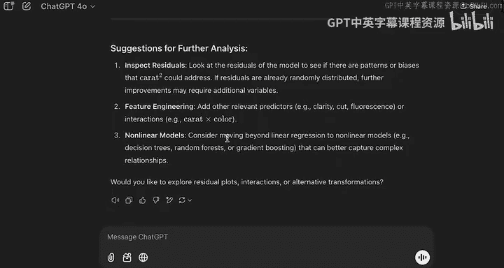

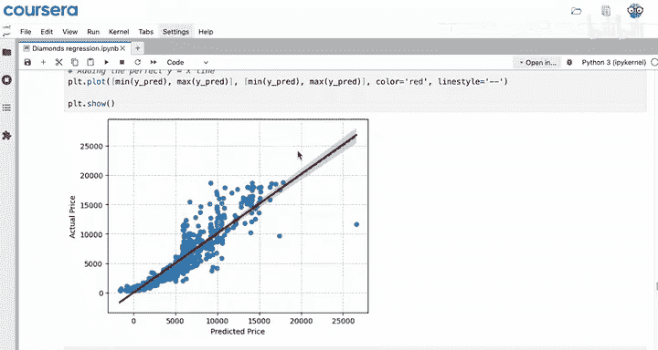

Based on these predicted versus actual values， what might you suggest to transform the data， to me。

 it looks like the predicted values increase rapidly， then level off compared with the actual。

The model returns several suggested transformations。

 The first suggestion says to log transform the dependent variable price。

 Target is just another way of saying dependent variable。

 The second suggestion is to log transform the carrot variable。

 And then it make some other suggestions as well， including higher order polynomial terms like carrot squared and carrot Qd and beyond。

 Then it tells you some next steps。 starting with applying log transformations for price and or carrot。

 Then it offers to help you implement these transformations on your model。

 you may have seen a graph of y equals log X。 which looks like this graph here。

 So there's a more rapid increase in y at the lower values of x。 and then for higher values of x。

 the graph of y levels off。 There does seem to be some similarity to how the predicted prices are distributed。

 And the LM recommends adding the log of both the price and the carrot。 So let's ask for that code。

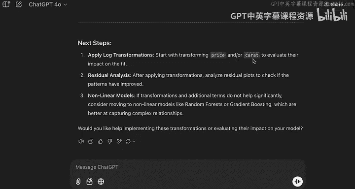

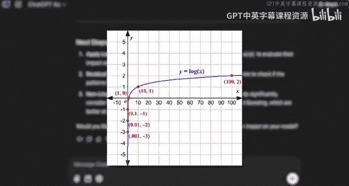

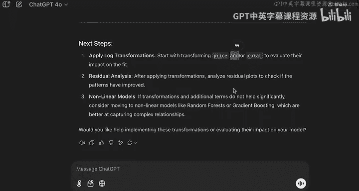

Modify this code so it includes the log of price and the log of carrot， but not carrot squared。

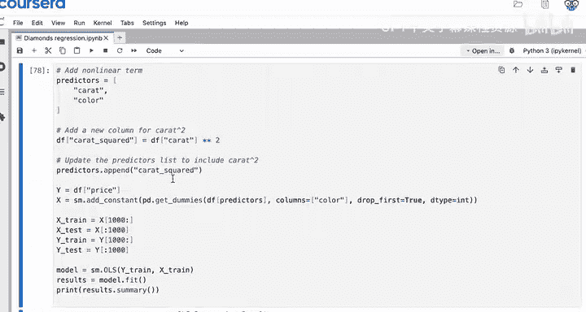

Okay， that looks relatively straightforward。 You just need to domp log on the price and the carrot。

 so here's the code you started with instead of Df carrot squared， you're going to domp。 log。

 Now logarithms can be pretty challenging to understand。

 but let's just continue forward to see if this transformation works and improves the model。

 You can worry about explaining it later， So you have the log of carrot and the log of price。

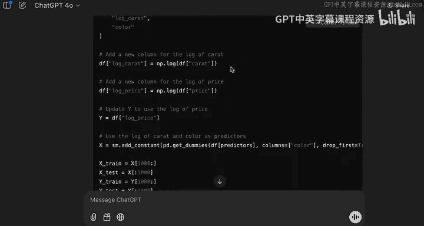

And while that had a noticeable impact， now R squared is 0。945。

 this combination of inputs has increased the predictive power of the model by almost 10%。

 which is a really big improvement， especially considering you were having trouble improving the model using just the existing features。

 a quick plot shows a much more linear relationship between the predicted and actual values。

But remember， these are predicted in actual values for the log of price。 So 678，9。

 These are values for the log of price， not linear prices。

 You're getting into territory where you added some transformations you never used before and introduce mercurre interpretationability into your model。

 It looks like the model is improving， but it's hard to be sure because of its complexity。

 So now is a good time to take a step back， do a bit more research。

 talk with a colleague and gather more information about how these transformations affect your ability to predict。

 You can also ask your LLM for more help with interpretation。

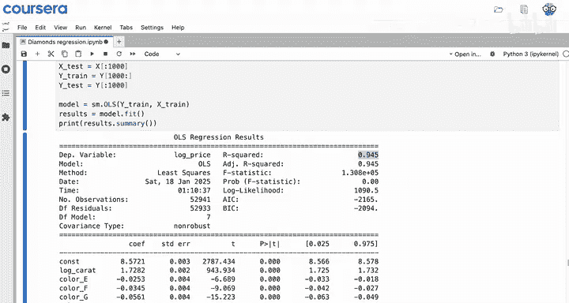

It's so helpful to have an LLM as a thought partner when developing a linear regression model。

 now that you've built one end to end， from variable selection to evaluation。

 let's take a look at the big picture， follow me to the next video to see how all these steps can come together。

