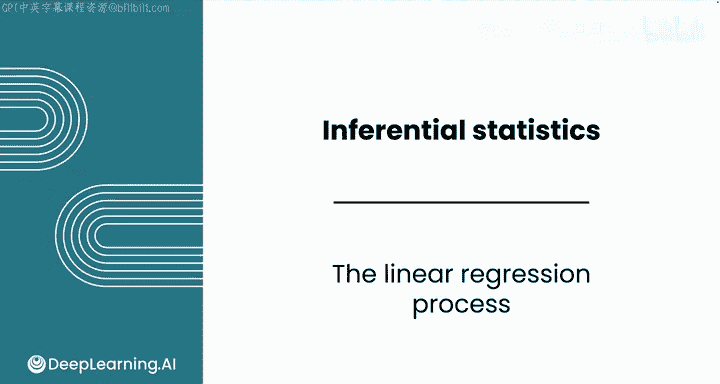
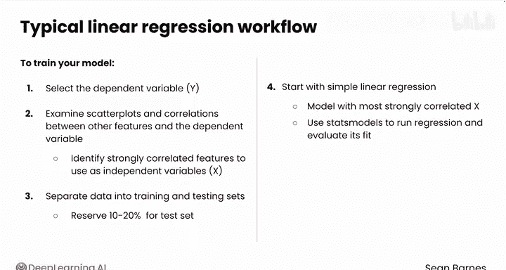
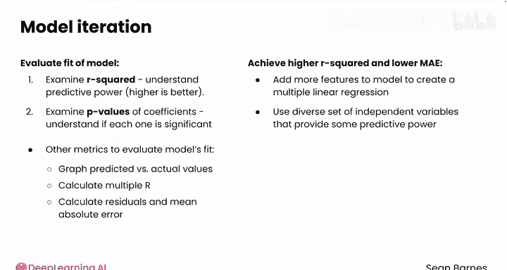
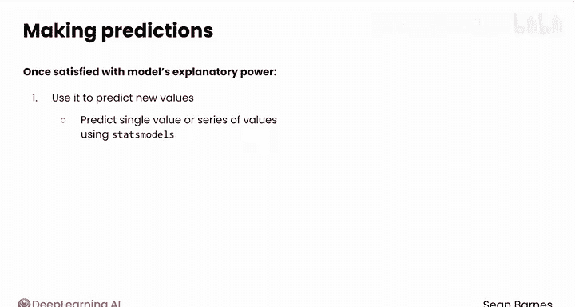

# 吴恩达《Python数据分析（数据分析第3课）｜Python for Data Analytics》中英字幕 - P81：80_线性回归全流程.zh_en - GPT中英字幕课程资源 - BV1rp5yzjEgn

You've done so much work to build your multiple linear regression model so far。

 Let's take a bird's eye view of the end to end process。

 recall that linear regression involves two major steps training where you build your model and prediction where you use your model to predict new values In this module you also learn how to evaluate your model Let's review the typical linear regression workflow to train your model you first select the dependent variable The feature you are trying to predict Then you can examine scatter plots in correlations between the other features in your data set and the dependent variable identify strongly correlated features to use your model as independent variables Once you've identified your x and Y variables separate your data into training and testing sets Res a small portion of your data like 10 or 20% for later evaluation This portion is called the test set the rest is used for training start modeling with the simple linear regression a model with only one independent variable you can start with the most strongly correlated independent variable you use the statistics model stats models to run the regression and evaluate its fit。

 Now you develop the first in a series of models。

Once you've developed one model， you'll enter into an iterative process。 First。

 evaluate the fit of your model。 Ex R squared to understand its predictive power。 General。

 a higher r squared is better。 Ex the p values of the coefficients to understand if each one a significant。

 If so， you can move forward with interpretation you can also use other metrics to evaluate your model fit。

 For example， you can graph the predicted values against the actuals and calculate multiple R。

 the correlation between predicted and actual values。 You can also calculate the residuals。

 The differences between the actual and predicted values and then calculate the mean absolute error。

 Each of these measures can be used to inform your next steps or help you communicate with your stakeholders to achieve a higher r squared and lower MAe。

 you can add more features to your model to create a multiple linear regression you'll want to use a diverse set of independent variables that provide at least some predictive power in the presence of the other variables。

 Be mindful of possible multicolineity variables overlapping in their explanatory power。

 Once you're satisfied with your models R squared。

Explanatory power， you can use it to predict new values。

 you saw how to predict the single value or a series of values using stats bonds。

And that takes you to the end of this lesson and this module linearar regression is a complex technique you can check out the upcoming reading items to learn more aboutlinear transformations and interaction features which allow you to model even more relationships in your data Com up。

 you'll complete the graded assignment and graded lab for this module in the graded lab。

 you'll use the inferential methods from this module to predict vehicle carbon emissions Once you're done follow me to the next and final module of this course time series。

