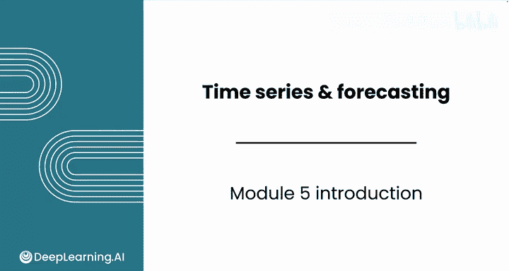
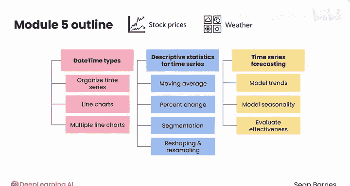

# 吴恩达《Python数据分析（数据分析第3课）｜Python for Data Analytics》中英字幕 - P82：81_模块5 简介.zh_en - GPT中英字幕课程资源 - BV1rp5yzjEgn

Welcome to Mo 5 Time series and forecasting Time series data uses many unique techniques compared with cross sectionional data while you'll still use pandas。

 mapplotlib， Seaborn and stats models to work with your data your approach will be drastically different In this module。

 you'll master essential techniques for analyzingizing and visualizing timebased data you'll work with real stock market and weather data to understand trends and seasonality plus forecast the time series into the future In the first lesson you'll explore working with datetime types in Python you'll organize time series data and visualize that data into well formatted line charts both single and multiple The second lesson focuses on descriptive statistics for time series analysis。

 you'll learn to code up powerful techniques like moving averages and percent changes and explore segmentation you'll also master reshaping and resampling techniques In the final lesson。

 you'll use linear regression for time series forecasting You'll learn how to model trends and seasonality in your data and evaluate the effect。

Of your time series model by the end of this module， you'll be able to manipulate。

 visualize and forecast time series data with confidence follow me to the first lesson to begin exploring daytimes and line charts See you there。

