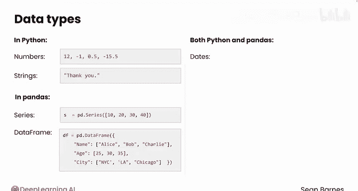
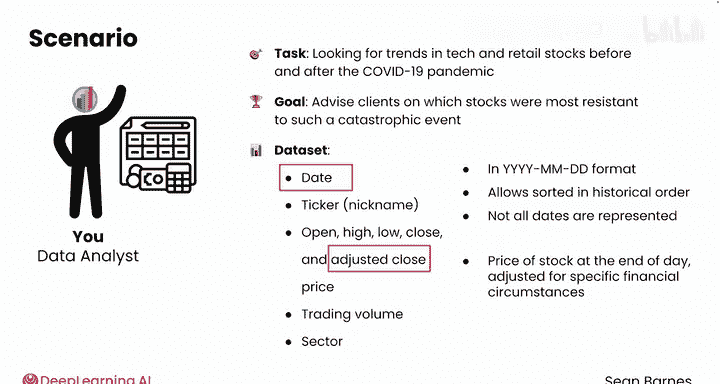
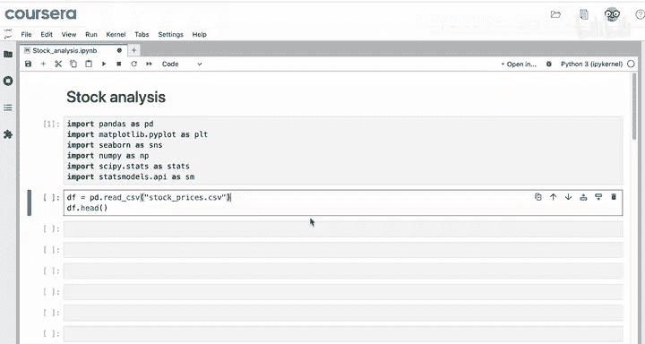
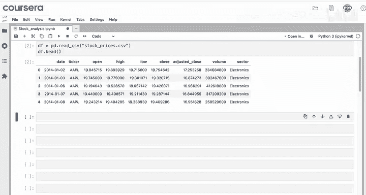
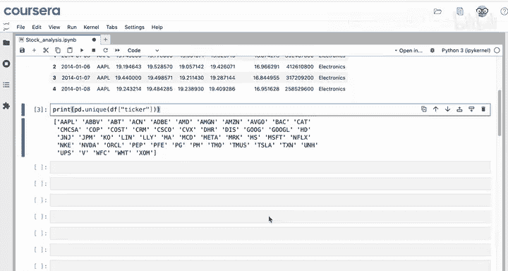
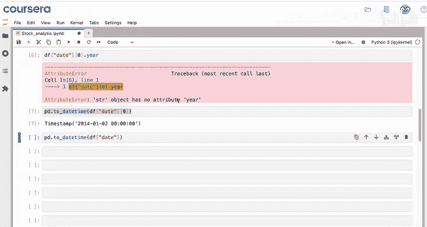
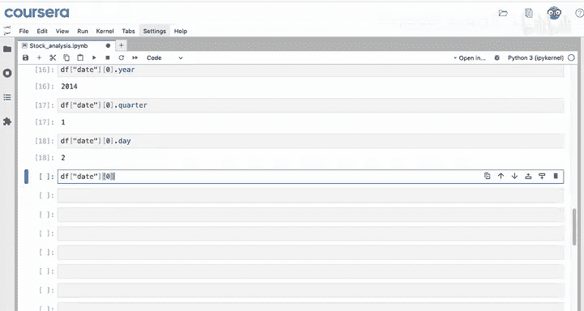
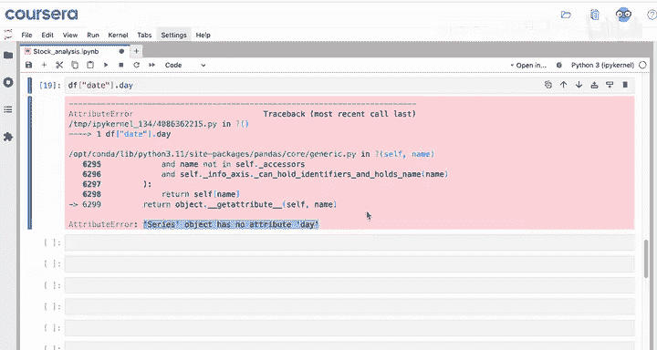
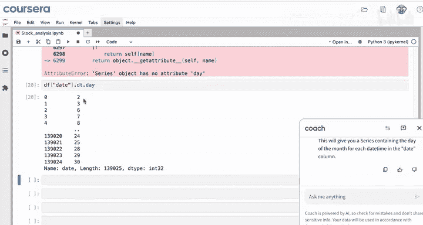
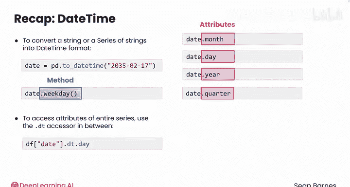

# 吴恩达《Python数据分析（数据分析第3课）｜Python for Data Analytics》中英字幕 - P83：82_日期时间处理.zh_en - GPT中英字幕课程资源 - BV1rp5yzjEgn

What's one important date in your life？

I'll always remember November 2， 2016， the day my beloved hometown baseball team。

 the Chicago Cubs won the World Series that win broke a 108 year drought without any championships dates are special to us and in code they require a special data type you've already worked with a lot of data types You've seen how numbers and strings are represented in Python as well as how pandas allows you to store data in rows and columns with series and data frames dates get their own special data type in both Python and pandas the date time type。

Suppose you're working with the financial planning organization and have been asked to analyze stock price trends over time。

 you're looking for trends in tech and retail stocks before and after the Covid-19 pandemic。

 The financial planning organization is looking to advise their clients on which stocks were most resistant to such a catastrophic event。

 You're working with the new data set with this set of features including date ticker。

 which is the company's nickname， the open high low close and adjusted close price。

 the trading volume and the sector of that stock。 You're especially interested in the adjusted close price。

 It's the price of the stock at the end of the day。

 adjusted for some specific financial circumstances the dates in the CSv are stored in yearmonday format。

 which is industry standard。 This format allows dates to be sorted in historical order。

 you also notice that not all days are represented in the data。

 Weeks and US banking holidays are not included。 start with the fresh notebook import your modules up top then reading your data from stock prices cv into the variable Df your notebook stock price analysis and the file stock prices csv are in the same。

Remember， you won't need to do any file management in Coursera。

 but importing your data like this only works if your files are stored together。

 Take a look at the first five rows。 The data has features for date ticker。

 which is the name of the stock， the open price and so on。

 Each row represents an observation of one stock on one particular day。

 It appears this data is sorted in some way because all five of these stocks are AAPL。

 which is Apple use PD do unique to see a list of all the tickers Aka companies in the data。

You've got Apple and Amazon and Google and Netflix and Tesla。

 as well as some that you might not be as familiar with。

 like the ticker for Exxon Mo The tickers are sorted alphabetically so that explains why you only saw Apple stocks with D head check out the D types of your data frame with DD types looks like date is an object。

 you learn previously that object means essentially text So right now your dates are stored as text which isn't ideal。

 if you select the first date by selecting the column then the first value of that column you get a string Since it's not a special date you can't get the year for example。

 you just get an error。 you can convert the datetime column from a string to a datetime using Pd do to datetime。

 Call this function on whatever value you want to turn into a datetime。

 you can do so on the first date in the data frame。

 which is January 22014 or you can select the entire column and change all of those dates to a datetime in one operation1 hitch if you just run that code。

 you get a new series but this command doesn't actually modify your original data frame The type of Df date0。

It'Still a straight。You'll want to save this result back into the date column。

 You're overriding the old strings with the new daytime。Now if you look at Df。D types again。

 your date column is a datetime 64 type Great， this MS stands for nanosecond。

 you're not storing any times just dates， but this date type can store time down to the nanosecond Now。

 because these values are day times you can do cool date related operations with them， for example。

 you can find the weekday， which in this case is three。Well， which day is that， you can ask your LLM。

 which day of the week is three if it's the output of DF date zero got weekday？

So it tells you that Monday is zero and Sunday is6， so if the code returns 3。

 it corresponds to Thursday， you can also use attributes to access different parts of the date directly。

For example， that year gets only the year。That quarter gives you the quarter。

 one for the first quarter of the year， Go day and so on。One more thing。

 notice what happens when you try to access the dot day attribute on a series like the entire date column。

You get an error series object has no attribute day。

 that's odd since you know the dates or date times。

 you can ask your LLM if youre run into this type of error， how can I fix this error。

 the values in the date column are date times。

Then， paste in the air。So it tells you that you're trying to access the dot day attribute directly on the series which doesn't work as you've already learned instead you need to use the dot Dt accessor to access daytime properties。

 so it looks like you need to add this dot Dt before you access the day attribute so try out the code looks like it works You don't get an error and the days line up with your expectations You see the second the third6。

7 eighth all the way up to the 30th at the end。

To quickly recap， you can use PDE。 to daytime to convert a string or a series of strings into the special daytime format。

 then you can use methods like do weekekday and attributes like dot monthth， day。

 year and even quarter to get information about each date if you're trying to access attributes of an entire series like a column in your data。

 you'll need to use the dodtacor in between like you did with the line of code dfd。dt。day。

Once you've converted the dates into proper date times。

 you can use them as indices for your data frame， replacing the default integers。

 follow me to the next video to see how also go kbies。

