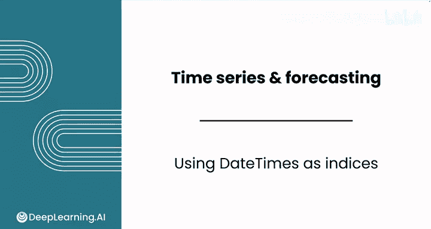
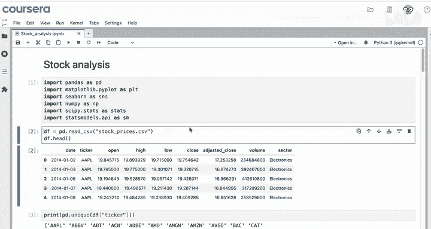
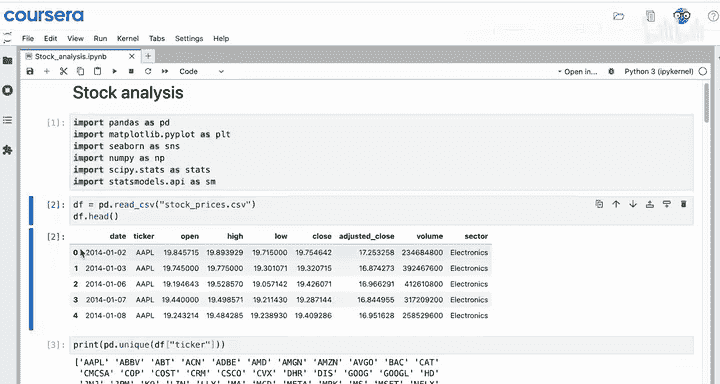
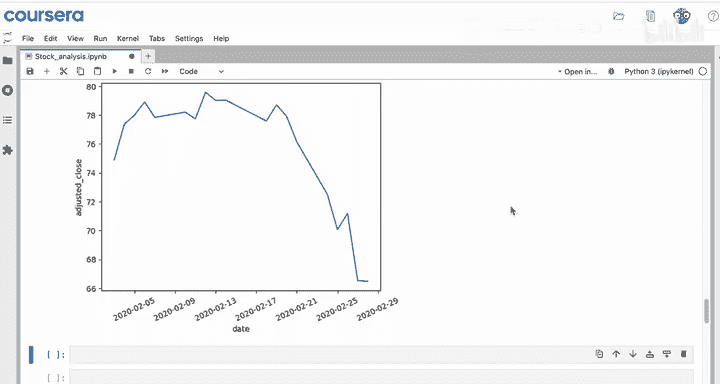
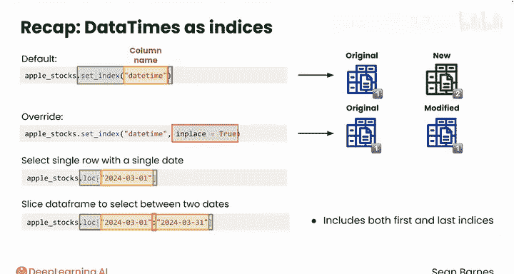

# 吴恩达《Python数据分析（数据分析第3课）｜Python for Data Analytics》中英字幕 - P84：83_日期时间索引应用.zh_en - GPT中英字幕课程资源 - BV1rp5yzjEgn

Dates have a natural order to them， and you can organize your data in a way that takes advantage of that natural order。

Specifically， you may be interested in setting the index of your data frame as the daytime column you just created。

To quickly recap， you already imported all your modules and you ready your stock crisis data into a data frame called DF。

Your first task is to examine trends in Apple stock over time to get a sense of how that particular stock was impacted by the pandemic right now your data has numerical indices。

 but to create a true time series， you'll need to set the indices to be dates First filter the data to only the stock prices for Apple stock select from the data frame where ticker equals Apple Use value counts on Apple stocks ticker to make sure you got the right data Great。

 all Apple and there's 2726 days of stock data for Apple Now set the day column as your index say Apple stocks do set index which you've seen before。

The argument is the name of a column， choose date。You learned previously that dot set index creates a new data frame by default。

 If you want to override that behavior， you can use the named argument in place equals true。

 This argument allows set index to modify the original data frame directly rather than creating a new data frame with the modification Now looking at the top of Apple stocks The new indices are these date times and the date column was removed from the columns of the data frame That's really cool because now you can select specific dates and slice your data frame using those dates say you want to access the3 February 2020 the first Monday of February as a baseline before the pandemic started significantly affecting the market you could say Apple stocks and then select the date that you want using a string you can use the date time2 but a string works and is shorter to type Don't be afraid to be a little lazy if it works。

 remember dot Lo allows you to select rows based on your custom indices In this case you want to select 20200203 year month day this command gives you all the information about that date。

 It was Apple stock of course and the adjusted closed price was just under 7。

You can also now slice your data using these dates for example。

 if you wanted to select one month of rows to see the effects of the pandemic as it was unfolding。

 you could start with what you had before， but now use the slicing operator。

 the colon to select from February 1 to February 28 2020 was a leap year so there's no February 29 Check out the result。

It's a data frame， notice that this slice includes the last value February 28 Now you can examine how the Apple stock price behave throughout the month of February 2020。

 you can use SMSs。Lme plot， then select the adjusted closed column to check out the T。Wow。

 that's a pretty big dip in late February Also I just can't help myself。

 don't you want to change the rotation of the Xts？Okay， that's better。

You'll jazz up this plot more in the next video。

To recap the tools you just learned， you saw that the set index method can be used to set a datetime as an index creating a time series Se index takes a column name as an argument by default。

 this method will create a brand new data frame rather than modifying the old one The in place equals true named argument overrdes that default behavior in place equals true means the set index method will modify the data frame directly rather than creating a copy first Many pandas methods have the optional named argument in place you can always ask your LLM whether it's an option for the command you're using you also use dot Lo to select rows based on the datetime index you can select a single row with a single date or you can slice your data frame using the colon to select a range between two dates Slic in with dot Lo includes both the first and last indices you select。

Now that you're using date times as Indsice， you're working with a true time series。

 follow me to the next video to see how to visualize time series data and Python， I'll see you there。

