# 吴恩达《Python数据分析（数据分析第3课）｜Python for Data Analytics》中英字幕 - P85：84_折线图绘制.zh_en - GPT中英字幕课程资源 - BV1rp5yzjEgn

You learn how to conduct a ton of cross sectional analyses in Python and the previous modules。

 so what are your options for time series data you can start with visualization。

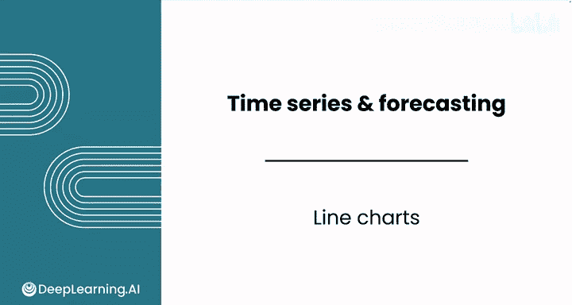

To recap， you've imported your modules and read your dataset into the variable DF。

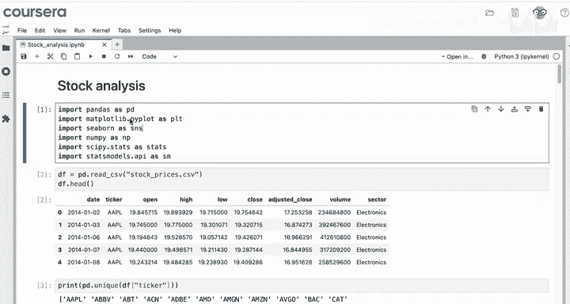

Then you created a subsy re data to focus on Apple stocks。

 you set your indices to date times to create a time series。

 and finally you plotted the adjusted close in a line chart。

 adjusted close price for Apple stocks in February 2020 Now that you have a line chart you can adjust its appearance Add a Y axis label and a title a larger font size will help with legibility。

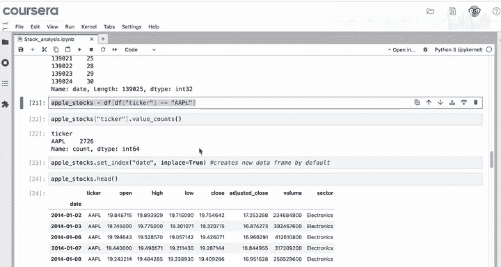

It's pretty clear these values on X axis are dates， so you can leave them without an access title。

You'll see how to format these axes more in the next video。

 you can adjust the appearance of this line as well， using arguments to SMSs。

line plotot like line styleyle， color， line width， and so on since you want to focus on February when news of COVID broke。

 you can use the color red and use a dashed line style。

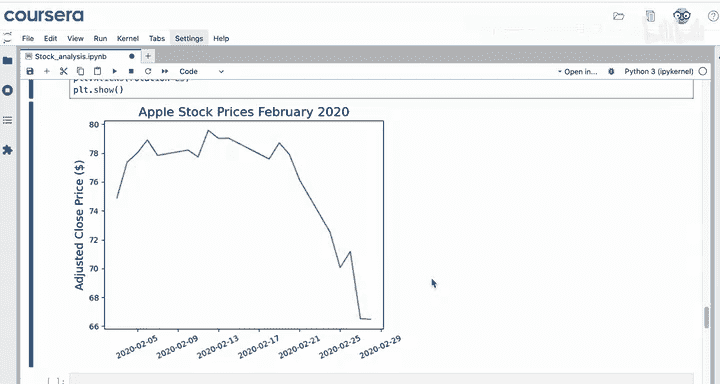

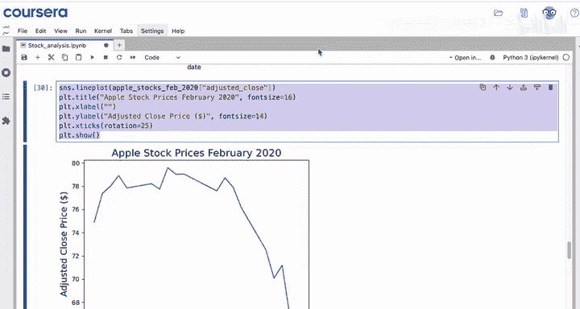

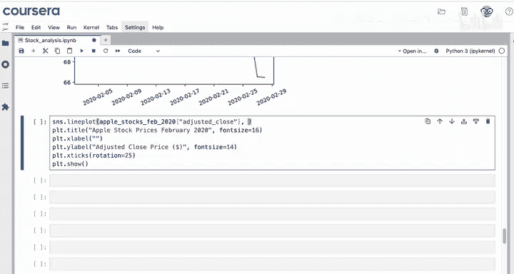

Now that you've created this nice looking graph， you may want to plot multiple series on the same chart right now you' are focusing on February 2020。

 but you can add some more context to this analysis by including the series for January and March2。

 you can add all these lines to same chart， Start with January。

 select the January stocks using the dates for January。Remember these bounds are inclusive。

 so even though January 1s is a holiday for the US stock market。

 you can include that value in your slice and you can go all the way up to January 31st then as you saw previously you can stack multiple axes on top of each other in the same chart。

So copy your code from the previous chart。

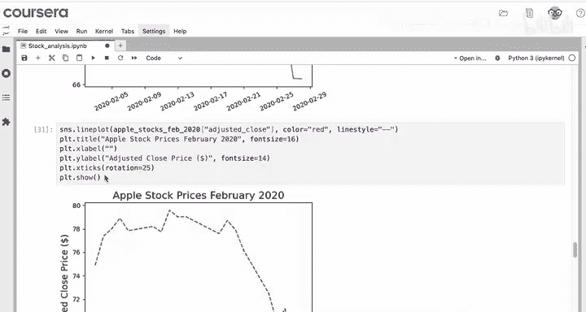

Change the titleJa through February 2020， then just add another SNS。

line plot call this time with the January 2020 data。

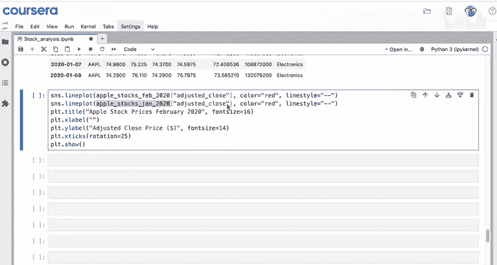

What's wrong with this plot？Well it' behaving as expected， since you're callinging a series。

 you have the date on the X axis， and these dates don't match up。

 but wouldn't it be nicer to compare the behavior of each month more directly。

 that would mean having the same values on the x axis。

 So these adjusted close prices are the y values。 What should you set as the x values。

You can use the day from the index， remember the index is a time series。

 so you can take the filter data frame。index。 day。

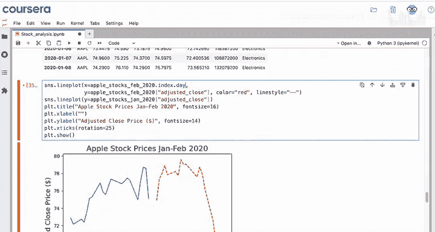

If you look at that value independently， by the way， it's a series of numbers。

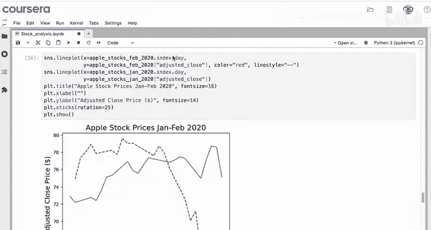

There are some missing， but don't worry， Seaborne will handle those gracefully。

 so update the exit values for both series， maybe January should be a solid black line。

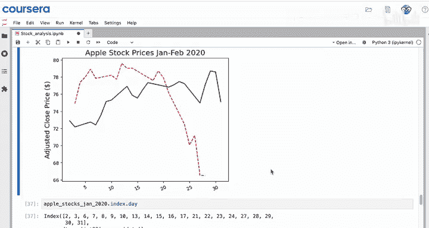

Cool， now you could add your series for March， select your data。

 maybe dark gray will work best for the line。

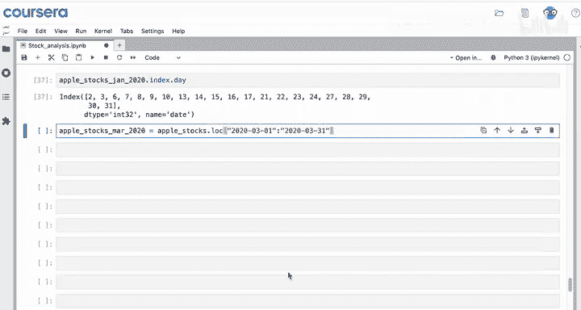

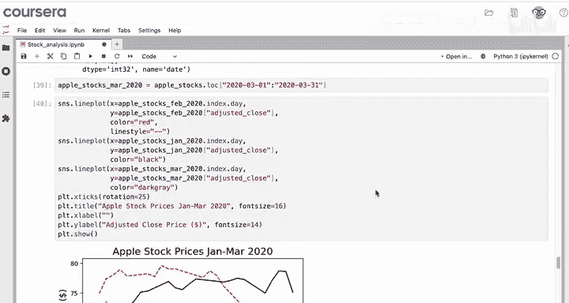

Again， you want to highlight February in your analysis so these other lines can be plotted in more muted colors finally update the title in your graph。

So you can see that February saw a sharp decline， but it was nothing compared with March 2020。

 Perhaps you should adjust the coloring in your graph to reflect that Now， finally。

 just by looking at this graph， your clients won't be able to tell which line is which if you try using plot legend you get this tiny empty box which is not what you need Why not ask your LLM how to add labels in a legend for each month。

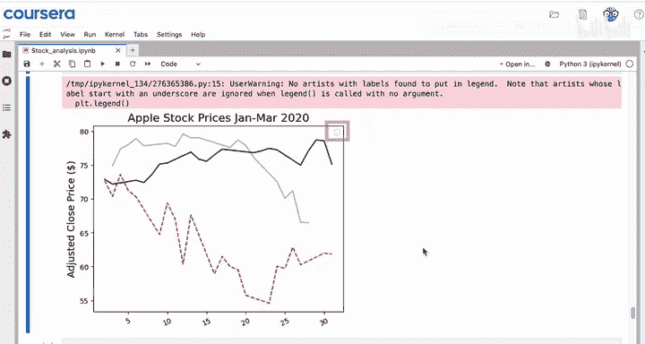

Okay， copy that code， remember for visualizations in particular， if the code works， it works。

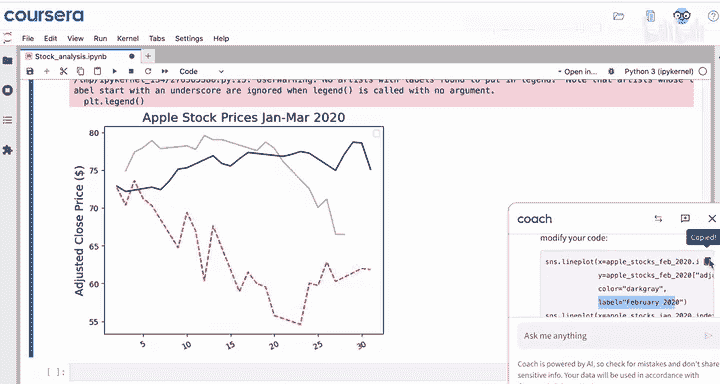

Cool， the legend is positioned well， the only thing you may want to do is remove the year。

 which is in the title already。

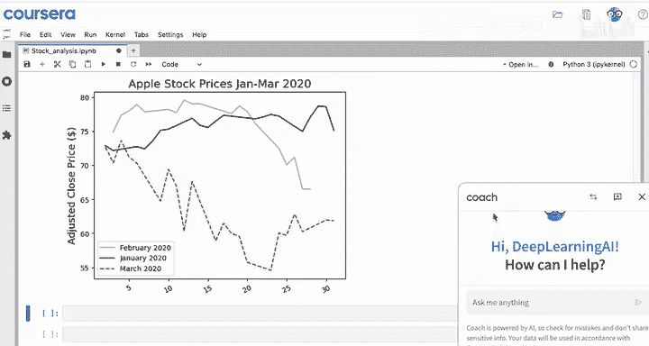

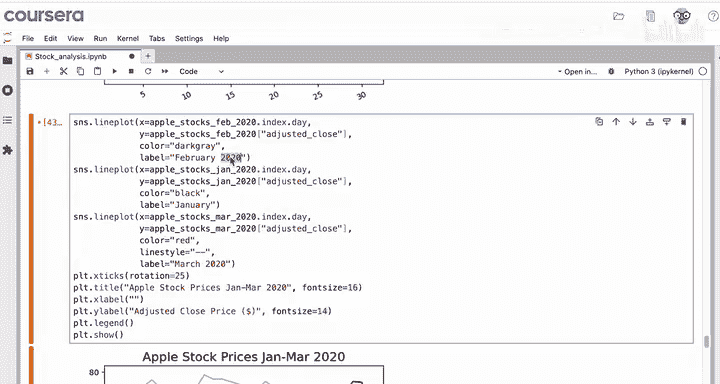

Reapping what you just learned， you saw that you can use the SNS。

 line plot function to create a line chart of Time series data you can plot a series of data directly or you can use the X and Y named arguments for more control over the data You saw that you can use the index if it's a datetime to plot different values on the X axis like the day of the month using do index。

 day You also saw that you can use the label named argument to add a label to each line before calling plotBt legend Line charts are your go to visualization for time series data however。

 formatting dates can be a little tricky follow me to the next video to see how to approach this task。

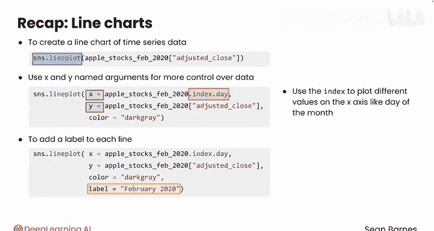