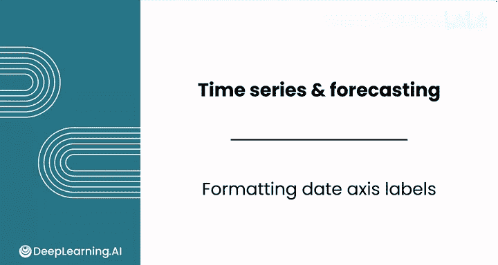
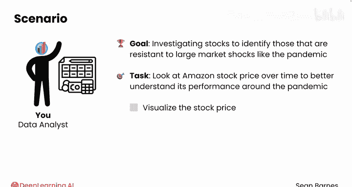
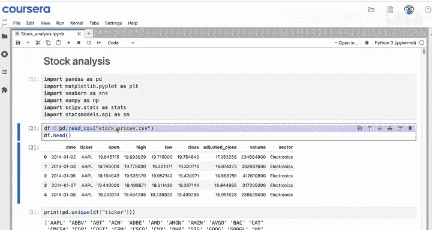
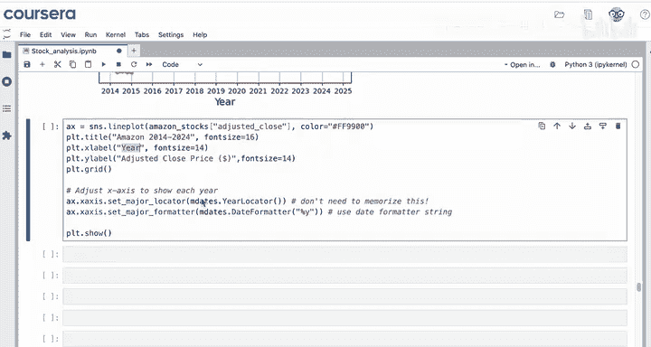
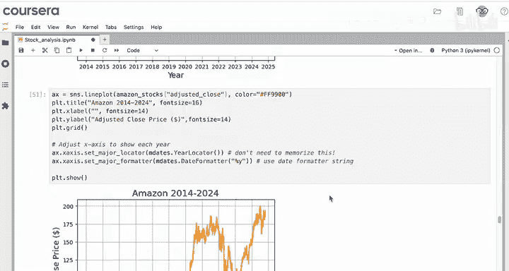
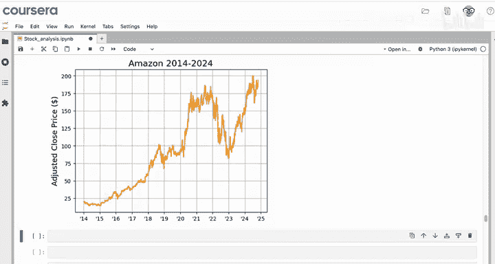
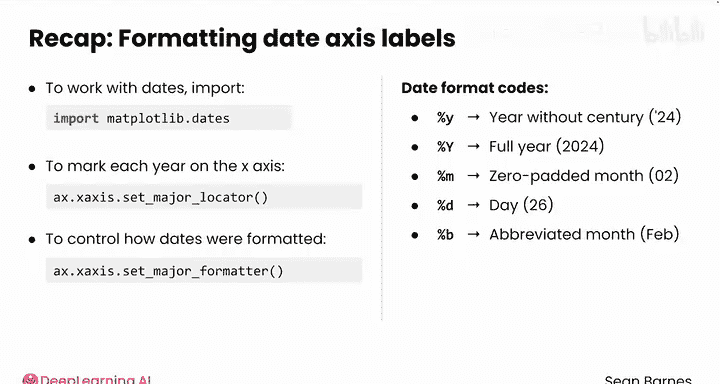

# 吴恩达《Python数据分析（数据分析第3课）｜Python for Data Analytics》中英字幕 - P86：85_日期轴标签格式化.zh_en - GPT中英字幕课程资源 - BV1rp5yzjEgn

Dates are important to get right in a time series of visualization。

Matplt Lab provides you with highly useful options for formatting dates。

You're continuing your work with investigating stocks to identify those that are resistant to large market shocks like the pandemic。

 your client has asked you to look at the Amazon stock price over time to better understand its performance around the pandemic First you can visualize the stock price。

To recap， you've imported your modules and ready data set into the variable Df Since you're working with a new set of stocks。

 youll need to set up your data again with datetime emdices。

 remember that your data frame contains information about multiple stocks for each date。

 so you'll want to select the Amazon stocks first then set the index to a datetime。

Use filtering to select the Amazon stocks。Then you can use the method Amazon stocks do set In with the date column to set the index to date times remember dot set index by default creates a new data frame so you can use inplaces equals true or overwrite your Amazon stocks variable to make sure this new data frame is saved properly Now you have a time series of Amazon stocks。

First， create a quick bot of this time series， use SMSs。 line plot with the adjusted close price。

 then plot。 show。So overall， the price has been trending upwards over time with a sharp drop in early 2022。

 this graph doesn't give you any additional information about why that might be。

 but during 2020 it looks like the stock rebounded quickly from the COVID market shock。

Let's jazz this up with titles， a grid and the Amazon brand color for the line。

 It's this bright orange with the Hex code F F 9900。

When you're working with line plot specifically one thing you may want to do is change the X axis。

 which is the date to make the graph easier to read you might want to display every year on the axis rather than every other year dates are a pretty complex type of data Matpottlibb has helpful date tools that you can import so you don't have to start from scratch it's common to use the nickname or alias and dates go ahead and borrow the code you had from earlier。

Remember that in order to change the axes after creating the plot。

 youll want to save the plot into the variable AX。Now you can adjust the X axis to show each year。

Say AX， so you're taking the plot itself do x axis because you want to select the X axis。

Then set major locator， and then you want the locator to be end dates。y locator。

Set allows you to change what is actually on the axis as opposed to just getting some information about it Major refers to the labels for the major or primary tick marks right now。

 the plot doesn't have any minor tick marks Locator means you're looking at change where the information is displayed so you're actually saying here is where I want those major axis ticks to be for that you're going to use the years So M dates year locator with no arguments will place ticks automatically at yearly intervals remember you don't need to memorize all these commands Just try to follow what's happening and make note of the options you have you can always pair a program with an LLM to help recall these commands Run the cell now you have each year plotted on the X axis。

Notice that your grid updated to be shown for each year as well。

 so this new axis makes it easy to compare the start of 2020 and the start of 2021。

 The last thing you may be interested in doing here is changing the X axis to show just the last two characters of the year like 1415 and so on to make it more readable you can copy and paste your code from the previous cell。

Now you want to use a very similar line of code to the locator。

 grab the X axis and this time you want to set major formatter。

 just like with the locator set means you're changing something。

 you're doing it for the major tick marks and you're changing the formatting not their location and dates date format and then you have some options that are specified in a special type of string called a date format you'll learn more about the options in just a moment here you'll want to use a character percent lowercase Y percent starts a format code and the lowercase Y specifies a two- digit year for each value you can remove the X axis label2 now that the dates will be clear。

Running that cell， you can see that lowercase Y gives you just the last two digits， create。Lastly。

 add an apostrophe at the beginning of the string， now running this cell will give you the apostrophe and then the last two digits of the year。

Awesome， so you have a clear graph showing each year on the X axis formatted in a legible way。

Summing up， you saw that to work with dates。 you can import mappllibb dates。

 You use the set major locator function with M dates year locator to mark each year on the x axis。

 and you use set major formatter to control how the dates were formatted on that axis。 remember。

 you don't need to memorize these commands。 Just know that you do have tools for fine tuning your plots formatting。

 you saw a moment ago this date formatter string with a percent sign。

 you use the percent lowercase Y date code which shows the year without the century。

 and you use a single apostrophe to add the apostrophe character directly to the format。

 you have other options too like percent capital Y to show the year with the century percent lowercase M to show month as a zeropaded number or percent D for day or percent B for abbreviated month name。

 you can also combine these together。 For example， by showing percent n percent y to show them month and year on the x axis。

 Excel work formatting dates for a visualization you have a lot of options available to you and you can always ask anella land for help。

Learn a ton of great tools for setting up and plotting time series data coming up。

 you'll complete the practice assignment and practice lab for this lesson In the practice lab。

 you'll explore a data set of flight delays published by the Australian Government。

 I'll see you in the next lesson， Descriptive statisticsts for Time series。

