# 吴恩达《Python数据分析（数据分析第3课）｜Python for Data Analytics》中英字幕 - P87：86_移动平均线.zh_en - GPT中英字幕课程资源 - BV1rp5yzjEgn

One of the core analytical tools for time series is theMoving average Moving averages help you smooth out the noisy data to help you better understand the trend。

 seasonality and cyclicalality。 Another way to assess the stock's resistance to market shocks like a pandemic is to look at its trading volume Volume is the number of shares in the stock that were traded on a particular day。

 you want to analyze the trading volume of Amazon stocks around the time of the Covid-19 pandemic to understand investor behavior for that particular stock。

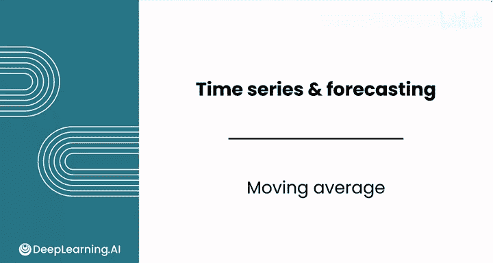

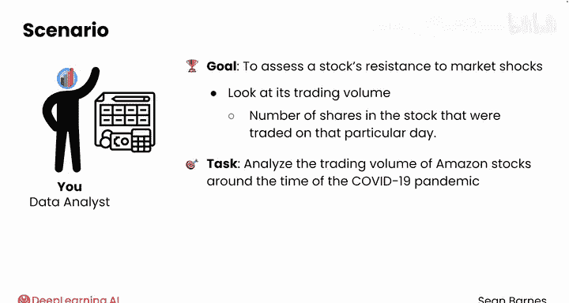

To recap， you've imported your modules， read your dataset into the variable DF。

 then you selected the Amazon stocks and set the indices to date times to create a time series Finally you plotted the adjusted closed price in a line chart like this to grab volume instead of adjusted clothes。

 what changes would you need to make？

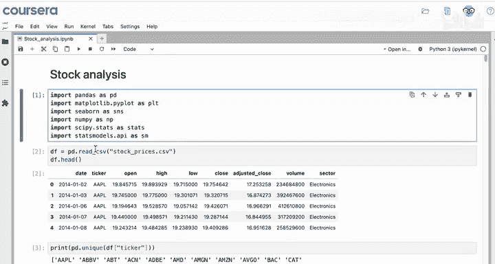

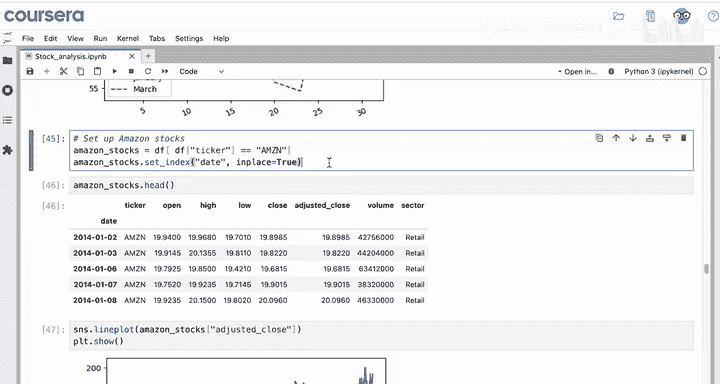

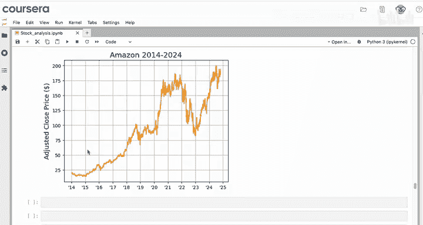

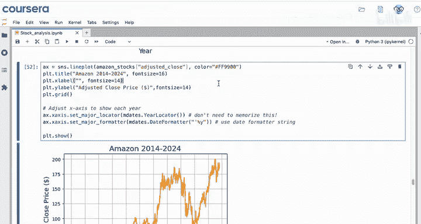

Well， you can just change the column selected here to volume， then update the Y axis title。

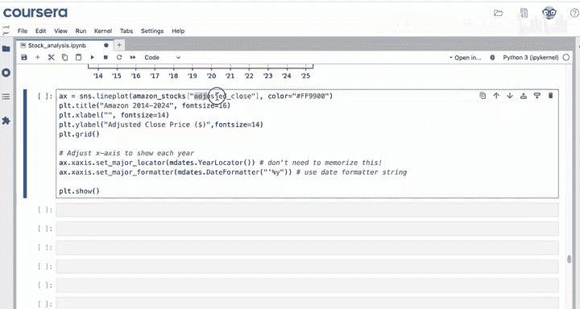

Right away， you can tell this graph is much noisier than the graph for adjusted close price。

 The trend seems to be going downwards overall， but it's not very pronounced。

 There are also a lot of spikes in the data to help smooth out the noise in this time series。

 you can calculate the moving average for volume。 remember。

 the moving average smooths out the data and helps you reduce the impact of these spikes to calculate the moving average。

 Start with the column you're interested in Amazon stocks volume and you want to use the dot rolling method。

 Ro here stands for rolling average。 Another term for moving average Roing creates subset of your data that have a certain window link use the named argument window equals sum number for example。

 each of your observations is the day。 So maybe you want to calculate the average over 14 days or two weeks at a time。

😊。

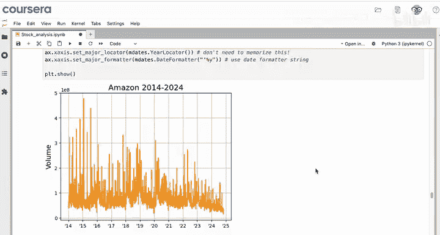

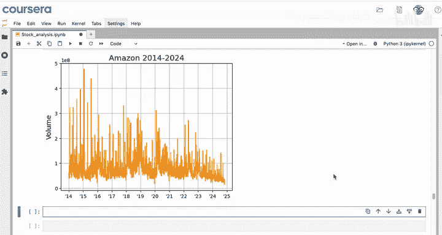

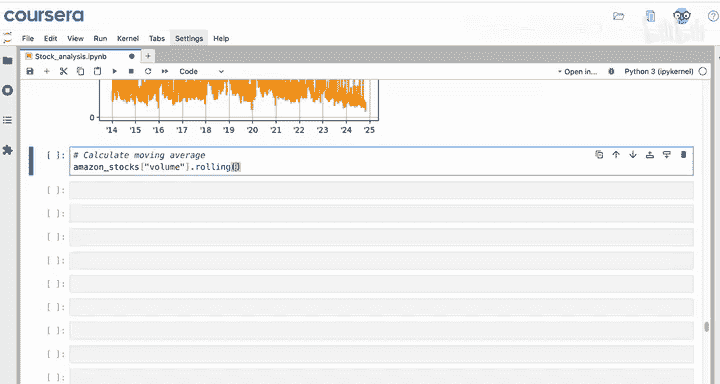

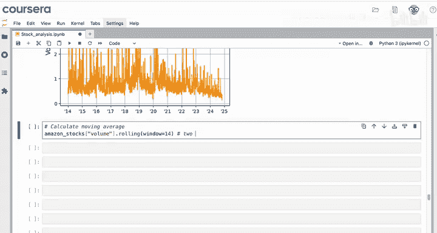

If you just shift enter there， you don't get any kind of rolling average。

 you just get this rolling output， which represents all of these subsets of your data。

 So the rolling method takes care of just the grouping of the rows in this case into sets of 14 similar to group I you'll need to apply some kind of aggregation function like mean or sum to your data to see the results。

 For example， you can calculate a simple moving average using dotme like many methods in pandas This command won directly add a new column to your data set。

 It's just going to generate a new series。 So you'll want to save that into a variable。

 say Amazon Volum 14 day。Now if you take a look at the first 14 values here。

 what do you expect to see？Well， the first 13 cells are empty because you don't have 14 days of data to average。

 but after that you get the first moving average value， you can plot this column in a line chart。

 grab your code from before since you can plot this line over your data。Using SNS Sc line plot。

 this time with the Amazon Volume 14 day variable， and choose color equals black to differentiate。

You may also want to deemphasize the original time series using alpha equals 0。

5 and Ly cell equals colon colon creates a dotted line。

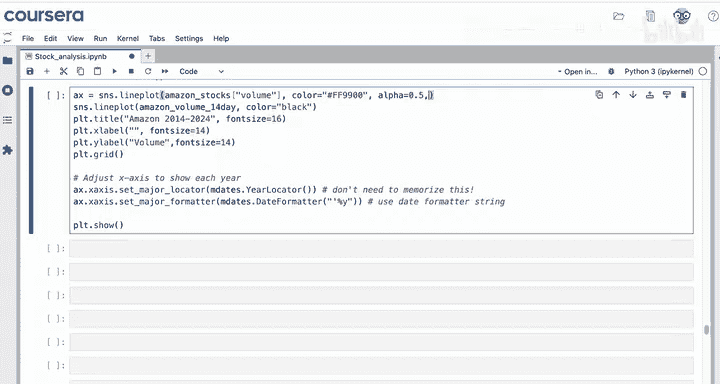

You can see that this line graph is much smoother with fewer spikes。

 but there is still some noise in the data， and notice that theres still so much data here。

 it's hard to pick out the moving average， you can use XL to show more data or you can create a larger figure let's create a larger figure you can use a fig size of 126 to create a Y chart。

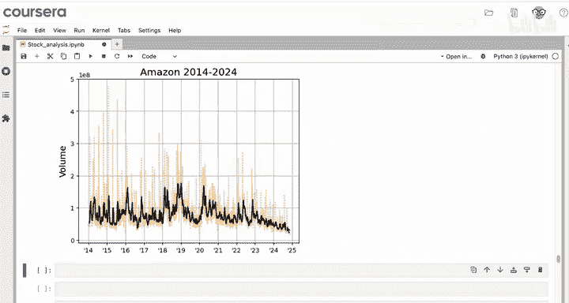

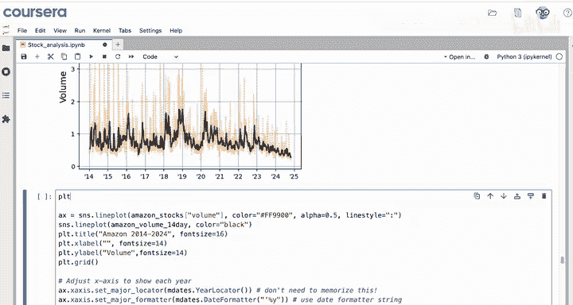

Finally， you can add a legend with the label for each series， as you did in the previous lesson。

 use the label named argument to Sns。line plotlo。Use the label's original and rolling 14 day average。

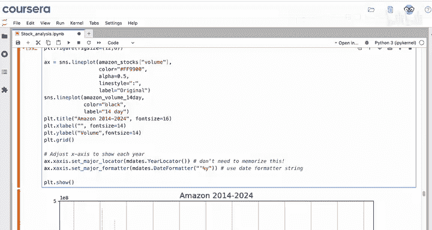

If you look closely at the original data， you'll see that there are typically around 5 to6 spikes per year。

 which may include quarterly reports or some other regular quarterly occurrence to help smooth these spikes even more and distill the trend you can create a threemon near average over 90 days。

 create a variable Amazon volume 90 day and borrow the same lot of code as before this time with window equals 90。

Add this to your plot with color equals blue， just to see how it compares。

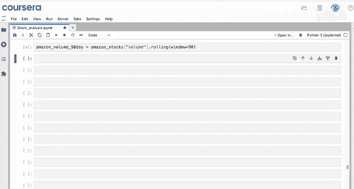

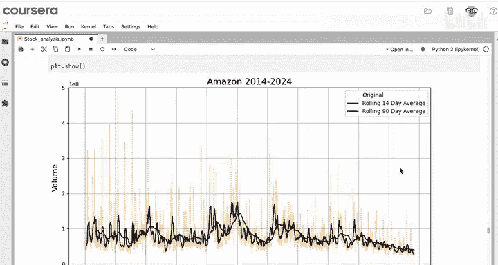

You can see that compare with the 14 day moving average， the 90 day moving average is much smoother。

 You can also see that the 90 day average sort of lags behind the 14 day average since it takes a little longer to pick up on the behavior of the original time series。

 you can now remove the 14 day average and make the 90 day average black to help it stand out Since it's a more interpretable representation of the data。

 you're really starting to distill the trend of your time series data without all the distracting noise。

 these types of longer termm moving averages are often used in stock price and volume analysis because the variability is often significant from day to day。

 you can see that trading volume for Amazon stock increased pretty significantly in early 2020。

 and then it started to taper off over the next year and a half。

 you can take these insights back to your clients so they can better understand the trading behavior of Amazon stocks。

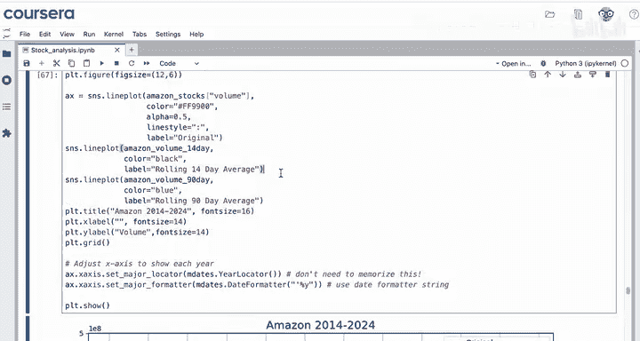

You just saw how to create a moving average first select the column you want to create a moving average for。

 like the volume column， then use the dot rolling method with a number for the window named argument。

You saw 14 day and 90 day averages， which are appropriate choices to smooth out daily observations Finally you'll need to apply an aggregation function for a moving average you'll want to use dom。

 but you can also use different aggregation functions like median then you can plot the newly generated series in the line chart using SMSS dot line plot。

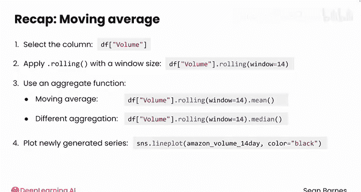

Moving averages are a great tool for smoothing out noisy time series data。

 it's quite fast to implement in Python compared with the spreadsheet。

 following to the next video to see how to calculate percent change to identify sharp spikes and dips in your data。

