# 吴恩达《Python数据分析（数据分析第3课）｜Python for Data Analytics》中英字幕 - P88：87_百分比变化.zh_en - GPT中英字幕课程资源 - BV1rp5yzjEgn

One powerful tool you have for time series data is the percent change。

 which helps you identify changes compared with the previous time period After discovering that Amazon's trading volumes spiked during the year 2020。

 you're continuing to work with the Amazon stock price you've been asked to identify dates with a negative price change of 5% or more。

 these dips can help you identify the market events that created the largest price shocks for Amazon over the years。

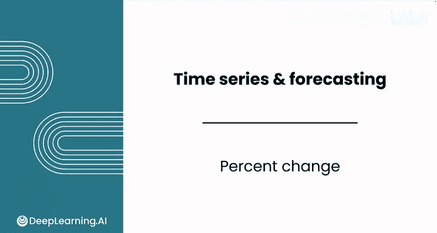

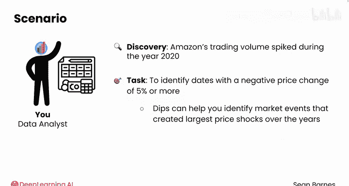

To recap， you've imported your modules and read your data set into the variable Df。

 Then you selected the Amazon stocks and set the embaicesies to day times to create a time series。

 Now， recall that you're interested in investigating the adjusted close price。

 The percent change will tell you whether the stock went up or down compare with the previous day to calculate the percent change first select your column Ad close。

 then use the method dot PCT change， which stands for a percent change。 Sa this result to a variable。

 Amazon closed percent change。 Now， what do you expect to see when you look at this variable。

 How many empty cells should have。

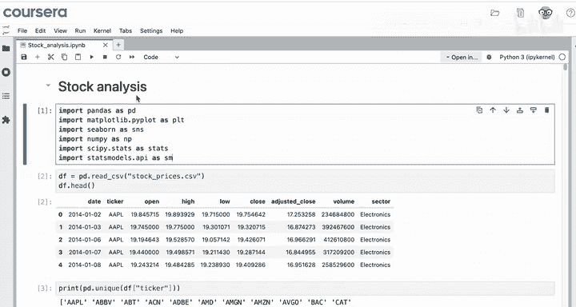

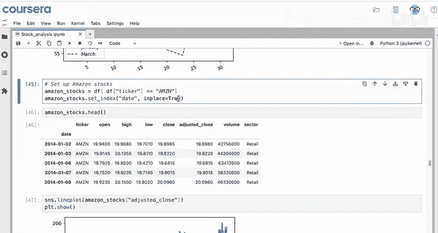

Only the first cell is empty because theres no previous time to compare their current price with the second and third days showed slight decreases。

 and the fourth and fifth days showed positive changes。 noticeice that these values are quite small。

 The percent change method is kind of poorly name because it actually computes the fractional change So these numbers are not percentages but proportions to get true percentages。

 You need to multiply by 100 like this The first number is still missing but the second number is negative 0。

38%。 the negative 0。71% and so on。 you should leave these numbers as is since they'll be easier to work with in the fractional or proportional4 These are all relatively small percent changes so you wouldn't highlight any of these in your analysis to the client。

 Now percent changes is a time series just like any other。

 so you can plot it with Ss dot line plot go ahead and add some labels and make the line color Amazon orange for fun。

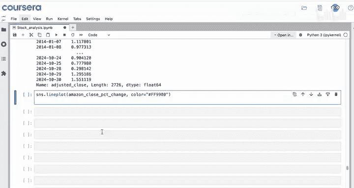

The X axis will again extend from 2014 to 2024， so you'll want to keep the same wide figure size。

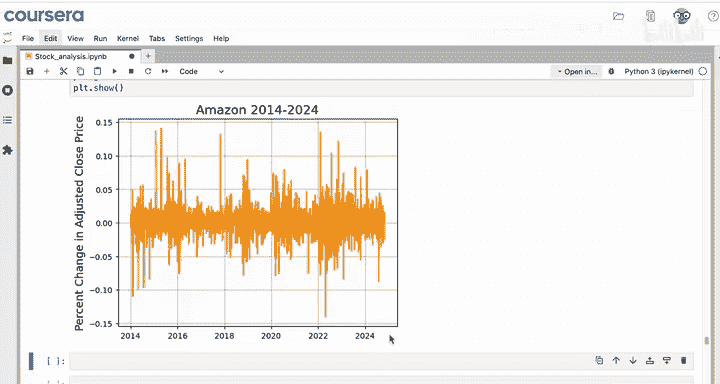

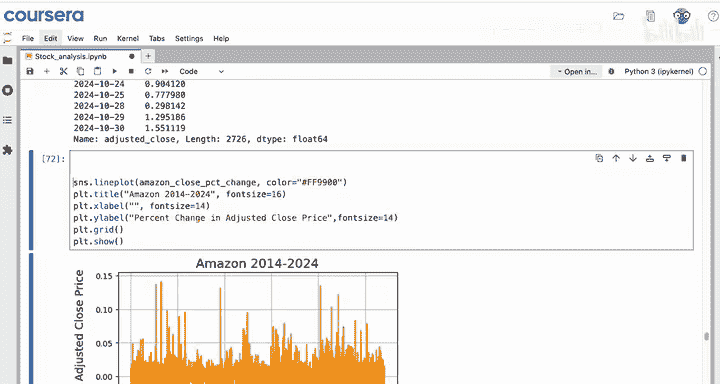

Notice that the percent change fluctuates quite a bit。Eyeballing it。

 the mean seems to be near to zero with both positive and negative spikes representing large daily changes。

To better visualize these points， you may want to add a horizontal line to this plot。

 remember if you need a refresher on the commands to use， you can always ask your LLE。

 please add a horizontal line at y equals negative 0。05 to this graph。

So copy the code and the LLM wants to use AX H line， perhaps the color can be black though。

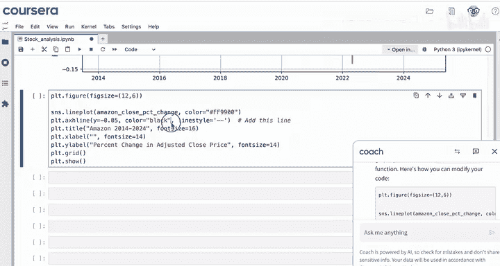

Nice， so these market shocks with a greater than 5% dip in price are relatively rare。 Now。

 how could you adjust this line to also highlight the cutoff at y equals 0 that separates gains from losses。

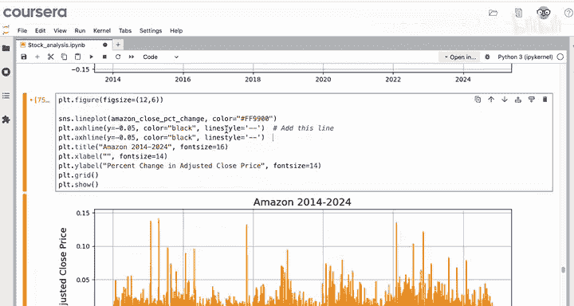

You can add another AX H line here with y equals0。That line can be solid for clarity。 Looks great。

 You can share this plot with your clients who may want to examine the data for themselves。 Finally。

 you can filter your data to get a list of dates with these percent changes。 Now。

 you can filter a series very similarly to how you would filter using a column from a data frame。

 You just don't need to select a column。 So dips equals Amazon closed percent change where that same value is less than negative 0。

05。😊，Check out the dot count of dips， so there have been 44 days in roughly the past decade where Amazon's adjusted close price dipped by more than 5%。

 that's a relatively rare event so to calculate the exact proportion of these dips divided by the length of your Amazon Sos data frame。

 and you can see that there's only 1。6% of days where Amazon stock dip by more than 5% you might have thought to do Amazon stocks count。

 but that will give you the count of each column in that data frame。

 so length will give you the overall number of observations in the data frame。Note that dips。

 indexdex gives you the list of dates that you can now investigate further to identify sources of these market shocks。

 starting in January 31st， 2014， all the way to August 2， 2024。

 even though this is a relatively rare event， three of those major dips occurred right near the beginning of the pandemic in the US around March 2020。

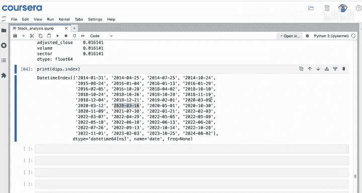

Playing that back， you can use the Dot PCT change method to create a series representing the percent change from period to period In this video。

 you created a new series to represent the daily percent change in Amazon's adjusted closing price。

 you can also graph the percent change over time or filter your data based on positive or negative percent change or by a certain magnitude of percent change。

 like the days with greater than 5% decrease in adjusted closing price compared with the previous day。

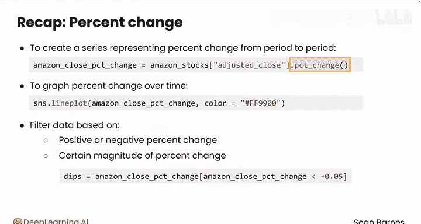

Once you've applied moving averages and percent change to your data。

 you may be interested in segmenting your data to better understand individual subsets。

 Follow me to the next video to see how。