# 吴恩达《Python数据分析（数据分析第3课）｜Python for Data Analytics》中英字幕 - P89：88_分群分析.zh_en - GPT中英字幕课程资源 - BV1rp5yzjEgn

You have a lot of options for segmenting your time series data。

 you can segment by both categorical features and attributes of your daytime index like the month or year。

 you're continuing to investigate the resilience of different stocks to mark a shocks。

 your clients have asked you to investigate different seasonalityities within the stock data to understand how companies are performing monthly and quarterly in addition to year over year you decide to expand your analysis to include the streaming service Netflix to recap you've imported your modules and write your data set into the variable Df Now。

 just like you did for Amazon stocks， you can select Netflix stocks from the data frame。

 then set the index to be the date column do that operation in place so it sticks Now you can proceed with your analysis go ahead and plot the volume with the line graph you can use similar styling to your earlier line plots Roing that cell there's a huge volume spike in around April of 2022 When you look at this data overall you can see that there's about roughly four spikes per year which is pretty interesting pattern and seems to hold up pretty consistently throughout the data。

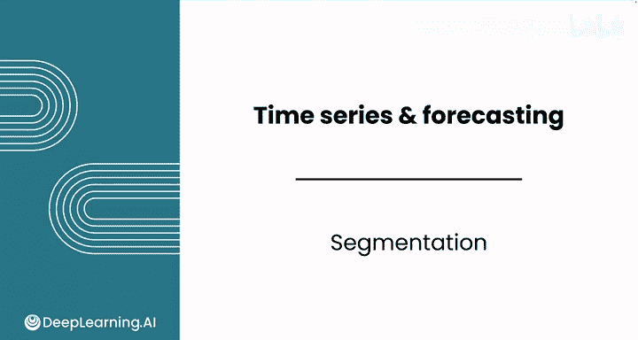

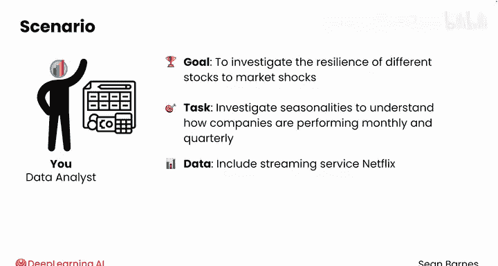

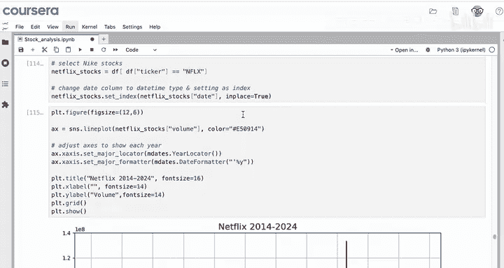

You may be interested in grouping this data by month， which is a component of the date。

 Netflix releases quarterly reports at regular intervals。 Take a look at the dates for 2024。

 These reports were released in January， April， July and October。

 These months are relatively consistent year over year。

 You may be curious about whether trading volume behaves differently in those months。 If so。

 you can align this trading behavior with the adjusted close price to better understand the impact of any market shocks。

 So do you remember how to access the month of each row from this data frame。

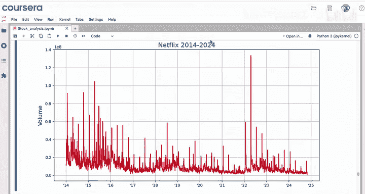

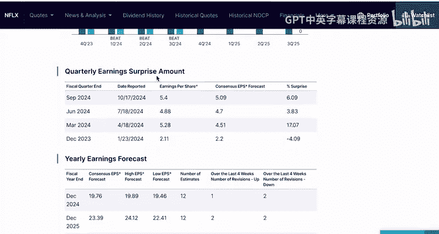

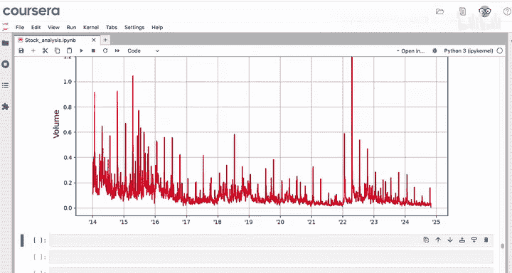

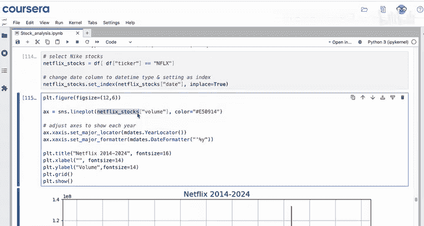

From the index， that's this column label date here。Use Netflix stocks。 indexex。

 so index is the date time here， which allows you to access each aspect of the date， then do month。

You have other options like dot day， which you saw previously or do year or do quarterder for in that cell。

 you can see that you start out with ones and you end with1s。

 Remember that your time series ends in October 2024。

 So if you look at the result of PDd dot unique to check the different values。

 You just get one through 12。 Make sense。 one for each month。

 you can add the month to your data frame as a column。 This step isn't technically necessary。

 but it leads to cleaner code in the long run。 Netflix stocks month creates a new column for the month。

 set that equal to Netflix stocks index month。 you'll get this setting with copy warning。

 Don't stress it's just a warning。 you can investigate this more with the LLM if you'd like to examine the aggregated performance of the stock over time。

 You can use the group by method to group by month。So NetflixTs。groupI month。

Then select the volume as you normally would， and then add dot mean to calculate the average monthly volume over the entire date range。

 save that to a variable monthly volume and then view to check out the different monthly averages There may be some interesting trends here check out the data using dot plot Ki equals bar the quick plotting method from pandas as you learned previously add X and Y axis labels and plot do show。

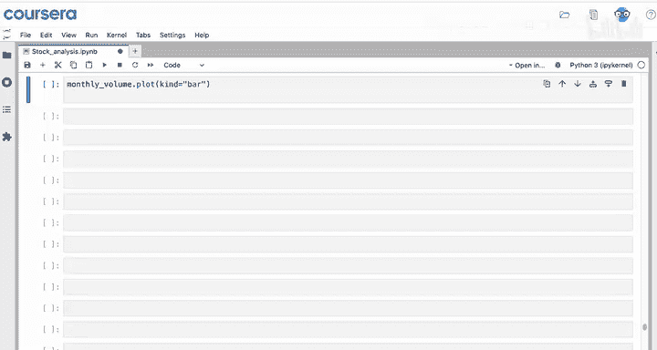

There seems to be a pronounced pattern in trading volume across the months， January， April。

 July and October have spikes and trading volume when the Netflix quarterly report is released This spike seems to be roughly 30 to 50% higher than the typical monthly volume to better understand the distribution of trading volume you could graph a segment and box flat using seaboard you can use SNS do boxpl with Netflix stocks X's month Y is volume The distributions in the months with quarterly reports seem to be a little higher than the other months。

 but they are clearly more outliers during these months。

 but overall these graphs are a little bit difficult to interpret adding color might help a bit。

 let's ask the LLM to create a list of colors for each box with Netflix red as the first and then every third after that with light gray for the other colors。

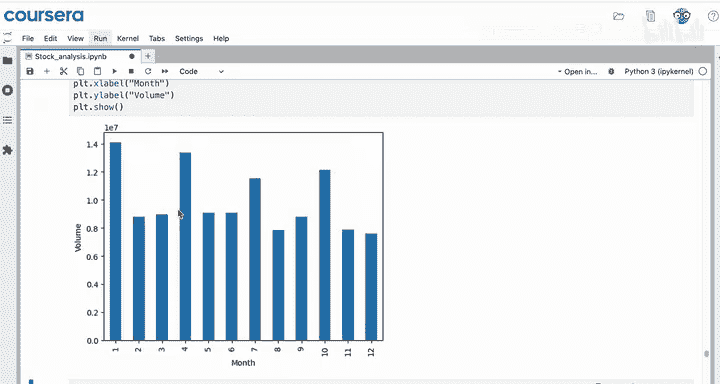

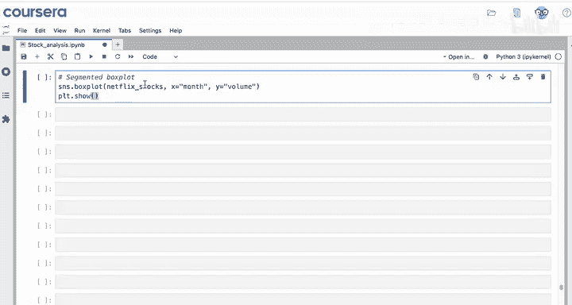

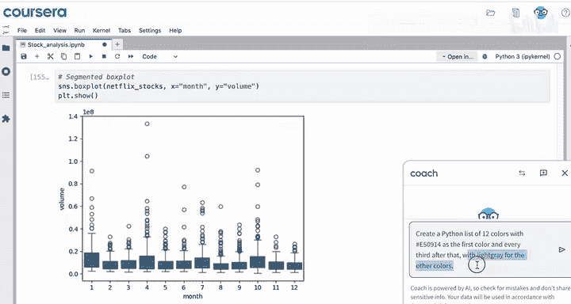

Okay， great so you can see that it produced this list with Netflix red as the first out of every three colors followed by two light grays。

 This pattern just repeats itself for all 12 months。

 You can incorporate these colors into your chart by using the palette named argument and the SMSs dobox plot Don't worry too much about this warning。

 Okay great， you can see that it applied this color and you have Netflix red on each of the months with quarterly reports So that helps a bit。

 but let's also zoom in on the most relevant region of the data using YN try values between 0 and 0。

4 E8 which is 40 million。

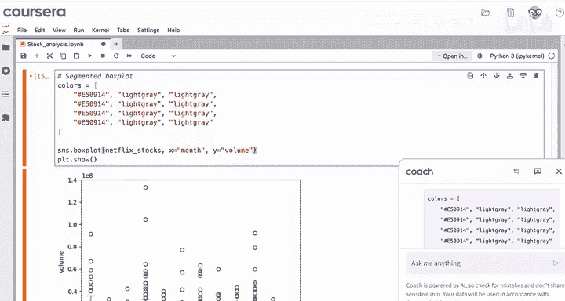

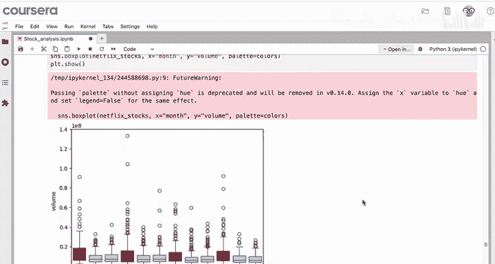

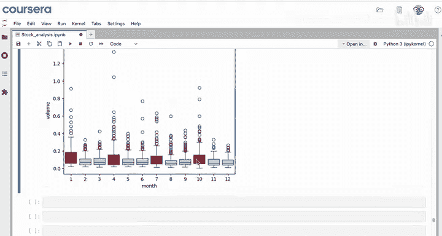

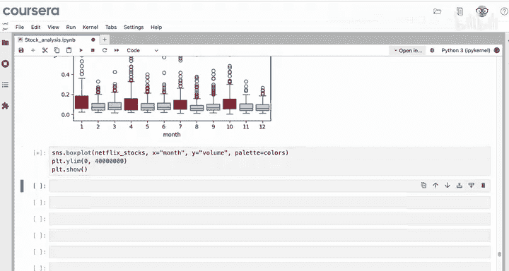

Okay， that's better。Now you can see that the median volumes show the same trend as the averages with higher values in the quarterly report months。

 you can also see that these months seem to have higher variability than the others。

 Their intercorrtile range is wider。 the highest median volume is in January the same as you observe for average volume hopefully the seasonality can help you differentiate between market shocks and typical market trends that happen on a monthly basis due to Netflix's quarterly reports to recap。

 you can access different aspects of the date time in your time series using the name of your data frame index then do year month quarter or whatever attribute you'd like to access you also saw that you can save parts of the date to a new column for example。

 you could create a column quarter， say the index quarter to that column。

 then use the new quarter column for segmentation you saw that you can group your data by that feature of the date like grouping by year or month use the dot group by method you learned previously have the month for example as the argument to that function then you can select a column to apply dot describe or dot mean or。

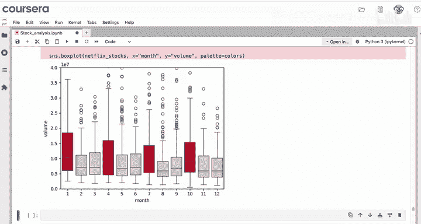

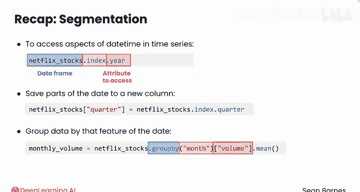

Use a plot segmentmenting time series is a useful strategy for extracting multiple series in your data。

 Foow me to the next video to see how to reshape your time series data for plotting。

