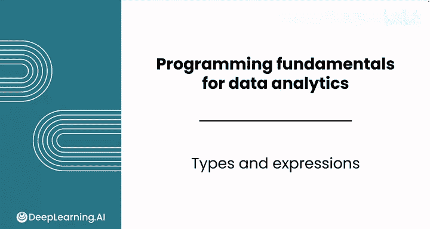
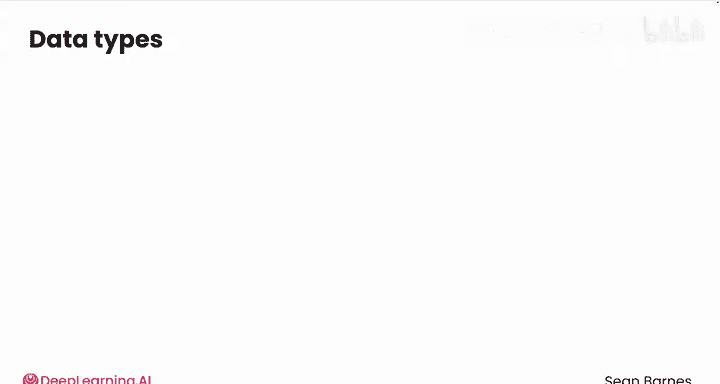
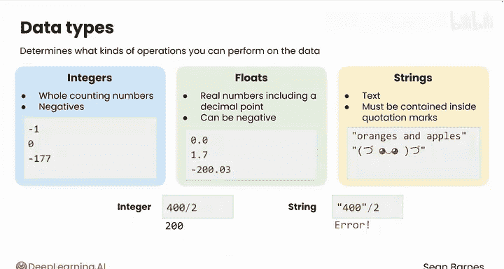
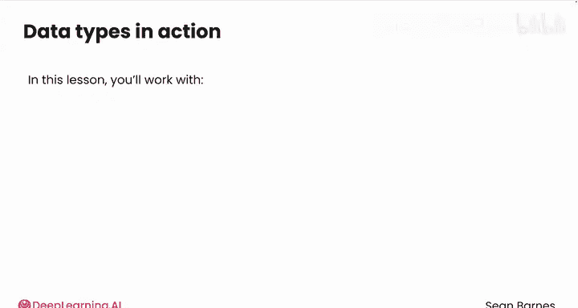
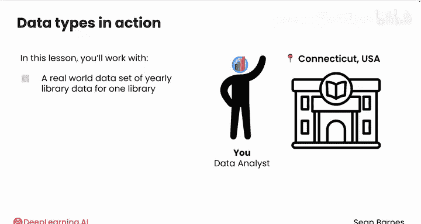
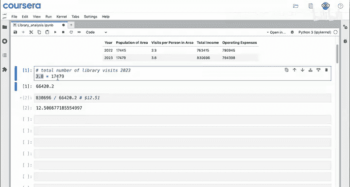
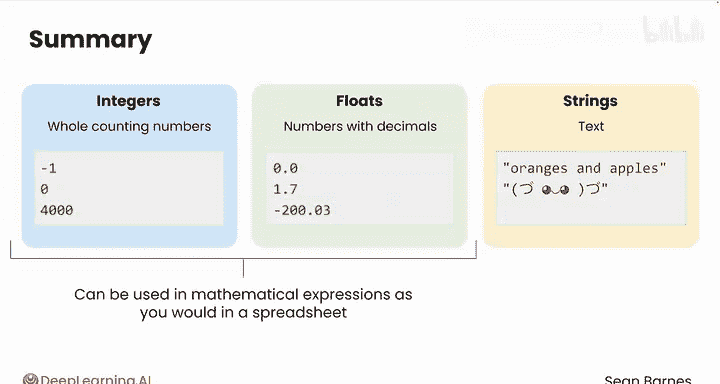

# 吴恩达《Python数据分析（数据分析第3课）｜Python for Data Analytics》中英字幕 - P8：7_类型与表达式.zh_en - GPT中英字幕课程资源 - BV1rp5yzjEgn

All right， let's check out the building blocks of code data types in Python。

 you can work with different kinds of data and perform different operations on that data depending on its type you'll work with three core data types for now integers。

 floats and strings An integer represents a whole counting number including negatives like negative10 negative 177 and so on。

 a float or floating point number represents a real number including in decimal point and can be negative as well。

 0。0 1。7 and minus-200。03 are all floats a string represents text in Python text must be contained inside site quotation marks That's how Python knows its text and not a command Ex include oranges and apples or this funny face made out of special characters The type of data is more important than it might look at first glance。

 That's because the type determines what kind of operations you can perform on the data。

Here's an example。 Can you tell the types of these two values。

 The 400 on the left is an integer While the 400 and quotes on the right is a string。

 even though they look the same to you and me， the computer thinks of these numbers differently。

 For example， dividing the number on the left by 2 will output 200 while dividing the string on the right by two will give you an error since you cannot perform division on a piece of text。

 Let's see all of this in action。 In this lesson， you'll work with the real world data set of yearly library data for one library in the state of Connecticut USA。

Say you get an email from the Plainville Public Library in Hartford， Connecticut， USA。

They've sent you some data here where each row represents a year of operation for the library and each column is some feature of that year the library has two questions for you what was the total number of library visits in 2023。

And what was the income per library visit in 2023 you'll discover that in Python。

 these operations are very， very similar to what you've already become confident with in spreadsheets Comments are another useful tool for marking up your code Let's start with the total number of library visits in 2023。

That's the number of people times the visits per person。

Multiply these two numbers like you would in a spreadsheet using an asterisk。3。8 times 17，479。

Hit shift En to run the cell and you get $66，000 total visits。For the second task。

 you'll use the number you just calculated。Divide total income by this result。Hit shift enter。

 And here's the income per library visit，$12。51。 Co。

 can you spot the data types that you used in each of these expressions？ Well。

 going back up to the first code cell，3。8 is a float。 It is the number that has a decimal。😊。

In 17479 is the integer， it's a number with no decimal。 So to sum up。

 there are three key theta types in Python that you'll be working with。

Integers， whole count numbers， floats， numbers with decimals and strings， text。

 and you can use integers and floats in mathematical expressions as you would in a spreadsheet to do things like calculate profit or income per visit for this task。

 it might seem like a spreadsheet would have been easier to use Sr tasks sometimes require simpler tools as you get into more complicated tasks。

 Python's advantages will become much more obvious。

Great work you've seen in the core data types you'll be working with every time you code something up in Python。

 follow me to the next video to learn more about printing and comments I'll see there。

