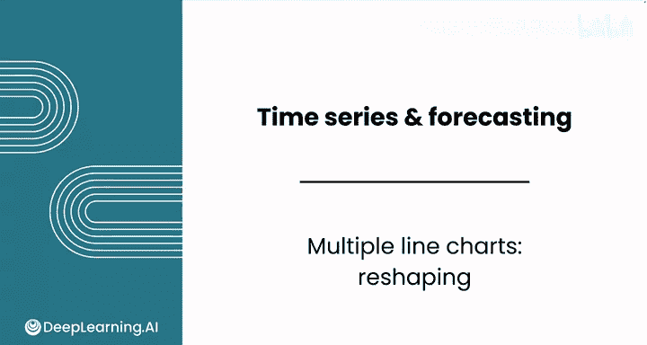
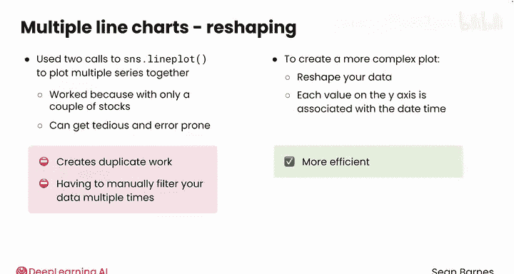
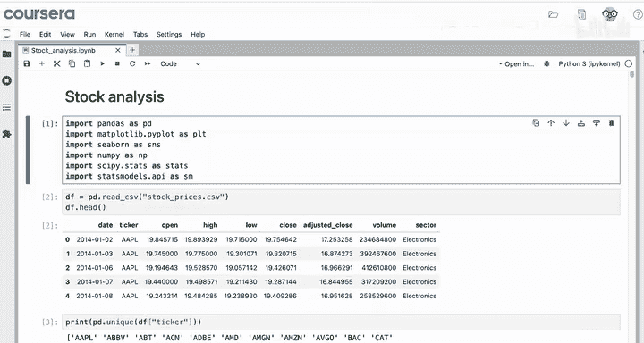
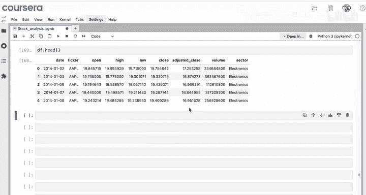
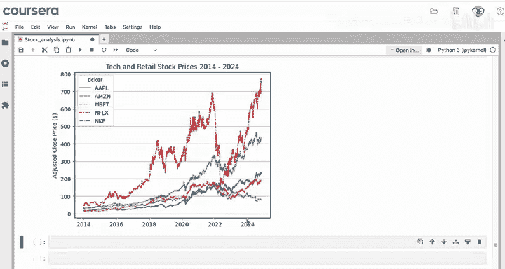
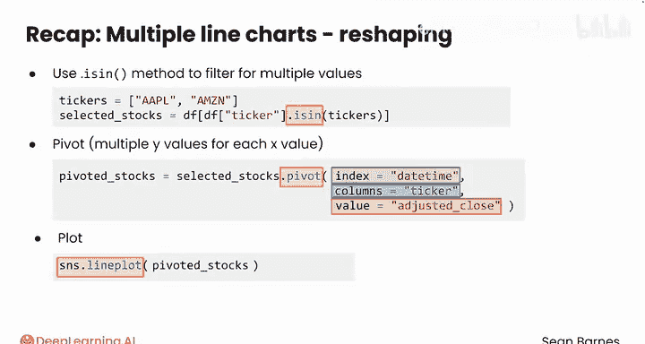

# 吴恩达《Python数据分析（数据分析第3课）｜Python for Data Analytics》中英字幕 - P90：89_多折线图重构.zh_en - GPT中英字幕课程资源 - BV1rp5yzjEgn

Often the difficulty in plotting your data is in getting it into the right format for the plot。

 rather than in specifying the plotting methods， let's take a look at some common reshaping operations you'll need to perform。

In an earlier video， you used two separate calls to Sns line plot to plot multiple series together That approach worked because you were only working with a couple of stocks。

 but manually filtering stocks and plotting them together can get tedious and make your code errorprone However。

 if you want to create a more complex plot， you'll sometimes need to reshape your data in particular。

 you want your data arranged so that each value you want to plot on the Y axis is associated with some unique x value the date time while it's sometimes possible to use many calls to Sns line plot to create a complex plot like this you can create a lot of duplicate work for yourself this way Often by having to manually filter your data multiple times。

 Once you know how to reshape your plots become much more efficient as an example。

 say you want to compare the adjusted closed prices for Apple and Amazon together to understand how each stock reacted to the Covid-19 pandemic you could plot the adjusted closed price for each stock with multiple lines。

 However， if you take a look at the original data frame。

 your data isn't yet set up properly If you just look at the datetime ticker and adjusted closed columns。

You have a situation where each unique day has two rows， so datetime is repeated。

 and the adjusted clothes for Apple and Amazon appear in different rows。

 What you need in order to graph this properly is to somehow reshape this data so that there's only one row for each unique daytime。

 and the columns in that row are the adjusted close price for Apple and Amazon。To recap。

 you've imported your modules and read your data into the variable Df going back to this original data frame。

 sayy you wanted to graph the performance of Apple against the performance of Amazon。

 You already looked at those stocks separately and saw that they behave differently around the pandemic。

 But what if you wanted to graph them together First filter for multiple tickers。 Apple and Amazon。

Previous， you saw how to filter for one ticker using the line of code like Df Df ticker equals equals Apple to filter for multiple tickers。

 One useful option is in the isn method。 create a list of tickets you're interested in Apple and Amazon。

 Start with the data frame。 Select from it where the ticker is in this list tickers。

 You can call this filter data frame selected stocks。 Great。

 Now what you may want to do is check the tickers in selected stocks。

 Just to see if that operation happens successfully。

 So running this line of code to get all the unique values in the column ticker。 What do you expect。

😊。

You should expect only two tickers， Apple and Amazon looks right。

Now you can sample a few values to check that your data looks like what you were expecting。

 It's just a filter down set of rows of your data frame。

 so the IN method will allow you to select multiple tickers using a list now that you filter for only these two stocks。

 you need one more step to set up your data， which is to pivot the data if you're interested in the adjusted clothes for Apple and Amazon。

 then what you really want to have as these columns， datetime， Apple， Amazon。

 and then you would have some date like August 2 2018 and some price for Apple。

 say 100 and some price for Amazon like 85， whatever it is。

If you can imagine two lines being plotted on the same graph。

 this format would be ideal because you have two y values for each x value。

 the two y values correspond to the two lines are plotting Apple and Amazon in order to reshape your data in this way you need to pivot your data Pivo is a little bit different from a pivot table A pivot table summarizes your data but the pivot method is going to reorganize your data across rows columns and values without summarizing the name arguments to both methods are the same however。

 so how would you use pivot， say selected stocks do pivot for each row or the index you want to have the date for the columns you want to have the ticker you've only got two unique values in ticker so now you're just going to have two columns in your data Apple and Amazon plus the index and for the values you want to have the adjusted close。

Save this result into a variable like pivoted stocks because it creates a new data frame rather than changing the old one。

 take a look at pivoted stocks。head Now you have exactly the same format of data you wanted。

For each date， you can then graph the adjusted close price for Apple and the adjusted close price for Amazon。

 Now you can just say SNs do line plot pivoted stocks plus addpl do show。

 You get this nice multiple line chart of both stock prices。

 noticeice that Seaborn already gave each line a unique color and style to help you differentiate them。

 You can see that both stocks were increasing in the first several years。

 but then they started to diverge。 Apple stock price didn't see as much of a decline in 2022 as Amazon did。

 Now you can continue by adding access labels， annotations and so on to your plot。😊。

You can see that most of the work here was in reshaping the data to get it into the form that you needed now that you've done this reshaping。

 it's just a small change to the graph， say five tickers instead of two。

 just by adding those tickers to your list and rowing this code again。

 here's what it would look like if you added Microsoft， Netflix and Nike。

To quickly recap， you use the IN method to filter for multiple values in a column。

 that method checks if a particular value is in a list that you specify。

 you also use pivot with daytime as the index， ticker as the columns and adjust it close as the values to reshape your data with the goal of having multiple Y values for each X value Once you reshape your data。

 you can use SNS。 line plotot and get a nice looking plot that you can continue to finesse with mappllootlib。

Excellent work reshaping your data to plot multiple series in one chart in addition to reshaping your data。

 you'll often need to resample your data as well， reducing or increasing its frequency follow me to the next video to see how。

