# 吴恩达《Python数据分析（数据分析第3课）｜Python for Data Analytics》中英字幕 - P91：90_重采样技术.zh_en - GPT中英字幕课程资源 - BV1rp5yzjEgn

Sometimes you'll find yourself with time series data that' sampled way too frequently。

 like stock prices by the minute。 and sometimes you won't have frequent enough data。 However。

 you can use resampling to change the frequency of your time series。

 You previously saw how to extract information about the dates in your time series like quarter or month and save that information into a new column while this approach is useful for segmentation。

 It doesn't make your data any more or less frequent to get more or less aggregated periods of time。

 you'll need to resample your data。 Downsling involves aggregategregating periods together。

 Often by taking the mean value。 For example， you could take your daily stock price data and downsample to weekly data by getting the average stock price for each week。

 Ups involves increasing the frequency of your data by creating new periods between others。

 This technique is less common， but you should be familiar with the term。😊。

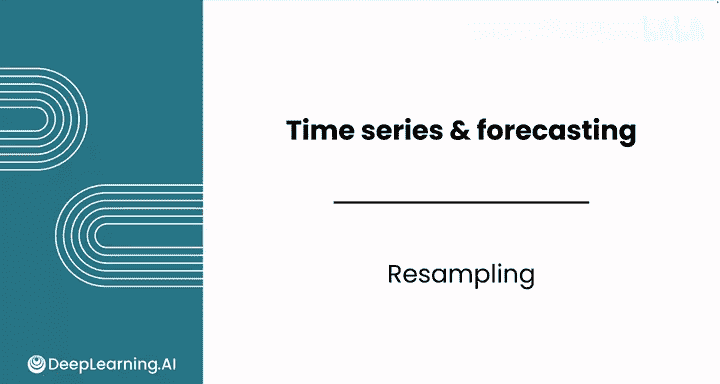

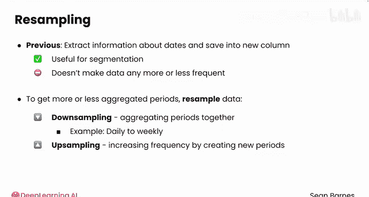

To recap， you've imported your modules and read your dataset into the variable Df。

 say you want to create a weekly Nike stock time series rather than a daily one to smooth out some of the noise in the time series inside this variable。

 you'd like to save Nike stocks resample W noticeice that this W is similar to the date format or strings you saw previously If you run the cell as is you'll get this datetime index resampler thing similar to the group I androll methods you've already used resample is also just an intermediate step。

 You won't be able to see the results of this command until you perform some type of aggregation。

 That makes sense after all， you need to tell pandas how to sample the data should to calculate the mean median or something else。

 you can use dot mean to take the average。

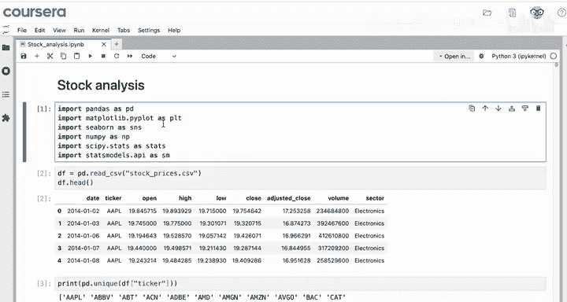

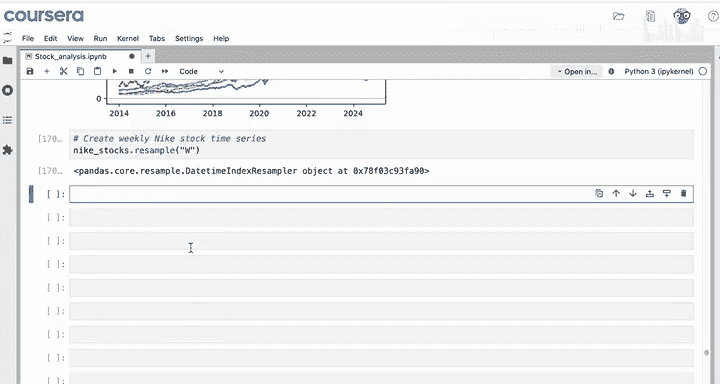

Running that cell。 Hold on。 You get an error。 What's happening here。

 Scing all the way down to the bottom of this error。 By the way。

 you should focus on the bottom of these long error messages。 Anyway， scrolling all the way down。

 you have a type error ag function failed。 How mean De type object。

 You may be getting a sense of why this is happening。

 It's trying to apply the mean aggregation function to an object type。

 Do you remember what the object type typically represents。 Typ strings。

 So it's trying to aggregategg strings。 Let's chat with the LLM to troubleshoot。

 I ran into this error with this line of code。 I'm not sure how to fix it。

 But I think the reason is related to having strings in the data frame。

Then provide the code and the error。Okay， so the LLM says that indeed the mean function can only be used on numeric data and that you must have some nonnumeric data in your data frame。

 so to fix this it gives you suggestion and it says that you should use the selected D types method and specify the name argument include equals number。

So similar to the dot core method， you'll need to select only the numeric columns you want to work with again。

 don't worry too much about memorizing all these requirements。

 You can always chat with the LLM for a reminder， focus on how to solve these errors collaboratively。

The LM provides some code to select the numeric columns so you can try that make sure to give it a once over since this select D types function is new。

 these numeric columns look right， Se has been removed。

 which was the object Now you may want to choose a new variable name like Nike Weekly。

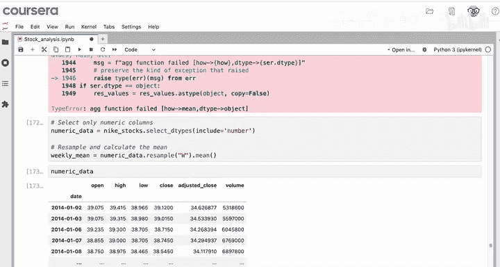

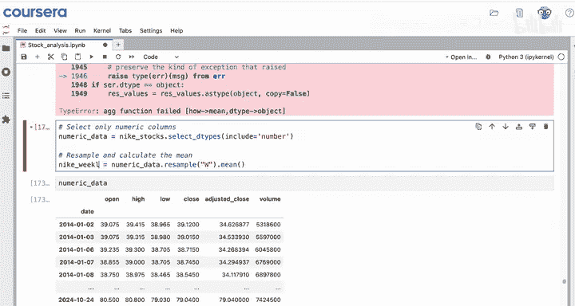

Remember， you can choose any variable names you'd like that makes sense to you。

Use the same line of code as before andvoila。 Now you only have one row per week， the  fifth，12th。

 19th， and so on。

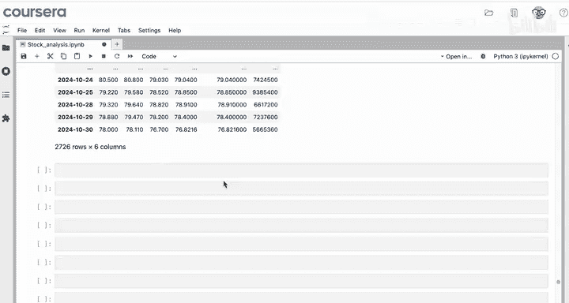

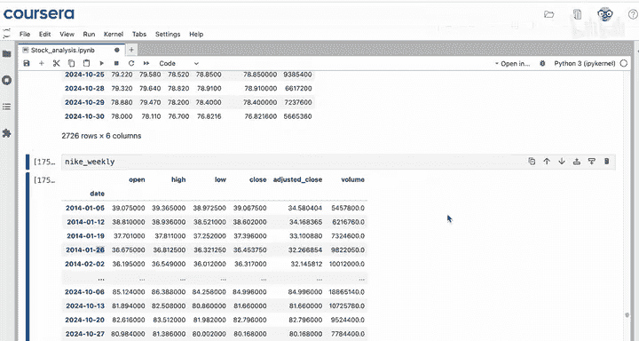

Just to show you quickly， you can also resample monthly with ME for Mon End。

 or WDS MON for weekly on Monday。

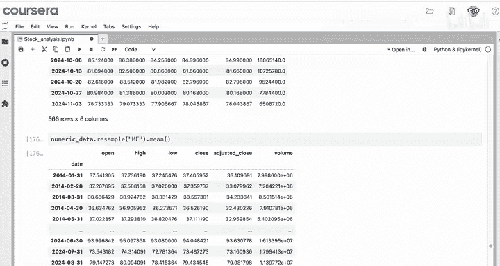

You have a lot of options， so I encourage you to explore if you have a use case for something different there's a solution out there for you。

 If you don't want to drop your numeric columns， you can instead use a different aggregation function like first。

 it just takes the first value。

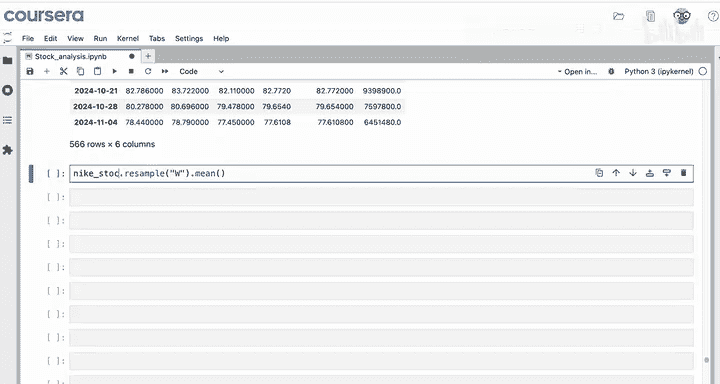

Check that out。You have the same days as before， but now the first value in that set of periods was taken rather than the average。

 notice that the sector column is preserved and doesn't throw an error。

 so first is one useful option for categorical data。To play that back。

 you saw how to use the resample method to downsample your data。

 The argument W resamples on a weekly basis， but you have many other options。

 including D for daily me for month end and W MN for weekly on Monday you learn that resampling with the mean only works on numeric columns。

 you can select only those numer columns to calculate the mean or you can use a different aggregation function like first if you need to use categorical data in your analysis。

 Now that you're comfortable with resampling time series you can adjust your datas frequency as needed。

 that takes you to the end of this lesson Com up， you'll complete the practice assignment and practice lab in the practice lab。

 you'll continue working with the Australian flightlight delays data Once you're done。

 follow me to the next and final lesson of this module。

 time series forecasting with linear regression。

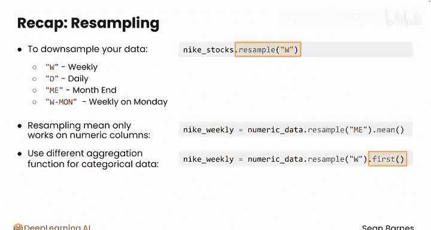