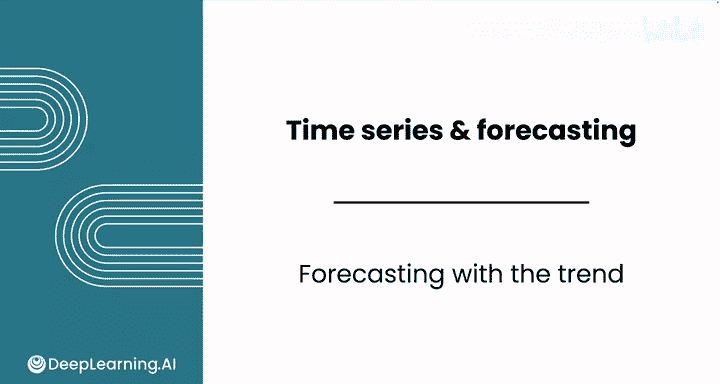
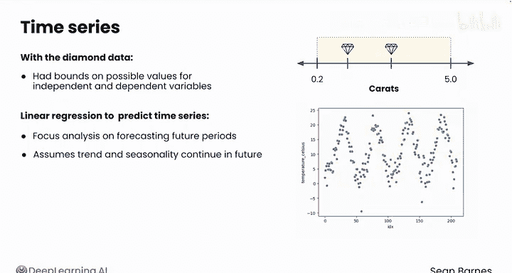
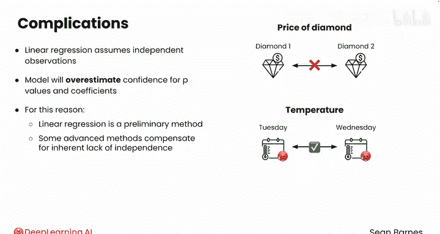
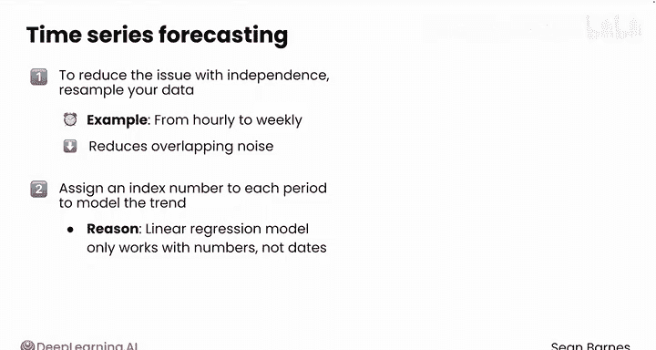
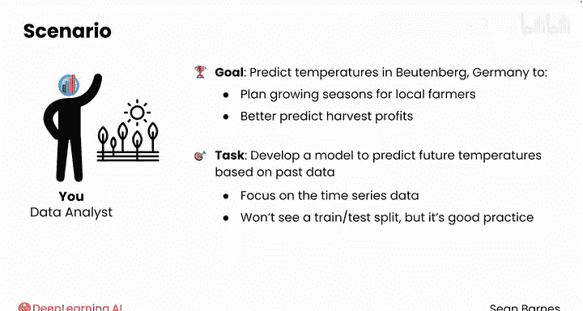
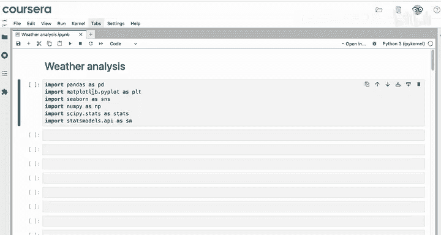
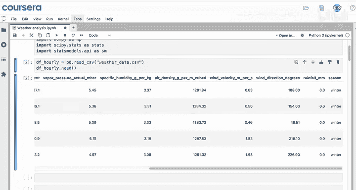
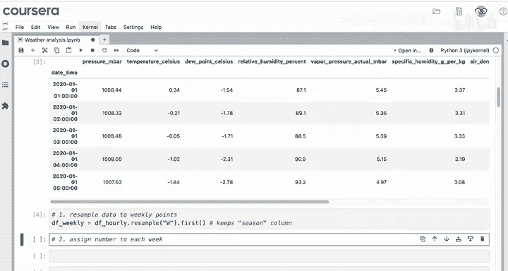
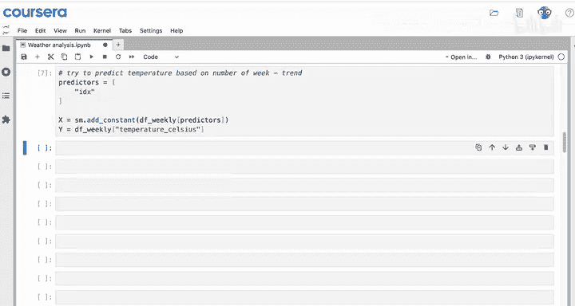
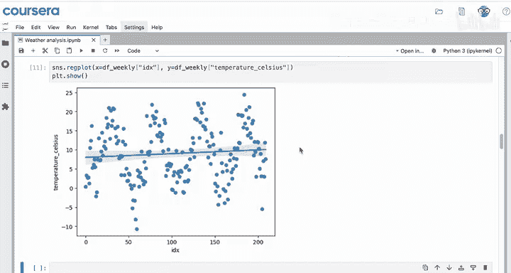

# 吴恩达《Python数据分析（数据分析第3课）｜Python for Data Analytics》中英字幕 - P92：91_趋势预测.zh_en - GPT中英字幕课程资源 - BV1rp5yzjEgn

Linear regression is a useful technique for time series data， not just for cross sectional data。

 you can use a simple linear regression model， a model with only one independent variable to forecast the trend of time series data。

Working with the diamonds data in the previous lessons。

 you have some balances on the possible values for your independent and dependent variables In the case of simple linear regression using carrot to predict price。

 the carrot was somewhere between 0。2 and about5。 For the most part。

 you expect a carrot of new diamonds to fall somewhere in between those bounds。

 When using linear regression to predict time series。

 the focus of your analysis is typically on forecasting future periods。

 So if you have data between January 1，2020 and January 1 2024。

 you're typically interested in forecasting times in 2024 or beyond your model assumes that the trend and seasonality continue in the future。

 but there's often increasing uncertainty the further you forecast conditions change and small uncertainties or errors can compound over many years。

 One complication affecting your time series modeling is that the linear regression typically assumes independent observations。

 So for example， it's reasonable to assume that one diamonds price doesn't affect in others。 However。

 the temperature on one day is highly related to the temperature on days around it。

 If it's a hot Tuesday， it will。

Be a hot Wednesday as well。 Don't worry too much about the technical details of this issue。

 The consequence for your analysis is that the model will overestimate confidence for P values and coefficients。

 you'll need to use caution when interpreting your results For this reason。

 linear regression for time series forecasting is typically a preliminary method。

 Some more advanced methods can compensate for this inherent lack of independence and time series data when you're working with time series forecasting and code。

 you'll need to consider two additional steps first to help reduce the issue with independence。

 you can resample your data for example， from hourly to weekly observations resamping reduces the amount of overlapping noise your model has to grapple with then assign an index number to each period to enable you to model the trend。

 that's because your linear regression model only works with numbers not these say you're working with an agricultural consulting firm to predict weather patterns in Germany。

 your firm is looking to predict temperatures in Boyenberg。

 Germany to plan growing seasons for local farmers and better predict harvest profits。

 you've been asked to develop a model to predict future temperatures based on past data。

The sake of simplicity so you can focus on the time series data。

 you won't see a train test split here， but it's generally good practice to use one。

 First up importm your libraries。 load in the data and take a look。

 remember this line of code works because the weather data csv file is in the same folder as your notebook So this data is hourly weather data from Boytonburg Germany notice this date column with the hour as well as the date you also have a lot of different available features here aside from temperature Celsius which is what you're trying to predict including pressure dew point and so on。

 and you have the season column as well to make this data a time series set the index to the date time column make sure to do the operation in place Finally two prep steps before you can create your linear regression model。

First， you want to resample your data to weekly points。

Resampling reduces the random noise in your data。Use the resample W method to do so since you want to keep this season column for later you can use the dot first aggregation function rather than dot mean Finally。

 you need to assign a number to each of these weeks because date time is its own type not a number。

 but your linear regression model expects a plain number add a new column IDX for index equals use the range function。

 which just goes from zero to the length of the data frame， so that's the number of rows。

And then just take a look at DF weekly again， so now you have this index column that just goes 0，1，2。

3 and so on all the way up， then you can start setting up your regression predictors start with a simple linear regression。

 one independent variable。Use a list with just one item in it IDX。

 so you're going to try and predict the temperature based on the number of the week。Later。

 you can add to this list and keep the same code otherwise。

 And this linear regression model is going to try to predict the trend of the data。 Remember。

 linear regression just estimates the line of best fit。 If temperatures are going up overall。

 then a later week will have a higher temperature。 If temperatures are going down than a later week or higher index is going to have a lower temperature。

 same code is before with your crossseal data where x equals sn do at constant。

 select the predictor's columns right now it's just one column and y is going to be the temperature and Celsius。

 You've now set up your regression and now you can run your regression。 Remember。

 your're interpreting the trend。 First off， that's a very low r squared。 only 0。007。 In other words。

 the week explains about 0。7% of the variability in temperature。 that's not a lot。

 check out the P value for the index coefficient。 it's 0。22。

 much higher than any reasonable alpha threshold like 0。05 or 0。01。

 So what is that P value tell you there is no significant effect of week on the overall temperature。

 right now。

You only have three years of data here from 2020 to 2023 and the model doesn't have enough evidence to be able to predict temperatures in the future。

 that kind of makes sense if you take a look at a scatterplot of the weak number versus the temperature。

 you can see that this relationship is very nonlinear You're trying to fit a line through here but a line doesn't model this data very well that's a potential clue that you either need more data or a more sophisticated model So adding seasonality to your model is really going to help you predict the temperature and more accurately by the way。

 it's common to find a noneect in your initial model when you're working with the fewest variables you should continue on to improve your model。

So you've seen how to model the trend of a time series using simple linear regression。

 follow me to the next video to learn how to add seasonality to your time series forecasts。

