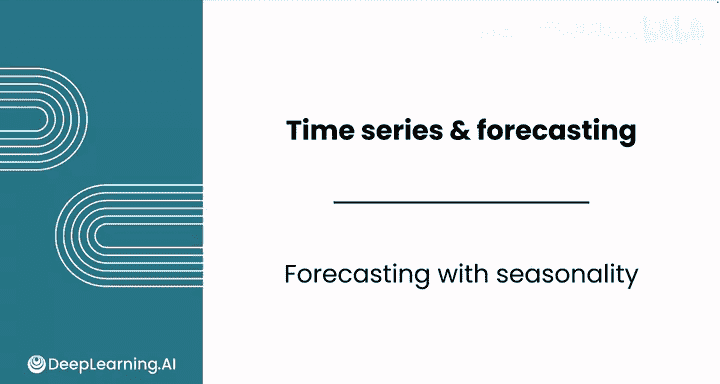
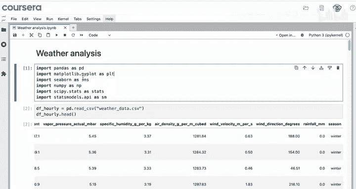
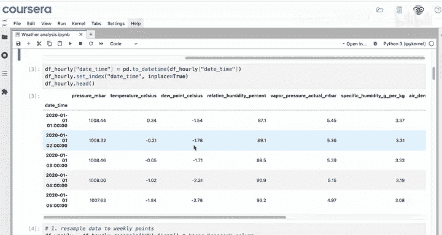
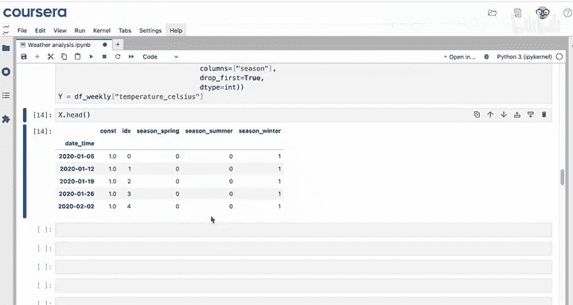
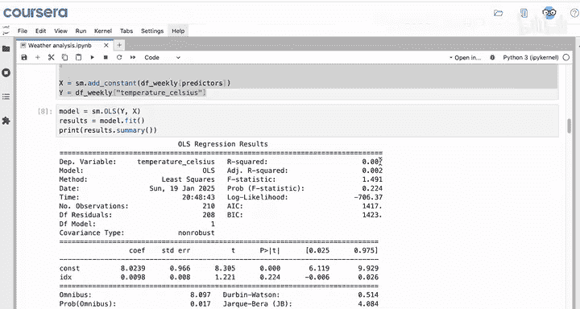
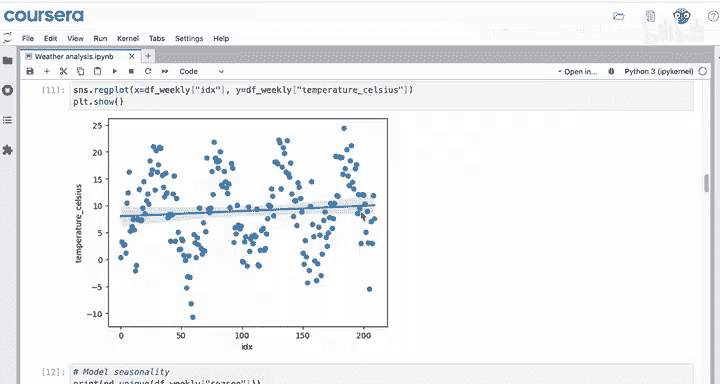
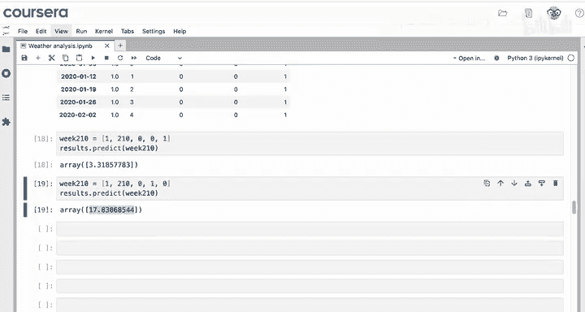
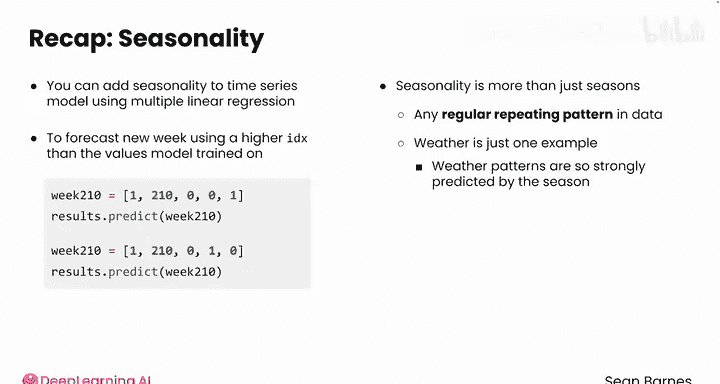

# 吴恩达《Python数据分析（数据分析第3课）｜Python for Data Analytics》中英字幕 - P93：92_季节性预测.zh_en - GPT中英字幕课程资源 - BV1rp5yzjEgn

With simple linear regression， you can develop a forecasting model for a time series trend with multiple linear regression。

 you can expand on your model to add seasonality。 Let's take a look。

 recall that you are working on forecasting temperatures in Bortonburg Germany for a consulting company you left off previously having imported your modules and read data set into the variable Df hourly set the time series as the index down sample to Df weekly and added an index column to your data You left off looking at the seasonality in this data where the temperature is really spike in the summer they fall in the winter and fitting a line through this data just doesn't get you very far。

 So your next step is to model the seasonality。 If you look at PDd do unique for the season column you have the four seasons。

 which makes sense。 add season to your list of predictors。

Remember that for categorical data， you'll need to use PD。

 gett dummies to get a numerical value for season rather than a string。

 The first argument is your Df predictors then give a list of columns you want dummies for which is just the season column D first is true because you want to leave out one season and D type equals int so that you get integers rather than booleance remember you don't need to memorize all these parameters you can always consult your previous notebooks and chat with your LLm as needed Finally use sm。

 add constant just like you had before， so your model can estimate the intercept take a look at x dohead I it exactly the format you want You have your constant the index which is the weak number and a dummy variable for three seasons Can you tell which season was dropped。

It looks like autumn was dropped。That's actually helpful since autumn is not the extreme of summer or the extreme of winter。

 which will help with your interpretation。You're interpreting more from the baseline temperature rather than from an extreme。

Okay， looks like your regression is set up。 No errors so far。 Go ahead and run that。

 And now you have some interesting results。 So your R squared is 0。575。

 which means you're explaining about 58% of the variation and temperature right now。

 That's the explanatory power of your model as a whole。 previously， your R squared was 0。007。

 So the regression modeling both the trend and the seasonality predicts a lot more of the variation and temperature than the model with just the trend。

 which makes sense because as you saw in the graph。

 temperature varies a lot more with the season than it does with the week in the data set。

 You also will probably be interested in understanding the coefficients。

 So the coefficient for Ix is still not significant。

 Your model still doesn't have enough data to identify a significant trend。

 recall that your drop season was autumn。 So your other season coefficients are all interpreted compared with the autumn category。

 The coefficients for all three seasons。 spring， summer and winter are all very significant。

 On average， being a summer month compared to autumn is adding 8 degrees。

 and being a winter month compared to autumn。😊。

Subtracting 6。5 degrees Meanwhile， spring months are 2。

2 degrees cooler Now that you've trained a model with significant coefficients。

 you can start with forecasting。If you want to predict the future week。

 you can look at the tail end of the data， the highest index was 209。

 so now you can predict the temperature in week 210， which is the next week in the data。

 the second week of 2024。Check out X outhead you'll want a list of values that looks like this。

 so week 210， a list with one for your constant， 210 for the week number，0 for spring。

0 for summer and one for winter Use results predict week 210 to get a temperature of 3。

3 degrees Celsius， about 38 degreeshe。So if you were to have one for summer。

 what would you predict this temperature might look like？

Summer should add several degrees compared to winter。 Maybe you would expect 8 plus 6 and half。

 So about 14。5 degrees higher。 and that's exactly what you see17。8 degrees Celsius。

 if this week happened to be a summer week， which you know it's not。

 but if it happened to be summer that changes the prediction a lot so you can see that the seasonality component of the model is doing a ton of the work and helping to predict the temperature especially compared with a trend to recap you saw that you could add seasonality to your time series model using a multiple linear regression。

 even if your trend was not significant。 you could still model the seasonality in your data。

 you also saw how to forecast a new week using a higher number for Ix then the values your model have been trained on by the nature of forecasting you're working with values outside the original data so you need to interpret your results carefully remember。

 seasonality is more than just seasons。 Its any regular repeating pattern in the data this weather data is just one illustrative example。

 you can see why these patterns were nicknamed seasonality though because weather patterns are so strongly predicted by the season。

 Great work modeling seasonality and a time series。😊。

You've developed a sophisticated model for predicting weather patterns based on historical data。

 following to the next video to better understand how linear regression error metrics apply to time series forecasting。

