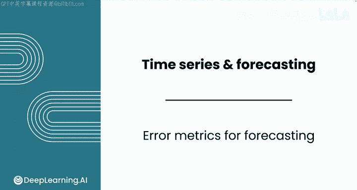
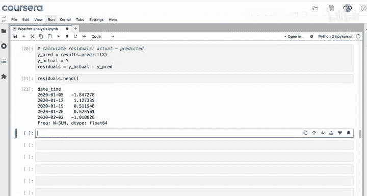
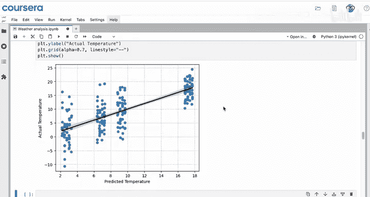
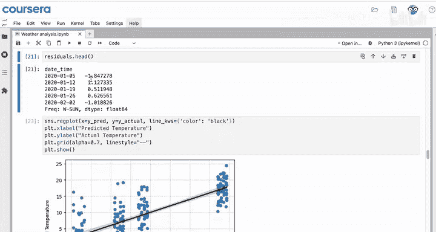
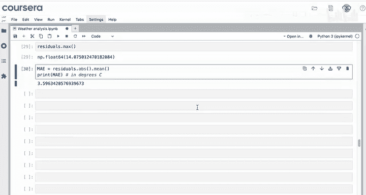
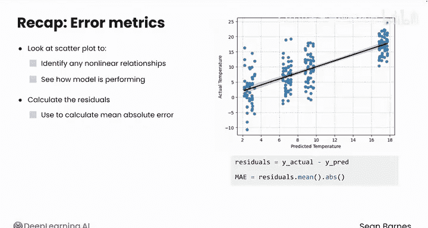

# 吴恩达《Python数据分析（数据分析第3课）｜Python for Data Analytics》中英字幕 - P94：93_预测误差指标.zh_en - GPT中英字幕课程资源 - BV1rp5yzjEgn

When evaluating a time series linear regression model。

 you can calculate the same error metrics you use for cross- sectionional data。

 Take a look at how to interpret these in the context of time series data。

 recall that you are working on forecasting temperatures in Boydenburg Germany for consulting company you left off previously having imported your modules read in your data Downsample it to weekly values and created a multiple in regression model to forecast temperatures so just as you did to calculate the residuals for diamond prices。

 you can also calculate them for your time series forecast remember that residuals are defined as the actual values in this case temperatures minus the predicted values。

 residuals tell you how often your model predictions were compared with the true values to get the predicted temperatures also known as y pre Use results that predict for x Y actual is just y and then the residuals are the actual temperatures minus the predicted temperatures and same as before。

 you can also check out a scatter plot of the predicted values and the actual values so you can see that you have four different clusters and these are probably the four different seasons。

The middle temperatures are the spring and autumn values。 Autum is a bit higher。

 higherer temperatures are summer。 Low temperatures are winter。

 It would be nice to color code this graph。 That's something you can work with your LLMmo。

 Remember that ideally， you want to see a linear relationship between these two。

 just a kind of one to1 correlation。 As you already saw the seasonality rather than the trend that this data is doing most of the predictive work。

 You can take a look at the residuals head。 which tells you how off your model's individual predictions were。

 So the first prediction seems pretty close。 It's off by about 1。8 degrees。

 in the first week of 2020， the actual temperature was less than 2 degrees higher than the predicted temperature。

 you could also look at the max。 if you're curious about the maximum error in your dataset。😊。

In this case， there was a prediction that's around 14 degrees off。

 it's probably something close to zero， so it appears there was one week where the air was around 14 degrees off。

Finally， using the exact same code as for your cross sectional data。

 you can calculate the mean absolute error for your model。

 remember that mean absolute error is in the units of your data。 In this case， degree Celsius。

 So on average， your model is off by about 3。6 degrees Celsius。

 if you're using it to solve problems like should you wear a sweater today。

 maybe that's useful if you have some agricultural or scientific application probably that's not going to have enough explanatory power to recap。

 you can use the same methods for evaluating your time series regression model as you used previously for evaluating a cross- sectional model First。

 look at the scatter plot of the actual versus predictive values to identify anyline relationships and see how your model is performing。

 then you can calculate the residuals and use those to calculate the mean absolute error。

 mean absolute error tells you on average how off your model's predictions were whether those errors were positive or negative。

 Now that you've developed a model with some explanatory power。

 you can bring this model back to your client as a starting point for conversations or work to improve it using the iterative process you used in the previous module。

😊。

By adding more features as predictors or by exploring more options within LLM。

Now you're well equipped to forecast time series data and interpret it correctly using multiple linear regression and that takes you to the end of this lesson and almost to the end of the course Com up。

 you'll complete the graded assignment and graded lab for this module in the graded lab you'll analyze coral reef data to help a marine conservation team Finally。

 you'll complete the capstone exercise for this course you'll act as a data analyst working with a new fintech startup。

 your goal is to create a predictive model to estimate loan interest rates you'll combine everything you've learned in this course from data manipulation。

 descriptive statistics， visualization and inferential statistics to put together a comprehensive rigorous analysis Once you're done with the graded assignment and lab as well as the capstone exercise I'll see you in one final video to talk about your next steps as a data analyst Keep up the great work and I'll see you on the other side of the graded items and capstone。

😊。