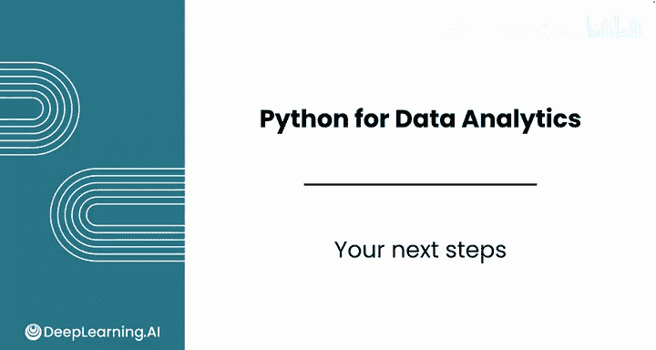

# 吴恩达《Python数据分析（数据分析第3课）｜Python for Data Analytics》中英字幕 - P95：94_你的下一步计划.zh_en - GPT中英字幕课程资源 - BV1rp5yzjEgn

Congratulations on completing the capstone and this course。

 you've made incredible progress in programming and analytics。 You learn Python functions。

 data types and techniques that many advanced data analysts use all the time。

 You've analyzed all kinds of real world data from public library revenue and restaurant ratings to loan interest rates。

 coral reef metrics and diamond prices。 You're prepared to run custom analytics at scale。

 and there's a lot more to learn。 Even after years of working in this field。

 there's something to learn every day。 So I hope you'll join me in the next course in this series。

 data processing with SQL and Python。 so far in this specialization。

 you've primarily worked with clean， tidy data。😊。

But data in the real world is often messy。You'll learn how to collect。

 store and process data to prepare for analysis。 you'll implement a variety of data collection methods。

 including web scraping and using APIs。 You'll also learn the SQL language for communicating with the database writing queries to sort。

 filter， aggregate and more you'll also learn advanced techniques for data validation with SQL and Python This course will teach you to collect data from so many real world sources and turn it into a data as beautiful and clean as the ones you've worked with so far。

 So congratulations again on completing this course and I'll see you in the next one。😊。

