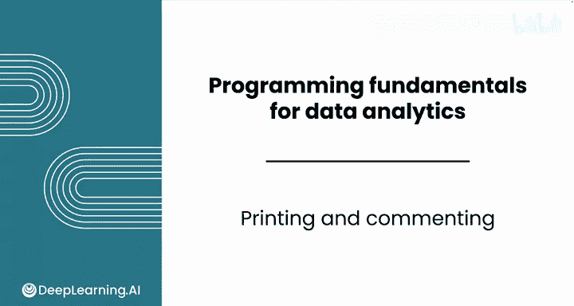
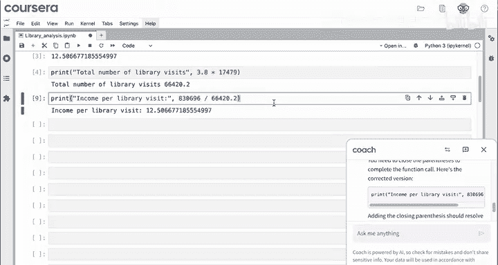
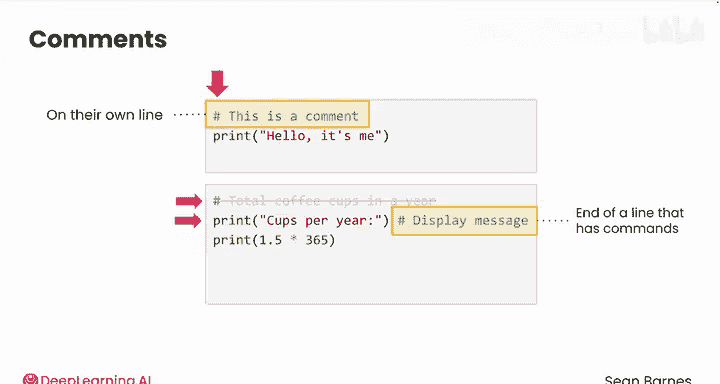
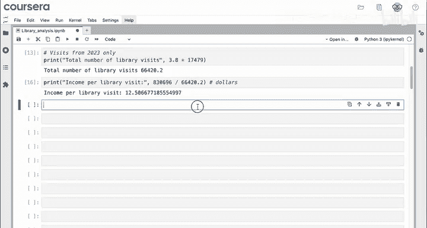

# 吴恩达《Python数据分析（数据分析第3课）｜Python for Data Analytics》中英字幕 - P9：8_打印输出与注释.zh_en - GPT中英字幕课程资源 - BV1rp5yzjEgn

Coding is about more than just doing calculations You'll often want to add information to your code for you and other humans。

 you can do that using print statements or comments Earl。

 you calculated the total number of library visits and that information was displayed here by default。

 Jupiter notebooks will display the last value that was calculated in the cell。 In this case。

 a number however， you can also use the print command to display information to the screen。

 you can print multiple pieces of information by separating them with a column。

This strategy allows you to add labels to pieces of information in your code。For example。

 first you can print some text as a label。Print， total number of library visits， close the quotes。

 then comma， and leave this expression as is， then close the parentheses。

Running this cell you get a nicely formatted output Can you tell what types are used in this per command。

 you have a string label and the result is af floatat。

The print command displays them on the same line separated by a space for this second task。

 you can do print， open quotes。Income per library visit， close quotes， comm， that's your label。

 then keep the expression。And you get a nicely formatted output as well。😊。

It's good practice to use print statements to display information rather than relying on the Jupipyter notebook to display the last value。

 the formatting at a print statement is usually nicer and you can have multiple of them in a single cell。

 say you're coding up these tasks and you run into this error。

You may notice it comes from leaving off the closing parenthesis。To you and me as people。

 this code still means the same thing。But the computer can't complete the task without that parenthesis。

Forgetting a parenthesis is a really common error， by the way， first。

 you can try to solve this error yourself by reading it and fixing the code。

Arror messages can get long and complex though。If you get stuck， you can always ask your LLM。

For example， you can say， hey， I ran into this error while coding。

 Can you help me understand why it's happening and then copy in the whole error。

 even use shift enter and the chat window to add a new line。

And then it says the error you're encountering is a syntax error。

 which means theres a mistake in the structure of your code。

 so looking at your code it tells you that the issue is that theres a missing closings parenthesis。

 so you need to add that closing parenthesis to correct the issue so you can copy the code that it suggests if you like and see if that fixes the problem。

Okay， looks like that fix it。 errors are a completely normal part of coding。

Seemingly small things like leaving off this comma or accidentally putting a space in the word print。

 those all create errors。

Don't forget that you can always ask your LLM to help solve them Comments act as notes to your future self or to your collaborators。

In Python， they start with the hashtag and they can be on their own line。

 or they can come at the end of a line that already has some commands when the computer sees the hashtag。

 it will completely ignore everything else on that line and just move on to the next one。

 you will see comments in both the practice labs and grade in labs。

 as well as throughout the videos in this course。 Let's say that you're going to send this code to a colleague and you want to mark it up with a little bit more information。

 You can add a comment。

A comment starts with a hashtag。 The computer will completely ignore the rest of the text on this line after the hashtag。

 the next line will be executed normally， so we can start at the beginning of a line or come at the end of a line。

You might want to say， for example， visits from 2023 only， so this information is just for you。

 the human， the computer will completely ignore the comments to text。As another example。

 you can add a comment here at the end that says this should be in dollars， so hashtag dollars。

The computer will execute everything up to the hashtag， ignore dollars。

 and then execute the next line if there is one If you run the cell again with shift enter。

 you get the same output and no matter how many comments you add。

 you can also put a comment in between two other lines of code that's also completely fine。

 For example， here you can save visits from 2022 only and calculate the total on the next line。

Both lines will work as expected。You've seen how comments and code combine。

 follow me to the next video to learn how to store information in Python using variables。

