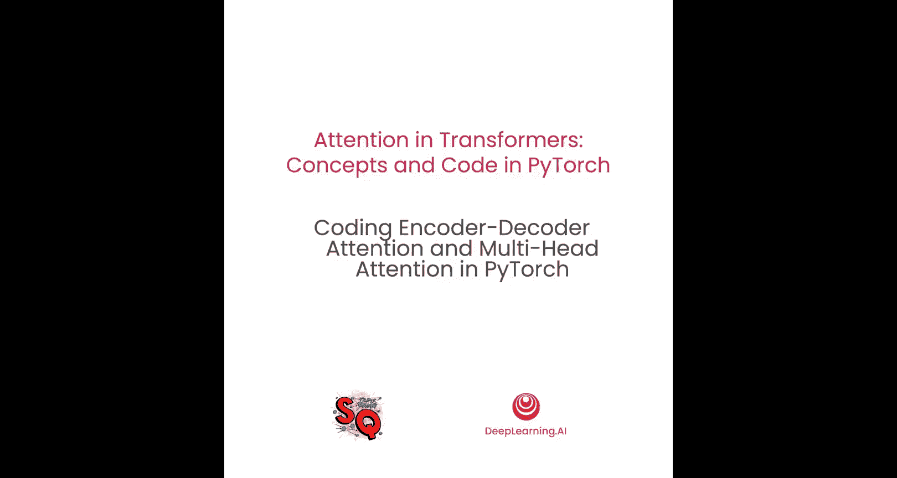
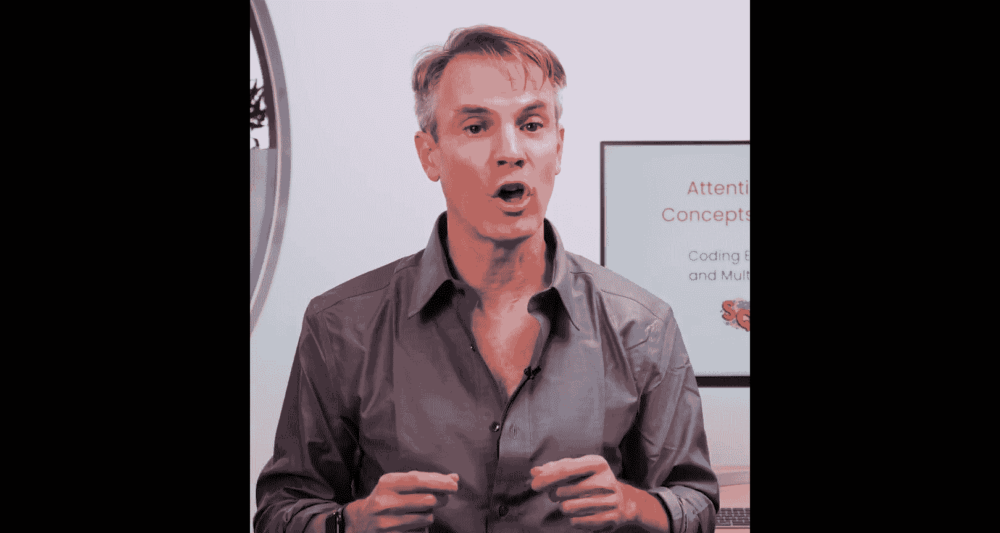
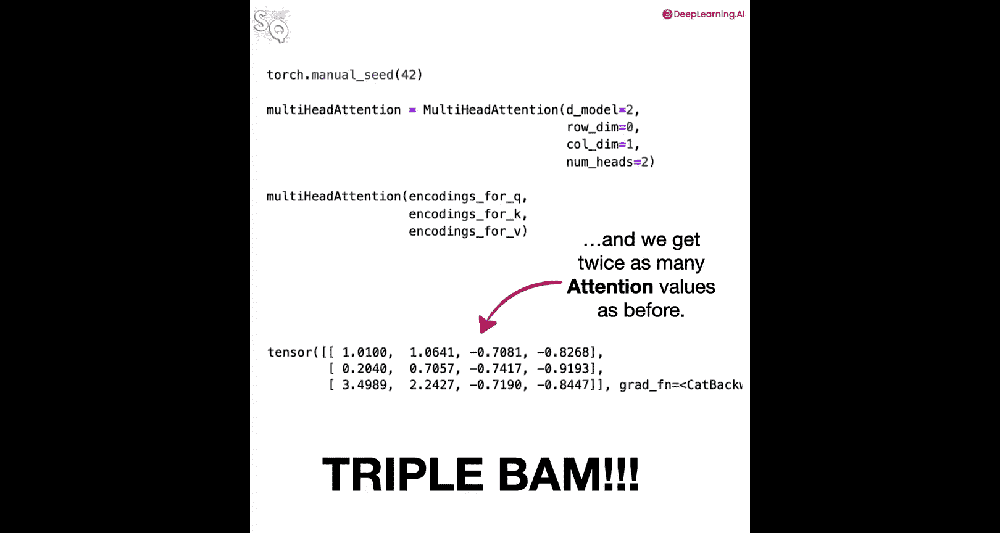

# 吴恩达《Transformer中的注意力机制：概念与PyTorch代码实现》中英字幕（deepseek-R1纠错+翻译 - P10：10.coding-encoder-decoder-attention-and-multi-head-attention-in-pytorch.zh_en - GPT中英字幕课程资源 - BV1AYKpeGEUf

In this lesson， you'll use pi torch to code a class that implements self attention。

 mask self attention， and encodeder decoder attention。

 you'll also code a class that implements multi head attention， let's code。

Just like before， we're going to import。Torch， torch dot N N and torch dot Nn dot functional。

Now we'll code a class that implements encoder decoder attention。Actually。

 we're going to code a class that implements all three types of attention that we've learned about。

 self attention， mask self attention， and encoder decoder attention。

So we start by defining a class called attention that inherits from NN dot module。

And the init method。Is identical to what we've already coded twice before。Bam。

The forward method has two changes。First， we can now specify different encodings for the queries。

 keys， and values。And second， we pass those potentially different incodings to the matrices to create the queries。

 keys， and values。Everything else is the same。Now let's run some numbers through it and make sure it works as expected。

We'll start with the same matrix of encodings for the same tokens that we used before。Except now。

 we're specifying that they are for creating the queries。

Now we create a matrix of encodings for making keys。And a matrix of encodings for making values。Note。

 in this example， I'm making the encoded values the same so we can easily compare the result to what we did before。

Then we set the seed for the random number generator。

And create an object from our attention class using the same parameters we used before。Lastly。

 we pass the encodings to our attention object。And these are the attention values。Bam。As always。

 if you got something different， you can verify the results like we did before。

Now let's talk about how to code multi head attention。

We'll start by defining a class called multi head attention that inherits from in and dot module。

And in the init method， we'll add one new parameter， nu heads， the number of attention heads we want。

As always， the next thing we do is call the parent innate method。

Then we use a four loop to createn heads， attention objects。

Each attention object that we create is initialized with the same values for D model， RDm， and CalDm。

And we store them in a module list called heads。A module list is just what it sounds like。

 It's a list of modules that we can index。The last thing we do in the inent method is save the call dim parameter。

The forward method takes the encoding matrices。And then uses a for loop to pass the matrices onto each attention head。

The attention values returned by each head are then concatenated。And returned。

And that's all there is decoding multi head attention。Double bam。

Now let's run some numbers through it and make sure it works as expected。

So we set the seed for the random number generator。

And then create and initialize a multi head attention object。The parameters， D model。

 rh dimm and Caldm are the same as before。And we're setting numb heads to one just to see if we can get the same results as before。

 We'll change this value later。Then we pass in the encoding matrices that we made earlier。

And we get the same results as before。Bam。And now let's do the same thing with two heads。

So he reset the seed for the random number generator。

And create a new multi head attention object that has numb heads equal to2。

Then we pass the encoding matrices。And we get twice as many attention values as before。Triplebam。

