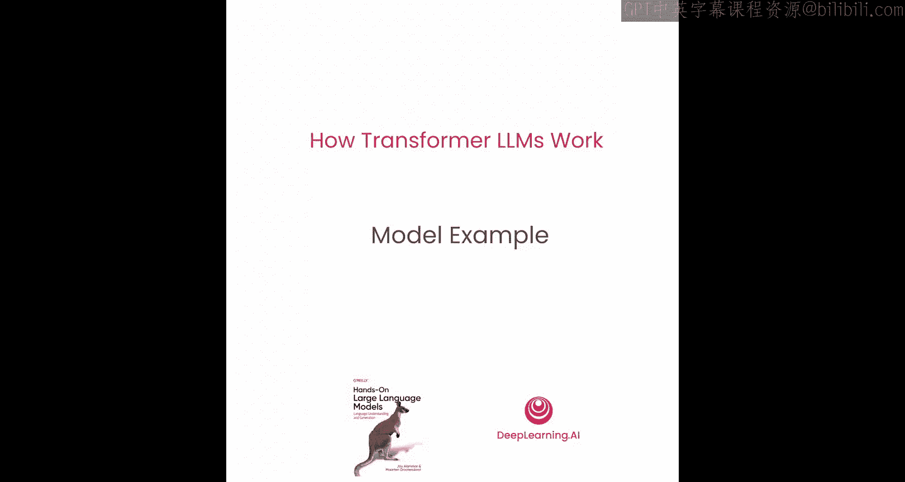
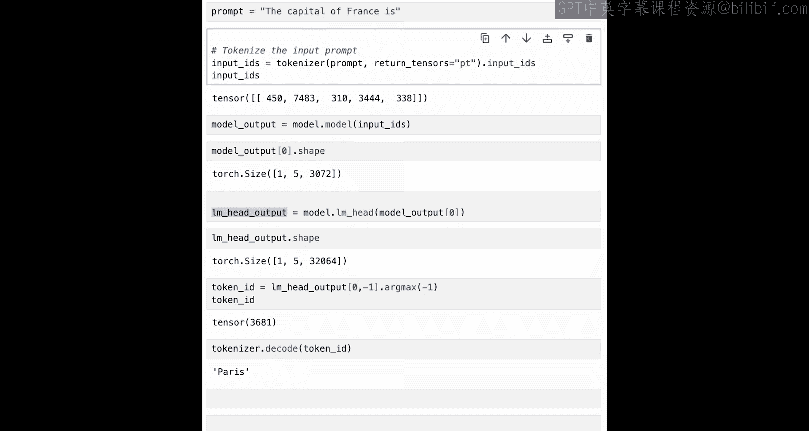
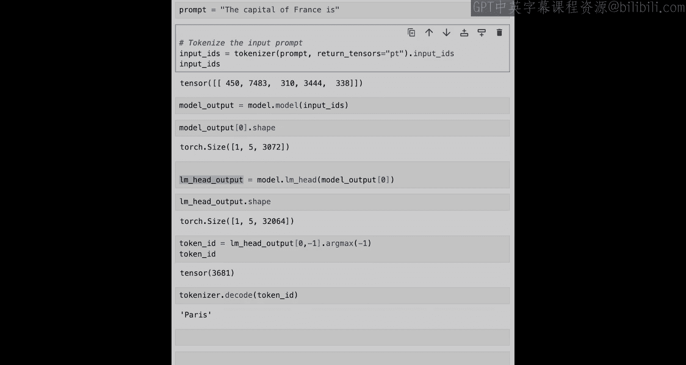

# 吴恩达《Transformer大语言模型工作原理｜How Transformer LLMs Work》（deepseek-R1翻译中英字幕 - P10：10.model example.zh_en - GPT中英字幕课程资源 - BV1juNaeREyf

You'll learn so far about all the different components of the transformer。 Now。

 it's time for you to explore the architecture of one model example using the hugging face Transformers's library。

 Let's code。

To reinforce everything that we've learned so far， let's take a quick look at the code of how hugging face transformers allows us to look at a transformer and its tokenizer and how that process happens that we've looked at。

 So how the processing and how the flow of information happens from the tokenizer to the stack of transformer decoders to the element and look at how that works in in the code。

 So let's start with。😊，Just a couple of logistics as we want to remove a little bit of these warnings that we're gonna see。

 and then we're gonna to be loading a language model。

 So this is the phi3 mini model So here we're downloading it with its tokenizer Since we're using it on a CPU it's showing us a couple of these warnings。

 but we can just ignore them let's now define a huggingface pipeline。

 So we're saying this is the model that we've downloaded and the associated tokenizer that we've downloaded so you can see that this is the phi3 model and this is the Phi3 tokenizer we pass them both to this pipeline。

 which is just a code abstraction that makes it easier to generate code with an LLM after we give it and load up the model and tokenizer And here we're saying that okay whenever we give you a problem we want you to generate 50 tokens and in response to that They do sample parameter means that we're doing greedy deco。

As we've looked at so with each token it would score the probability of the output tokens and it would choose the token with the highest probability。

 So this is almost exactly like setting the temperature to0 Now that we've done that we can declare our prompt and pass it to the model Now this is the prompt that we're giving the model it' being processed right now So it's saying right an email apologizing to Sarah the tragic gardening mishap Ex how it happened Now the model is processing these let's skip through to when it's done generated and talk about what it did in the process And here we see the output So these are the 50 tokens that the model generated email to Sarah and the subject and then you started to write the body of the message and then it stopped at the middle of the 50th or last token that it generated Now you can take that chance to change the prompt to whatever you'd like and see how the model responds it might take around two minutes to generate the output because it's running on CPUs in this。

Whi is why in industry， a lot of these models actually run on GPUs that are highly optimized and a lot of these efficiency methods that we've discussed are important to speed up that generation that's the reason why there's a lot of focus on that efficiency。

Now a lot of people have not used language models beyond just a chat interface or a playground。

 And so if you're one of these people and this is your first time generating with a language model encode congratulations now you understand these models a little bit better。

 And if you've seen this in the past， stick around and I'll show you a couple of the cool things that a hugging face sort of enables you to do in terms of just understanding the hierarchy of the model and how it works together。

 So a couple of things to point out with a hugging face is now that we've loaded the model as model we can just。

😊，Print that。 And that will show you the structure， the architecture of the model that we have here。

 And you can see that it's indented。 So this shows you the hierarchy here。 So you have a model。

 So this is the phi 3 for causal language modeling。

 This is a decoder model is a causal language model or autoregressive。

 which means that the attention step only focuses on the previous tokens inside this model we have two major components。

 We have the model itself。 This is where all of the layers。 these are the transformer blocks sit。

 you have the tokens。 So this is the tokens matrix。

 The model has 32000 tokens in its vocabulary and the model dimension is 3072。

 There are 32 decoder transformer layers and you can see the exact components of each one of them。

 so we have selfatten。 the projection， the rotary embeddings addition here。 the MLP。 the multi。

Layer perceptron is what we call the feed forward neural network that is the component here and you can see that it projects it up to the high level dimension which is 16000 in this case and then projects it down to the model dimension of 3000 again you have your activation function and then your layer norm and then towards the end of the model you see the language modeling head and which outputs a vector of dimensions 3072 in the end here we see the language modeling head which takes in the final vector of 3072 that's the model dimension and it outputs a score for each of the tokens that the model has in its vocabulary。

Hygging face also makes it possible to do something like this so you can browse。Like this。

 So we now we went into the model itself， we can address all of these layers kind of like this。

 so we can access the embedding layer matrix like this。 So we can say okay。

 let's say we want to do model model layers and then you want to access that first transformer block it looks like this And so this is a way for you to be able to access each of these layers and matrices and see the input size and output for each of these layers。

 but also access the actual matrices themselves if you want to do that let's go back to the generation。

 let's say we have a simple prompt like this the capital of France is now we'll process this in a different way。

 So instead of doing a pipeline， the pipeline sort of abstracted a few things from us。

 let's do it in a way where we get to see a little bit of the mechanics of how that information or how that processing is actually done。

 So we have this code here where we have our prompt we send it to the token。

And we have it return inite。 Let's say we want you to show us the inputite。

 And that's the result of the tokenization。 So the tokenization said， okay。

 this one string of text is now broken into these five tokens。For number 4，50， number 7，4，83。

 the number 3，10。 This is how this information is represent。 Now we can send that to the model。

 And notice here that we are sending this to the model component of the model。

 So this will not go through the language modeling head。

 This is just flowing through the stack of transformer blocks。

 So let's look at how that output looks， looks something like this。

 Now you have this tensor of dimensions 1 by 5 by 3072。1， this is the batch dimension。

 So we pass the model only one text。 And so it processed only one。 while in training。

 you'll have a lot more of these。 And so this can be a lot more5 is the number of tokens in this sequence。

 and 3000 is the dimension of the output vectors。 Now。

 to think of this think about this visual that we've at in the past。

 The vector that we're currently looking at is a matrix that is basically this row。

And this row together sort of mued as let's say two rows of one matrix。

 And so 3000 is the number of dimensions for this vector。 And then here we have two。

 but in here we have five tokens。 And so that is the the output here。

 which is the vectors before we hit the language modeling head。

 We can pass that to the language modeling head。Independently and then see what that output looks like。

 Let's look at the shape of this output。 And so this is a tensor of one by5 by 32000。

 And when you see 32000 now you know that that is the vocabulary size that we have。

 And so these are the scores for each of these outputs。

 But to get the actual output for this string that we or this prompt that we've sent to the model。

 this is what we do。 So we address the actual vector that we want。

 So it's the last token in the sequence and then we pass it to this will give us the token ID which is a number。

 let's print that here。 So the number， the output token。

 the first output token that the model will generate is the token number 3681。

 and then to decode that back into human language that is Paris。

 And I find that fascinating for two reasons。 So one is now we have this piece of。

Software that is able to sort you can download this piece of software to your computer or your phone and it's able to tell the information about the world somehow that can be very complex。

 but also there's another thing that you can only see here which is the model really never saw the text。

 The model only sees these lists of numbers and it only outputs these lists of numbers everything that the model touches is just this is token number4 or 4000 it never have seen through the actual letters that we think of it's fascinating that language models operate in this way where the models has never really seen human language in ways that we actually see it only sees this list of indices of tokens So this has been a quick look at the code of a huggingface language model in the next lesson we look at other recent improvements to large language models。

