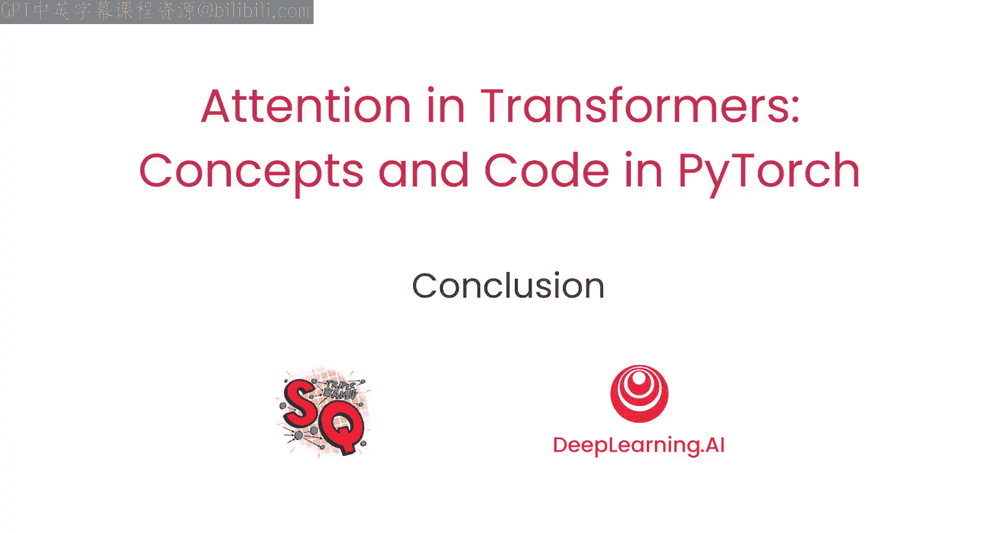

# 吴恩达《Transformer中的注意力机制：概念与PyTorch代码实现》中英字幕（deepseek-R1纠错+翻译 - P11：11.conclusion.zh_en - GPT中英字幕课程资源 - BV1AYKpeGEUf

🎼In this course， you learned about three types of attention， self attention。

 mass self attention and encoder decoder attention。

 You went in deep and explored the strengths and weaknesses of self attention versus mass self attention and learned when to use each one You also coded the three types of attention and verified that they worked as expected。

 I am looking forward to seeing what you will build on your own。🎼Bow。

