# 吴恩达《Transformer大语言模型工作原理｜How Transformer LLMs Work》（deepseek-R1翻译中英字幕 - P11：11.improvements.zh_en - GPT中英字幕课程资源 - BV1juNaeREyf

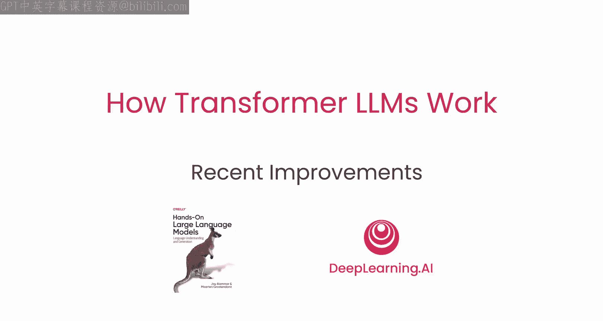

Great， now that you know how a transformer LLM works。

 let's now look at a couple of the more recent ideas that are part of the latest models。

This is a simplified view of a transformer。This is a transformer decoder。

 this is the architecture of the original one from 2017。You might have seen this figure before。

It is basically the same thing。 We just removed a couple of these components。

 I'll show you in a bit how this relates to the visuals as we've seen previously in the lesson。

 but we just flipped it upside down just because when we're writing a blog or a paper people tend to view things from the top to the bottom but basically if you look here so you have the words in the input prompt。

 they're chunked or broken down let's say into tokens and then those tokens become vectors and then positional encoding is this method of applying positional information otherwise it would be represented to the model as a bag of words there's no order to these words and the order of words in a sequence matters a lot and so positional encodings is a ways a method there are multiple methods of adding that position information to the representation of the vectors and that goes into a transformer block and then here we're just generally showing how a transformer block in a decoder network looks like Now this figure on the right。

The one from the original transformer paper So the same thing but a couple of things that we trimmed down in terms of just to make it a little bit simpler and more relevant to today's transformers is that the original transformer was an encoder decoder model and so that's what you see here this is the encoder component and this is the decoder component while most LLMs now in existence are mostly decoder models that do not have this encoder component and then here you have the positional encodecodings and then here you have the language modeling it we can。

Put these visuals here so you can just see what I how it breaks down into an encoder block and a decoder block。

 And so a lot of our focus here has been on these decoder blocks that explain how how these。

Vast majority of LMs that you interact with are actually built in how they operate。

 So there are still some encoder decoder models out there。

 but the predominant majority of text generation LLms are decoder models and then encoder models are also in use in models like Bt or the Bt like models that do text embeddings or rerannks or a lot of these efficient ways of doing NLP tasks that are not text generation necessarily。

 And so if we're comparing just the transformer block from the original transformer。

 we can juxapose it to a modern era。 So these are the 2024 era transformer blocks。

 and it looks very close。 let's point out some of the things that has changed。

 So one is that they're no longer a positional encoding at the beginning step here at the beginning of the processing of the model we'll talk a little bit of where that happens。

 but now we can see that we use rotary embeddings。 we'll touch on them a little bit later in this lesson。

 but positional information is now added at the。

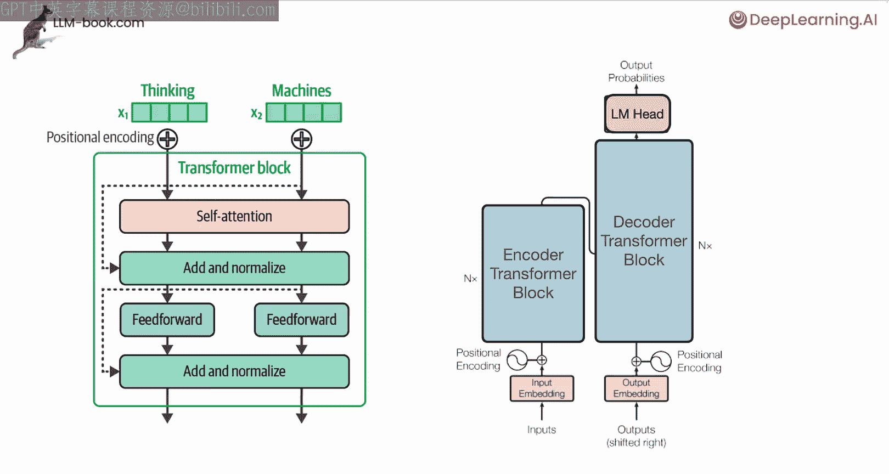

Selfatten level the layer normalization has moved before the selfat and feed forward neural network layer here。

 as you see， some experimental results showed that the models do better with this kind of setup And then you can see that these models also have grouped query attention as selfatten。

 So we talked about the evolution of self-atten mechanisms and then one important thing to also note that was both in the original transform run the current ones is the residual connections。

 I don't think they're sort of shown here as much but there are these residual connections that go around these layers to repack that information from the beginning of the layer back to the representation sort of add them back together。

 We'll talk a little bit about rotary embeddings。 But to do that let's talk a little bit about training。

 So you know that LLMs are trained in multiple steps。

 The first step is the base training where it's the next generation prediction step that's what's called language model。

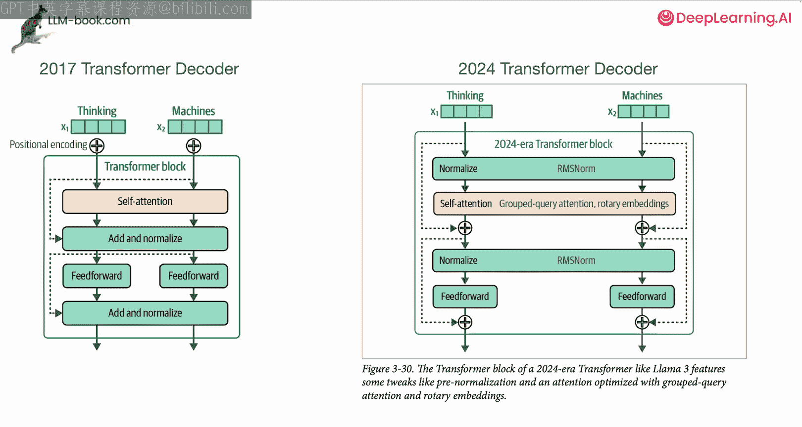

That's why we call them language models When you visualize it in your head。

 you might think of training in batches kind of like this where each row in the batch is a document。

 but then the model has let's say you're training a 16000 K context into a model the document or lots of short documents will not be able to fill that space So what do you do you would add padding to the rest of of that context and so if you're doing it naively this is one of the first ways that you might think about about doing training is that you'd have documents like this where the majority of the context is just padding that is not really used and this is an inefficient way to pack the training data。

In reality， a more efficient way of packing these documents for training is kind of like this where you have multiple short documents you pack them all into。

 let's say one row of your batch and you do that with the second row as well and so you end up with less padding and so you're using a lot of that compute since the GPU is going to be doing that crunching regardless。

 is it a document or a padding and so。This is a high level。

 let's say our side piece of information about how that training is done。

 And we say that because this also has an impact on the architecture。

 specifically with positional encoing。 So if you're doing this here you can say that okay token number one。

 I'll assign it with a positional vector that always denotes this is position number one。

 and then you do that with position two in three and4 and you can have multiple of these static positional encoding methods that denote either they can be either learned or they can be algorithmic in terms of you having some combination of signine and cosine that the model with time learns that this kind of vector or this kind of information in a vector relates that this is position number one or position number two or three or four of the token in that context link。

 So that's what's called static positional encoding there are other methods that are more dynamic that they denote that this token is three tokens。

Before this one， for example， but if you're doing this on the bottom here you need something else when the model is。

 for example， being trained on document number two first the self-attention mechanism should not be able to look at document1 but that's not a positional encoding component the positional encoding property that is needed here is a way to allow the model or the mechanism for positional encoding to say that okay this is the first token of this document and so in the counting of which token which position we are in the context length you support a way where the model can make sense that okay this is token number one in document number two without sort of counting everything that comes before So this is a little bit of the intuition of why a lot of the more recent models use positional encoding methods like rotary embeddings will not discuss rotary embeddings in detail but we can say that they're added that positional information is added at the selfat。

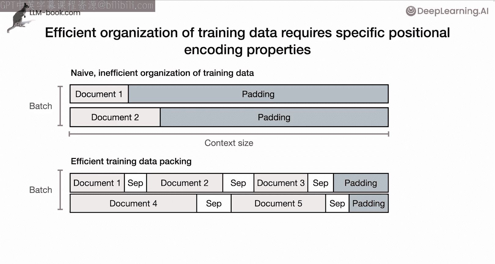

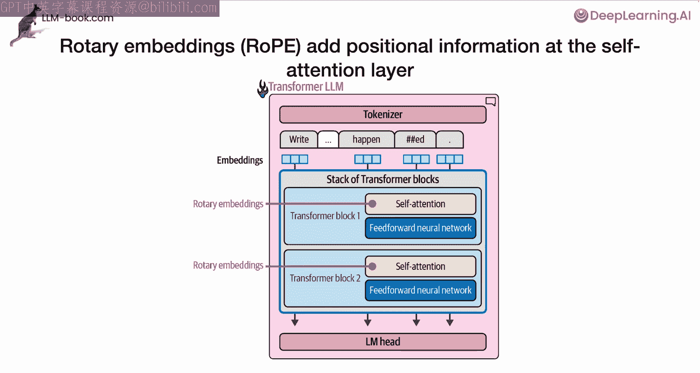

Layer of each transformer block rottary positional embeddings or rope adds that positional information in this step of self-atten。

 This is just before the relevance scoring step。 the first of the two steps that selfatten does。

 It basically has a formulation that add that information to the queries and keys vectors。

 And so these here have positional information that denote that this vector comes before this vector that comes before this vector。

 So that information is in the set here on the right。

 but it's not present in the set here on the left。 And that is added using rope and positional encoding methods like rope。

 One more recent development that you might have come across is the idea of mixture of experts。

 and this is a concept that uses multiple submods to improve the quality of LLM。

 Now that's not to say that all LLM are becoming mixture of expert models。

 And you can think of this as a variant of transformer language models rather than replacing these dense models。

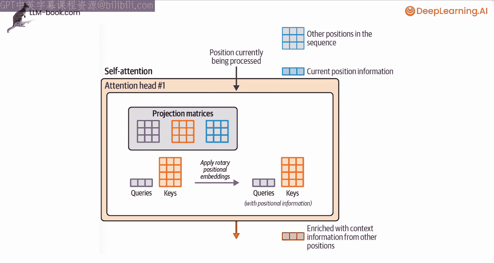

That we've covered in this course so far。 The idea of mixture of experts is that at each layer。

 you have multiple sub neuralural networks。 Each one we call an expert and then a router in each of these layers that decides which experts should process this token or this factor。

 Martin has an incredible guide to it that you can look at for a more detailed explanation。

 but we'll also look at that in the next lesson in more detail。

 for the intuition of experts is important not to think of each expert as being one monolithic component。

 Each layer has its own set of experts。 And then another important intuition is that these experts are not specialized in specific domains like a psychology expert or a biology expert Rather。

 these experts might tend to focus on， let's say specific kinds of tokens and and focus on how to process them best like punctuation or verbs or otherwise in the flow of using a mixture of expert model you're not。

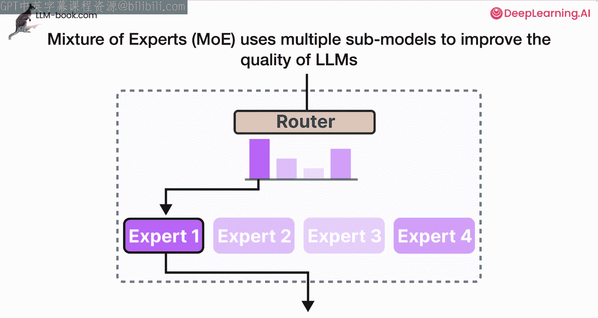

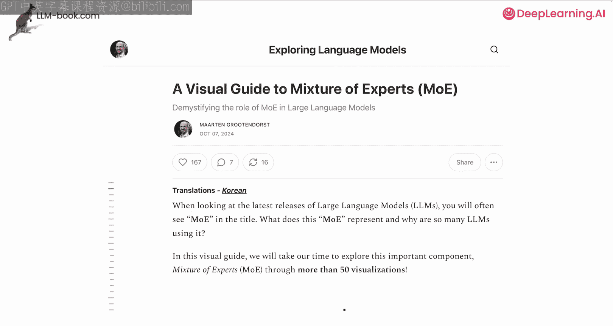

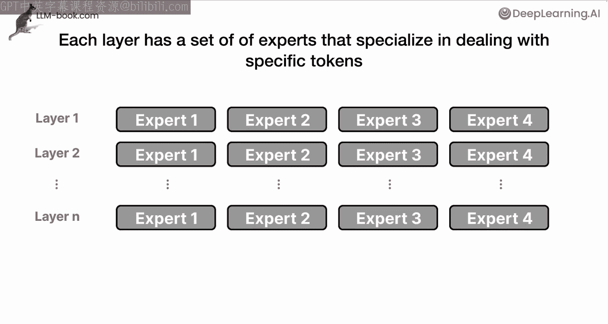

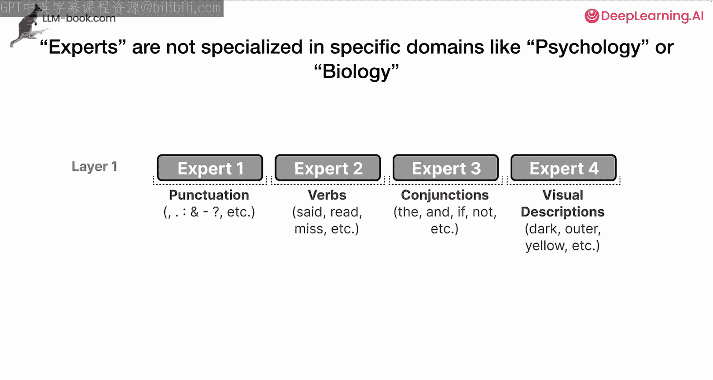

Assigned to one expert。 so if you're assigned in layer1 to expert  one layer 2 might use expert 3 or4。

 this routing happens at each layer and each layer sort of routes to the proper expert at that layer and there are methods that would route for example in each layer would route to two different experts and sort of merge the information from both back。

 So there are a couple of different methods for using these。

 but this is a high level let's say intuition and this is where they sit So they are part of the feed forward neural network where you would have multiple of these networks and each of them is called an expert in addition to having these experts。

 the mixture of expert layer also has this router， which basically is a classifier that classifies for this type of token。

 what is the best expert that is most suited for this So you can think of this as a classification score where here the router has deemed that to process this token this expert will do the best job for example。

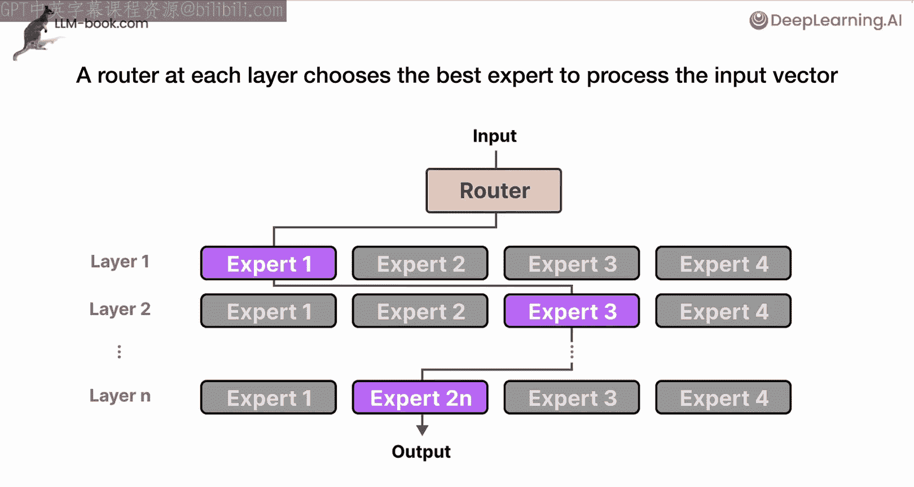

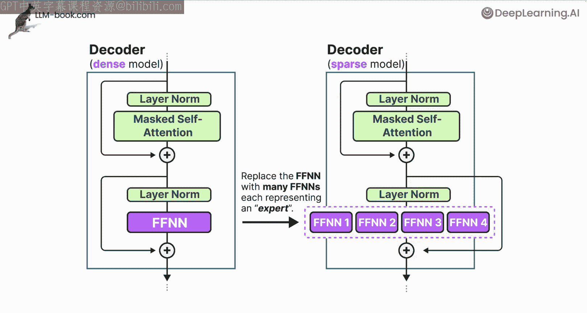

That processing is how the feed forward neural network is applied to this token and this processing step in this layer this was a high level look at mixture of expert models the next lesson will dive a little bit more deeper into how they work。

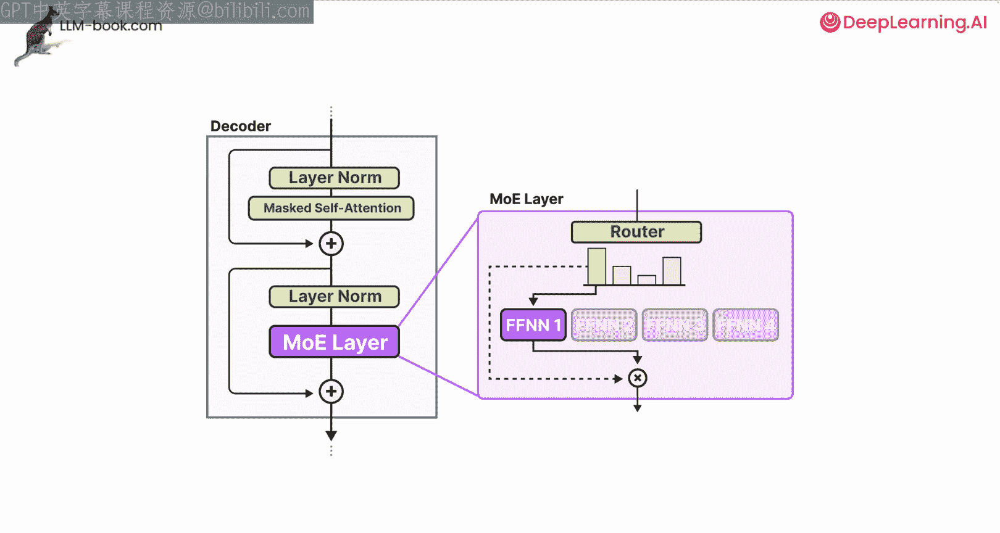