# 吴恩达《Transformer大语言模型工作原理｜How Transformer LLMs Work》（deepseek-R1翻译中英字幕 - P12：12.MoE.zh_en - GPT中英字幕课程资源 - BV1juNaeREyf

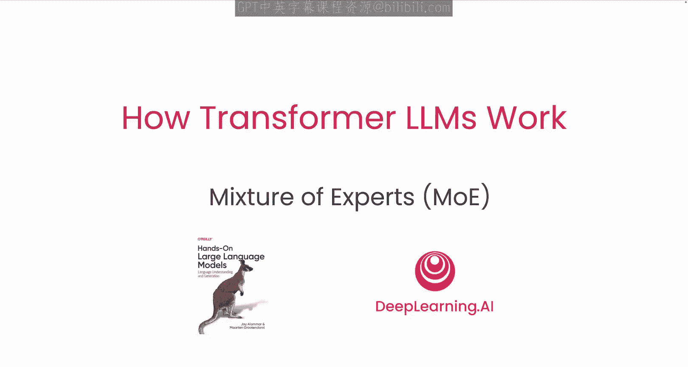

An exciting improvement to transformer LLMs is mixture of experts。

 This technique extends transformers by introducing dynamically chosen experts。😊，In this lesson。

 we will learn its two main components， the experts and the router。Let's take a look。

 make of experts changes parts of the decoder block inside a transformer model。

 Let's first recap how this decoder block works。The input of a decoder is typically several vectors representing the input tokens。

These are first layer normalized。Before pause to the attention mechanism。

You apply musked self attention to the input to weight tokens based on their relative importance in the context of all other tokens。

This output is aggregated together with the unprocessed input。

 creating both a direct and indirect path。 This concludes one of the most important components of transformer models。

 its attention mechanism。It prepares the input in such a way that more contextual information is stored in the vectors。

It is then layer normalizedized before processed by a feet forward neural network。

This network is typically one of the largest components of an NLM。

 since it attempts to find complex relationships in the information processed by the attention mechanism。

The feet forward neural network takes the input and processes it through one or more hidden layers。

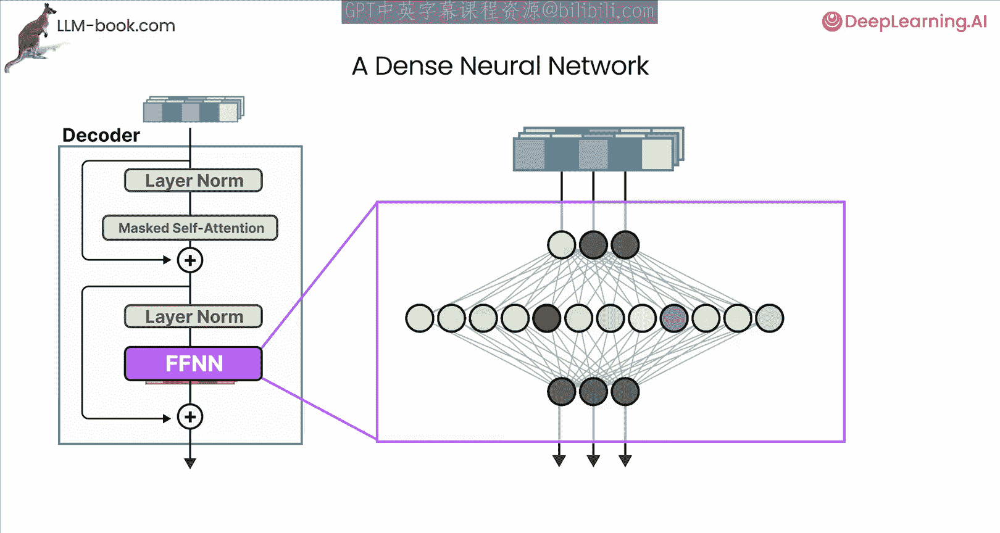

This is called a dense network， since all parameters of the network are activated and used at least to some degree。

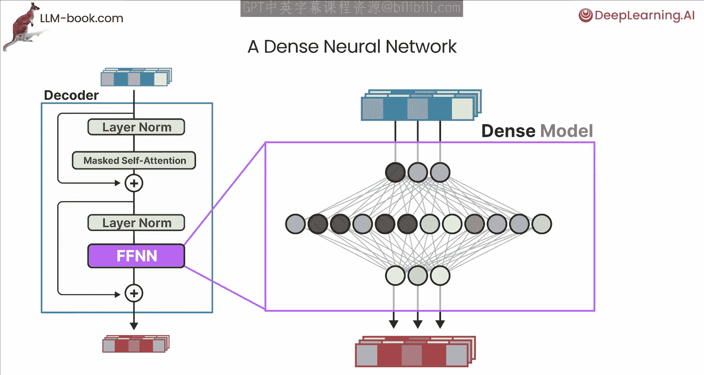

Make sure of experts is a technique that relates to the feed forward neural network。

Instead of a single network， it has several networks that it can choose to use。

Each network is called an expert。Know that an expert is not specialized in a specific domain like psychology or biology。

At most， it learns syntactic information on a token level， instead like punctuation。

 verbs and conjunctions。

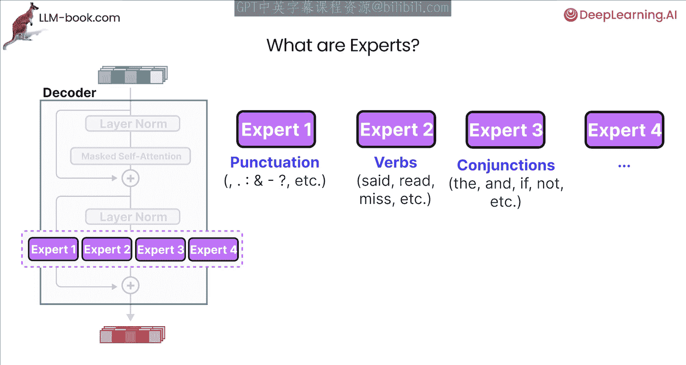

The single fit forwardner network now consists of four networks， each called an expert。

When the input flows through this expert layer。

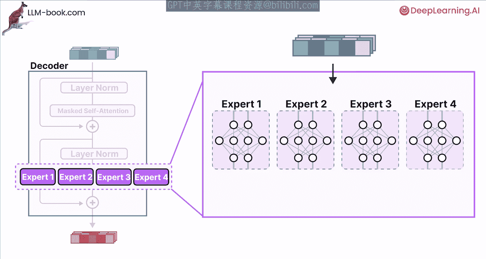

One or more experts is selected that will process the input。

And note that this will leave other experts unactivated。This is called a sparse model。

 since only a subset of experts is activated at a given time。

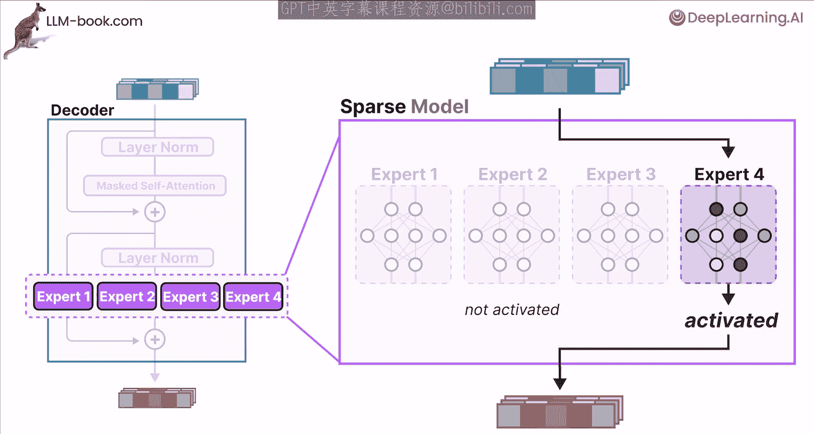

This sparse model is often referred to as the mixture of experts layer or the mo layer。

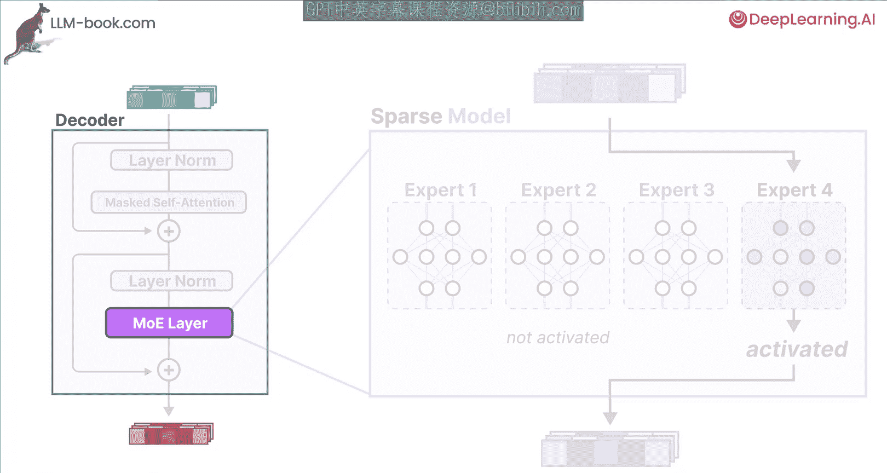

The mo layer therefore consists of one or more experts， each a feet forward neural network。

That takes in the input data。😮，And select an expert best suited for this particular input。

To generate the output。

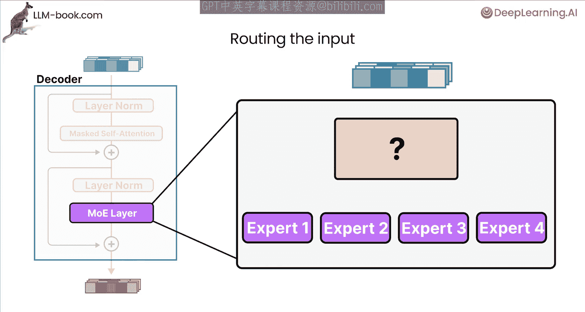

But how do you know which input should go to which expert？

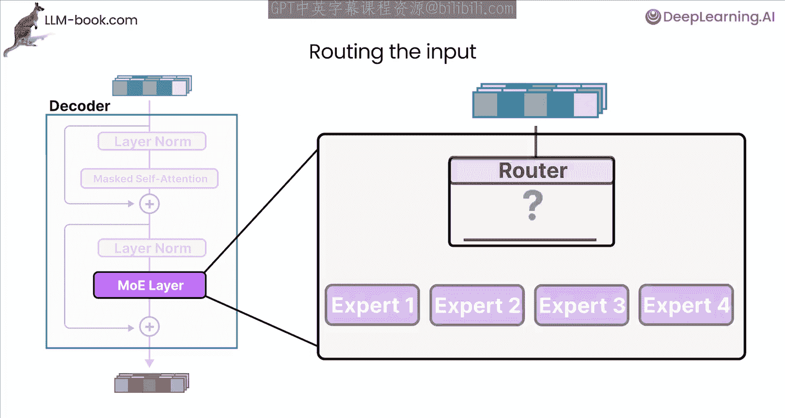

This is where the router comes in。 It main job is to choose which input you go to which expert。

 like the experts， the router is a feed forward neural network itself。

 but quite a bit smaller since it should do nothing more than route the inputs。For each expert。

 the router creates a probability score to indicate how likely it is that the expert is suited for that particular input。

😊，After creating the probability scores， one for each expert。

 the router selects the expert based on those scores。

 one strategy is to select the expert with the highest probability。

 but other strategies exist that might introduce more creativity to the output。

The final output can be generated based on the output of a single expert。

Or you can choose multiple experts and aggregate their output。

 This aggregation process is typically a weighted mean。

Experts that or given a higher probability by the router end up with a bigger say in the final output。

The router， together with the experts are the two main components of mixture of experts and is what we call the mo layer。

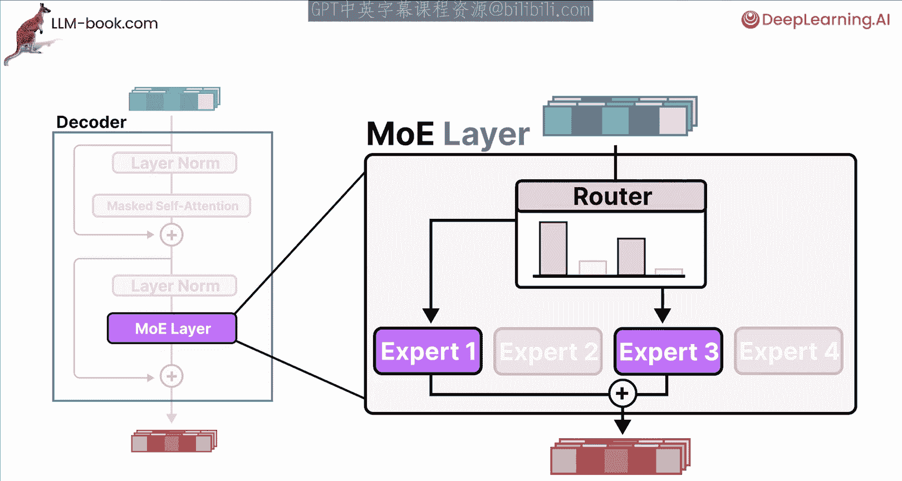

Looking back at the decoder， you can replace the single network with multiple experts and a router。

Although the technical implementation can be difficult。

 overfitting on a single expert is a real problem， make sure of experts can be summarized by these two components。

A major benefit of mixture of experts are its computational requirements。

Although having multiple experts rather than a single expert seemed like it would only increase the computational requirements。

 it is actually a bit more nuanced than that。 The parameters of a model using mixture of experts can be found in roughly five different places。

First， the input embeddings。Second， the masksque self attention。😮，Third， router。Fourth the experts。

And fifth， the output embeddings。When we load a model， we need to load all parameters。

These are called the sparse parameters， as not all of them are used Currently。

 All experts are loaded， despite only using one of them。In contrast。

 the active parameters are those that are actually used to run inference with mixture of experts。

 not all experts are used， therefore， although you need to load in all parameters of the model。

 only a subset of them are used one or more experts As a result。

 the amount of memory needed to load in the model is relatively high due to the multiple experts。

 but comparatively low during inference since not all experts are used。

Let's explore this with an example and calculate the parameters of a model。

 the model that you will be exploring is Mi 8 times 7b， it is a mixture of experts model that。

 as its name suggests， has8 experts， each with 7 billion parameters。

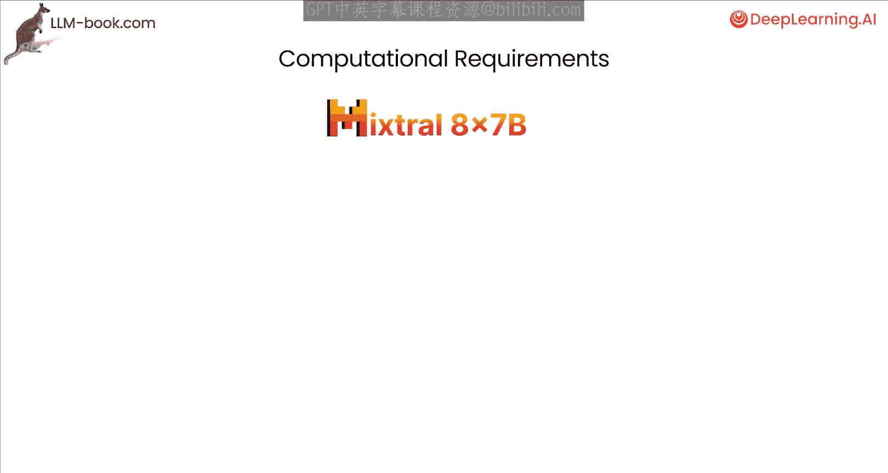

The share parameters of Mi are those that are always used。

 both when you load the model and when you run inference。

The largest number of parameters can be found in the attention mechanism with more than a billion parameters。

Note that the router is a relatively small model with only 32，000 parameters。

Mixroll indeed has eight experts。But each expert actually has 5。

6 billion parameters and not to suggest it 7 billion。

Most likely the authors added the shared parameters to the parameters of the experts。

 which would indeed result in 7 billion parameters。It is a bit misleading。

 as the shared parameters shouldn't be counted towards the experts， as those are not expert specific。

Together， the experts make up for 45 billion parameters。

Which is the majority of the parameters of this model。So when you load Mi。

 you will load all 46 billion parameters。Running the model and performing inference requires the shared parameters。

However， Mitra only selects two experts at a given time。

 greatly reducing the parameter count during inference。

Although the sparse parameters might seem large during inference。

 the model actually uses much fewer resources。 This makes Mo models excellent when you run them in production。

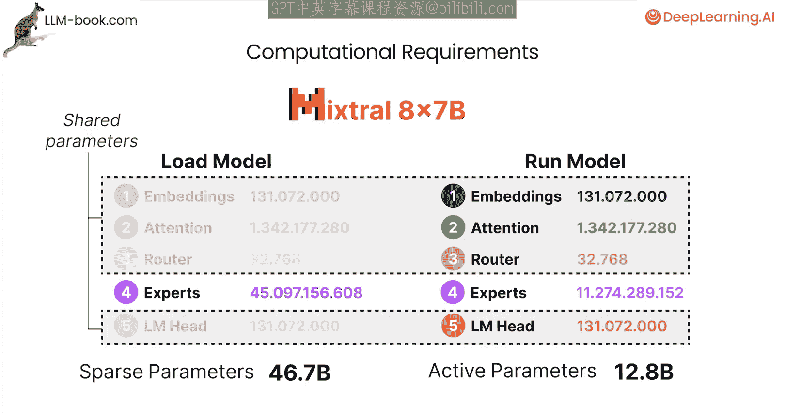

There are a number of pros and cons to this architecture。

Although you will need a lot of memory to load the model。Running inference requires fewer Fam。

 A GPU's memory。Theres also a risk of overfitting on a single expert。

 which requires careful balancing of the model。However。

 its performance tends to be higher than traditional models。

 as the experts help remove redundancy in computations。Finally， this architecture is more complex。

 which requires careful training。But also has a flexible architecture in the experts that are chosen and used。

Moreover， since the mo layer only affects the feet forward neural network and not the intention mechanism。

 non transformformer models can also have mo layers， for instance。

 state space models like Mmba and Yomba as an alternative to transformer models also have mo variant。

 and this makes Mo a very interesting and useful architecture to use across the entire LLM space。

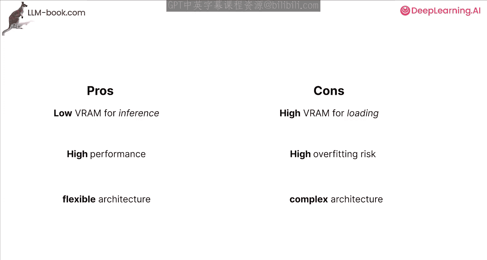