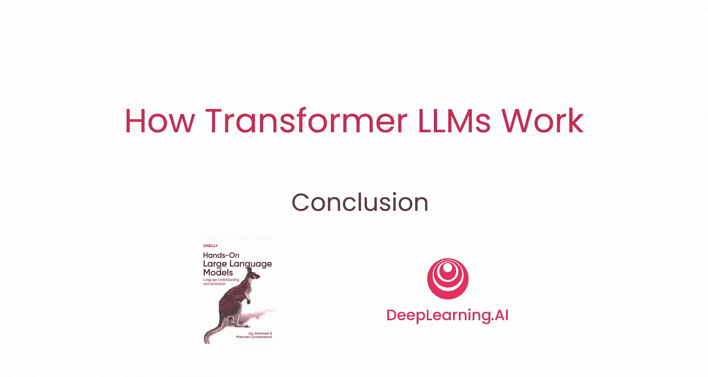

# 吴恩达《Transformer大语言模型工作原理｜How Transformer LLMs Work》（deepseek-R1翻译中英字幕 - P13：13.conclusion.zh_en - GPT中英字幕课程资源 - BV1juNaeREyf

That's it， congratulations， you now have a solid understanding of large language models and transformers。

Martin and I hope you can now see LLMs as more than a black box and that this will help you use them more effectively。

