# 吴恩达《Transformer中的注意力机制：概念与PyTorch代码实现》中英字幕（deepseek-R1纠错+翻译 - P1：1.intro.zh_en - GPT中英字幕课程资源 - BV1AYKpeGEUf

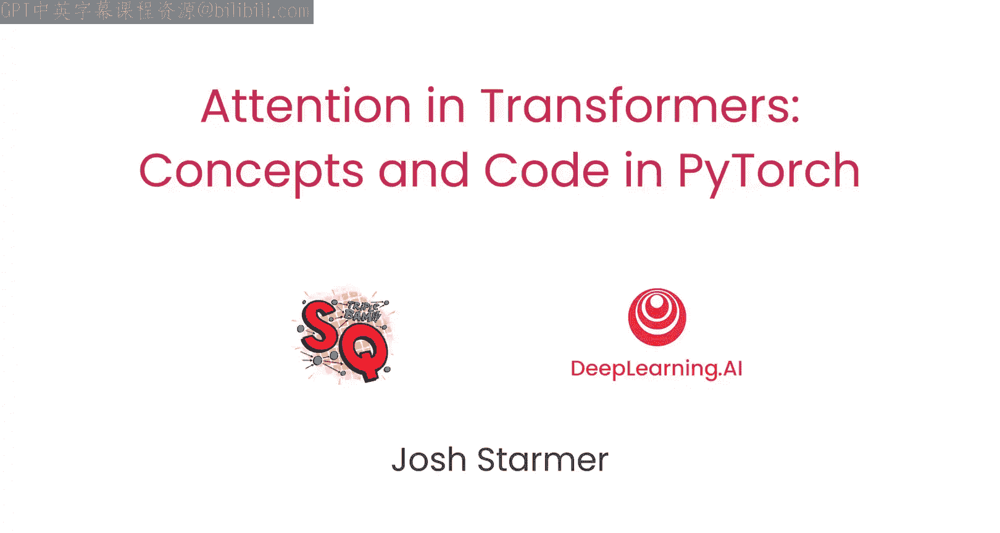

Welcome to Attention and Transformers conceptcepts and Code in Pytorch taught by Josh Tmer Josh is the CEO of StaQu an online provider of educational material and AI data science。

 machine learning and statistics It's my pleasure to be here with you Andrew and to teach this course In this course you learn about the attention mechanism which is a key technical breakthrough that eventually led to transformers you learn about how these ideas developed over time。

 how it works and how this implemented The transformer architecture and the attention algorithm have been hugely important in the development of large language models。

Let me describe some the history and then Josh will dive into the details of the algorithms in implementation with some great illustrations and examples Back 2014。

 a lot of researchers were working on machine translation and de task of say inting a sentence in English and translating it into French。

 a very basic approach were to take each English word and look up the French word that that word translates into。

😊，But this approach doesn't work that well， for example。

 the word order may not be the same in English and in French。Here。

 the English sentence stars the European economic area was。

 but the world order has changed in French。Sentences can also be of different length。

 This three word English sentence they arrive later five words in French to managehis challenges a couple of research groups。

 Joshsha Benjo's group at the University of Montreal and Chriss Man's Group at Saford University independently came up with similar approaches and invented and attention mechanism The papers ci cited here on the slide。

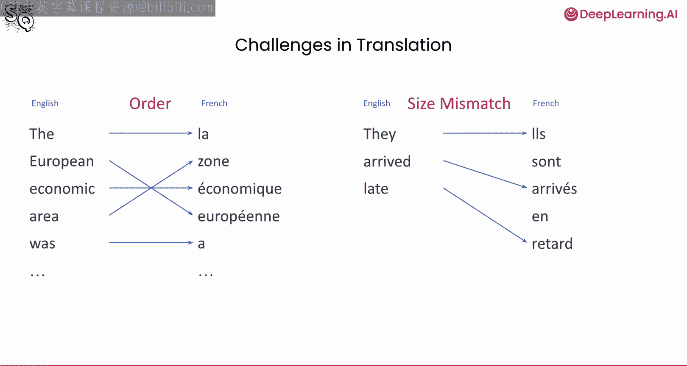

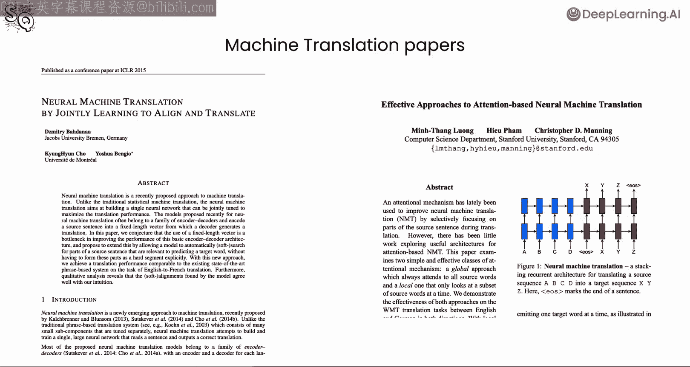

Both research groups found that an encoder decoder mechanism can be effective for translation。

 let me show you how this worked， the encoder reason one word at a time and produces output vectors one per word。

Early approaches had produced a single dense vector that represented the meaning of the entire sentences。

 but in these new papers， the vectors from each individual words were preserved and made available to the decoder。

These dense per word vectors captured the meaning of words in the context of the sentences Today we might call these contextual embeddings when the embedding depends not just on the word。

 but also on the words around it on the context。 Once the input sentence is converted into vectors。

 the decoder then uses these vectors as inputs， the decoder would generate the outputs one word at a time to produce say that French output from the English input。

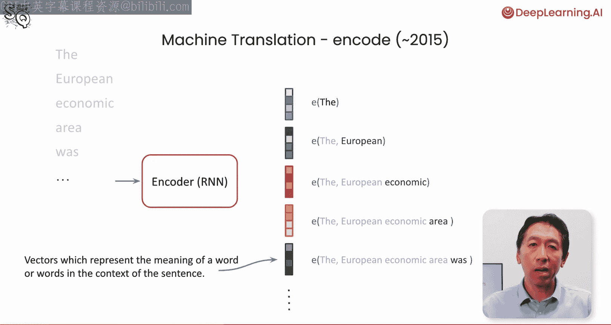

Now， here's the important part。The decoder has a means of waiting。

 or we also say attending to or paying attention to each input word or really each input was embedding。

Independently， based on where it is and the input and where it is in producing the output。

So for example， when the translation starts and is trying to generate the first French word in my way or attend to the first English word in the input most heavily。

For the second word， however， in this example， it will attend to the fourth input vector。

 the vector for area due to the change in word order in fringe。Continuing。

 the model weighs or attends to or pays attention to the wordss most relevant for that step of the translation。

And this gave us an early form of attention。

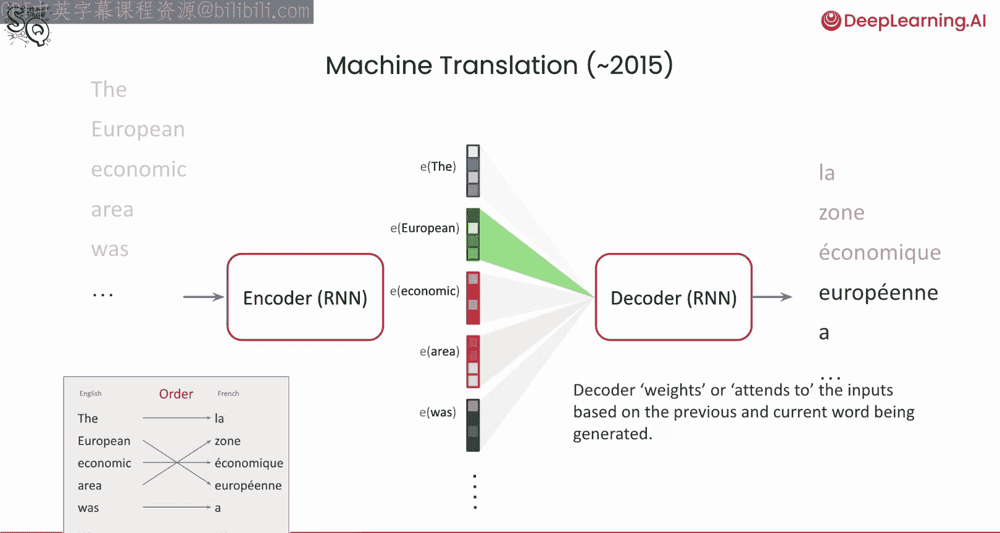

Just a few years later， in 2017， the paper attention is all you need by Ashsh Vaswani， Noam Shazir。

 Nikki Palmer， Jacob Uqueray， Lion Jones， Aden Gomez Lucas Kaiser。

 whos actually done some teaching with DeI and Ia Poloocin was published from my former team The Google praying team。

 This paper introduced the transformer architecture and the more general form of attention which Sha would be describing today。

 and was designed specifically to be highly scalable using GPUs a Cha of Aden。

 and he told me about how back then designed this architecture。

 the number one criteria from law design choices was can be scale this on the GPU and that turned out to be a great decision。

 This paper also studied machine translation and the model described also had an encoder and then also a decoder。

The encodeder creates contextual embeddings for the input sentence in a single pause。

 and the decoder then produces the output one word at a time。

Each output is fed to the input of the decoder to serve as a context for the next step。

 so when it's generated in the next word， it knows one of the previous words that have already generated。

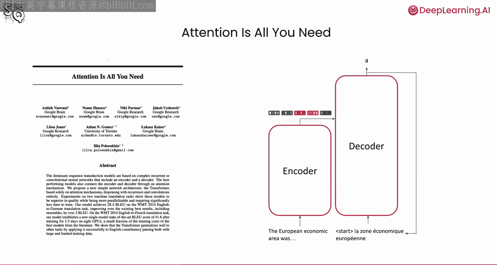

And the encoder model would go on to be the basis for the Bt algorithm。

 BRT stands for bidirectional encoder representations from transformformers。

 which in turn is the basis for nearly all the embedding models you might use to create embedding vectors for rag or recommend applications today。

 the decoder model has since been use as the basis for the GT or generative pretrained transformformer family of large language models that Openia has been building。

 and which you might use in ChGT and this decoder is also the basis for most other popular models such as those from anthropic Google Miral and Me the original paper used just six layers of attention while。

 for example， Lama 3。245b by Me has 126 layers， but the basic architecture is still the same as UV learning with Josh today。

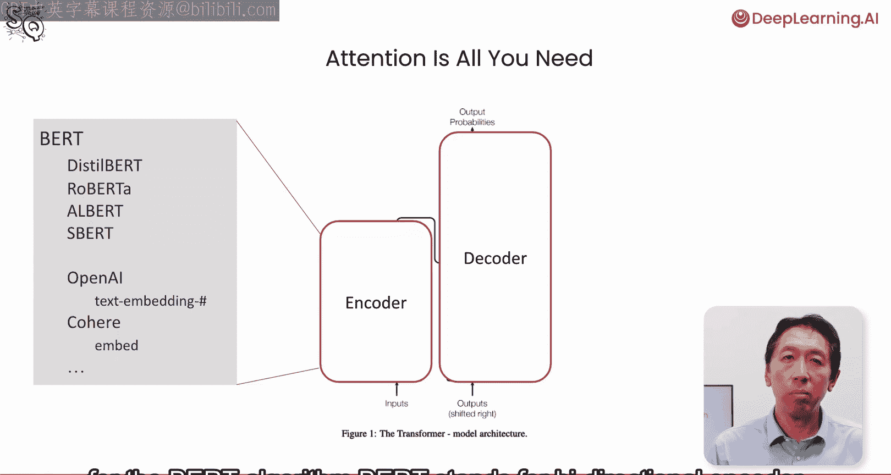

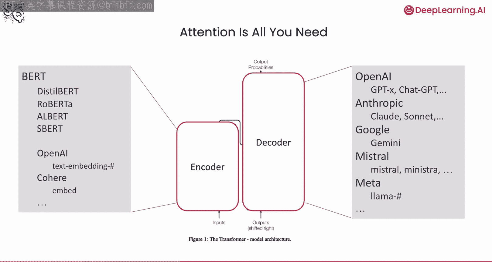

Here's how the course is laid out。 We'll start by describing the main ideas behind transformers and attention and then go on to work through the matrix math and coding of attention。

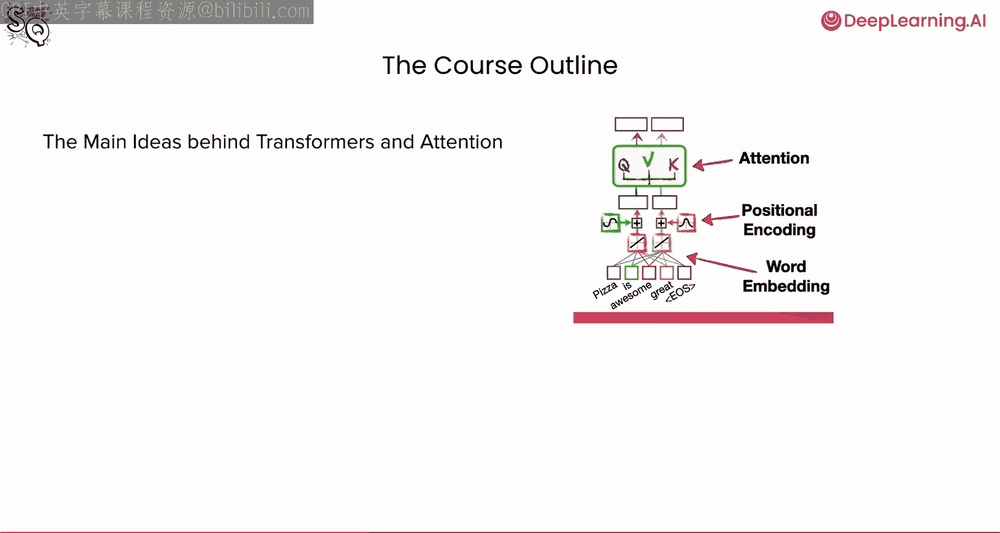

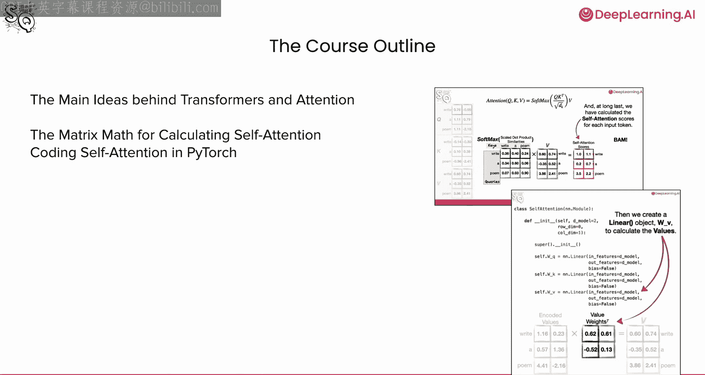

You'll then learn the difference between self attention， masked self attention。

 and work through the pie torch implementation， then you will learn the details of the encoder decoder architecture Andrew just described。

 as well as multi head attention。

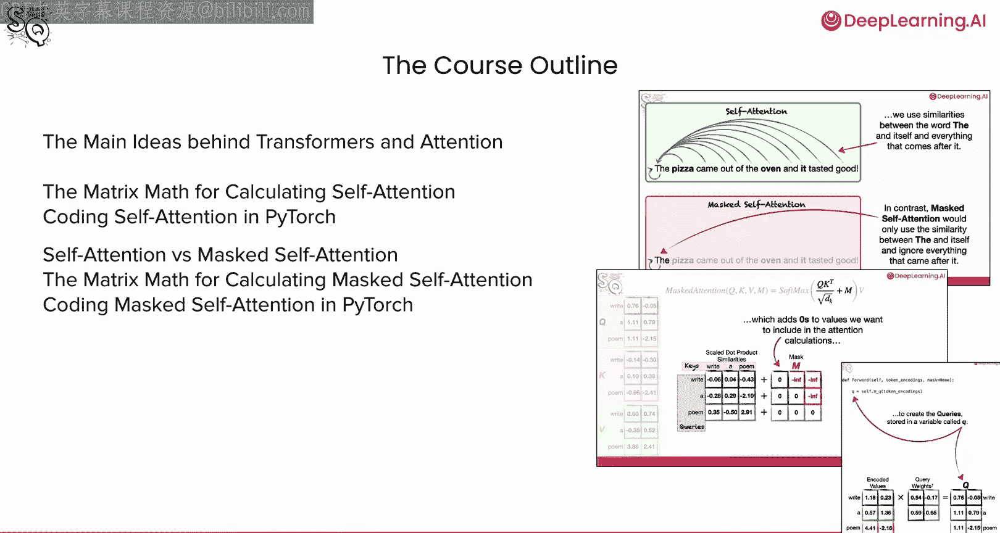

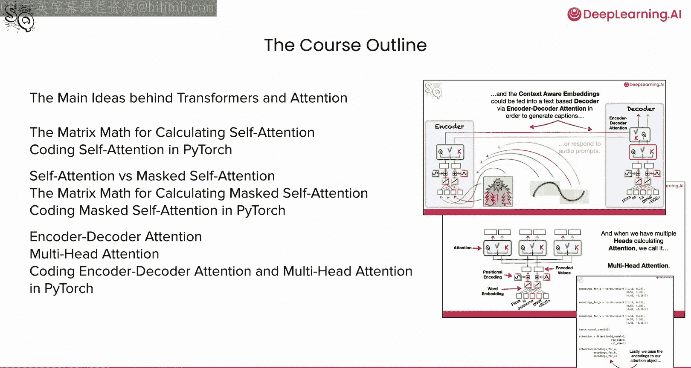

Many people have helped with this course。 I'd like to thank Jeff Lutwig， Eper Ggami and Harun Salami。

 Hey， Andrew， what's with the mask。 Oh， I thought you're going to talk about mass selfatten and I thought I would try to illustrate that。

 Well， clearly I'm selfat。 but maybe this conversation between the two of us we call that trust attention yeah。

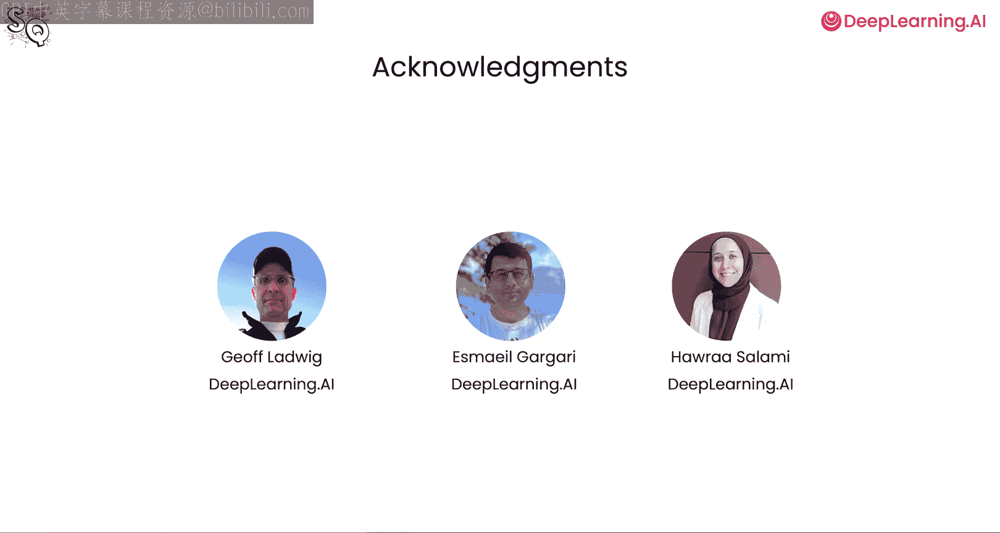