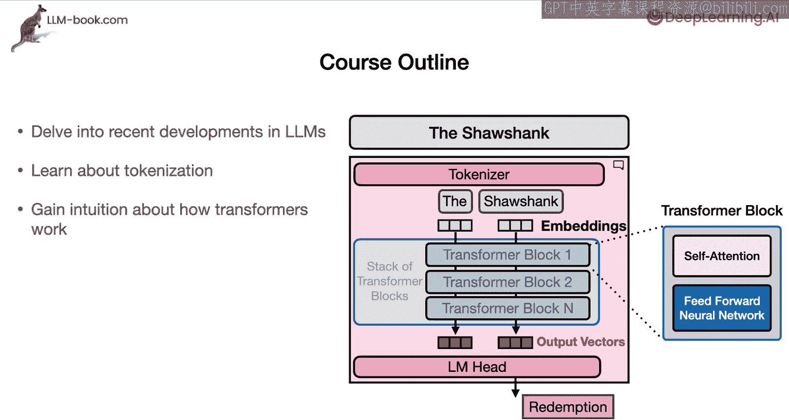
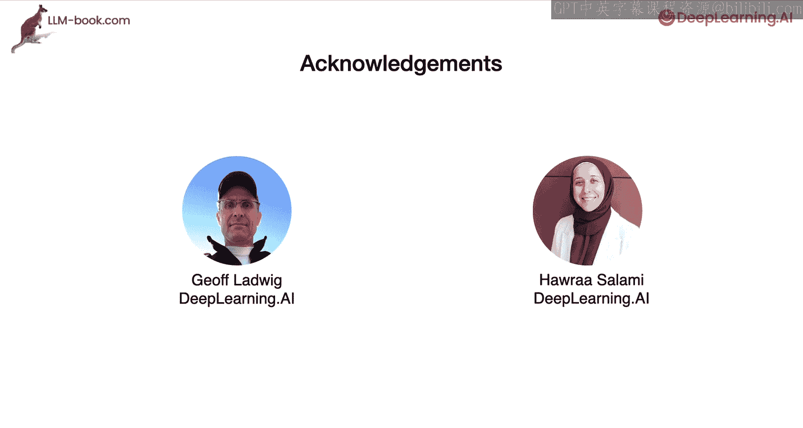
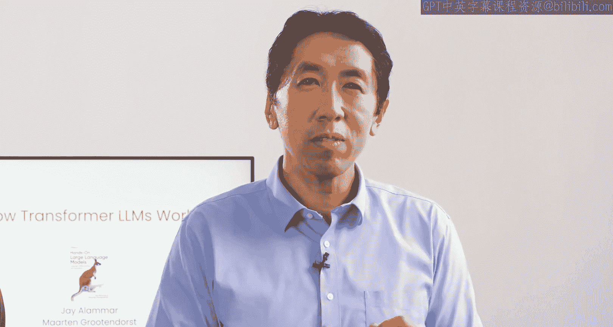

# 吴恩达《Transformer大语言模型工作原理｜How Transformer LLMs Work》（deepseek-R1翻译中英字幕 - P1：1.intro.zh_en - GPT中英字幕课程资源 - BV1juNaeREyf

Welcome to how Transformer As work In this course you learn about the main components of the El transformer architecture that has transformed the field of language processing I'm delighted our instructors for this course are J Lmar and Martin Rutenzs。

In that book， hands on large language models， Jay and Martin beautifully illustrated the underlying architecture of Elms and provided insightful explanations of transformers Thanks Andrew。

I'm so happy to be here today and to have the opportunity for Martin and me to teach this course。

 We wrote our book to provide an easy to understand introduction to transformer based L L Ms。

 This course allows us to present that information in person。😊。

Our hope is that as you leave this course， you will be able to read through papers。

 describing models and understand the details that are used to describe these architectures。

 and these intuitions will help you use LLMs better too。

 Let me add that it is a pleasure to work with you on this。 Andrew。

 I've taken so many of your courses over the years and appreciate all your effort into making machine learning and AI accessible to all。

 We're so happy to add this course to the effort。 Thank you。

 Martin and J is so good to work with all of you。😊，Let me introduce the main topic of this course。

 The Transer。 The Transer architecture was first introduced in the 2017 paper attention is all you need by Ashush Vaswani and others for machine translation task。

 The idea was to say input an English sentence and have the network output a German sentence。

 This same architecture tend up be grade at inputting。

 say a prompt and outputting a response to that prompt。

 like a question and the answer to that question。 And so this helped herald the early rise of large language models。

 The original transformer architecture consisted of two main parts was the namer and a decor。

 Consider translating English into German， the encoder preprosses。

 the entire input English text to extract the context needed to perform the translation。

Then the decoder uses the encoded context to generate the German。

The encoder and the decoder form the basis for the models used in many language models today。

The encoded model provides rich context sensitive representations of the input text and is a basis for the birth model and most of the embedding models using rag applications。

The decoder model performs text generation tasks， such as summarizing text， writing code。

 answering questions， and is the basis for most popular Os， such as those from Open the eye。

 Anthropic， cohere and Me。 Let's go over what you learned in the schools。

You first delve into recent developments in LMs to see how a sequence of increasingly sophisticated building blocks led to the modern transformer You then learn about tokenization。

 which consists of ticking text and breaking it down into tokens that comprise words or word fragments that can then be fed into the LM After that。

 you gain intuition about how the transformer network works， focusing on the decoder only models。

A generative model takes in a text prompt and it generates a text in response by generating one token at a time。

Here's how the generation process works。The model starts by mapping each input token into an embedding vector that captures the meaning of that token。

After that， the model passes these token embeddings through a stack of transformer blocks。

 where each block is a specific neuralne architecture that was designed to learn flexibly from data and also scale well on GPUs。

So you learn how each block is made up of an attention layer and a P4 network。

The model then uses the output vectors of the transformer blocks and passes them to the last component。

 the language modeling head， which generates the output token I'd like to thank from deep learning out AI Jeff Ludwig and Harra Salami for helping with this course。

 By the way， I know that transformers might seem a little bit like magic to some people and in fact。

 one common experience after you learn how transformers work is I've heard some people go oh that's it。

😊。

And I think part of the reason for that reaction is the magic of LMs actually comes from two parts。

 one， the transformer architecture， which you learn is well worth learning， and second。

 all the incredibly rich data that the models learn from So while the magic of LMs comes not just from the transformer architecture but also from the data having a solid intuition of what this architecture is doing will give you better intuitions about why they behave in certain ways。

 as was how to use them， let's get started with Martin in the first lesson。😊。

