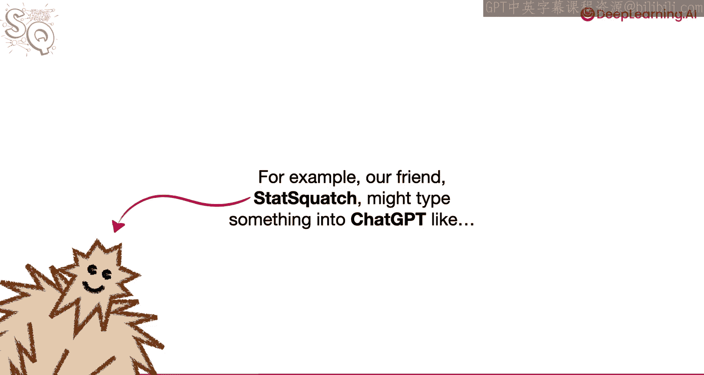
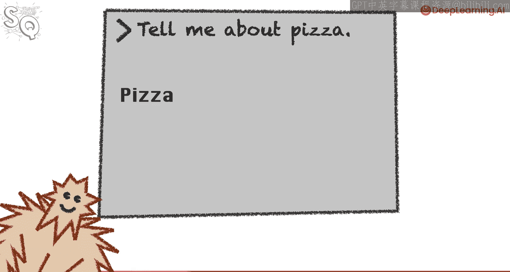
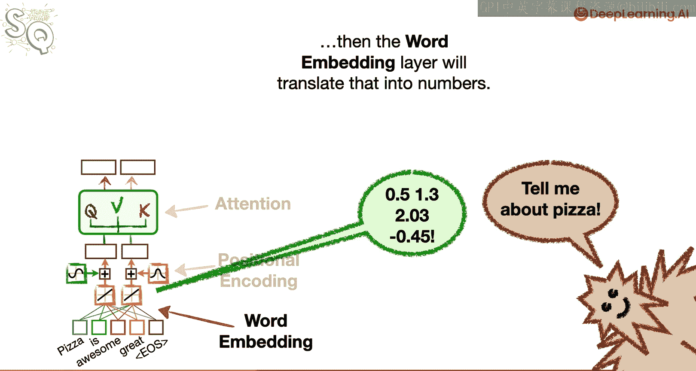
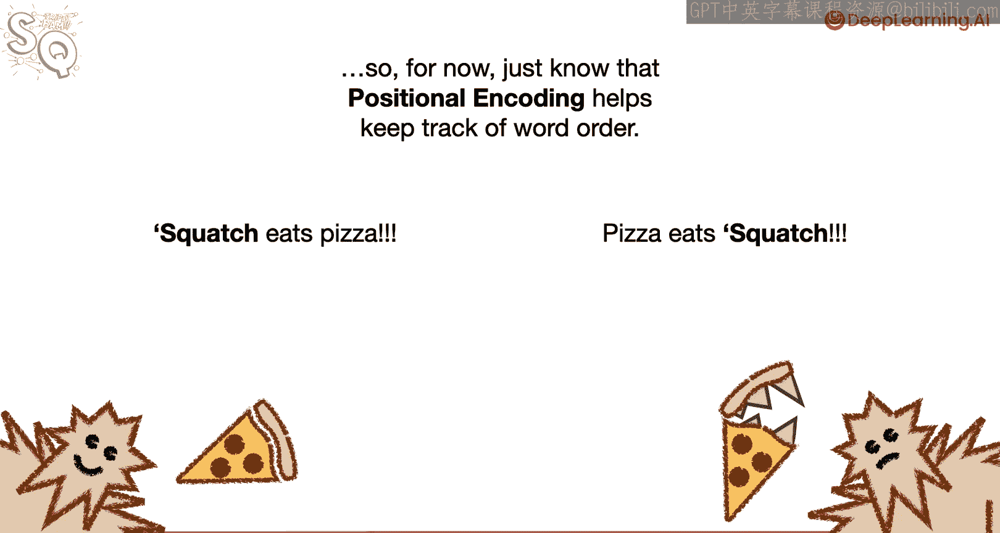
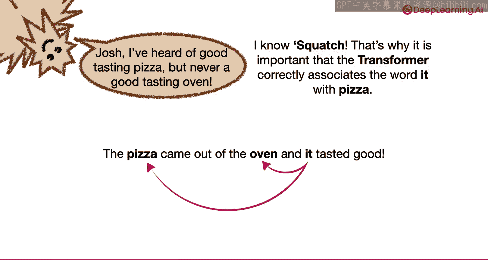
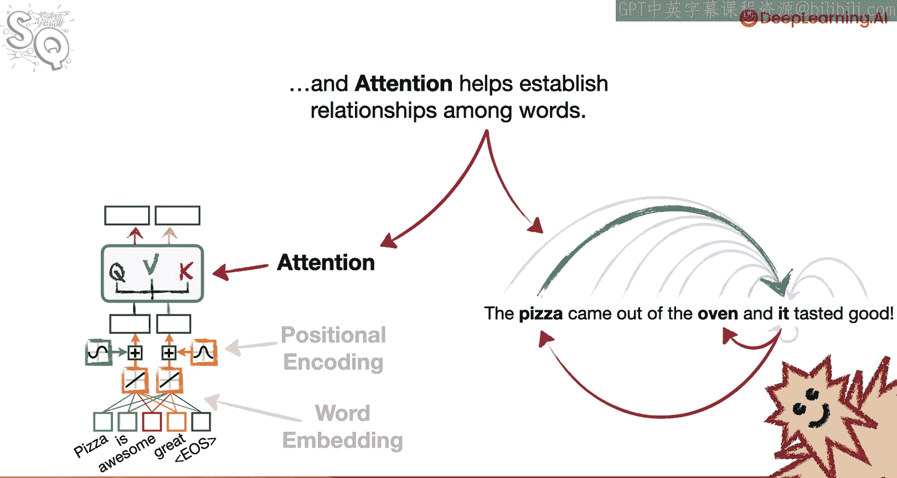

# 吴恩达《Transformer中的注意力机制：概念与PyTorch代码实现》中英字幕（deepseek-R1纠错+翻译 - P2：2.main ideas behind tansformers and attention.zh_en - GPT中英字幕课程资源 - BV1AYKpeGEUf

Right now， people are going bonkers about something called Chat E PT。For example， our friend。

 Stat squtch might type something into Chad G B T。 like tell me about pizza。 P is awesome。😊。

Bm。Anyway， there's a lot to be said about how Chay P T works， but fundamentally。

 it is based on something called a transformformer。 Transformers can look complicated。

 but fundamentally， they require three main parts。Word embedding， positional encoding and attention。

The first part， word embedding converts words， bits of words。

 and symbol collectively called tokens into numbers。

We need this because transformers are a type of neural network。

 and neural networks only have numbers for input values。 So if the input is， tell me about pizza。

 then the word embedding layer will translate that into numbers， bam。

Now that we understand the purpose of word embedding， let's talk about positional encoding。

 which helps keep track of word order。For example， if Norm said sququach eats pizza。

 then sququatch might say yum。In contrast， if Norm said pizza eats squatch。

 then squatch might say yikes。So these two phrases， sququaash eats pizza and pizza eats squch。

 use the exact same words， but have very different meanings。

 So keeping track of word order is super important。

There are a bunch of ways to implement positional encoding。

But the details are out of the scope of this lesson。So for now。

 just know that positional encoding helps keep track of word order。 Dole bam。

Now that we know that positional encoding helps keep track of word order。

 Let's talk about how a transformer establishes relationships among words with attention。For example。

 if the input sentence was this。The pizza came out of the oven， and it tasted good。Then this word。

 it could refer to pizza， or potentially it could refer to the word oven。Josh。

 I've heard of good tasting pizza， but never a good tasting oven。 I know sququaatch。

 That's why it's important that the transformer correctly associates the word it with pizza。

The good news is that transformers have something called attention。

 which is a mechanism to correctly associate the word it with the word pizza。Note。

 there are a few different types of attention， as we'll start by describing the most basic self attention。

In general terms， self attention works by seeing how similar each word is to all of the other words in the sentence。

 including itself。 For example， self attention calculates the similarity between the first word。

 the and all of the other words in the sentence。Including itself。

And self attention calculates these similarities for every word in the sentence。

Once the similarities are calculated， they are used to determine how the transformer encodes each word。

For example， if you looked at a lot of sentences about pizza and the word it was more commonly associated with pizza than oven。

 then the similarity score for pizza will cause it to have a larger impact on how the word it is encoded by the transformer。

 bam。Now that we understand the main idea of how attention tries to establish relationships among words。

 we understand the main ideas behind a transformer's three fundamental building blocks。

 Word embedding converts the input into numbers。 positional encoding helps keep track of word order。

 and attention helps establish relationships among words。

Triple bound。