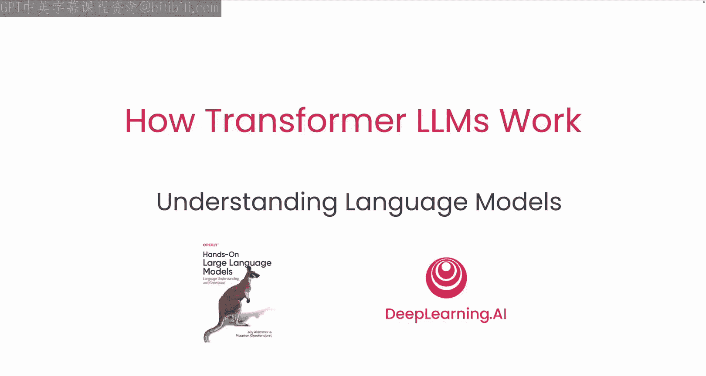
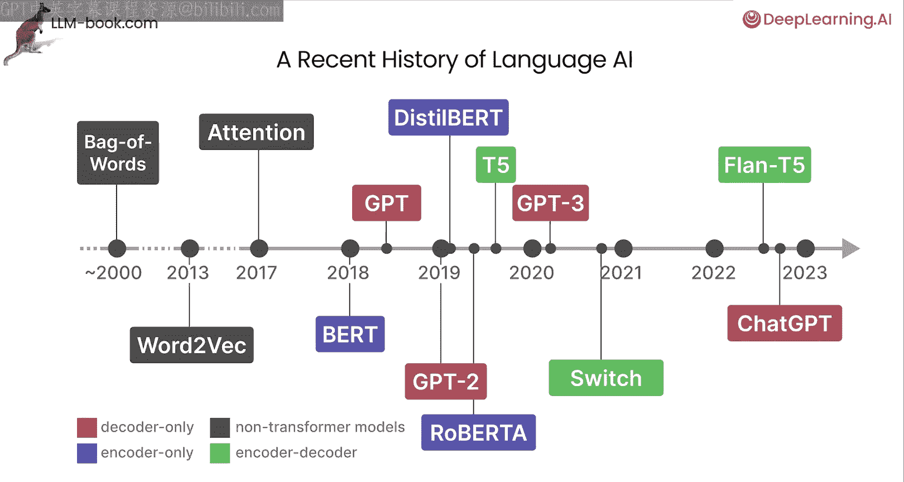
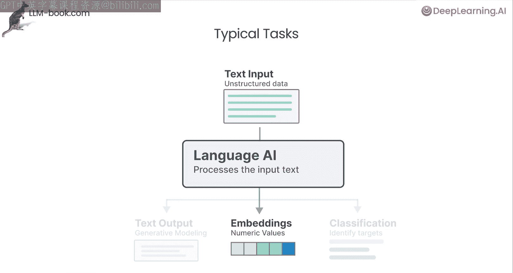
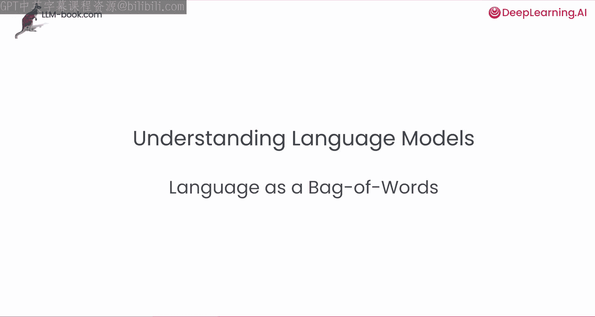
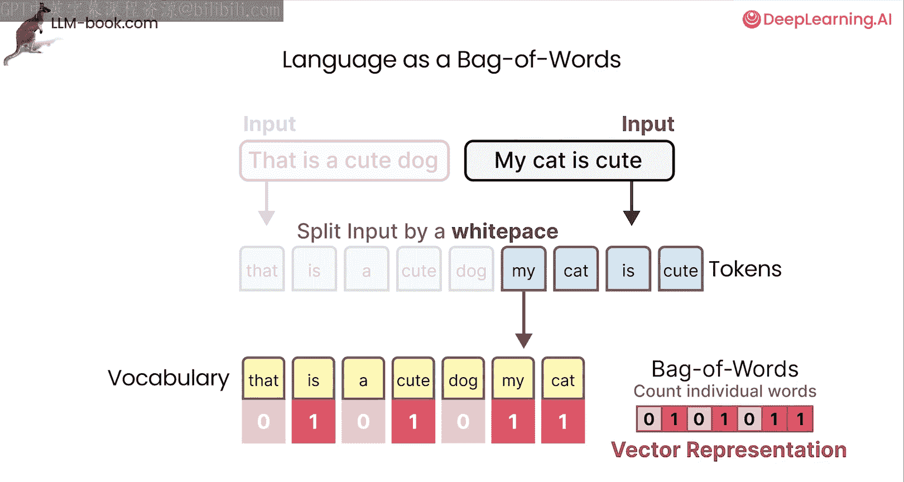
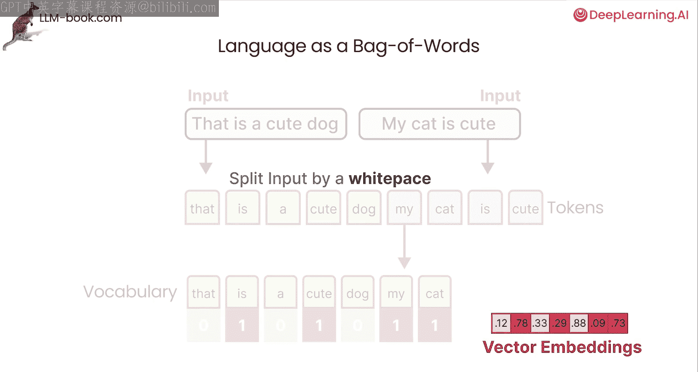

# 吴恩达《Transformer大语言模型工作原理｜How Transformer LLMs Work》（deepseek-R1翻译中英字幕 - P2：2.understanding language models(Word2Vec embeddings).zh_en - GPT中英字幕课程资源 - BV1juNaeREyf

In the next several videos， you will learn the evolution of how language has been represented numerically。

 will start with bag of words， an algorithm that represents words as large sparse vectors or arrays of numbers。

 which simply record the presence of a word。Then were tovaec。

 whose word representations captured the meaning of words in the context of a few neighboring words。

Finally， transformers whose dense factors capture the meaning of words in the context of a sentence or a paragraph。

All right， let's jump in。 I have some illustrations that will help clarify these ideas。

 Although we will explore a more recent history of language AI and language models。

 it is important to understand where we started。😊，Earlier techniques such as bag of words and word to fact have been arguably the foundation of what we're using to day。

 Although they lack contextualized representations， they are often a good baseline to start with。

We call these non transformer models since today's models are typically powered solely by transformer models。

 in contrast to the strong baseline。Then we have encoder only models。

 which are great at representing language in numerical representations。In contrast。

 decoder only models are generative in their nature。Their main usage is to generate text。And finally。

 we have encoder decoder models that attempt to get the best of both worlds。

You will learn about these non transformer models， encoders， decoders。

 and how they relate as we explore this more recent history of language。 AI language， however。

 is a tricky concept for computers。 Text is unstructured in nature and loses its meaning when represented by zeros and wants or individual characters。

As a result， throughout the history of language AI。

 there has been a large focus on representing language in a structured manner so that it can more easily be used by computers。

From generating text to creating numerical representations and classifying textual input。

 these are just a few of the numerous tasks you can do with language AI。

At the start of this language， AI field， the focus was mainly on representing language to analyze unstructured data。

 A first and still very relevant method is by representing language as a bag of words。

 Imagine you have some input text。 That is a cute do。 to represent this sentence。

 You can break it up into smaller pieces。

To do so， you split the text into words by separating them through a white space。

This process of converting the input textt into pieces is called tokenization。

 and each individual word is called a token。 Note that a token can be even smaller than an entire word。

 but we will go through tokenization in the next lesson in more detail。

 You can perform the same tokenization process with another document。 My cat is cute。

 Although similar documents， they do contain different words and have a different meaning。

Now that you are left with two sets of tokens， you can create something called a vocabulary。

This vocabulary contains all unique words or tokens found in both input documents。 As such。

 the vocabulary will contain fewer words than the amount of tokens that were generated。

And we typically refer to the number of tokens or words in the vocabulary as the vocabulary size to then represent one of our inputs with numerical values。

 Let's focus a bit on our second input。 My cat is cute。

This input has four tokens that match with some of the words in the vocabulary， but now。

You can then count how often a certain token appears in the vocabulary that we already created。

In this case， each token appears once。 However， you will also have to take note of the words in the vocabulary that do not appear in the input。

 A sentence not only gives meaning to the words it contains， but also to the words it doesn't。

 Now that you have counted how often the words or tokens of our input appear in the vocabulary。

 you have created your numerical representation。 This is called a bag of words。

 And does nothing more than counting individual words that appear in the vocabulary。Therefore。

 the numerical representation of my cat is cute is 0，1，0，1，0，1，1 in that specific order。

 The order is important， as it allows us to compare different sentences to one another。In practice。

 we call this a vector representation a list of numerical values that represents the input。

 In this example， these values are counts and have an explicit meaning。 Namely。

 the number of times a word in vocabulary appears in the input。

Factor representations in more complex and advanced models typically do not have such an intuitive meaning and have values between 0 and1。

 Let's go to the next video and learn how these factor embeddings are created。

