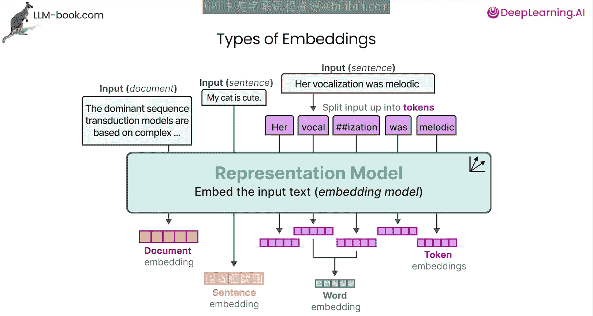
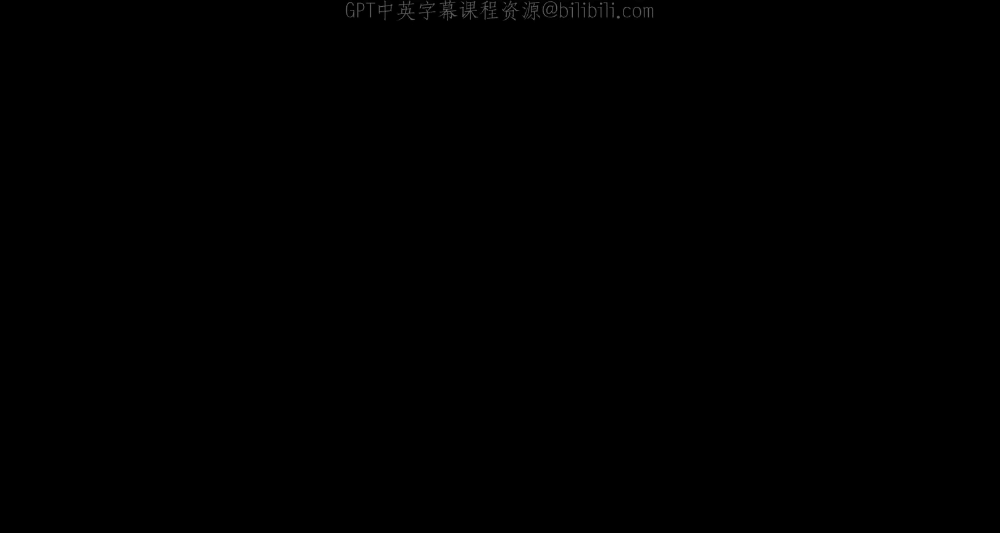

# 吴恩达《Transformer大语言模型工作原理｜How Transformer LLMs Work》（deepseek-R1翻译中英字幕 - P3：3.understanding language models( word embeddings).zh_en - GPT中英字幕课程资源 - BV1juNaeREyf

Let's explore how these more complex factor embeddings are created。 Note that bag of words。

 although an elegant approach， has a flaw。It considers language to be nothing more than an almost literal bag of words and ignores the semantic nature or meaning of text。

 released in 2013， Wordtuveec was one of the first successful attempts at capturing the meaning of text in embeddings to do so。

 Wetuvec learned semantic representations of words by training on vast amounts of textual data。

 like the entirety of Wikipedia。😊，To generate these semantic representations。

 where Tvec leverages neural networks。These networks consist of interconnected layer of nodes that process information。

Neurural networks can have many layers， which each connection has a certain weight。

 depending on the inputs。These weights are often referred to as parameters of the model。

Using these neural networks， word tovaag generates word embeddings by looking at which other words they tend to appear next to in a given sentence。

You start by assigning every word in your vocabulary with a vector embedding。

 say five values for each word is initialized with random values。Then in every training step。

 you take pairs of words from training data and a model attempts to predict whether or not they are likely to be neighbors in a sentence。

During this training process， Wordtu fact learns the relationship between words and distills that information into the embedding。

If the two words tend to have the same neighbor， their embeddings will be closer to one another and vice versa。

The resulting embeddings captured the meaning of words。

But what exactly does that mean to illustrate this phenomenon， Let's explore an example。

Assume that you have an embedding for the word cats。

This embedding has generate values between minus1 and1。

Ebeddings attempt to capture meaning by representing the properties of words。For instance。

 the word cats might score low on the properties， new born and human and fruit。

Whilst scoring high on the properties， animal and plural。

The number of properties or values an embedding has is called the number of dimensions and is generally a fixed size。

The same can be said for other words， such as puppy， which scores high on animal and newborn。

 but low on all others。By doing this for a number of words。

 you can use these values to get a proxy of the meaning of these words。

Note that the number of dimensions can be quite large。

 where it is not uncommon to see embeddings with more than1 thousand00 values。However， in practice。

 you do not actually know what these properties exactly represent。

 as they are learned through complex mathematical calculations。

These properties do allow you to compare embeddings， and therefore， words with one another。

 Words with similar meaning will be grouped together， whereas different words are further apart。

How similar or dissimilar certain words are depends on the training data。Thus far。

 we explored word embeddings， but there are many types of embedding that we can use。

When we talk about a model like wordtu Vec that converts textual input to embeddings。

 we refer to it as a representation model as it attempts to represent text as values。

Imagine that you have some input。 For example， the sentence rev vocalization was melodic。

Through tokenization， you can split that sentence up into tokens。

 Note that this procedure is actually not splitting the input by white spaces。

 The word vocalization is split up into vocal and aation。

 The reason for this is that models that perform tokenization also called tokens have a fixed vocabulary。

 As such， they cannot represent all words that exist。

 but sometimes have to find combinations of words。You give the representation model of these individual tokens。

 which in turn generates these embeddings， one for each token。

Note that the word vocalcalization contains the token's fo andization。

So when you average the embeddings of these tokens。

 you get a word embedding as it now represents the entire words。

Similar techniques can be used for entire sentences to create sentence embeddings。

And the same for longer texts， such as documents to create a document embedding。

These are just a few of the many embeddings that exist。

 Join me in the next video to learn how you can encode and decode contextualized information rather than static representations。

