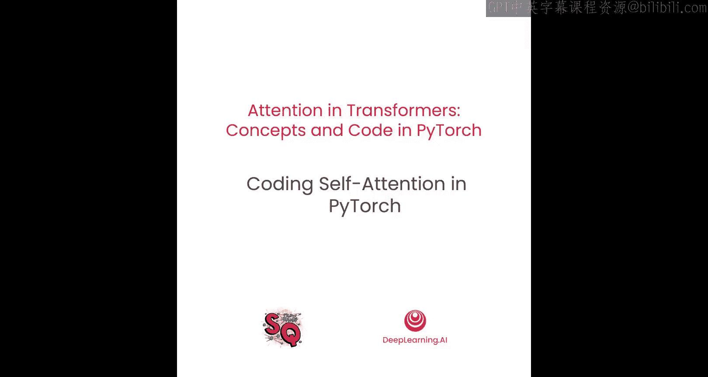
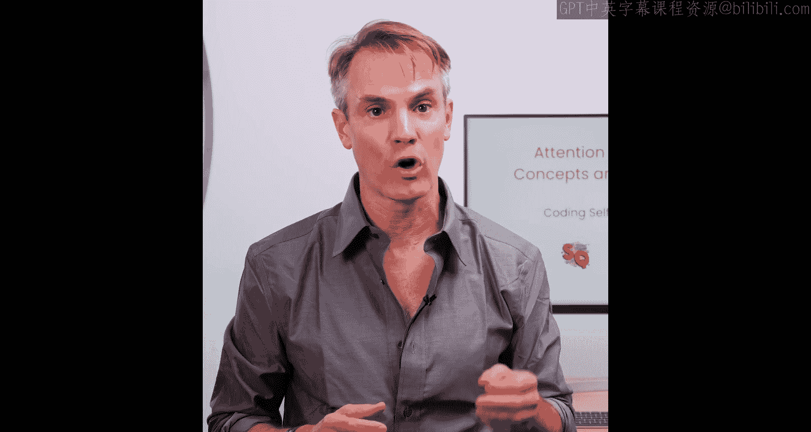
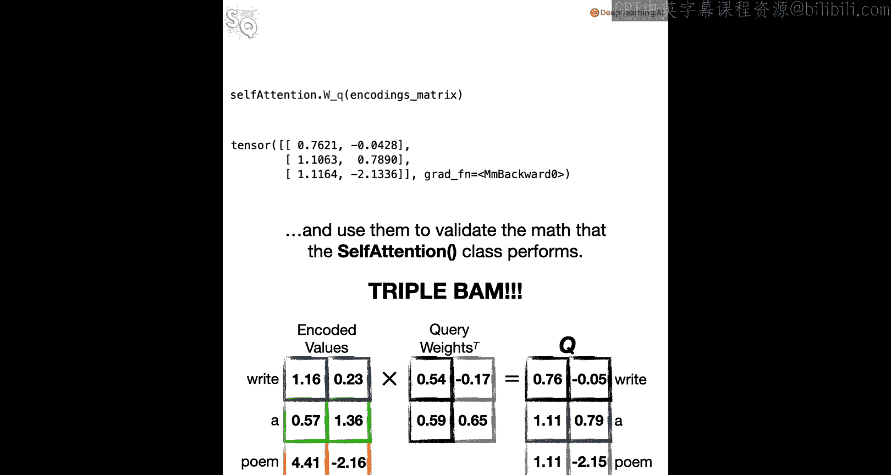

# 吴恩达《Transformer中的注意力机制：概念与PyTorch代码实现》中英字幕（deepseek-R1纠错+翻译 - P4：4.coding-self-attention-in-pytorch.zh_en - GPT中英字幕课程资源 - BV1AYKpeGEUf

In this lesson， you'll use pi torch to code a class that implements self attention。

 you'll also run some numbers through it and verify that the calculations are correct。 All right。

 let's code。

The first thing we do is import torch to create the tensors we will use to store the raw data and to provide a few helper functions。

Note， if you are not already familiar with tensors。

 then just think of them as multidiional lists optimize for neural networks。Then we import Torch。

nn for the module and linear classes and a bunch of other helper functions。Then we import Torch。

 nN dot functional to access the softm function that we will use when calculating attention。

Now we'll code a class that implements self attention。

So we start by defining a class called self attention。That inherits from an in dot module。

In in dot module is the base class for all neural network modules that you make with P torch。

The first thing we'll do in our new class is create an init method。In this case。

 we're passing the inent method， a D underscore model， the dimension of the model。

 or the number of word embedding values per token。We'll use D model to define the size of the weight matrices that we'll use to create the queries。

 keys， and values。For example， if D model equals 2。

 meaning we're using two word embedding values per token。And thus。

 after adding positional encoding to each word embedding， we have two encoded values per token。

Then to grade the queries， we'll multiply the encoded values for each token by a two by two weight matrix。

We're also passing in some convenience parameters so that we can easily modify the row and column indexes in our data。

Usually the first dimension is the batch size， but in this example we won't be using batches of data。

However， at some point in the future， we might want to use batches of data and we can adjust these parameters then。

Next， we call the parents a knit method。 Otherwise。

 there's no point inheriting from a class to begin with。Now。

 in order to create the weight matrix that we will use to calculate the query values Q。

We use NN dot linear， which will create the weight matrix and do the math for us。

N features defines how many rows are in the weight matrix， so we'll set it to D model。

And out features defines the number of columns in the weight matrix， so we set it to D model as well。

Lastly， in the original transformers's manuscript， they don't add additional bias terms when calculating attention。

 so we won't either by setting bias equal to false。As a result。

 we end up with an object we're calling W subq that holds the currently untrained weights needed to calculate query values。

And because W subq is a linear object， it doesn't just store the weights。

 but it will also do the math for when the time comes。Note， just as a reminder。

 I've labeled the query weights matrix with the transpose symbol。

Because of how pie torch prints out the weights。Also， note。

 there are really no rules about the shape of the weight matrices。

So feel free to modify the code later to have other dimensions。

 just make sure that the matrix multiplication still works out。

Then we do the exact same thing to create a linear object。

 a W sub K that contains the weights needed to calculate the keys。Then we create a linear object。

 W sub V to calculate the values。The last thing we do in the init method is save the row and column indexes。

We then add a forward method to the self attention class。

The forward method is where we actually calculate the self attention values for each token。

And werere passing it， the token encoings。Which are the word embeddings。

 plus positional encoding for each input token。Now we pass the token encodings。To W subq。

 the query weight matrix。And that does the matrix multiplication。

And returns the queries stored in a variable called Q。Then we calculate the keys and store them in K。

And we calculate the values and store them in V。Now， using the matrices we just created。

 we calculate self attention。We start by using torch dot mat Mole to multiply Q by the transpose of K。

To calculate the similarities between all possible combinations of queries and keys。

Then we scale the similarities by the square root of the number of values used in each key。

The next thing we do to calculate attention is run the scaled similarities through a soft max function。

Remember， applying the softm function to the scaled similarities determines the percentages of influence that each token should have on the others。

Which is why we store the results in a variable called attention per。Lastly， we use Torch。

 mat Mole to multiply the attention percentages by the values in V。

And that gives us the final attention scores stored in attention scores。Which we return。Altogether。

 the self attention class looks like this。Dm。Now let's run some numbers through it and make sure it works as expected。

We'll start by using torch dot tensor to create a matrix of encodings for three tokens。The result。

 which we're calling encoding's matrix， looks like this。

Now we're going to seed the random number generator with torch dot manual seed so that hopefully we'll all get the same results。

Then we create an object from our self attention class。With D model set to2。

And the row index set to0 and the column index set to 1。

This will create a new object that we are saving as self attention。

That has initialized the weight matrices that we need to calculate the query， key and values。Lastly。

 we pass self attention， the encodings matrix。Because the self attention class inherits from in in dot module。

 it will pass the matrix to the forward method that we wrote。

And the result should be a matrix of self attention values that looks like this。Double boundm。Note。

 if you got something else， don't panic。In just a bit。

 we'll validate that the math was done correctly regardless of the output we see here。Also note。

 this last bit of the tensor is used for training the weights with back propagation。

Since we're only coding a self attention class and not a full transformer。

 we won't actually be doing any training。But at least you know what this bid is for。Small bam。

To validate that the math was done correctly， we can start by printing out the weights in the matrix that we use to calculate the queries by transposing the weight property associated with W sub Q。

And we should get a two by two matrix like this。Likewise， we can print out the weights in W sub K。

And we can print out the weights in Ws sub V。Now， combining these weight matrices。

And the original encodings matrix。We can calculate the query， key and value matrices by hand。

Or we can pass the encodings matrix directly to W subq to calculate the queries。In other words。

 we can extract the weights that the self attention object is using to do calculations。

And use them to validate the math that the self attention class performs。

Triple boundm。