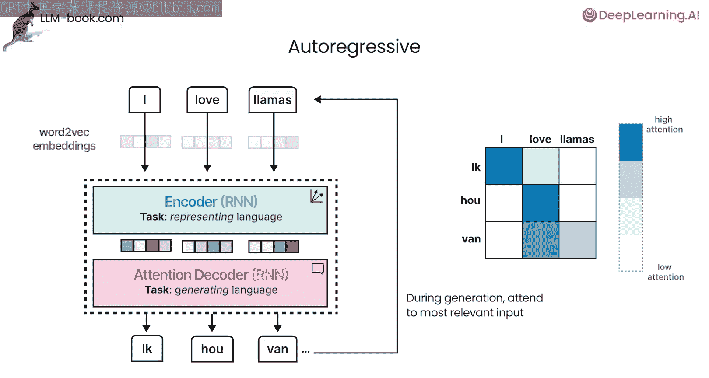

# 吴恩达《Transformer大语言模型工作原理｜How Transformer LLMs Work》（deepseek-R1翻译中英字幕 - P4：4.understanding language models( encoding and decoding context with attention) - GPT中英字幕课程资源 - BV1juNaeREyf

In the previous videos， we explored word and token embedding techniques。

 but with limited contextual capabilities In this video。

 we will explore how you can encode and decode context with attention。

 word to that create static embeddings。 The same embedding is generated for the word bank。

 regardless of the context。 bank can refer to both a financial bank， as well as the bank of a river。

😊，Its meaning and therefore， its embedding should change depending on the context。

Capturing the text context is important to perform some language tasks， such as translation。

A step in encoding this text was achieved through recurrent neural networks or R andNs。

These are variants of neural networks that can model sequences as an additional input。To do so。

 these RNNs are used for two tasks， encoding or representing an input sentence and decoding or generating an output sentence。

Let's explore this by showcasing how this input sentence I love Lamas， gets translated to Dutch。

The text is passed to the encoder， which attempts to represent the entire sequence through embeddings。

The decoder then uses those embeddings to generate language。

Here it translated the English I love Lamas to the Dutch Ihaon Lamas。

Each step in this architecture is auto regressive。When generating the next word。

 this architecture needs to consume all previously generated words。 For instance。

 you take the input I of laamas。The model then generates the first token。

 which is I to then generate the next token。 the output I is appended to the inputs。In step 2。

 the input is now I love Lama's I， which in turn generates the output how。

You can continue this process at each step and continuously update the input with a previously generated token。

Until the entire output is generated。Most models are auto regressive and will therefore generate a single token each time。

Let's explore this encoding and decoding in a bit more detail。

You again start with the input sentence， I love Lamas， tokenized into tokens。

We can use word to V to create the embeddings as the input。

 although these embeddings are static by themselves。

 the encoder processes the entire sequence in one go and takes into account the context of the embeddings。

The encoding step aims to represent the input as well as possible。

And generates the context in the form of an embeending。This decoder， in turn。

 is in charge of generating language。And does so by leveraging the previously generated context embedding。

To eventually generate the outputs。As we explored previously。

 these output tokens are generated one at a time， which is called auto regressive。

 This context embedding， however， makes it difficult to deal with longer sentences。

 since it is merely a single embedding representing the entire input。

 So the single embedding might fail to capture the entire context of a long and a complex sequence。

In 2014， a solution called attention was introduced that highly improved upon the original architecture。

 At allows a model to focus on parts of the input sequence that are relevant to one another or attend to each other and amplified their signal。

 At selectively determines which words are most important in a given sentence。

Take our inputs and output sequences， for example。Words with similar meaning like I and the Dutch Ich。

 which are synonyms， have higher attention weights since they are more related。

I and Laamas have lower attention weight since they do not relate much to each other in this particular sentence。

And the same applies to all other words。By adding these attention mechanisms to the decoder step。

 the RNN can generate signals for each input word in the sequence related to the potential output。

You can again represent the input using word to V embes and pass those to the encoder。

Instead of passing only a context embedding to the decoder。

 the hidden states of all input words are passed to the decoder。

 A state for a word is an internal factor from a hidden layer of an R N that contains the information about the previous words。

 The decoder then uses the attention mechanism to look at the entire sequence。Finally。

 this again generates the language due to this attention mechanism。

 the output tends to be much better since you now look at the entire sequence using embedding for each token word instead of the smaller and more limited context embedding。

So during generation， the model attends to the most relevant input after having generated Ihaon using the input I love Lamas。

 the attention mechanism then highlights words that are more relevant in this particular example。

 The sequential nature of this architecture precludes parallelization during training of the model。

 Let's go to the next video and learn how attention is used in transformer models。😊。

