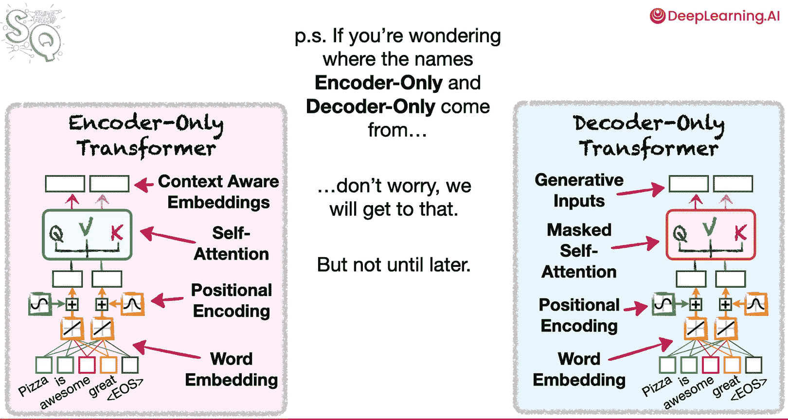

# 吴恩达《Transformer中的注意力机制：概念与PyTorch代码实现》中英字幕（deepseek-R1纠错+翻译 - P5：5.self-attention-vs-masked-self-attention.zh_en - GPT中英字幕课程资源 - BV1AYKpeGEUf

This lesson dives in deep to explore the strengths and weaknesses of self attention versus mass self attention。

 Although the differences are subtle， they have a huge effect on the types of problems you can solve with each type of attention。

 Let's dive in。So far， we've learned the main idea behind attention。

 that it helps establish relationships among words。And we illustrated attention with the sentence。

The pizza came out of the oven， and it tasted good。 where the word it。Could refer to pizza。

Or potentially， it could refer to the word of。We then talked about how attention and specifically self attention calculates similarities among the words and uses those similarities to make the correct association between it and pizza。

However， self attention is just one type of attention。

 and the type we use can have a profound effect on what we can do with it。

In order to understand these profound differences， let's start by diving into the things we can do with self attention。

And that means first talking a little more about how transformers convert words into numbers with word embedding。

One super easy way to convert words into numbers is to just assign each word to a random number。

For example， if sququaatch just ate a delicious pizza， they might say。Pizza is great。

And we could assign a random number to each word。Now， if Nor came along and said。Pizza is awesome。

Then we could reuse the random numbers that we already assigned to Pizz and I。

And assign a new random number to awesome。In theory， this is fine。

But it means that even though great and awesome means similar things and are used in similar ways。

They have very different numbers associated with them。

And that means the neural network will probably need a lot more complexity and training because learning how to correctly process the word great won't help the neural network correctly use the word awesome。

So it' be nice if similar words that are used in similar ways could be given similar numbers。

So that learning how to use one word will help learn how to use the other at the same time。

And because the same words can be used in different contexts or made plural or used in some other way。

 it might be nice to assign each word more than one number。

 so the neural network can more easily adjust to different contexts。For example。

 the word great can be used in a positive way， like pizza is great。

And it can also be used in a sarcastic， negative way， Like my cell phone's broken， great。

And it would be nice if we had one number that could keep track of the positive ways that great is used and a different number to keep track of the negative ways。

😊，Hey， Josh， deciding what words are similar and are used in similar contexts sounds like a lot of work。

 and using more than one number per word to account for different contexts sounds like even more work。

Don't worry， sququach， years before transformers were invented。

 people created standalone neural networks to create word embeddings for us。

So let's build a simple word embedding network for these two phrases。Pizza is great。

 and pizza is awesome。😊，The first thing we do is create inputs to a relatively simple neural network for each unique word。

Then we create an output for each word。Then we connect all of the inputs to at least one activation function。

And in this example， we'll connect the inputs to two activation functions。

The number of activation functions determines how many numbers we will use to represent each word。

In this case， since we have two activation functions。

 we'll end up with two numbers or word embeddings representing each word。Then we add weights。

 numbers we multiply the inputs by to the connections from the inputs to the activation functions。

These weights， which are the word embedding values。Are initialized with random numbers。 So right now。

 they're not very useful。But the plan is to train them and thus change them using this data。Lastly。

 we connect the activation functions to the outputs with some boring details that we don't need to worry about right now。

Because we have one word embedding for each word going to the activation function on the top。

And one word embedding for each word going to the activation function on the bottom。

We can plot each word on a graph。That has the top word embeddings on the X axis。

And the bottom word embeddings on the Y axis。For example， the word pizza goes here。

Because its top word embedding is negative 0。11。And its bottom word embedding is 0。10。Likewise。

 the word is goes here。Great goes here。And awesome goes here。Now， with this graph。

 we see that the words great and awesome are currently no more similar to each other than they are to any of the other words。

😊，However， because both words appear in the same context in the training data。

 we hope that training the network will make their word embeddings more similar。

The idea is that we want each word in the training data to predict the next word。For example。

 we want the first word in each sentence， pizza。To predict the word that comes after it is。

And we want the word is。To predict the words that come after it， great and awesome。😊。

So in order to see which word the network predicts should come after pizza。

We put a one in the input for pizza。And put zeros in all of the other inputs。

Then we do the math with the randomly initialized parameters。

And we end up predicting great because it has the largest output value，0。45。Thus。

 with the randomly initialized parameters， the network does not correctly predict the word that comes after pizza is。

However， after we train the model。We end up with these new word embeddings。And pizza。

Correctly predicts is。And is。Correctly predicts great and awesome。Now。

 when we graph the words with the new word embeddings， great and awesome， cluster together。😊。

This result is great and awesome， because great and awesome are similar words used in similar contexts。

😊，And they end up with similar word embeddings。Bam。Okay， so far。

 we have seen the simplest way to create word embeddings。

We used a simple network that we train to predict the word that comes after the input。However。

 just predicting the next word doesn't give us a lot of context to determine the optimal word embeddings。

In contrast， if we had a more complicated training data set。

Then we would have more inputs and outputs for our neural network。

And we could connect everything like we did before。But now， because we have more inputs and outputs。

And longer sentences in the training data。We can add more context to the training process。

For example， we can use the pizza came out to predict the next word of。In other words。

 instead of just using one word to predict the next。

We can use the preceding four words to predict the next。

Increasing the context can help create better word embedding values。

But I want to point out that the way we are doing things right now ignores word order。

And because we're not currently keeping track of word order。

 any jumble is just as good as anything else。In other words。

 the pizza came out of would give us the same inputs and output。As the jumbled up phrase。

 pizza out came the of。And as we saw in an earlier lesson。

 word order can be critical to understanding the meaning of the words。Specifically。

 these two phrases。Squach eats pizza。And pizza eats squash。Have the same words。

 but completely opposite meanings。So it would be nice if there were some way to create word embedding values that also took word order into account。

The good news is that is exactly what the positional encoding layer in a transformer does。

 It allows us to take word order into account when creating embeddings。😊。

And that is then followed by an intention layer that， as we saw earlier。

 helps establish relationships among words。And when we use self attention。

 which factors in all of the words， including those that came after the word of interest。

Then we create a new kind of embedding that is sometimes called context aware embedding or contextualized embedding。

Compared to word embedding， which only clusters individual words。

Context aware embeddings can help cluster similar sentences。

And they can even cluster similar documents。Dam。Transformers that only use self attention are called encoder only transformers。

And the context aware embeddings that they can create are super useful。

In addition to clustering sentences and documents。We can use context aware embeddings as inputs to a normal neural network that classifies the sentiment of the input。

For example， we might want to see if people are posting positive or negative statements about pizza on Twitter。

And the context to wear embeddings are great inputs for a neural network that can do that type of classification。

Alternatively， we could use the context aware embeddings as variables in a logistic regression model that does classification。

In summary， the context aware embeddings that encoder only transformers create can be used in a wide variety of settings。

Double bam。So now that we know about the cool things we can do with an encoder only transformer。

 which only uses self attention。Let's talk about another type of transformer called a decoder only transformer。

Like an encoder only transformer， a decoder only transformer starts out with word embedding and positional encoding。

But instead of using self attention。A decoder only transformer uses something called masked self attention。

And the big difference between self attention and masked self attention。

Is that self attention can look at words before and after the word of interest。In contrast。

 masked self attention ignores the words that come after the word of interest。For example。

 when we calculate self attention for the first word the。

 then we use similarities between the word the and itself and everything that comes after it。

In contrast， masked self attention would only use the similarity between the and itself and ignore everything that came after it。

And when we calculate the self attention for the word it， we calculate all of the similarities。

And masked self attention ignores the words that came after the word it。

Because decoder only transformers use masked self attention and can never look ahead at what comes next。

They can be trained to do a really good job generating responses to prompts。

This is because when we train a decoder only transformer。

 we can give it the first part of this sentence up to the word it。

And then modify the weights in the model during training until it generates the rest of the sentence。

 Tasted good。This is why chatt GBT， which is a decoder only transformer。

 is called a generative model。Because it was specifically trained to generate the text that comes after a prompt。

Thus， in contrast to an encoder only transformer， which creates context aware embeddings。

A decoder on my transformer creates generative inputs。

That can be plugged into a simple neural network that generates new tokens。In summary。

Self attention can look at words before and after the word of interest。

And masked self attention ignores anything that comes after the word of interest。

And that relatively small difference has a profound effect on the types of things we can do with encoder only transformers that only use self attention。

And decoder only transformers that only use masked self attention。Triple bam。PS。

 if you're wondering where the names encoder only and decoder only come from。Don't worry。

 we'll get to that。But not until later。

W w。

