# 吴恩达《Transformer大语言模型工作原理｜How Transformer LLMs Work》（deepseek-R1翻译中英字幕 - P5：5.understanding language models( transformers).zh_en - GPT中英字幕课程资源 - BV1juNaeREyf

In our previous video， we explored the main techniques of attention In this lesson。

 you will explore how this technique was further developed and to this day still powers many large language models。

 The true power of attention。 and what drives the amazing abilities of most large language models was first explored in the attention is all you paper。

 This paper introduces the transformers's architecture， which is based solely on attention。

 without the recurrent neural network。😊。

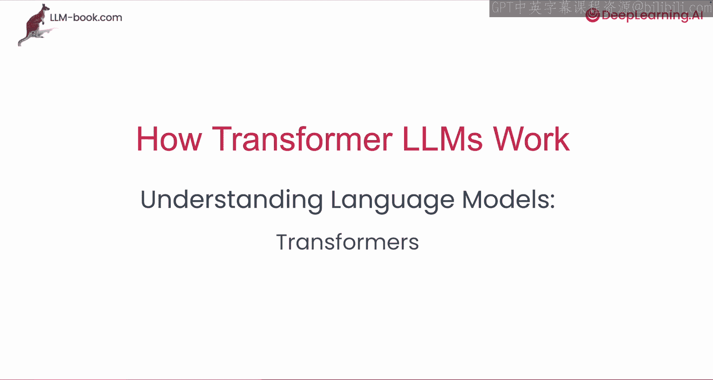

This architecture allows the model to be trained in parallel。

 which speeds up calculation significantly compared to the RNN based model。

 which precludes parallelization。Let's explore how this transformer works。

 Assum you have the same input and output sequences as before。

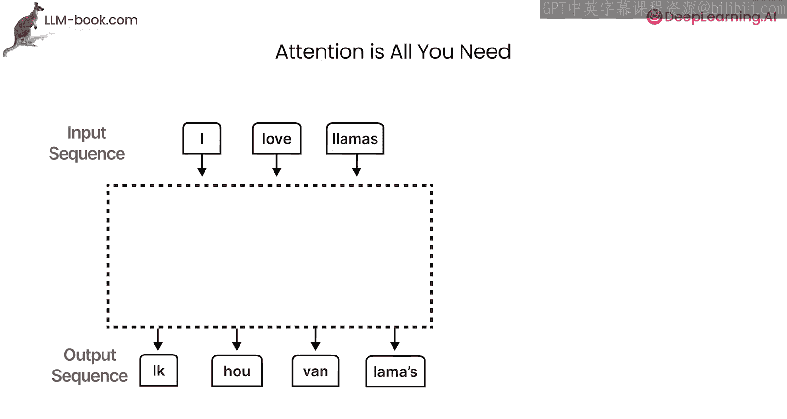

The transformer consists of stacked encodeder and decoder blocks。

These blocks all have the same attention mechanism that you saw previously。

And by stacking these blocks， you amplify the strength of the encodeder and decoders。

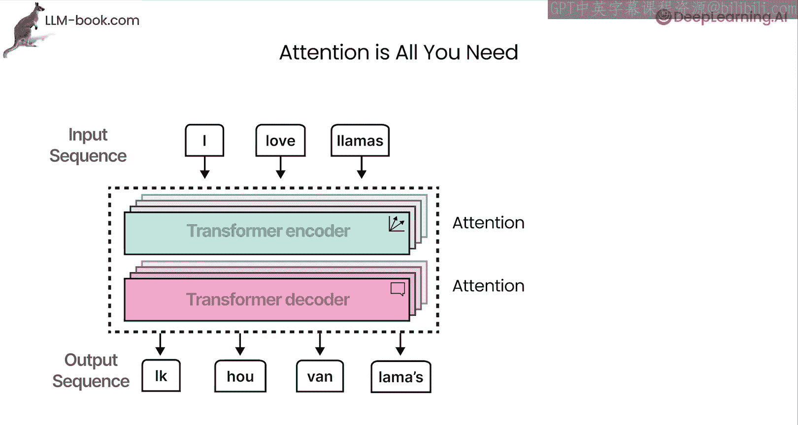

Let's take a closer look at the encoder。 The input I of Lamas is converted to embeddings。

 But instead of where to v embeddings， we start with random values。Then self attention。

 which is attention focused on only the input， processes these embes and updates them。

These updated embeddings contain more contextualized information as a result of the intention mechanism。

They are passed to a feed forward neural network， which is a similar network that we explored before。

To finally create contextualized token word embeddings。

Remember that the encoder is meant for representing text and does a good job of generating embeddings。

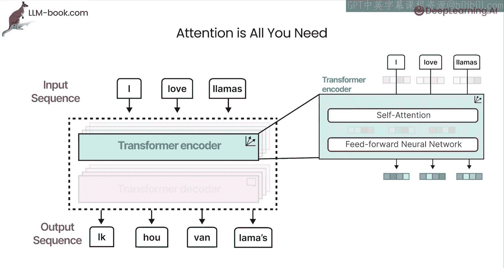

Self attention is an attention mechanism， and instead of processing two separate sequences。

 it processes only one sequence， the input by comparing it to itself。

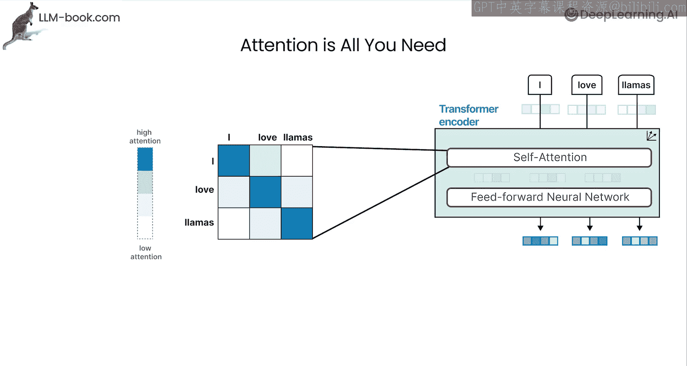

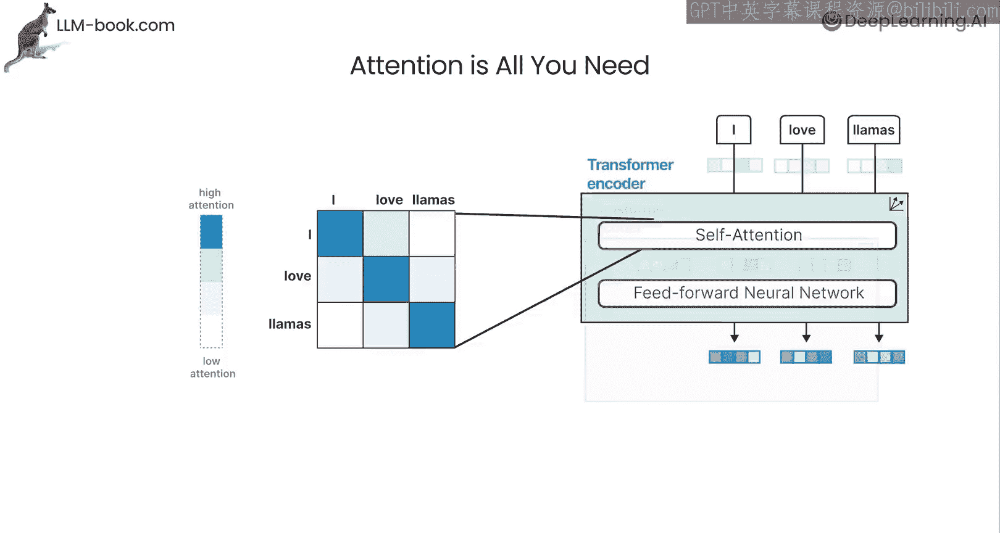

Now， after the encoders are done processing the information， the next step is for the decoder。

The decoder can take any previously generated words。And pass it to the masksqueed self attention。

 similar to the encoder to process these embeddings。

Intermediate embeddings are generated and passed to another intention network together with the embeddings of the encoder。

Thus， processing both what has been generated and what you already have。😮。

This output is passed to a neural network and finally generates the next word in the sequence。

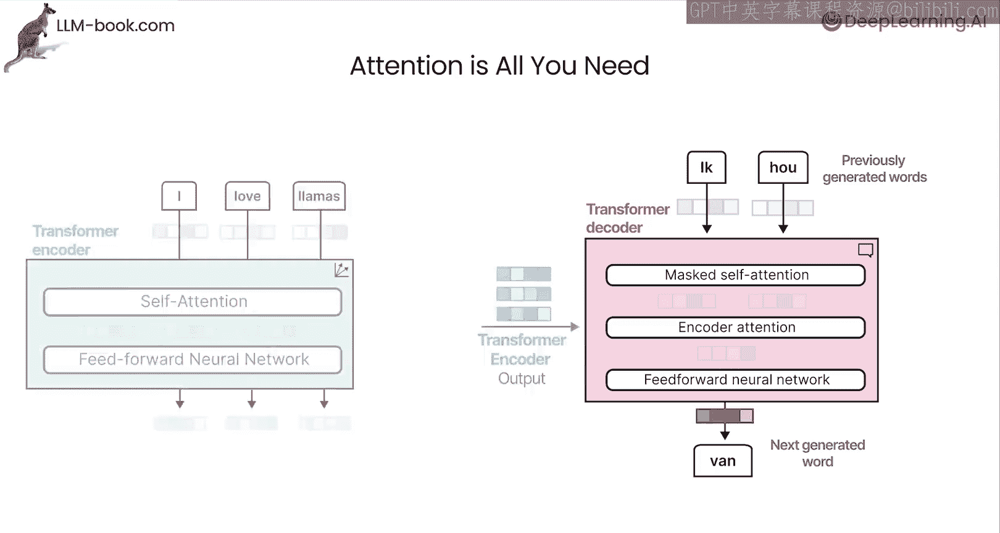

Msk' self attention is similar to self attention， but removes all values from the upper diagonal。

Therefore， it moss future positions so that any given token can only attend to tokens that came before it。

That helps leaking information， when generating the output。

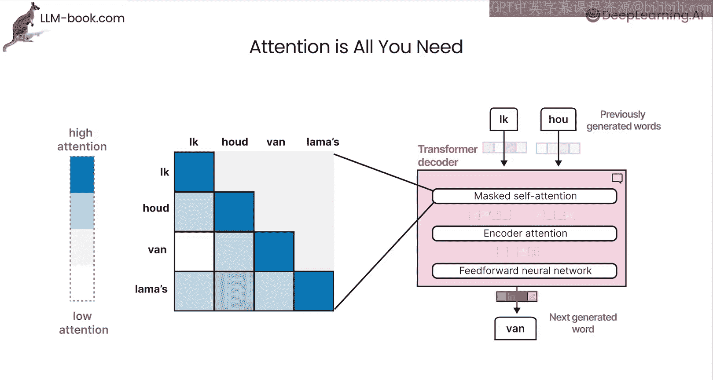

The original transformer model is an encoder decoder architecture that serves translation tasks well。

 but cannot easily be used for other tasks like text classification。In 2018。

 a new architecture called bidirectional Enr representationations from Transformers or Bt。

Was introduced that could be leveraged for a wide variety of talks。

Birt is an encoder only architecture that focuses on representing language and generating contextualized word embeddings。

 These encoder blocks are the same as we saw before。 Self attention， followed by neural networks。

The input contains an additional token， the CLS or classification token。

 which is used as a representation for the entire input。

 Often we use the CLS token as the input embedding for fine tuning the model on specific tasks like classification。

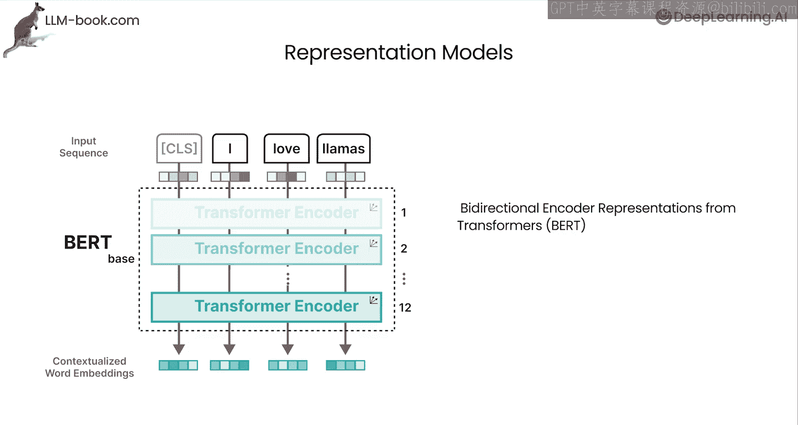

To train a birdlike model， you can use a technique called masksed language modeling。

You first randomly mask a number of words from your input sequence。

And have the model predict these mosted words。By doing so。

 the model learns to represent language as it attempts to deconstruct these masked words。

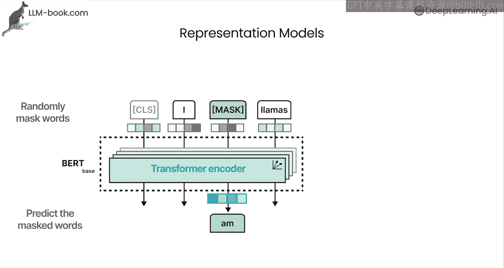

Training is typically a two step approach。 First， you apply mask language modeling on large amounts of data。

 and this is called pre training。After which you can fine tune your pretrained model on a number of downstream tasks。

 including classification。Genenerative models in contrast use a different architecture。

Assume that you again have another input sequence and randomly initialized embeddings。

The input is then passed to the decoders only， as generative models tend to only stack decoders。

One of the first implementations is called GP or GP 1。

 It stands for generative pre traineded transformformer， as it uses the D transformer decoder。

A decoder block uses a again mask self attention， which is then passed to a neural network。

Note that it does not use any encoders as we explored previously。And finally。

 the next word is generated。

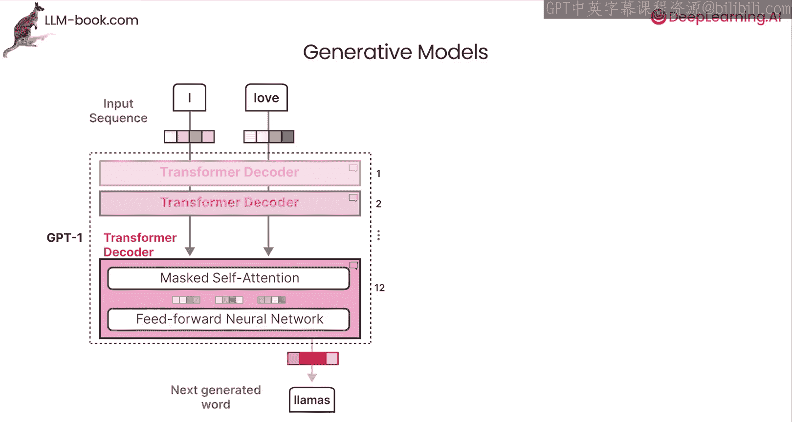

These are the two flavors that you will see most often generative models like Che GPT and representation models like embedding models。

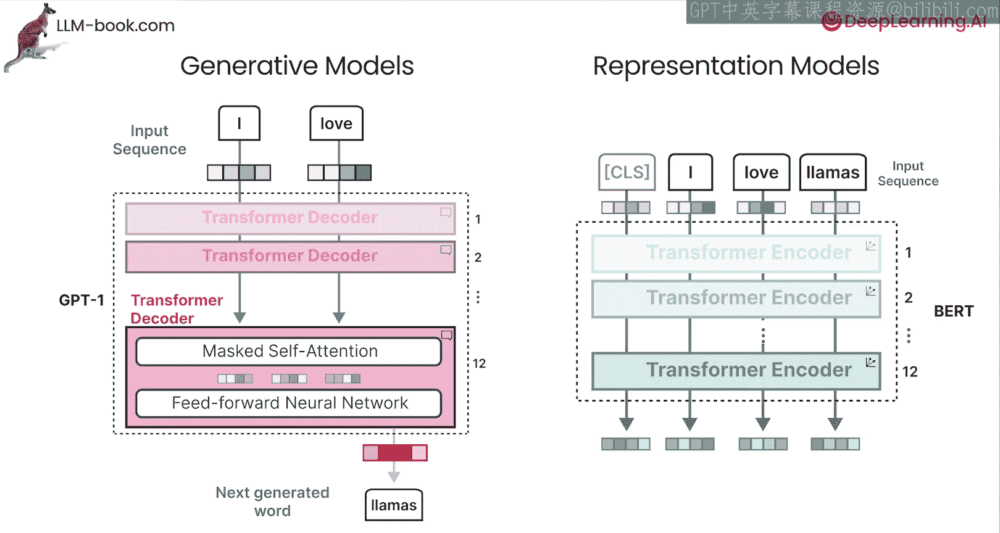

These models have something in common， called the context length。You start from an input sequence。

 tell me something about Lamas that we ask of the generative model in this example。Now。

 let's say that you already generated some tokens previously。The original query。

 together with a previously generated tokens， represent the current context length。

 That is the amount of tokens that are currently being processed。 In contrast。

 a generative L L M like GP T1 or even a representation model can have a maximum context length。

 For example，512。That means that the model can only process 512 tokens at a given time。

Note that this also includes the tokens that are being generated as they update the current contact length。

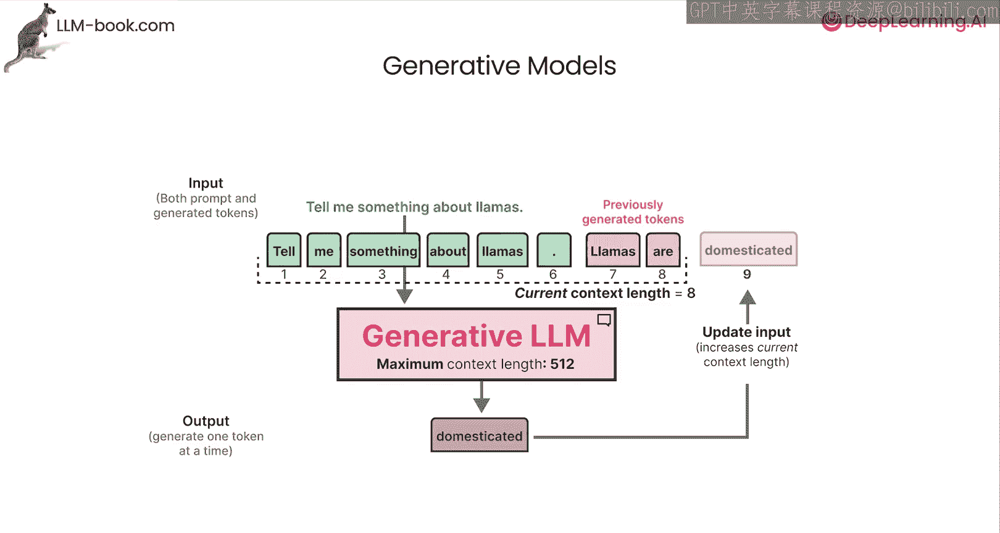

These generative models do the large and large language models。 Justice。

 G 1 already had more than 100 million parameters。The next version。

 G T 2 with over 1 billion parameters and G 3 with already  a75 billion parameters as the number of parameters grew。

 so did their capabilities。 That is why you will often see such large models。

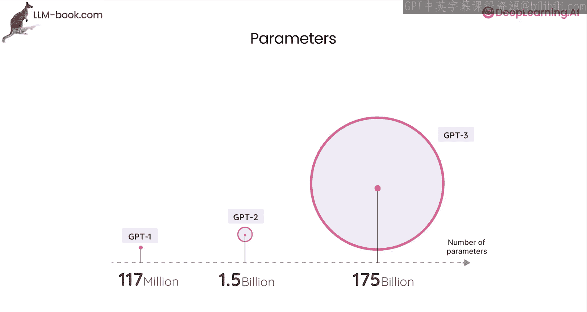

Looking back at a year that we playfully called the year of generative AI。

 it all started with the well known Chat GT model， or more accurately GT 3。5。

Following the success of Chep GPT， many other proprietary models soon followed。Unfortunately。

 open source models followed quickly。 These are models that have their weights publicly available for us to use。

 Some of them can even be freely used for commercial purposes。

Let's go to the next lesson and learn about tokens and embeddings。

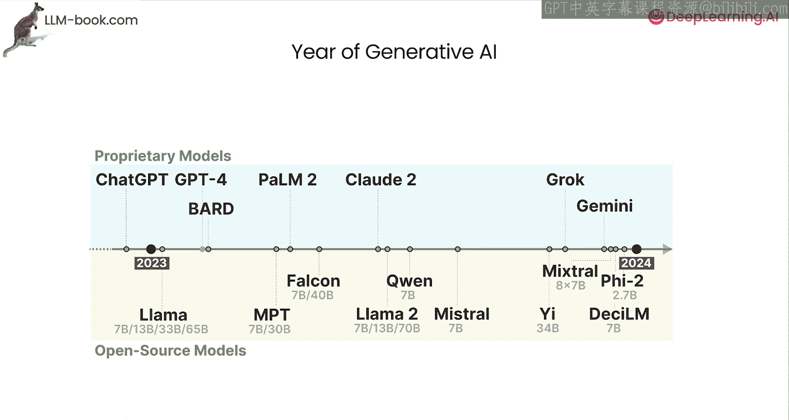