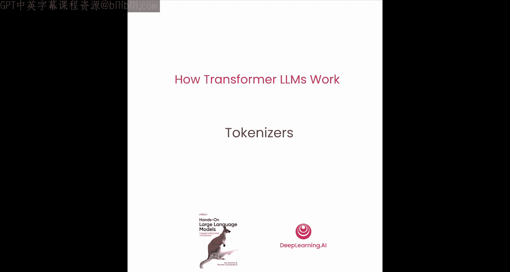
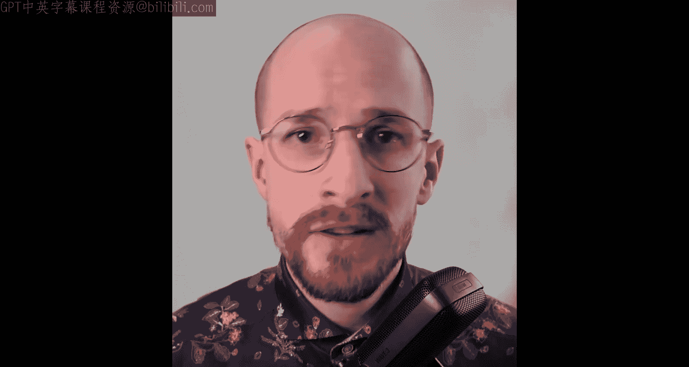
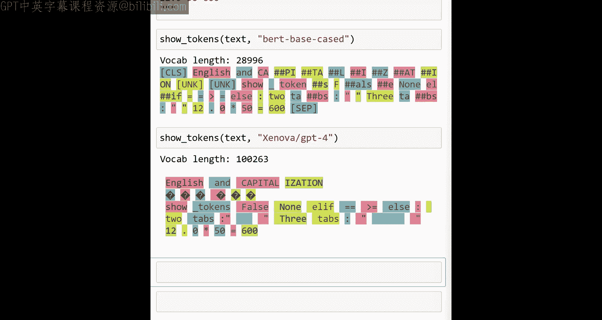

# 吴恩达《Transformer大语言模型工作原理｜How Transformer LLMs Work》（deepseek-R1翻译中英字幕 - P6：6.tokenizers.zh_en - GPT中英字幕课程资源 - BV1juNaeREyf

In the last lesson， you learned how word meaning was represented in vectors。

 We briefly introduced tokens as words or word pieces。 In this lesson。

 we will illustrate what those are and how they help transformers do their jobs。

If you're already familiar with tokens and tokens， you can skip this lesson。 Otherwise。

 let's take a look。 Imagine you have a given input sentence like half the barts， who。

For language model to process that input text， it will first break down the text into smaller pieces。

 Each piece is called a token。This process of breaking down the text is called tokenization。

Each token is then turned into a numerical representation， also called embeddings。

 These are vector values that represent the semantic nature of a given text。

These embeddings are static， and each embedding is created independent from all other embeddings and tokens。

These embeddings are processed by the large language model。

And convert into contextualized embeddings。 These contextualized embeddings are still one for each input token。

 but have been processed such that all other tokens are considered。

These embeddings can be the output of a model。😮，But also used by the model to then create the output in the case of generative models。

 this can be another token。Let's explore in detail how this stization process works。

Given an input sentence， have the bar who。It's tokenized or encoded into smaller pieces。

Docus can be entire words or pieces of a。When these pieces are combined， they form the original word。

 This process is necessary as tokens have a limited number of tokens or vocabulary。

So whenever it encounters an unknown word， it can still represent it by these sub tokens。

Each token has an associated fixed ID to easily encode and decode the tokens。

These are fed to the language model that internally creates the token embeddings。

The output of a generative model would then be another token ID。

 which is decoded to represent an actual token or word。

There are many different tokenization levels that we can explore。 As you have an input。

 half the bar who proceed it together with a special symbol。😊。

When you represent this input as word tokens， the entire sequence is represented by words。

Subword tokens， the example that we saw previously。

 can either be the entire word itself or subpieces of the original word。

If the tokenizer does not have a token for bars， it can still represent it with its tokens for B and arts。

You can split sub tokens into character tokens， one for each character in the original word。

 representing the entire input as nothing more than each individual character。

The smallest representation is that of bytes， which is used to encode a single character of text in a computer。

This is done for every single character。 Note how the symbol needs additional bys for representation。

 as that symbol is more complex than just a single character representation。In practice。

 most large language models have tokens that work on a sub word token level。

 Its vocabulary is flexible and allows to represent most words by either its entire representation or using sub tokens。

Let's now move to the notebook to explore different tokens To explore different tokens。

 we first need to install the transformer package with PP install transformers。

This is used not only to interact with tokens， but also to use large language models。

 Since I've already installed it in my environment， I can go ahead and skip it。Next。

 let's explore how this tokenization process works to do so and to load your tokenizer。

 you will first need to import the auto tokenizer from transformers。

And this is used to interact with any tokenizer。Then you can choose any sentence to process for this example。

 I selected the well known Hello world example as a sentence to process。

The tokenizer that you will be using is called the Bt based case model。

 and it's a pre traineded encoder model， which is named Bt。 Now that we have loaded in our tokenizer。

 we can start processing our input sentence。You can use the tokenizer to process the input sentence and extract token IDs。

You can then print the token ID to see what this variable contains。

Note how it contains a bunch of numerical values。 and it's unclear what they represent exactly。

As we saw before， token IDs represent certain tokens， but to get those tokens。

 we first need to decode them。And you can decode these tokens with the decocode function that the tokenizer has。

So when you loop over the token IDs， you can decode each token and print it。

Note how you will now see five tokens represented。The sentence hellello world starts with the CLS token。

 the CS token or the classification token that we explored previously represents the entire input。

Then you have tokens for hello， world and exclamation mark。 And there's also the special character。

 Sap。It's the separation token and signifies the end of a sentence to visualize all these different tokens。

 you will need some special coat。Before you create your function， first。

 you will create this list of colors。 These are RGB colors that we will use to highlight the tokens that help you differentiate different tokens。

 You can use any colors。 These are selected for you。Then the main function。

 and it's called show tokens。 And show tokens is what allows you to separate each token by collar。

It takes in a sentence and a name， the sentence of the sentence that you want to process and the name of the tokenizer that you want to load in。

You load in the tokenizer in the same way that you've done before。

You choose a name for the tokenizer that you want to process。😮，And then you create token Is。

Those were the Is that you saw before those numerical values that need to be decoded。

Before it's clear what words and tokens they actually represent。

 we will extract the vocabulary length because it's also interesting to see how vocabulary might differ between tokenizers。

Then each token will be printed through decoding with the tokenizer that we've explored before。

 and each token will be highlighted。 And this highlighting procedure allows you to easily differentiate between techniques that different tokenizer use before you will use this function。

 Let me first introduce the text that you will be using。😊。

This text contains all different types of words to showcase how these tokenrs will process this particular input。

Note that we have words that are fully capitalized。

 that we have values in there and that we even have special symbols to see what the tokenizer will do when faced with this particular sequence。

 Let's explore the tokenizer that you used before in more detail。

 We can do that using the show tokens function that you created before。 And you posit the input text。

😊，After you run it， you will see two pieces of information。 First。

 the vocabulary length of this tokenizer。It shows a value of almost 30000。

 which means that this tokenizer has almost 30，000 values or tokens it can represent below that。

 you will see all the tokens that it used for representing your input text， as we explored before。

 it starts with the Cs token， the classification token to showcase or to represent the entire input。

This tokenizer has a lot of difficulty representing the word capitalization。

 Note how it has to break that down into many tokens before it can actually represent that word。

 those hashtags showcase that this token belongs to the token before that。 and that together。

 they represent a single word。 You will also see the U N K token appearing up in these tokens。

 It's the unknown token。 and is used when it simply doesn't know how to represent any token。 Next。

 let's see how a more recent tokenizer differs from this bird model。

We will this time use the G4 tokenizer。 It's called T token。

 and although we cannot access the G4 model itself because it's proprietary。

 the tokenizer is still available。And you can run this。

What you will see is a vocabulary length that's more than three times as large as the bird model that you explored previously with 100000 tokens。

It needs to use fewer tokens to represent the inputs。Capitalization is now only two tokens。

And this model， this tokenizer， is meant for a generative representation。

 so it doesn't have the Cs and the sep classification tokens or those special characters。

 It's interesting to see how it needs fewer tokens to represent these entire inputs。 Even the taps。

 it represents that very well， because this model has such a large vocabulary length。

 It's easier to represent uncommon tokens， but there's a trade off。

The larger the vocabulary length is， the more embeddings need to be calculated for each of those tokens。

 So there is a tradeoff between choosing a tokenizer with potentially a length of a million tokens and actually learning the representations for each of those tokens。

 Now， many of the models can be fined online on the hugging face platform。

There you will find much of the tokenizers to use。 And because tokenizers themselves are relatively small。

 it's easy for you to try them out。See how they differ。

 What changes you have between tokens that are for Western languages or for eastern languages。

 In the next videos， Jay will explain to you how large language models process tokens to generate text。

