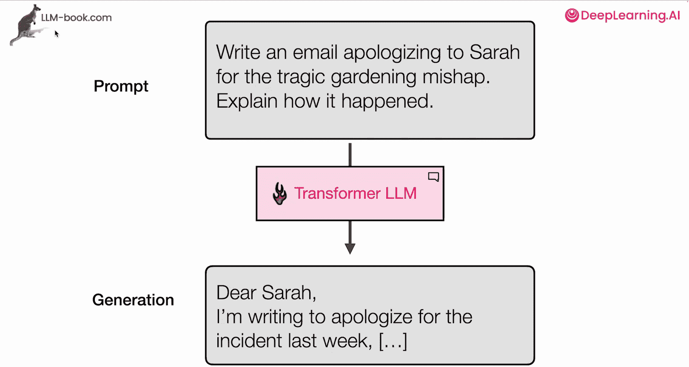
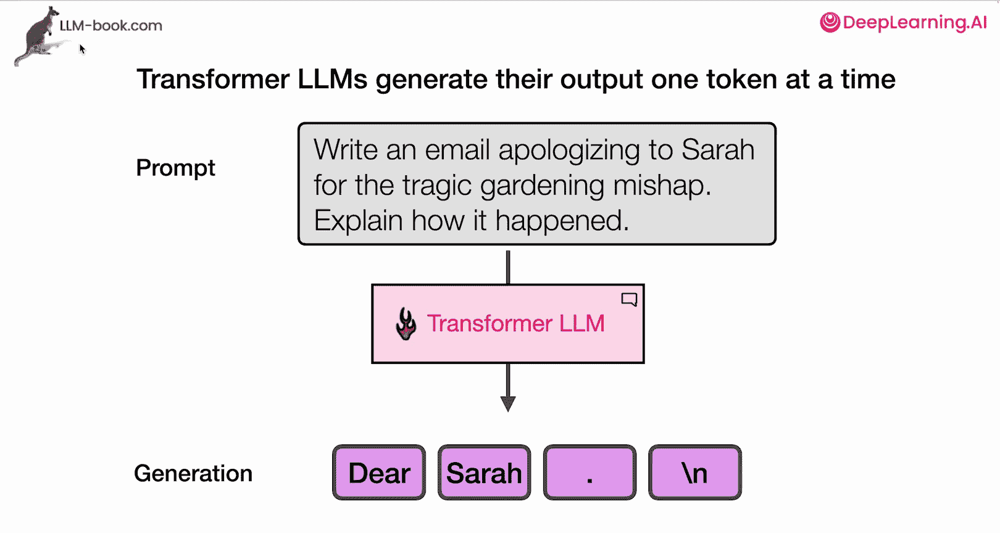
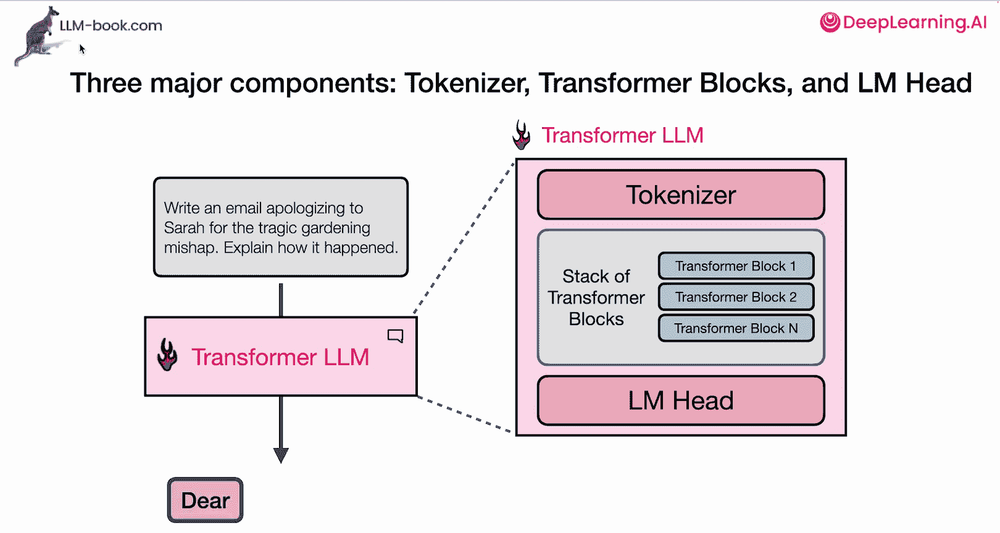
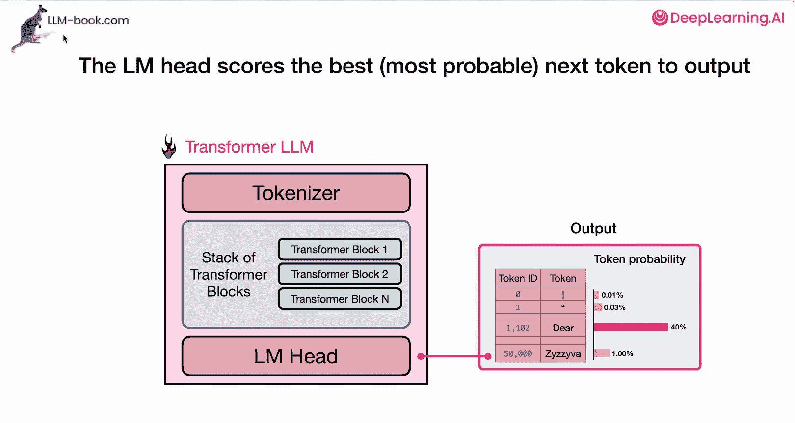
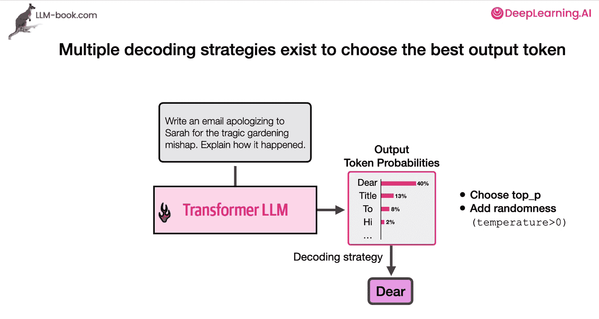
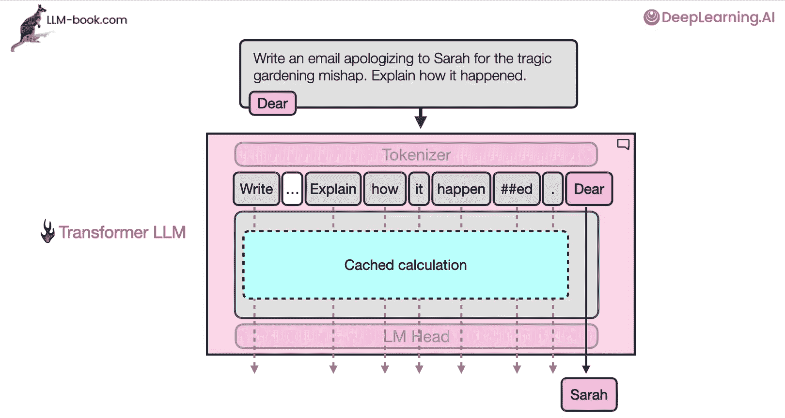

# 吴恩达《Transformer大语言模型工作原理｜How Transformer LLMs Work》（deepseek-R1翻译中英字幕 - P7：7.architectural overview.zh_en - GPT中英字幕课程资源 - BV1juNaeREyf

So far， you' have learned how language is represented numerically and how words are converted into tokens and dense embeddings。

 Now， you're ready to dive into the details of the transformer。

When we're thinking about transformer large language models。

 we know that theres an input prompt to the model and then there's a generation where an output text that the model generates。

Now， one of the first important intuitions to get the force of understanding how the transform works is to understand that it generates tokens one by one。

So to generate that output that we saw in the previous one。

 you can see that the model is generating them one token at a time and will break down these generation steps so you can understand the underlying mechanisms of how this。

The transformer is made up of three major components we've already looked at one in the previous lessons。

 so we've looked at the tokenizer that is the component that breaks down the text into multiple chunks and then the output of that tokenizer goes to a stack of transformer blocks。

 this is where the majority or the vast majority of computing is this is the neural networks that operate on this and do pretty much all the magic that happens here and by the end of these couple of lessons you'll see that it's no magic and it's quite understandable what they actually do in in sense。

The output of this stack of transformer blocks goes into a neural network called the language modeling head。

 Let's look at each of these components。 We looked at a tokenizer。

 and we know by now that the tokenizer has a vocabulary that breaks down that has independent chunks let's say we have this vocabulary of 50000 tokens that this tokenizer knows。

 the model has associated token embeddings for each of these tokens。

 So if we have 50000 tokens in our vocabulary， the model has 50000 vectors that represent each of these tokens and these are substituted in the beginning once the model is processing its inputs as we'll see。

 we'll talk about transformer blocks in the next lesson， but let's。

Go over the language modeling head as we're looking at the high level overview here。

 So at the very end of the processing of a language model。

 you have all of your tokens that you sort of started with that are defined in the tokenizer what happens at the end is a kind of scoring or a token probability calculation based on all of the processing that the model in this stack of transformers have done to make sense of the input context and what is requested。

 let's say in the prompt and what the next token should be in response to that And so the result of the language modeling head is this sort of token probability scoring that says okay of all the tokens that I know this is how much percent of probability that each of these tokens has and all of these they have to add up to let's say 100% and so if you have the word deer scored at 40% probability that becomes the highest probability token that becomes possibly the output。

Not necessarily the output， but you can choose the highest probability token and that's one method of choosing the next or the output token These are called decoding strategies if you're choosing the top scoring token all the time。

 It's a good strategy for a lot of cases it is what happens when you set the temperature parameter to0 it is a method called greedy decoding。

 but it's not the only method out there。 There are others like top P for example。

 that incorporate multiple token。 so it might generate deer。

 but it also in some cases with lower probability， it might pick the next highest probability token it definitely looks at the scoring but it doesn't always have to pick the top one and these are sometimes important to generate text that sounds natural and it sometimes why when you generate multiple times using the same prompt you will get different answers That's all related to decoding。

gieespecially if you set temperature to values more than 0。

 Another important idea or intuition about transformers。

 And this is one of the ideas that make transformers operate a lot better than previous methods like RnNs is that they process all of their input tokens in parallel and that parallelization makes a time efficient。

 let's say so you can compute a long context on a lot of different GPUus in a similar time。

 the way to envision this is to think of multiple tracks flowing through the stack of transformable blocks。

 and the number of tracks here is the context size of the model。 So if a model， for example。

 has a context size of 16000 tokens， it can process 16000 tokens at the same time。

 the generated token in decoder LLM transformers is the output of the final token in the model and we will see in the next slide how generating。

Other token after you start with let's say the first step that processes the input is a little bit different。

 So here you can see that all of these arrows are red。

 but then once we generated our first token now we feed that entire prompt with the token that we generated into the transformer again so you can think of it as a loop it is a loop and then where you process the inputs one by one as you generate these tokens。

 one thing that is different between that first step and the second step is that you can cache these calculations because they're going to be exactly the same calculation and you can cache them to speed up the generation of the model this is what it is called KV caching K means keys is values we'll talk about these when you talk about attention in the next lessons So that is one of the major additions to transformers that make them faster and you can also think about metrics So if you're working with efficiency there is this metric of time to first token。

kenThat is what happens here so time to first token this is how long the model takes to process all of this and then generating every other token is slightly a different process。

