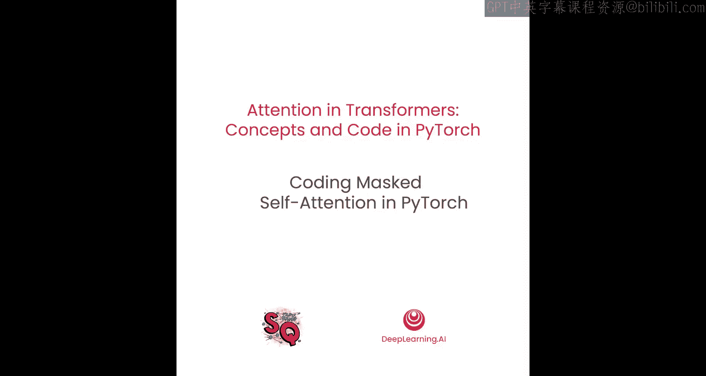
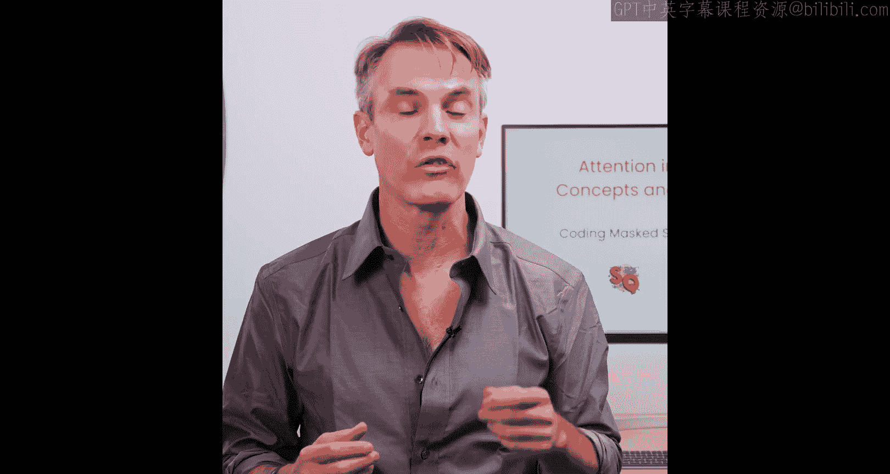
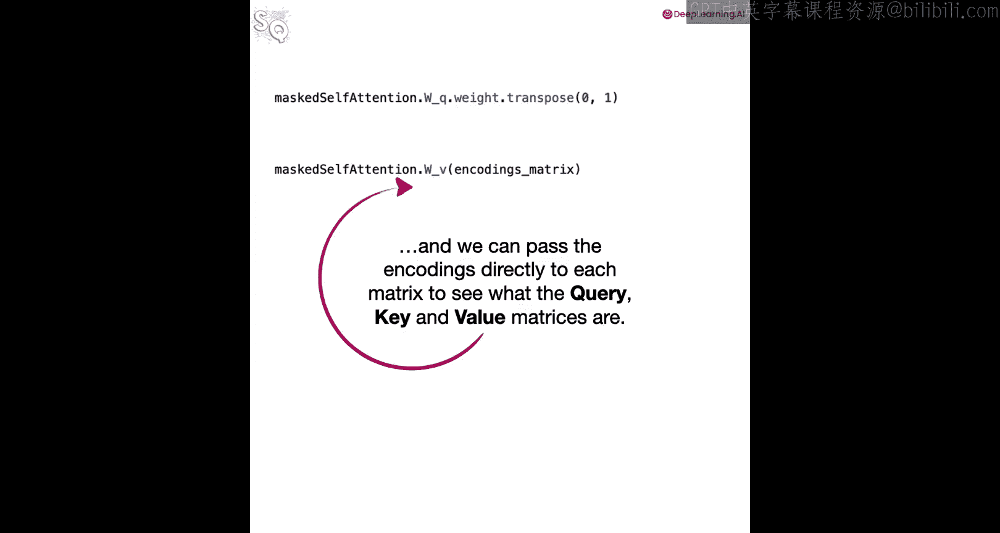
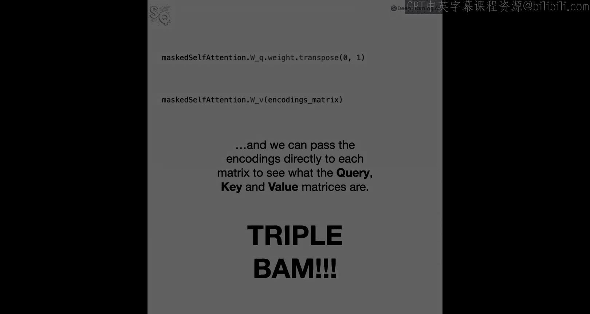

# 吴恩达《Transformer中的注意力机制：概念与PyTorch代码实现》中英字幕（deepseek-R1纠错+翻译 - P7：7.coding-masked-self-attention-in-pytorch.zh_en - GPT中英字幕课程资源 - BV1AYKpeGEUf

In this lesson， you'll use pi torch to code a class that implements masked self attention。

 then you'll run some numbers through it and verify that the calculations are correct， let's code。

Just like we did before， we're going to import torch。Torch dot N N。And torch。nN。t functional。

Now we'll code a class that implements masked self attention。

So we start by defining a class called masked self attention。That inherits from an and dot module。

 Then we create an init method that has the same arguments that we used before。

D model is the dimension of the model or the number of word embedding values per token。

 And we also have the row and column indices。 Then we call the parents ait method。

Then we use in and dot linear to create the weight matrix that will later make the queries from the encoded values。

Note， just as a reminder， I've labeled the query weights matrix with the transpose symbol。

Because of how pie torch prints out the weights， Then we do the exact same thing to create the key weights。

And the value weights。Then we save the row and column indexes。

The forward method is where we actually calculate the masked self attention values for each token。

Just like before， we accept the token encodings。But now we are also accepting the mask by setting the default value for the mask to none。

 we can use this class to calculate masked self attention and the original self attention。Now。

 just like before， we pass the token encodings。To W subQ， the query weight matrix。

To create the queries stored in a variable called Q。Then we calculate the keys， K， and the values V。

Now， using the matrices we just created， we calculate self attention。

We calculate the similarities among the queries and the keys， and then scale the similarities。

Then if mask is not none。We add the mask to the scaled similarities with masked underscore fill。

To understand how we add a mask using the mask underscore fill method。

 imagine that the mask is a matrix of trues and falses。

The truths correspond to attention values that we want to mask out。

So the massed fill method replaces the truths with value。

 which we set to negative 1 times 10 to the 9。And it replaces the falses with 0。

This matrix is then added to the scaled similarities。

Then we run the scaled similarities through a soft max function to determine the percentages of influence that each token should have on the others。

Then we multiply the attention percentages by the values in the。And return the attention scores。

Altogether， the masked self attention class looks like this bam。

And now let's run some numbers through it and make sure it works as expected。

We'll start with the same matrix of encodings for the same tokens that we used before。

And just like before， we'll set the seed for the random number generator。

Then we create an object from our masked self attention class using the same parameters we used before。

Now we need to make a mask to prevent tokens from looking ahead when calculating attention。

Because we have three tokens in the prompt， we start by creating a three by three matrix of wands with torched out oneands that looks like this。

That matrix of ones is then passed to torch do triL。

Which turns the ones in the upper triangle into zeros。And leaves the ones in the lower triangle。

 as they were。Ultimately， we save a matrix with ones in the lower triangle and zeros in the upper triangle in a variable called maskask。

Then we use mask equal equal zero to convert the zeros into trues and the ones into falses。Note。

 we can verify that we correctly created the mask by printing it out。

And seeing that it is what we expect。Bam。Lastly， we pass the encodings matrix and the mask to our masked self attention object。

And these are the masked self attention values。Double boundm。Note， if you' got something different。

 don't panic。You can verify that the math was done correctly using the same methods we used before。

 We can print out the weights。And we can pass the encodings directly to each matrix to see what the query。

 key， and value matrices are。

Triple boundm。

