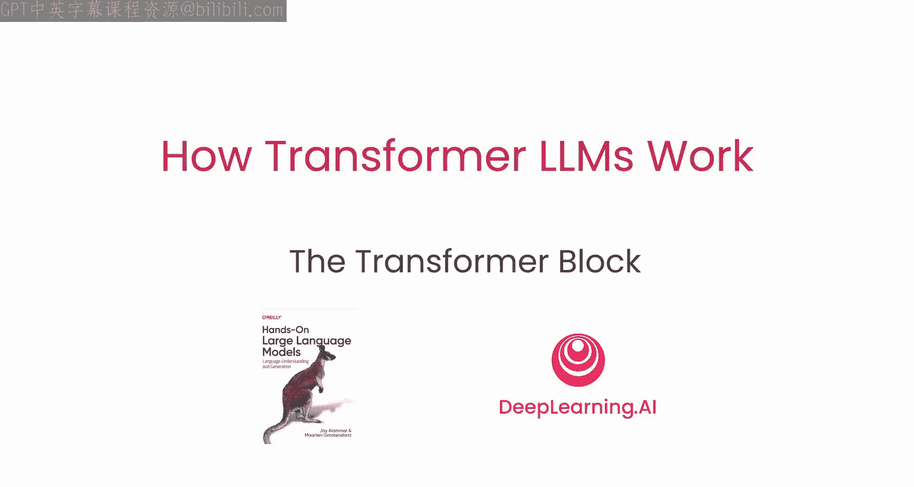
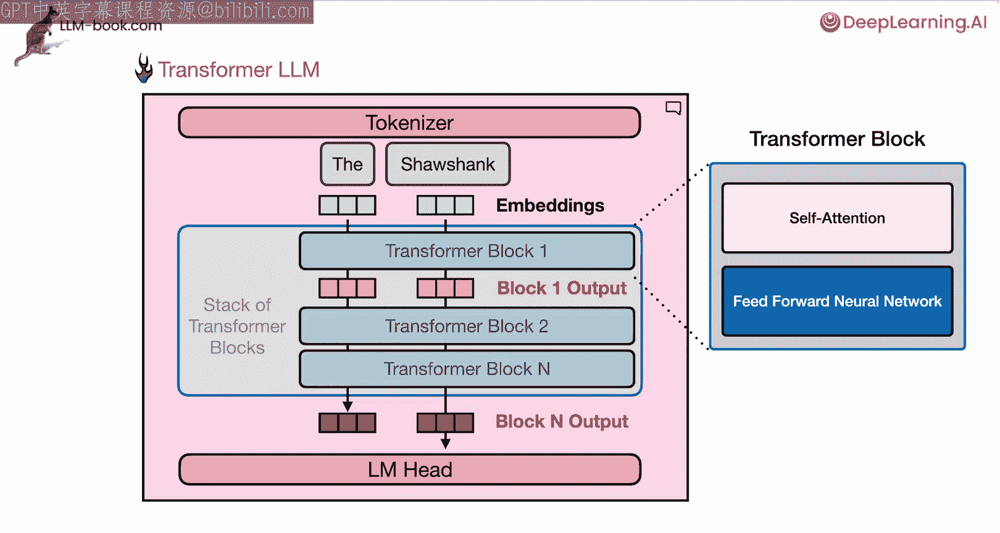
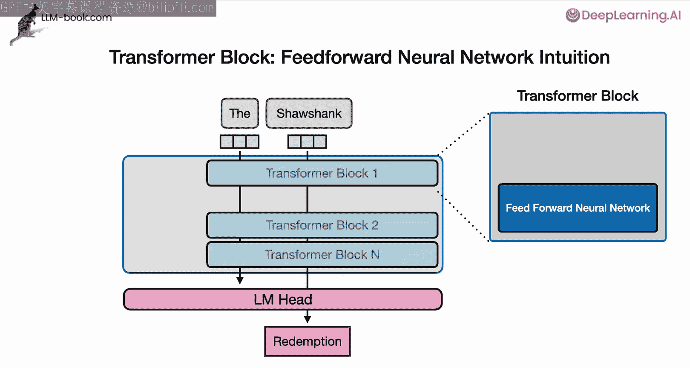
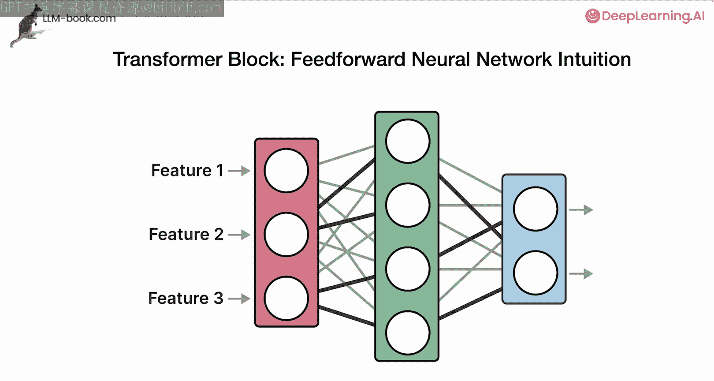
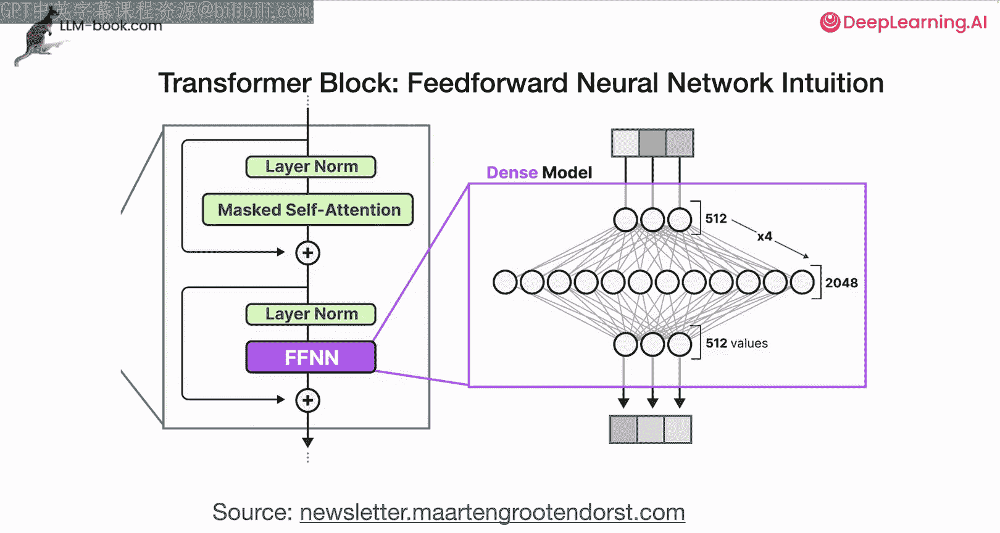
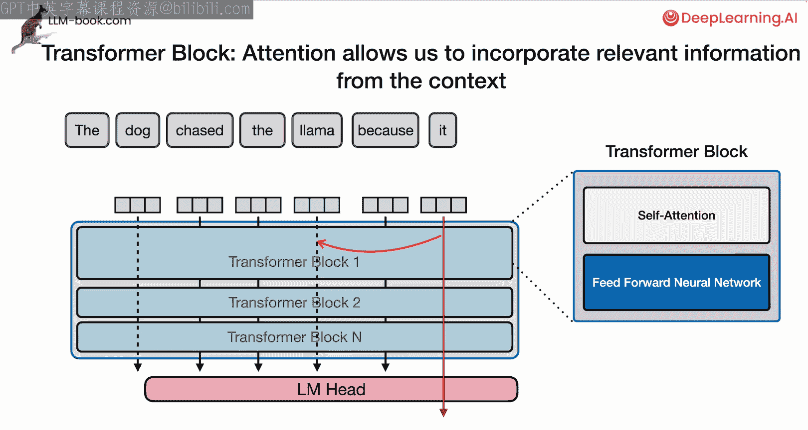
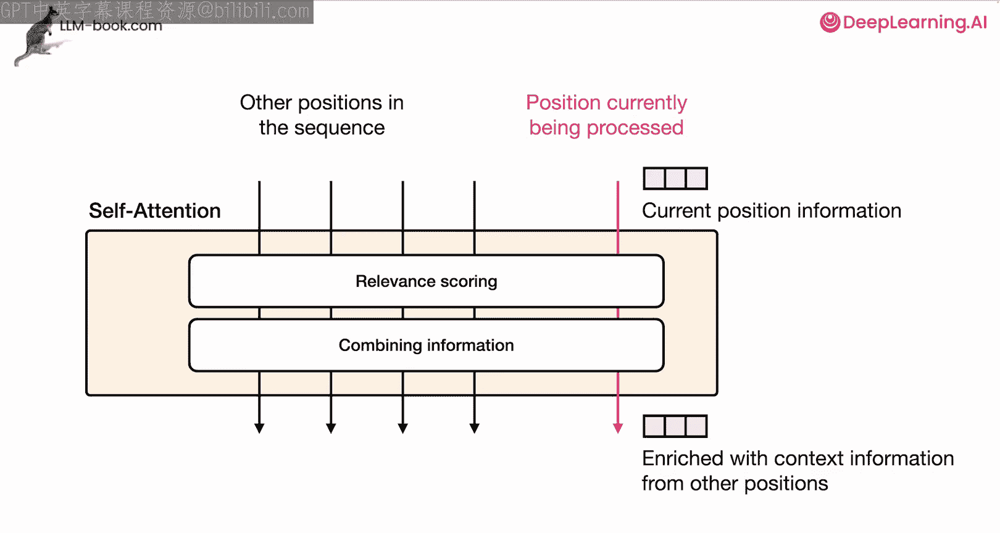

# 吴恩达《Transformer大语言模型工作原理｜How Transformer LLMs Work》（deepseek-R1翻译中英字幕 - P8：8.transformer block.zh_en - GPT中英字幕课程资源 - BV1juNaeREyf

In the architectural overview of the transformer， you have learned that after tokenization。

 the token embeddings are passed through a stack of transformer blocks。

 Let's get into the details of those blocks。Let's look at a basic example。

 Let's say we have this prompt two words the Shahhannk。 to understand how transformer blocks operate。

 Let's think about the two tracks that are flowing through the stack of transformer blocks。

 In the beginning， our tokenizer has broken down the prompt into these two tokens。

 So the is its own token and the shahhannk is the second token。

 And then since we have the associated embedding vectors for each of these。 we just replace them。

 And that is what we start calculating on。 Now we have turned language into numbers。

 and we can apply a lot of interesting calculus on them to predict what the next word is。

 So those flow to the first transformer block， which generates a vector of the same size as its output。

 But something has happened in the middle some processing that has happened in the transformer block in its components that we'll address here。

 But before we get into that， understanding this general flow。

The model is useful And so the same thing happens now with the second transformer block that operates on the outputs of the first transformer block in parallel across the various tracks and this happens down the list of transformer blocks all the way to the end and then the final layer。

 this vector， let's say for the final token in the prompt is presented to the language modeling head。

 which then outputs or generates the predicted next token So this is the flow So everything flows from the beginning towards the end one direction from the tokenizer down the transformer blocks one by one in sequence up until the language modeling。

The transformer block itself is made up of two major components。

 the selfattention layer and the feed forward neural network layer。

 the feed forward neural network layer is for a high levelvel intuition of the feed forwardward neural network if the transformer block only had this it didn't have attention。

 it would be able to generate this completion to say the token that is most probable to come after the Shahannk would be redemption and so this is in reference to the famous film because if you look at the training data set if you get data from the internet or Wikipedia redemption would be the word that often statistically appears after Shaannk in most cases。

 this is one thing that the feed forward neural network is able to do so we can think of it as a storage of information and statistics of let's say the next word that comes in after the input token。

That's a high level intuition like a lot of these neural networks do do things that are a little bit more complicated。

 but this is the reasonable first approach of how to think about the feed forward neural network and this contrasts it with self-atten that we look at after we finish talking about the feed forward neural network We have looked at neural networks earlier in this course they generally tend to look like this where you have a layer that expands into another layer that then shrinks back down into a third or output layer that's exactly what happens in the feed for neural network the connections of these dense layers is presumably where all of this information that models know is stored and modeled and interpreted and interpolate it between to enable the models to do the incredible things that they do to generate code and encode information about the world and speak to you in fluent and coherent language of your choosing。

lfAttention， on the other hand， allows the model to attend to previous tokens and incorporate the context in its understanding of the token it's currently looking at。

 Let's look at this example let's say we have a prompt that is the dog chase the  lama because it where the model is processing the word it needs to bake in some information about what does it refer to here is it the dog or is it the llma。

 It's important for the model to be able to have some sense of what that it refers to and that's a little bit of what self-attention does。

 It enables the model to bake in some of that representation of the lama tokens， for example。

 if the previous context points towards this being the llma self-attention allows the model to bake in some of that representation of the llma into it。

 And so while it's processing the token it has some understanding that。

This is referring to the llma quote unquote understanding This is an NLP task called co referenceference resolution。

 and if these are only the words that are presented to you。

 it might be difficult to really ascertain is it the dog or is it thellma but in this example let's assume that previous tokens in the prompt indicate that it is the llma So to understand attention at a high level let's formulate it like this。

 so we have other positions in the sequence。 so we have previous tokens that we've processed in the past and then we have the current position that we are processing we have its vector representation So this is the embedding if we're in transform block number one but if you're in block number two or three or four。

 this is the output of the previous block and then towards the end we want this vector representation that bakes in the relevant information from the other positions here So here you're looking at。

These are let's say five tracks and we're basically pulling in the right information that is useful to represent this token in in this step of the model's processing。

 so this is a high level formulation of selfatten we'll get into more of the specifics in the next lesson but what self-attention does is two things The first thing is relevant scoring so it assigns a score to how relevant each of the input tokens are to the token we're currently processing and then the second step is after scoring that relevance is combining the relevant information into the representation So at a high level this is what self-attention boils down to relevant scoring and then combining the information from the relevant tokens into the current vector that we're processing and representing。

In the next lesson， we'll look at more details of how that is done。

