# 吴恩达《Transformer中的注意力机制：概念与PyTorch代码实现》中英字幕（deepseek-R1纠错+翻译 - P9：9.multi-head-attention.zh_en - GPT中英字幕课程资源 - BV1AYKpeGEUf

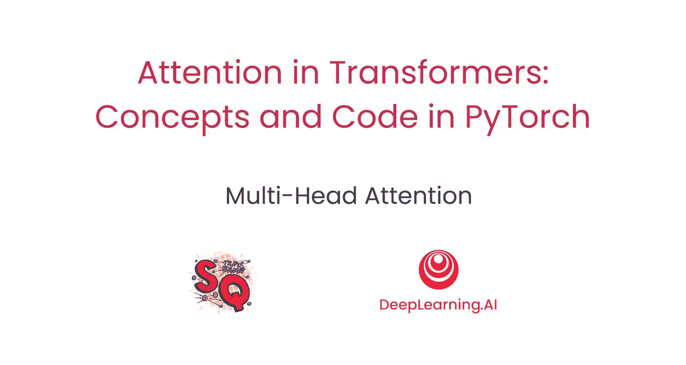

In this lesson， you will learn about multi head attention。

 you'll learn about how it is used and how it is incorporated into a transformer。 Let's get to it。

So far， we've seen that attention helps establish how each word and the input is related to the others。

And for a simple example， what we've seen so far works fine。

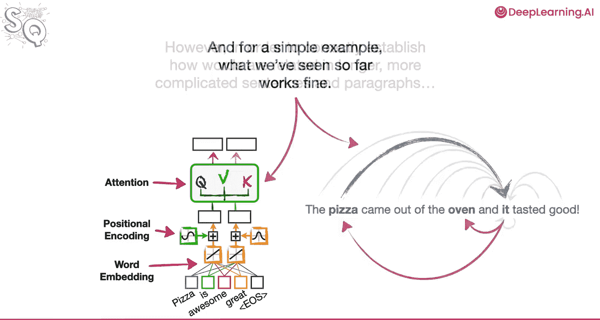

However， in order to correctly establish how words are related in longer。

 more complicated sentences and paragraphs。

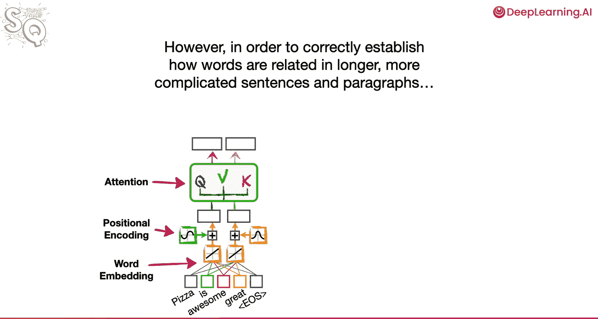

We can apply attention to the encoded values multiple times simultaneously。

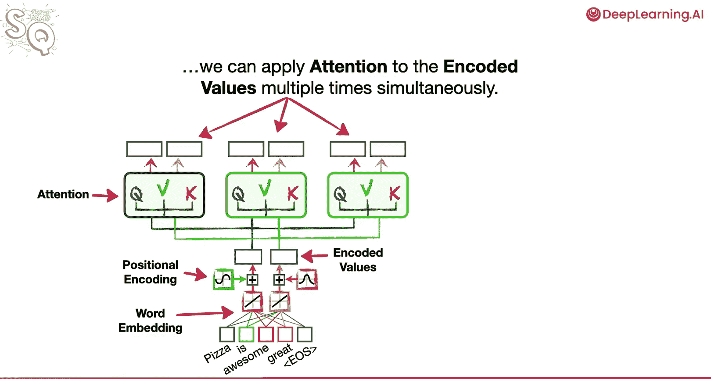

Each attention unit is called a head and has its own sets of weights for calculating the queries。

 keys， and values。

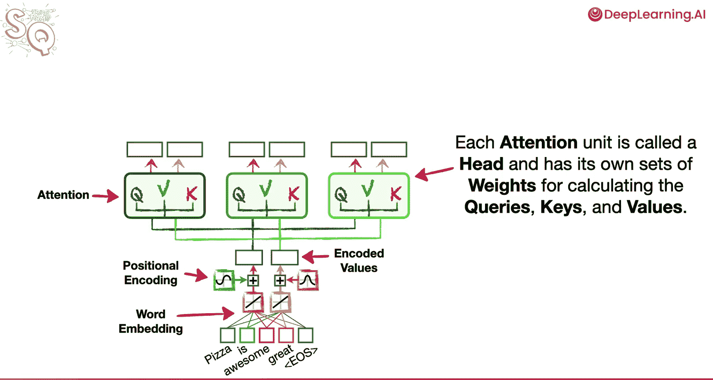

And when we have multiple heads calculating attention， we call it。Multi head attention。

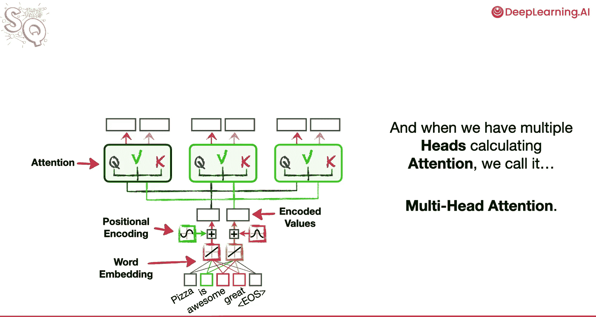

Bam。In this example， we have three attention heads。

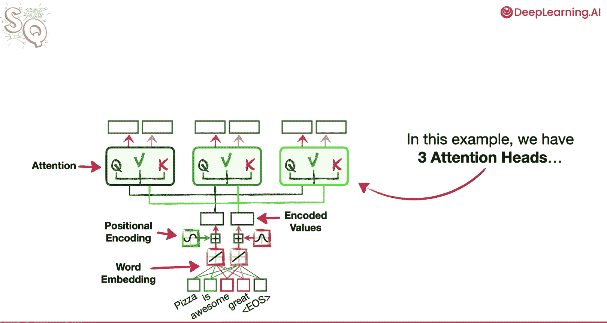

However， in the manuscript that first describe transformers， they use eight attention heads。

In our example， with three heads and two attention values per head。

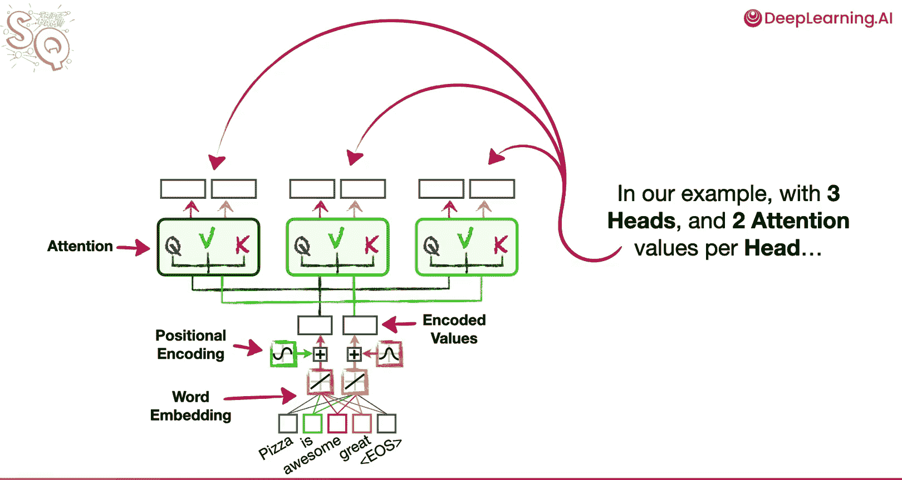

We end up with six attention values。In order to get back down to the original number of encoded values that we started with。

2。

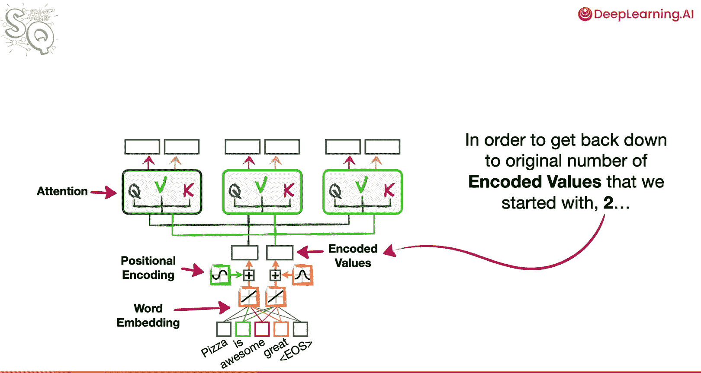

We simply connect all the attention values to a fully connected layer that has two outputs。

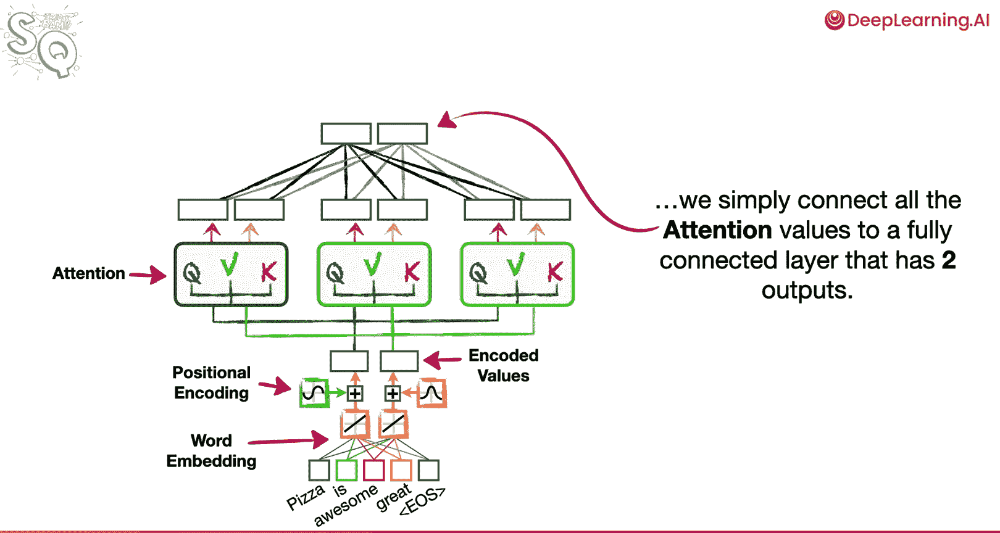

Bam。Note， another commonly used way to reduce the number of outputs。

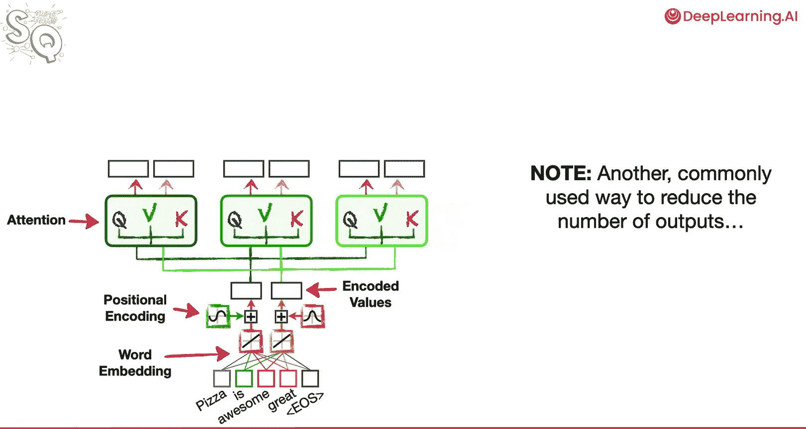

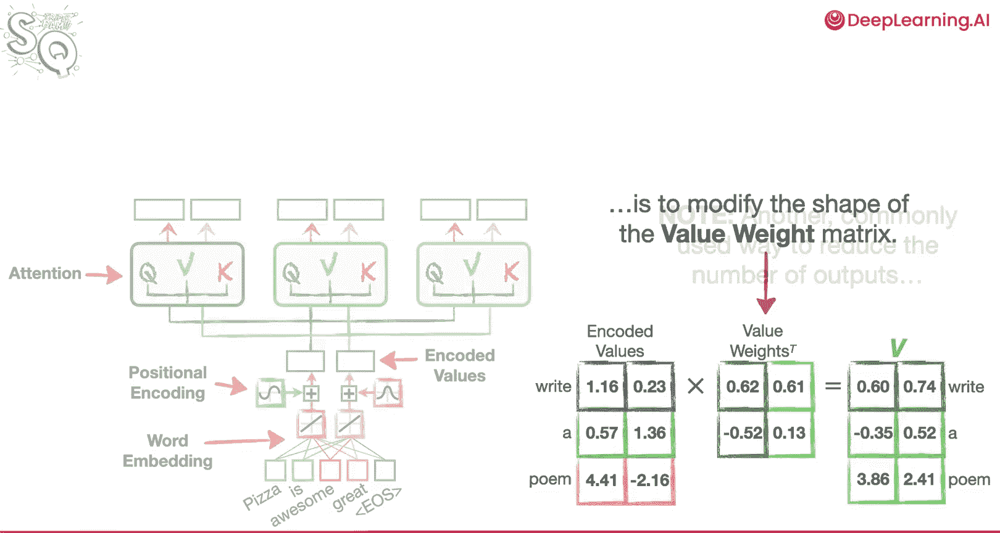

Is to modify the shape of the value weight matrix。So far。

 we've used a matrix with two columns of weights。And that gave us a value matrix with two columns。

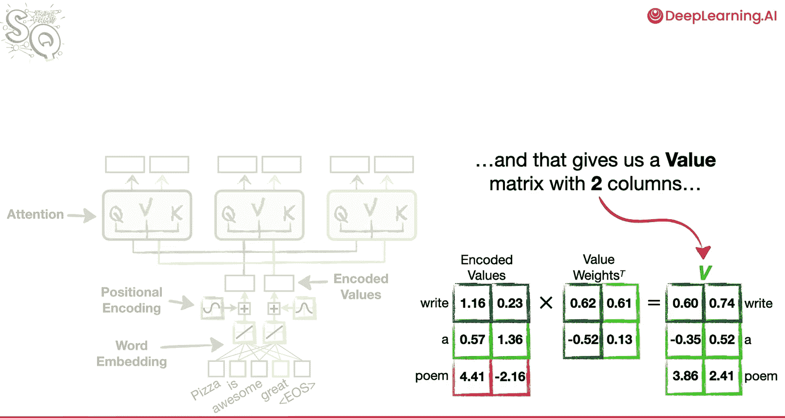

And as a result， each attention head has two outputs。

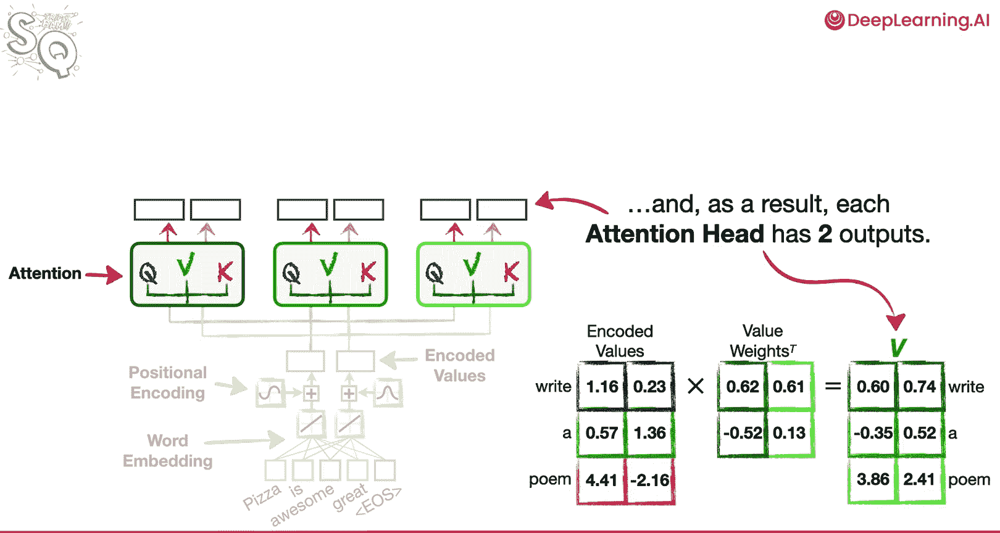

However， if we only use one column of weights。Then the value matrix will only have one column。

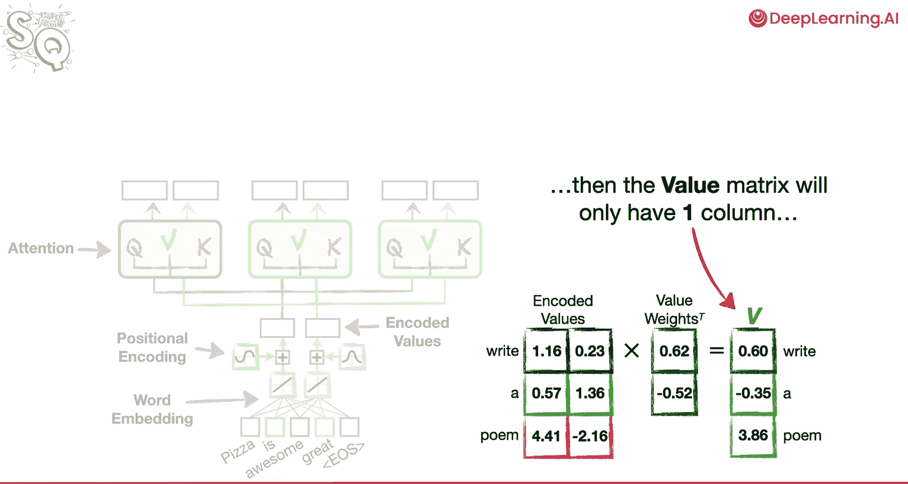

And each head will only output one value。

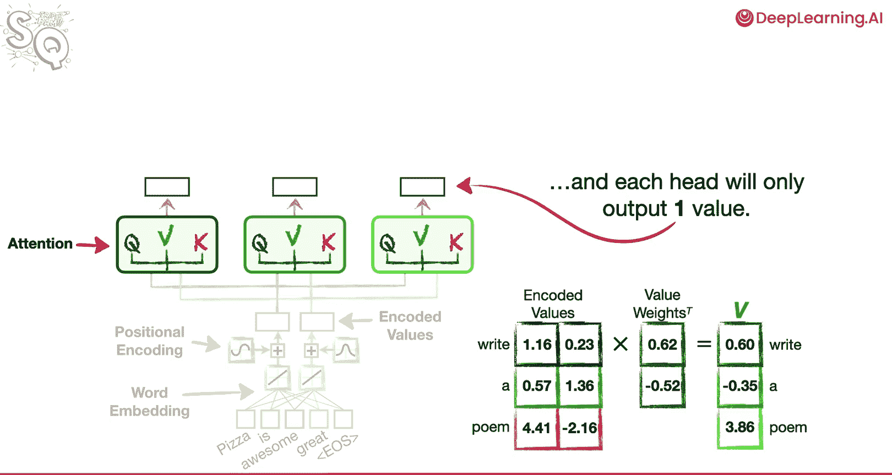

And in this case， since we started with two encoded values。

We could require a maximum of two heads to get back to the same number。

Or we could just code our transformer to be more flexible about these things。

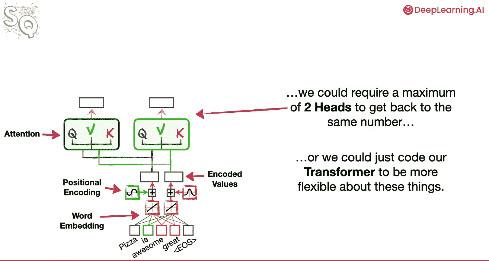

Bam。Now we understand the ideas behind multi head attention。Bam。

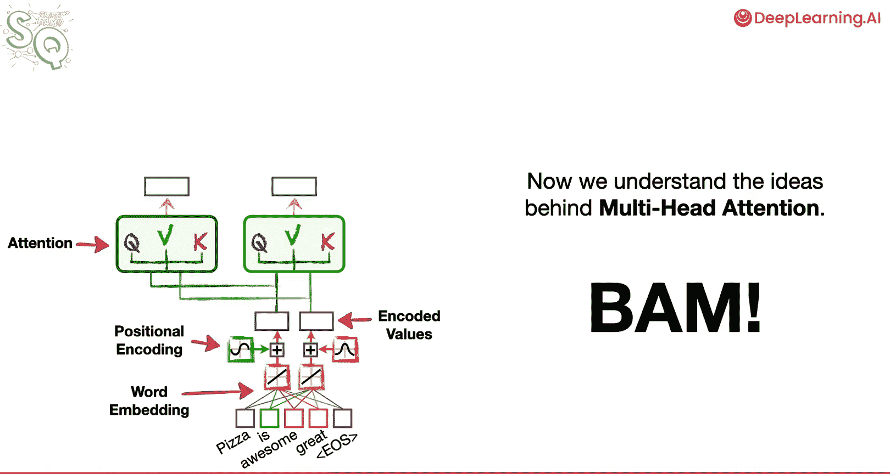