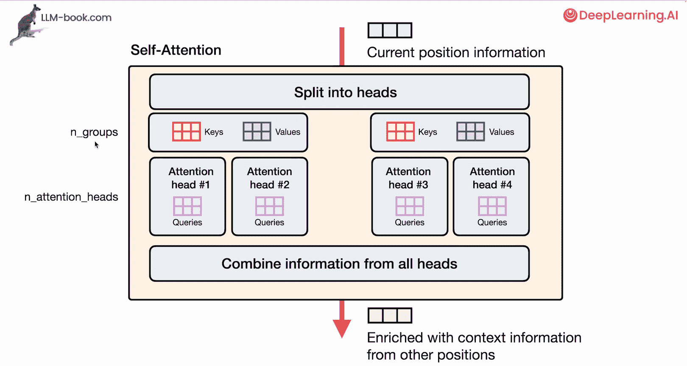
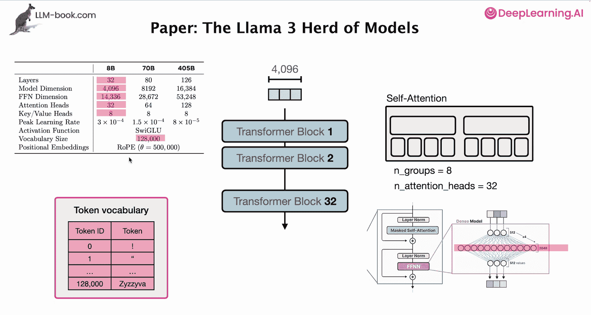
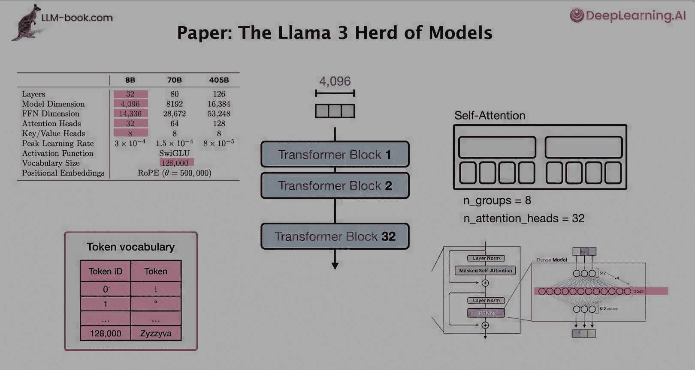

# 吴恩达《Transformer大语言模型工作原理｜How Transformer LLMs Work》（deepseek-R1翻译中英字幕 - P9：9.self attention.zh_en - GPT中英字幕课程资源 - BV1juNaeREyf

Self attention is a key component in the transformer block。

 You've learned that it consists of two steps， relevance， scoring and then combining information。

You'll now take a closer look at how those are calculated and how that has evolved in recent years to enable more efficient attention。

Let's dive in。 So by now， you know that self attention breaks down into two high level steps。

Relevanance scoring and then combining information。 Let's look at those at more detail。

Self attention happens within what we call an attention head。

 so let's assume we only have one of these attention heads right now that we're using to process self attention。

We have the token that we're currently processing。And then we have the other positions in the sequence。

 So these are the vector representations of the other tokens that precede this token。

Selfattention is conducted using three matrices， the query projection matrix。

 the key projection matrix and the value projection matrix for transformers。

 the queryries keys and values are important concepts In this calculation。

 you'll get a sense of what each of them is used for。

 These weight matrices are used to calculate query key and value matrices。

 and through some interaction that we'll discuss in the next coming slides。

 we can go about scoring the relevance and then combining the information。

 So let's say on the query side here we have this query that represents the current position。

 and then this matrix let's say each row here represents one of the other tokens in the series。

 and the same thing is done with keys and values。 each row is a vector represents one position in the sequence。

 The end goal of relevant scoring is something like this。

 Every token that we have in a score assigned to them telling us how。😊。

relevan this token is to the token we're currently representing in this case。

 let's say we have the dog that has the highest relevance scoring and so more of those the representations of the tokens and the dog will be baked into the enriched vector here towards the end。

 but this is the end of relevance scoring giving us these scores and they add up to 100。Now。

 technically， how this is done is by matrix multiplication。

 we multiply the queries vector associated with the current token by the keys vectors that represent all of the previous tokens。

 This is a high level intuition。 But if you want to know more about how attention is calculated and implemented。

 deep learning AI has a short course that is entirely devoted to the calculation and implementation of attention。

 You can see that on the screen if you want to dive into more details。

 I highly recommend that Joshua Starmer is incredible in I love Staquests。😊。

And then now that we have the relevant scores， we can start with the second step。

 which is combining information from the relevant tokens that is done using the values vectors associated with each of these tokens。

 So each token has a values vector associated with it。

 We just multiply the score of each token by the vector value。

 and that gives us these weighted values where the dog would have the highest value。

 and then these will be closer to0 because we're multiplying them by smaller numbers。

And then once we have our weighted values， we just sum them up。

 and then that is the output of this second information combination step。

 As we've mentioned that calculation happens within an attention head， but in self attention。

 the same operation happens in parallel in multiple attention heads。

Each attention head has its own set of keys， queries and values weight matrices。

The attention that they assign to the various vectors is different。

 so we can think about two components of self-attention before splitting into attention heads。

 there's this step of splitting that information into the attention heads and then we have a step of combining that information from all of the attention heads back together to form this this output of the self-atten layer。

 it's also important to visualize those keys queries and value matrices。

 So we've said that each one of these attention heads has its own set of projection matrices for keys。

 queries and values。 and now that you have that visual we can talk about more recent forms of attention。

 that power the current generation of transformer large language models to make self-atten。

More efficient because this is usually one of the steps that takes the longest and requires the most computational time in transformers。

 So one idea that was proposed to make attention more efficient is this idea of multi query attention。

 And the idea here is that not each attention has its own keys and values。

 But no let's have them all share the same keys matrix and values matrix。

 So you only have one for the entire later one set of these two projection weight matrices。

 you can think of this as some sort of compression。

 So we have a smaller number of parameters to calculate all of this and this helps models be faster when they calculate self- attention。

 more recently， grouped query attention is a efficient attention mechanism that allows us to use multiple keys and values。

 not the same number of attention heads。 It's a smaller， lower number what we refer to here。

As number of groups and this leads to better results than when we just shared one set of keys and values matrices。

 This is especially important with larger models that required more of those parameters to represent the data that is required to really do selfattention on very large sets of training data And so now when you read papers that describe the architecture of the model that they trained。

 you will find if they use multi queryry attention。

 they will mention how many attention has that they use。

 but also how many groups of keys and values that they use Another important recent idea for improving the efficiency of attention is this idea of sparse attention and this usually happens not in all layers So let's say the first layer has self-atten in the way that we've just discussed where token number7。

 as we're processing it is able to attend to all of the tokens that that preceded it in larger and larger models that becomes a little bit too expensive if you allow that to happen at every layer。

So you start to see that maybe interweaved， so layer 2 and layer 4 and layer 6， for example。

 are not able to attend back to all of the tokens in the history。

 but maybe to the last four or 16 or 32 this is an idea that's called sparse attention one way to think about it if we're to set up some visual language let's say we have the token the we're processing it now so we can't really attend to any previous tokens。

But let's say the second token is dog， so dog can attend to both the and dog。

And then we have chased the third token and that is able to attend to three tokens so we have chased attends to dog and now this is just to set up the visual language for figures like this that describe what sparse attention looks like So this is full attention where every token can attend to every previous token so we can think of each row as as a step in processing。

 maybe we generated this token and then when we've generated it where do we attend to but sparse attention can be like this。

 this is strideed where at every position you can look back at the last three or four but then you can also maybe look at specific position so you can look at position number one and and four here for example and then another idea of sparse attention is this idea fixed where there are these fixed positions in the context sequence that after you reach token number four you're only allowed to look at the tokens from four until the current position。

This is a figure from this paper generating long sequences with sparse transformers that goes a little bit into more detail about how these methods work more recently and to allow these models to go through 100000 or a million token context sizes are ideas like ring attention。

 and for that I'd highly recommend you check out this blog post ring attention explained that goes through a highly visual and animated explanation of the ring attention and how it works。

 Congratulations for making it this far now that you've seen all of this visual language when you are reading a paper like this。

 this is the most recent at the time of recording paper by meta for the Lama 3。

1 models when you go to the architecture section you should by now have the visual language to think through all of these parameters that describe the architecture of the model And so when you look at tables like this you know what each of these components look like if we。

Ex and look at this A toB model， you can see that it has 32 layers。Which can look like this。

 So this is a set of how many transformer blocks that it has。 It has 4000 model dimension。

 That is the dimension length of the vector that flows through the transform。

 You see that the feed forward neural network has a dimension of 14000。

That is how many units are in this part of the feedford neural network。

You see that it has 32 attention heads。And you know what those are。

 and you see that it's using grouped query attention with eight key value heads。

 and that's the number of groups。You also see that it has a vocabulary of 128。

000 and you know how that is represented inside of the tokenizer and the associated embeddings matrix inside of the model。

 and you can see that it uses rope for positional embeddings。

 This is a method called rottary embeddings that we'll talk about in the next lesson。

