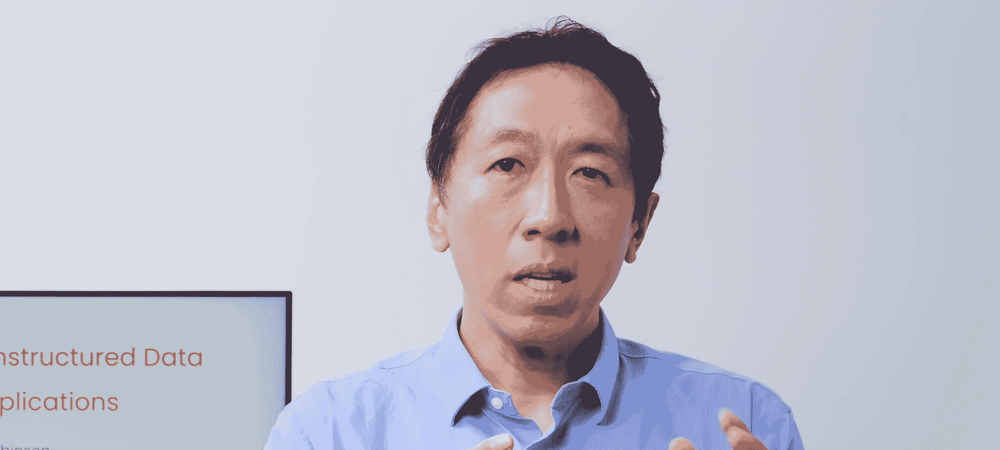
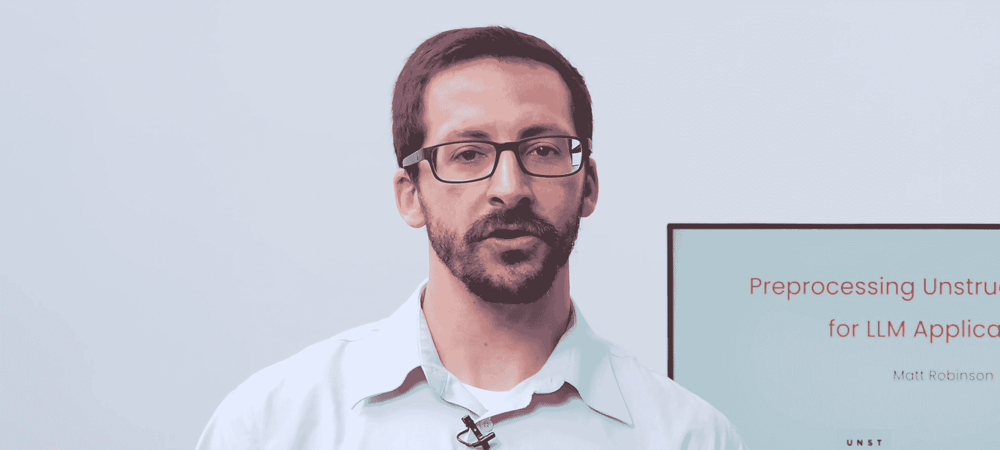
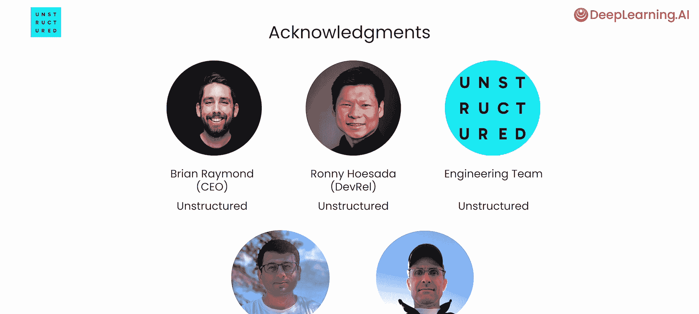
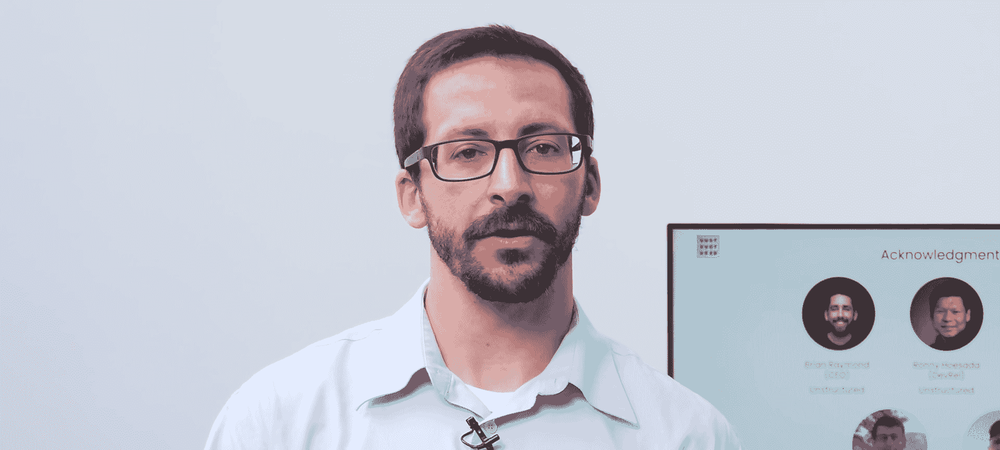

# 吴恩达《为LLM应用程序预处理非结构化数据｜Preprocessing Unstructured Data for LLM Applications》中英字幕 - P1：1.introduction - GPT中英字幕课程资源 - BV1ji421f7QD

欢迎来到与Unstructured合作开发、由Matt Robinson讲，授的LLM应用非结构化数据预处理课程。检索增强生成（RAG）正在许多企业广泛采用。

典型的RAG管线包括数据加载、分块、嵌入、存储在向量，数据库中，然后检索等关键组件。在本课程中，您将学习如何表示各种非结构化数据，如文本。

、图像和来自PDF、PowerPoint和Word等许多不同来源的，表格，以便让您的LLM RAG管线访问所有这些信息。RAG中一个特别具有挑战性的任务是数据加载和分块，因为。

数据存储在许多不同的文件类型和数据格式中。例如，您可能在Excel电子表格中有数值数据，或者在PDF或，Markdown文档中有文本报告，或者在PowerPoint、幻灯片。

或Keynote演示文稿中有幻灯片，或者在Outlook或Slack或，Teams中有通信等。每种文件类型本身也可能支持以不同格式存储在其中的数，据。例如。

PDF或PowerPoint文件本身可能包含表格、图像或项，目符号列表。因此，数据加载器必须首先能够解析许多不同的文件格式，但是，一旦解析了这些数据，接下来呢？事实证明。

从这些不同来源规范化数据非常有用。因此，当您规范化来自PDF或PowerPoint等文档中的表格时，所有这些都可以以类似的方式表示，或者从PDF或电子邮，件中的项目符号列表中也可以以类似的方式表示。

此外，通过在元数据中保留结构化信息，保留原始文档的某，种结构也是非常有用的。例如，可能会录制一个段落有一个父项，即章节的标题。匹配该章节的查询可以扩展为返回子文本，例如，在此示例。

中，您的数据组织为树形层次结构。接下来，我们请到了Matt Robinson，他是Unstructured公，司产品主管，为我们解释所有这些是如何完成的。

Matt 的团队负责为LLM使用而设计的非结构化数据摄取工，具，他帮助许多开发人员构建使用和结合来自不同来源数，据的LLM应用程序。谢谢，Andrew。我很高兴能与您和您的团队合作。

本课程解决了LLM应用程序开发中关键但常常被忽视的方，面，即数据预处理。您将学习如何从各种文档类型中提取和规范化内容，包括，PDF、PowerPoint、Word和HTML，使您的LLM能够访问各种。

信息。您还将学习如何使用元数据丰富此内容，并增强RAG结果，支持细致的搜索功能。本课程涵盖了文档图像分析技术，如文档布局检测和视觉，变换器，并教您如何提取和解释表格。

最后，您将应用这些技术构建一个RAGBOT，使用诸如PDF、，PowerPoint和Markdown文件之类的文档，将您所学到的一，切整合起来。许多人共同努力创建了本课程。

我要感谢Unstructured公司的Brian Raymond和Ronnie ，Hoseda，以及Unstructured的工程团队。DeepLearning。

ai的Eshmel Gagari和Jeff Lardway也为本。

课程做出了贡献。在第一课中，您将学习如何从各种类型的文档中提取和规，范化内容，以便您的LLM可以引用来自PDF、PowerPoint、。

Word文档、HTML等的信息。数据工程是让您的LLM获得所需上下文的关键，从而让它们，在应用程序上表现出色。我希望您喜欢学习这些领先的技术，我认为您会发现对构，建许多应用程序都很有用。

