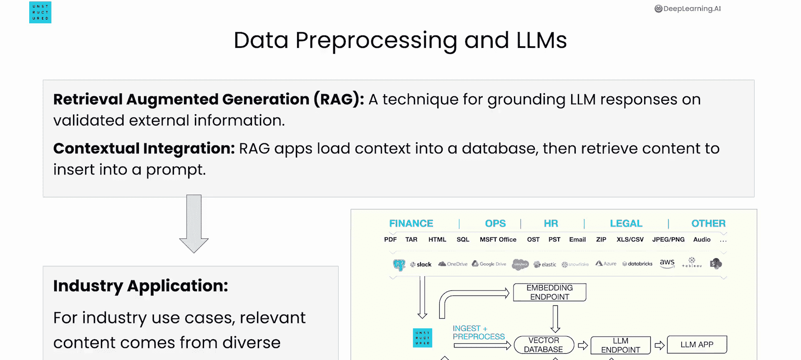
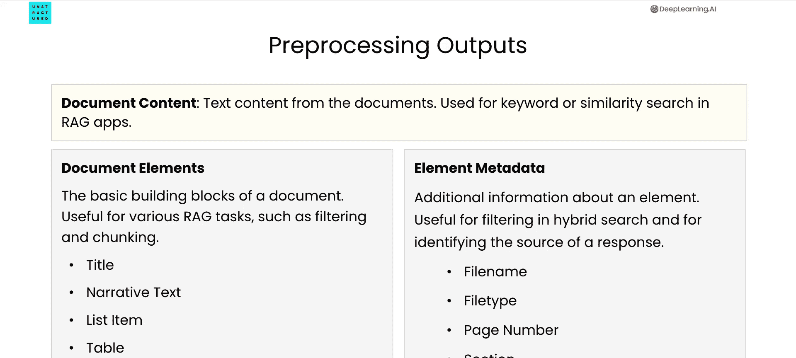
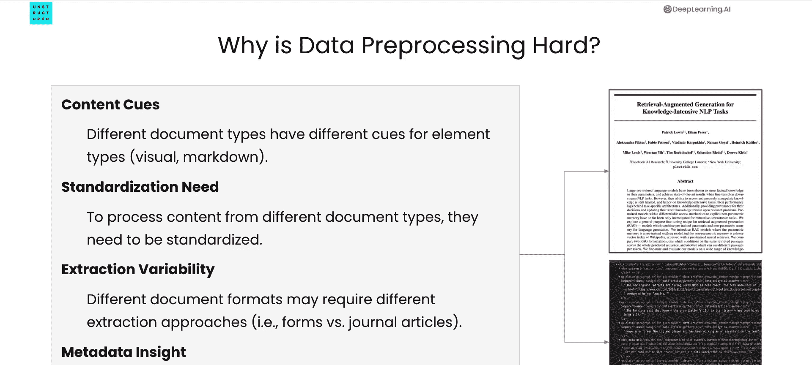

# 吴恩达《为LLM应用程序预处理非结构化数据｜Preprocessing Unstructured Data for LLM Applications》中英字幕 - P2：2.overview - GPT中英字幕课程资源 - BV1ji421f7QD

在本课程中，您将学习 LLM 数据预处理的所有基础知识，以及为什么以及如何在构建使用来自不同来源具有不同文，件格式和结构的数据的 LLM 应用程序时，这是一个重要且，具有挑战性的问题。让我们开始吧。

在您学习如何预处理特定数据类型之前，了解这个过程在，整体架构中的位置非常重要。首先，了解检索增强生成，即 REG，是很重要的。这是一种将 LLM 响应基于经过验证的外部信息（例如您的，企业信息）的技术。

这些信息可以包含在各种文档类型中，例如电子邮件，PDF ，或 PowerPoint 幻灯片中。在概念上，RAG 应用程序将这些外部上下文加载到数据库，中，然后检索该内容，将其插入到提示中。

然后将该提示传，递给 LLM。这样，当问题或提示传递到 LLM 时，它包含了 LLM 可以用，来构造其响应的外部信息。在行业应用中，这非常相关，因为组织数据存在多种格式。

文档预处理包括几个步骤。首先，您需要提取文档内容。这是文档中的文本内容，可用于构造您的提示。还有其他重要的信息需要提取，包括文档元素。这些是文档的基本构建块，例如标题，叙述文本，列表和表，格。

您可以使用这些文档元素执行一些重要的任务，这些任务，对于 RAG 应用程序非常重要，例如分块和过滤。您将在课程后期了解更多关于这些操作的信息。此外，提取元素元数据，如页码或文件类型，也是非常重要，的。

在课程的后期，您将学习如何在执行混合搜索时使用此信，息，这使您能够在构建提示时过滤从向量数据库中提取的。

信息。那么，为什么数据预处理很难呢？嗯，有几个原因。首先，不同类型的文档具有不同的内容键。因此，例如，HTML 文件可能使用标记名称来指示文本片段，是标题还是列表。PDF 文件将具有视觉提示。

因此是完全不同的提示。因此，能够以通用方式预处理所有这些不同类型的文档需，要您了解不同文档类型如何指示文档类型中的不同元素。其次，文档以各种格式存在。您需要使这些文档标准化，以便您的应用程序可以以相同。

的方式处理它们。因此，理想情况下，您的应用程序只需知道外部信息。它并不一定关心源文档是 HTML 还是 PDF。通过标准化这些文档，您可以在最终用户应用程序中以相，同的方式处理所有这些文档。但是。

标准化很困难，因为这些文档再次具有不同的格式和，不同的提示，指示元素类型。此外，不同的文档具有不同的格式。因此，例如，期刊文章和表格是不同的。因此，数据预处理技术需要能够考虑这种变异性。最后。

您需要了解文档结构信息，以提取有意义的元数据，您可以将其用于RAG应用程序中的各种操作，例如过滤，您，将在本课程的后续部分中学习到。总的来说，当涉及数据预处理时，有很多要素需要考虑，这。

并不是非常简单的，但它是开始并运行RAG应用程序的重要，部分。在下一课中，我们将深入了解如何预处理一些不同类型的。

