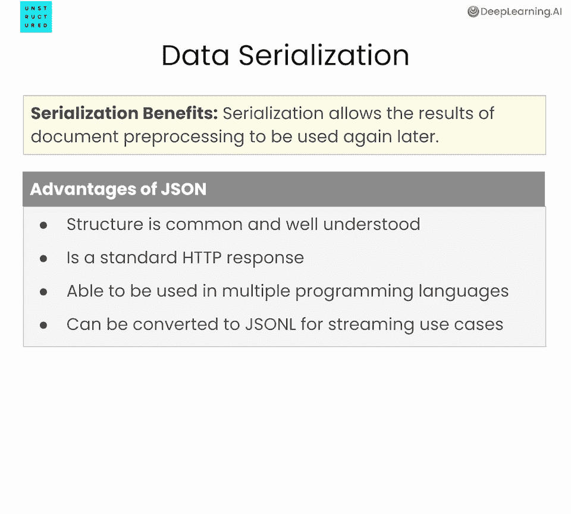
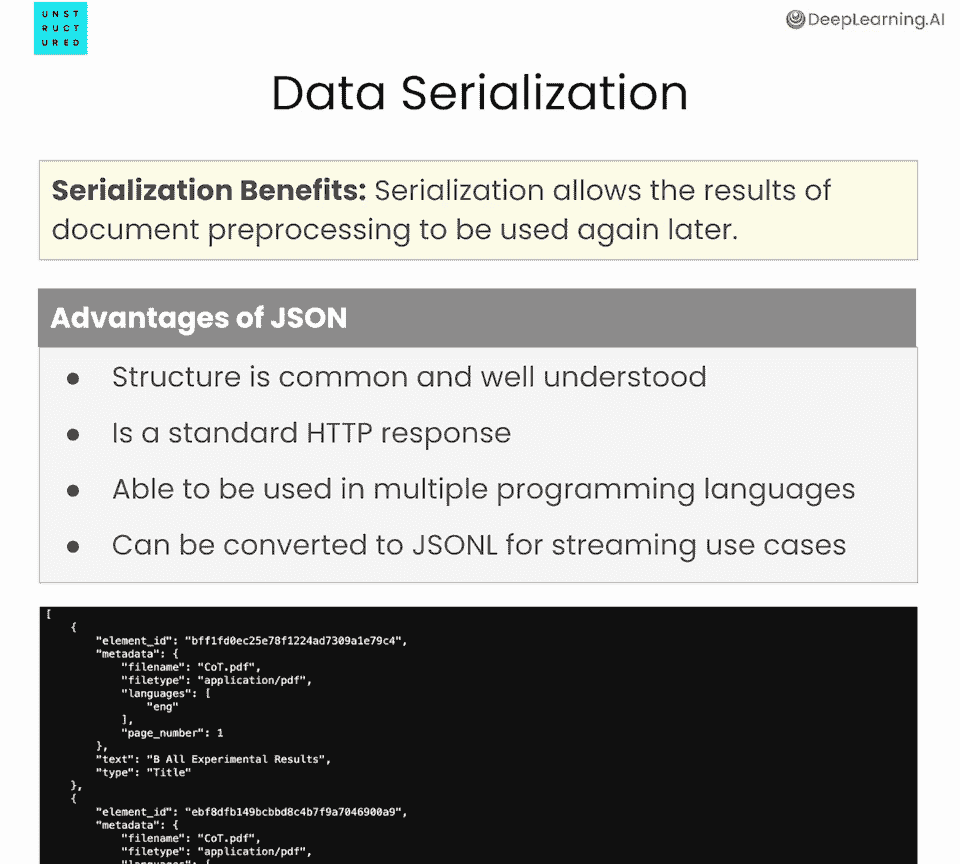
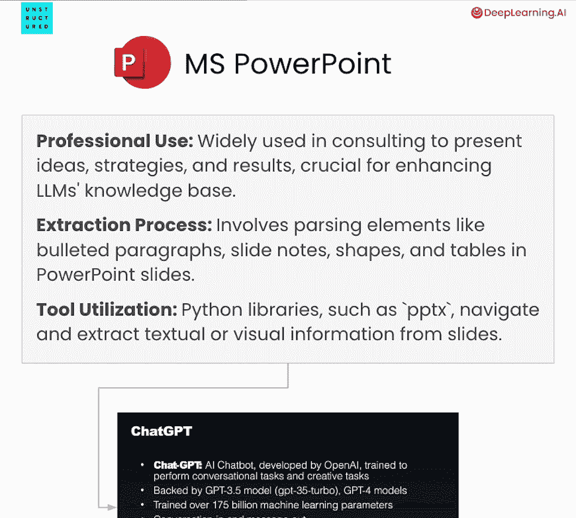
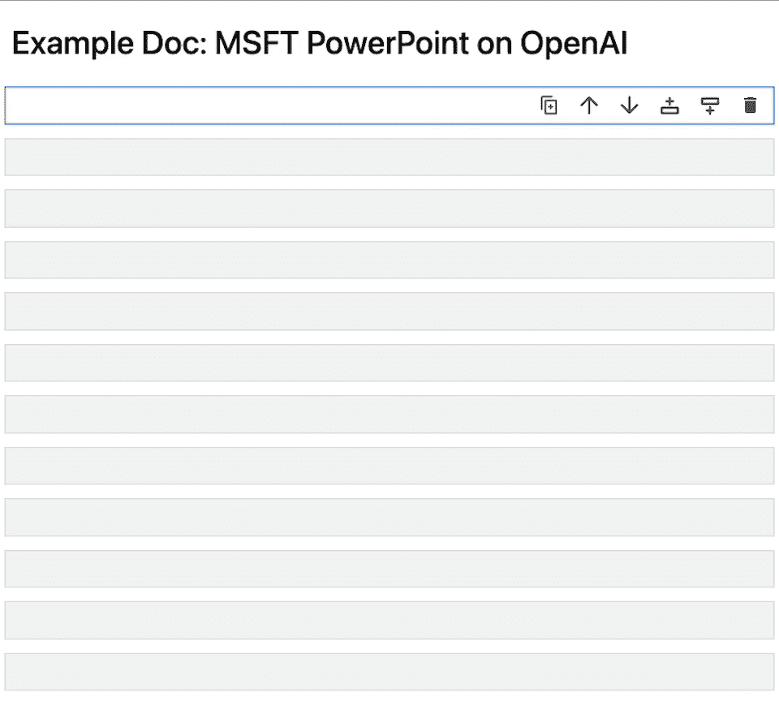
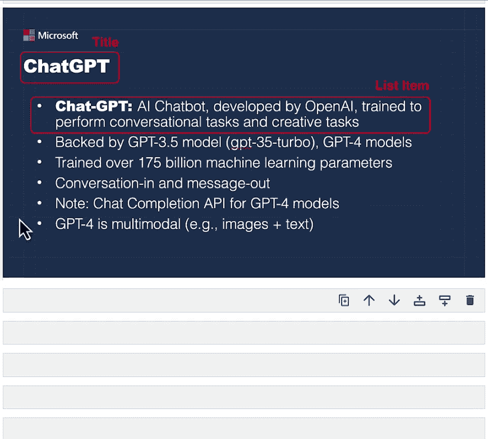
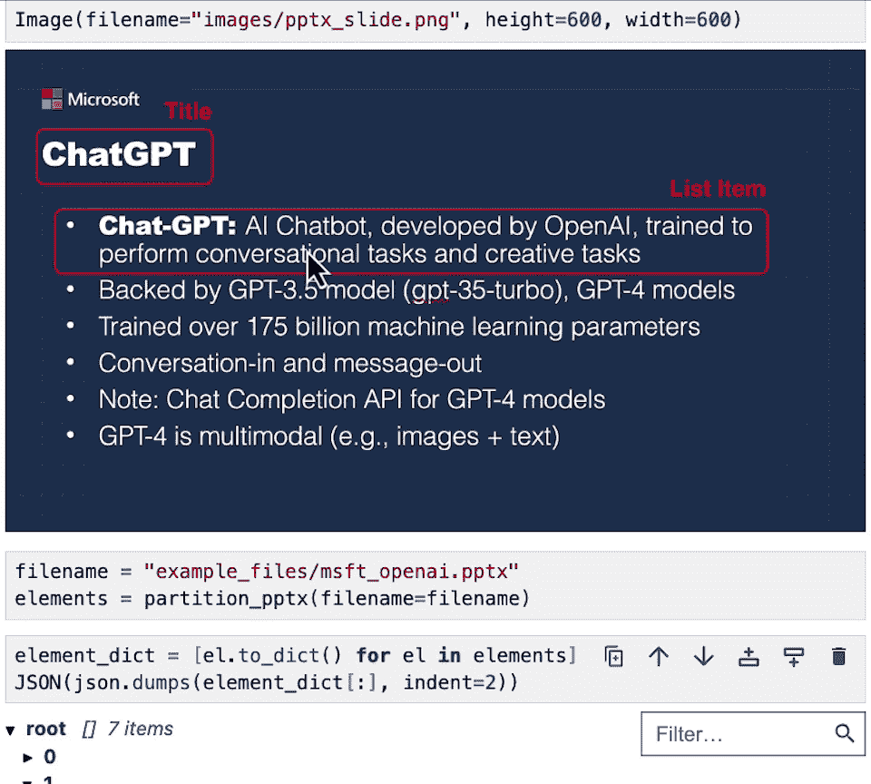
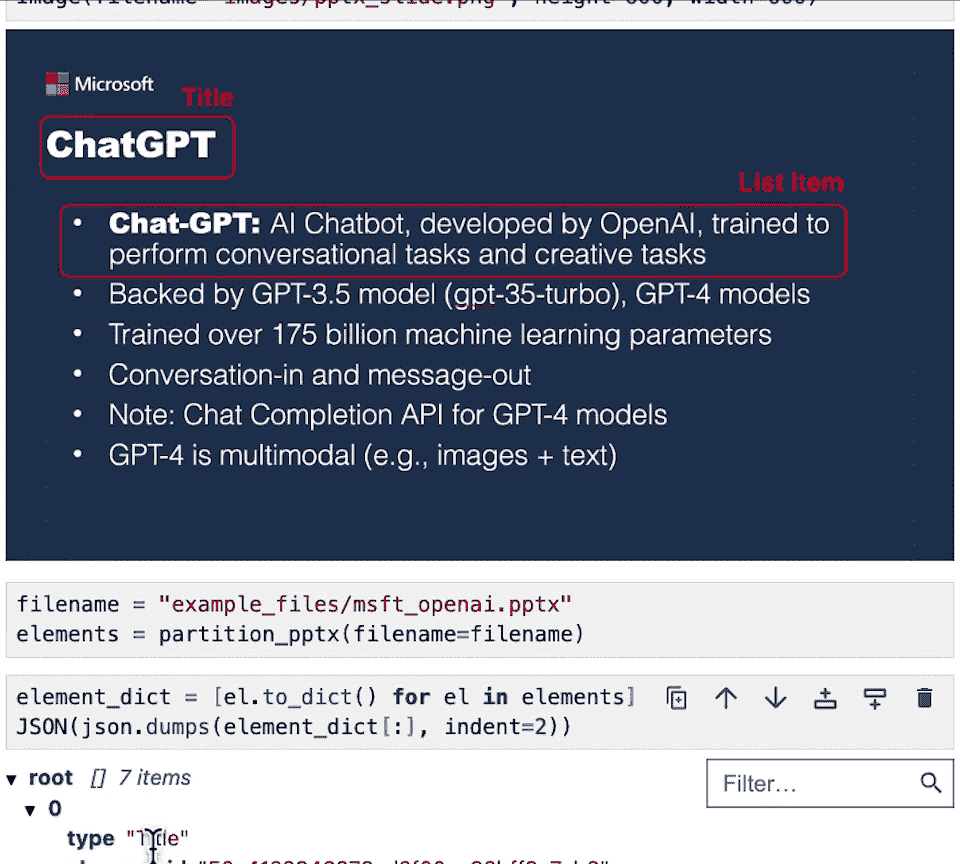
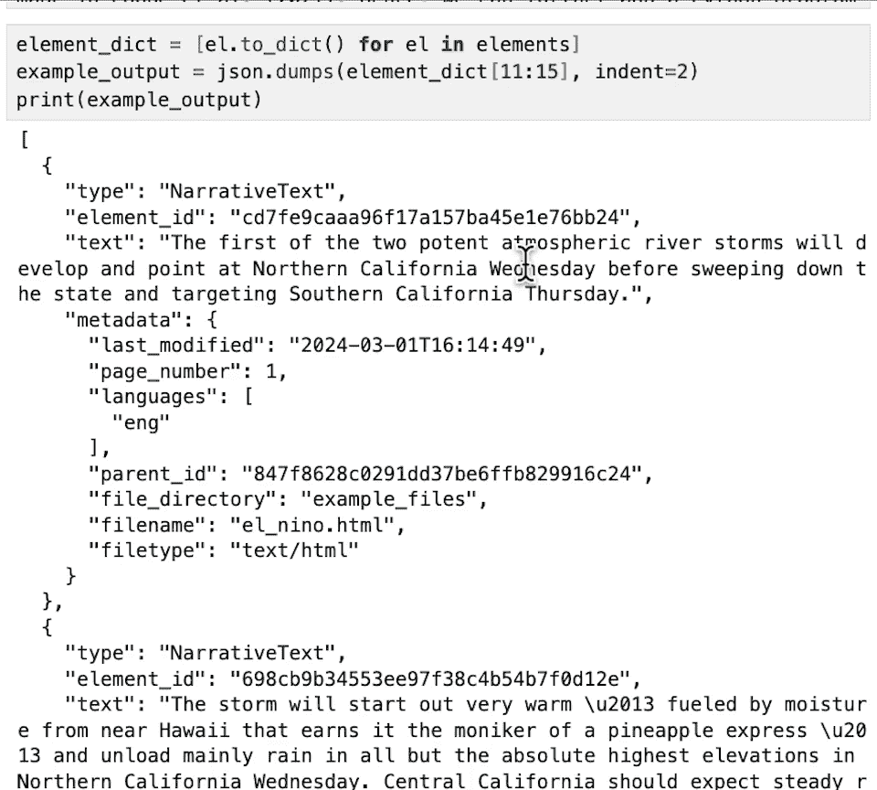

# 吴恩达《为LLM应用程序预处理非结构化数据｜Preprocessing Unstructured Data for LLM Applications》中英字幕 - P3：3.normlize - GPT中英字幕课程资源 - BV1ji421f7QD

在本课程中，您将学习如何从各种文档类型中提取和规范，化内容，以便您的LLM可以引用PDF、PowerPoint、Word文，档、HTML等中的信息。好的，让我们深入代码。首先。

您将了解为什么需要规范化各种文档类型。首先，文档存在多种格式。想象一下您在组织或大学看到的所有文档。您可能看到过PDF或Word文档，甚至是HTML文档，所有这些，文档都以不同的格式存在。

当您构建LLM应用程序时，您实际上不希望关心文档来自何，处。您希望它们都以一种通用格式呈现，以便在LLM应用程序中，您可以以相同的方式处理它们。因此，做到这一点的第一步是将这些文档分解为标题和叙。

述文本等常见元素。这样做有几个好处。首先，它允许您以相同的方式处理任何文档，而不管其来源，格式如何。这将使您能够执行诸如过滤掉不需要的元素（如页眉和页，脚）之类的操作。

如果您要为HTML和PDF文档分别执行此操作，您将不得不为，每个文档编写单独的逻辑。通过将它们规范化，您可以使用相同的代码片段完成所有，操作。其次，它允许您在所有不同的文档类型上以相同的方式应。

用下游操作，例如分块。因此，您不必为每种文档类型创建不同的分块策略。这在降低处理成本方面也有好处。通常，预处理文档最昂贵的部分是提取初始内容。下游操作，如分块，通常成本不高。

通过将所有内容规范化为相同格式，您可以以非常低的计，算成本尝试不同的分块策略。一旦您规范化了内容，通常的下一步是数据序列化。因此，数据序列化有一些好处，这使您可以在以后重复使用，输出。

而无需再次预处理文档。在本课程中，您将把数据序列化为JSON。这里有其他选项，但是由于多种原因，JSON是方便的。首先，它是一种常见且广为人知的结构。其次，它是标准的HTTP响应。

当您处理需要在API上运行模型工作负载的PDF和图像等文，档时，这将发挥作用。JSON也可以在多种编程语言中使用。这很重要，因为如果您正在使用JavaScript构建应用程序。

您可以在Python中预处理文档，将输出序列化为JSON，然后，将这些输出读入JavaScript应用程序中。最后，JSON也可以用于流式处理用例，例如将文档存储为。

JSON-L。这是在本课程中预处理文档时，序列化输出看起来像的示。

例。所以现在您将了解一下预处理几种不同类型的文档。您将首先学习的是HTML。因此，这对于LLMs是相关的，因为在许多情况下，您希望从，互联网中的内容读取到LLM应用程序中。当您理解HTML文档时。

通常会查看HTML标记。因此，例如，H1标记将指示内容很可能是一个标题。一个段落标签表示内容很可能是叙述性文本。除了使用这些标签之外，还使用自然语言处理功能来理解，文本内容，以更好地理解内容的分类。

因此，例如，在段落标签中具有多个句子的长内容很可能是，叙述性文本，而在段落标签中全大写的短内容可能更有可，能是标题。因此，我们可以同时使用文档中的结构化信息和非结构化，信息来对元素进行分类。

这是实际页面中可能看起来的示例。因此，在此示例中，标题由 H1 标签表示，然后在叙述性文，本下的第二个框中，该内容在段落标签中表示。现在您已经了解了如何预处理 HTML，可以将所学内容付诸，实践。

您将首先导入几个辅助函数，这些函数将允许您预处理这，些文档。所以首先，您将导入这个。这只是过滤我们在课堂上不想要的警告。接下来，您将从非结构化开源库中导入几个辅助函数。在这种情况下。

您将使用非结构化开源库中的分区 HTML ，函数来预处理 HTML 文档。稍后，您还将使用分区 PowerPoint。从非结构化开源库导入这些辅助函数之后，还将设置使用，非结构化 API 所需的内容。

您将在本课程中需要处理 PDF 或图像的情况下使用非结，构化 API。这是因为这些是昂贵的基于模型的工作负载，需要更多的，设置。这段代码允许您设置凭据以使用非结构化 API。

这里我们正在设置非结构化 API 客户端。现在让我们来看一下您在课程中之前看过的 HTML 文件。让我们在这里打开一个它的屏幕截图。这就是该文档的外观。这是来自非结构化博客的文档。

您将读取 HTML 文件，然后使用非结构化开源库对其进行，分区。首先，只需查看文件名。这个文件包含在您的笔记本目录中。其次，使用非结构化开源库对其进行分区非常容易。

您只需调用之前导入的分区 HTML 函数并传递文件名即可，现在您有了输出，可以将其转换为字典。然后，就像您在课程中学到的那样，您可以将其转换为 ，JSON 对象进行序列化。这样。

我们将所有元素都转换为字典。然后从字典中，轻松转换为 JSON 文件。因此，对于这个初始输出，您将查看 JSON 对象的字符串表，示形式。稍后，我们将只有一个 JSON 显示对象，这将更容易地导航。

到此对象。现在您已经看过 JSON 对象的外观，可以使用 IPython 中，的此 JSON 显示函数更轻松地导航这一点。因此，如果执行该操作，您将看到每个元素都是该列表中的，一个元素。

您可以浏览并轻松地导航。因此，在这种情况下，您可以看到您在这里检测到叙述文本，这是 Medium 博客的第一段。所以，您已正确提取了作为标准化输出中叙述文本的部分。

现在您已经了解了如何预处理 HTML 内容，这对于从互联，网上获取知识并将其插入到 LLM 应用程序中非常重要，特，别是对于网页抓取用例。在企业环境中，能够预处理其他文档类型（例如 。

PowerPoint）也很重要。这些文档广泛用于各种商业领域，如咨询或一般业务。对于企业用例来说，这对于扩展 LLM 对您的组织的知识至，关重要。因此。

Microsoft PowerPoint 的提取过程实际上与 PPTX ，文件中的 HTML 在幕后非常相似。因此，更现代的 PowerPoint 文件是一堆我们可以使用基。

于规则的逻辑预处理的 XML。您可能也熟悉旧的 。PPT PowerPoint 文件。当您处理这些文件时，很容易将它们转换为 。PPTX，然后使，用基于规则的解析器解析它们。因此。

您可以利用 Python 库（如 PPTX）来浏览这些文件中，的元素并预处理内容。因此，您可以查看下面的文件。您将看到如何在 Jupyter 笔记本中预处理此文档。

好的，现在您已经了解了如何预处理 PowerPoint 文档。让我们使用您刚刚查看的有关 OpenAI 的 PowerPoint 文，稿来实践一下。因此，您可以看看这里的文档是什么样子的。

再次，就像您对 HTML 文件所做的那样，您只需将其传递给。

非结构化开源库的 partition PPTX 函数。因此，您只需在这里获取文件的名称。然后，就像您之前处理 HTML 文件一样，这次不是分割 ，HTML，而是分割 PPTX，传入文件名。

然后您就可以提取元素，了。就像之前一样，您可以将这些输出转换为 JSON。因此，您可以在这些元素之间导航。因此，您可以看到您正确地将项目符号列表中的第一项标。

识为列表项，并提取了这里的文本。这里重要的一点也是，您将文本“chat gtpt”标识为标题。因此，就像您在 HTML 文档中识别 h1 标签为标题一样，您。

也能够识别 PowerPoint 文件中的等效元素为标题。同样重要的是，一旦您对应用程序规范化了这些文档，您就。

可以以相同的方式处理它们。好的，现在您已经了解了 HTML 和 PowerPoint。在这两种情况下，您都学会了如何使用基于规则的逻辑预，处理文档。现在您将学习一个更复杂的用例，即 PDF 文档。

PDF 文档与 HTML 或 PowerPoint 有些不同，因为在那些，文档中，您是在查看半结构化信息，以了解如何划分文档中，的元素类型。在 PDF 或图像中，您将寻找不同的内容。您将寻找视觉线索。

因此，在 PDF 中，您将查找文档中的格式设置等内容。因此，在 PDF 中，将文本标记为粗体并加下划线的可能更，有可能是标题。而一些更长、更厚重且包含多个句子的文本，也许没有粗，体或下划线的强调。

更可能是叙述性文本。因此，这使您能够预处理这些文档。再次强调，您将查看文档中的视觉信息，而不是半结构化信，息，就像您在处理HTML或PowerPoint时所做的那样。所以你可以在这里看到一个例子。

通过查看这份文档，您会发现顶部的文本“All ，Experimental Results”是粗体，并且旁边有一个B。因此，在视觉上，这看起来像是一个标题，而下面的文本看，起来像叙述性文本。

您还能够识别该文档中的一个表格。您稍后将更具体地了解如何处理表格。现在，您已经学习了一些关于预处理PDF的知识。让我们在一个PDF上实践一下。在这种情况下，PDF将是关于思维链推理的学术论文。因此。

首先，您可以查看一下此文档在笔记本目录中的图像，文件夹中的样子。同样，在这种情况下，我们将找到像这样的标题。我们将找到叙述性文本的部分，并且还将识别表格。在这种情况下，您可以像在以前的案例中所做的那样。

从抓，取文件名开始。但是，这一次，与其将文件名传递给非结构化开源库，您将，其传递给非结构化API。在这种情况下，您将使用API的原因是因为PDF处理是一种，基于模型的工作负载。

这是计算上昂贵且有点难以在本地，运行的。因此，您将使用API，其中模型已经设置好并准备就绪，而不，是使用开源库。现在，您有了文件名。您可以使用之前设置的非结构化API客户端来准备您的请，求。然后。

一旦准备好，您就可以发出请求。再次强调，这是一个基于模型的工作负载，因此处理过程需，要一点时间。所以如果需要几秒钟，不要担心。好的，现在您的PDF已经处理完毕。

您可以看到来自API的JSON响应看起来很像我们之前在使，用非结构化开源库时序列化的JSON。因此，您可以在这里看到文档元素。就像之前做过的那样，您可以使用IPython的JSON显示功能。

来探索这个JSON。这里的关键是，您可以直观地识别出所有展开的结果是一，个标题，它与您的幻灯片文件和HTML文件中的标题具有相，同的标准化类型。这里的关键是。

如果您有一个包含幻灯片、HTML文件和PDF，文件的语料库，您可以以相同的格式处理它们，并以相同的，方式处理它们。在课程的后面，您将学习如何在这些文件类型的多样语料，库上创建一个ragbot。

现在您可以尝试使用文件上传小部件自己进行操作。只需运行这部分代码，然后实例化您的小部件，然后您就可，以选择要添加到目录中的文件，以便自己尝试。您甚至可以在示例文件目录中检查它是否出现了，它确实，出现了。

ElNino。html。您以后还会再次看到这个文件。现在文件在这里，我们可以更改分区HTML部分中的文件名，以便您可以对自己的文件进行分区。我们将向上滚动到该部分，更新文件名，然后重新运行分区。

正如您所看到的，内容发生了变化，如果您有自己想要分区，的文件，您可以使用部件将其上传，然后进行分区。这就结束了第一课。我鼓励您尝试在自己的文档上进行这些操作，上传几个文，档，然后尝试使用库。

看看输出的结果是什么样的。在下一课中，您将学习更多重要的预处理技术，包括元数据。

