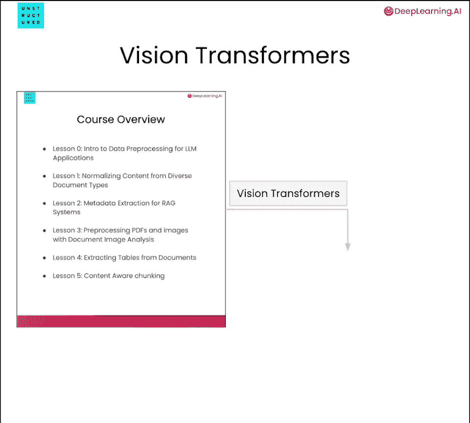
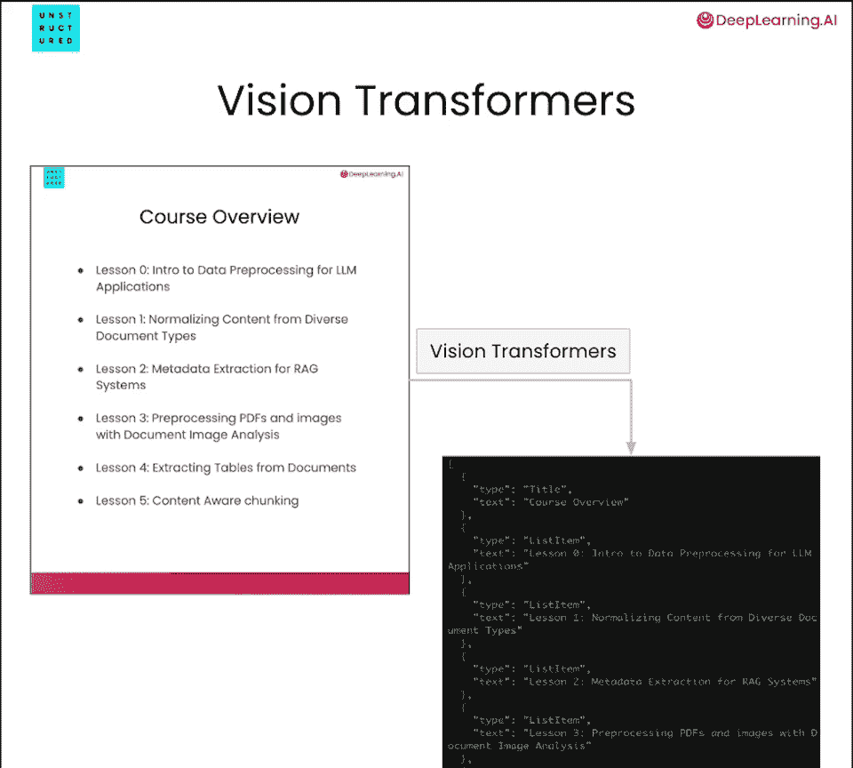
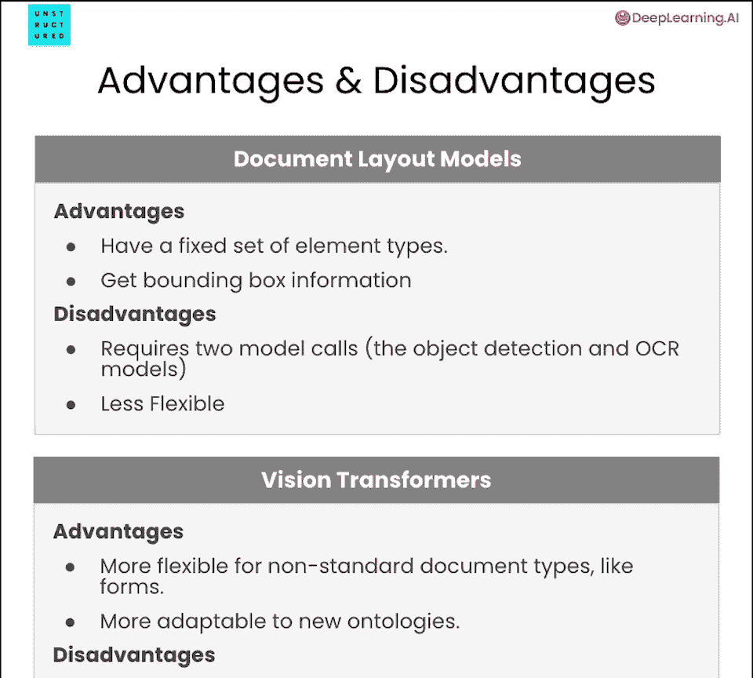
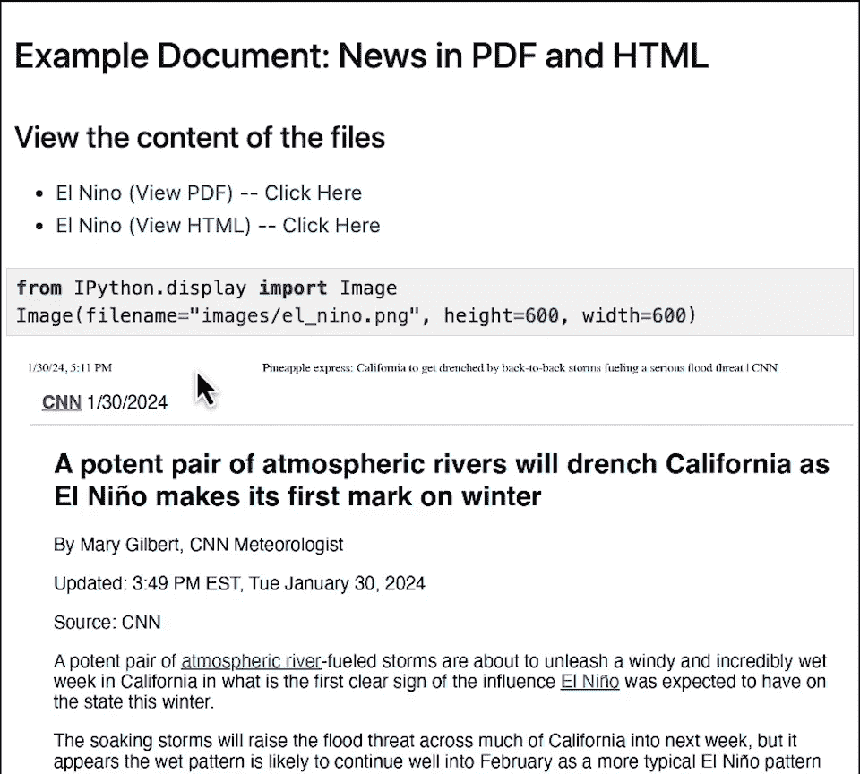
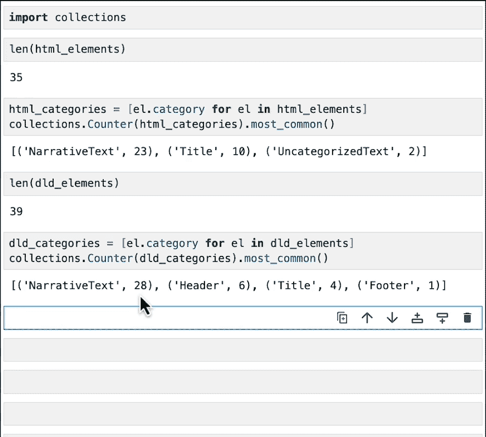

# 吴恩达《为LLM应用程序预处理非结构化数据｜Preprocessing Unstructured Data for LLM Applications》中英字幕 - P5：5.preprocess - GPT中英字幕课程资源 - BV1ji421f7QD

一些文档类型，如 PDF 和图片，需要模型进行预处理。在本课程中，您将学习有关文档图像分析技术的知识，例如，文档布局检测和视觉转换器，以及如何使用这些技术处理 ，PDF 和图片。让我们开始编码！

到目前为止，您已经学习了如何预处理需要基于规则的解，析器（如 HTML、Word 文档和 PowerPoint）的文档。但是，某些文档本身没有结构化信息可用，例如 PDF 和图，片。对于这些文档。

您需要使用视觉信息来理解文档的结构。在本课程中，您将学习文档图像分析，它允许我们从文档的，原始图像中提取格式化信息和文本。在本课程中，您将学习两种文档图像分析方法，即文档布局，检测和视觉转换器。

文档布局检测使用目标检测模型在文档上绘制和标记边界，框。一旦绘制了这些边界框，边界框将被标记，然后从边界框内，提取文本。相比之下，视觉转换器以文档图像作为输入，并生成文本作，为输出。

这些模型可以被训练为生成结构化输出，如 JSON，作为输，出文本。需要注意的是，视觉转换器可以选择包含文本提示，就像 ，LLM 转换器一样。现在让我们学习文档布局检测。文档布局检测需要两个步骤。首先。

识别并分类文档中元素周围的边界框，然后从这些边，界框内提取文本。首先，您需要在文档中的每个元素周围绘制一个边界框，例，如叙述性文本、标题或项目符号列表。确定并标记这些边界框后，您需要提取文本。

根据文档类型，可能有两种方法可以做到这一点。在某些情况下，文本无法从文档本身获取。在这种情况下，您需要应用诸如对象字符识别或OCR之类的，技术来提取文本。在其他情况下，例如某些PDF文件中。

文本可以从文档本身，获取。您可以使用边界框信息将边界框追溯到原始文档，并提取，落在边界框内的文本内容。您可以看一下下面关于YOLOX模型的架构是什么样子的，这，是经常用于文档布局检测的模型之一。

如果您感兴趣，请查看下面的存档论文。作为文档布局检测实践的一个例子，请查看下面的示例。我们已经在各种文档元素周围绘制了边界框，例如标题、，叙述性文本和表格。确定了这些边界框并标记它们后。

您就可以提取文本。现在，让我们了解另一种文档图像分析技术，即视觉转换器，与文档布局检测相反，视觉转换器可以在一个步骤中从PDF，和图像中提取内容，而文档布局检测模型将会绘制一个边，界框。

然后在必要时应用OCR模型，视觉转换器接受图像作，为输入，然后直接生成文本作为输出。在这种情况下，不需要使用OCR从图像中提取文本。一种常见的视觉transformer架构是环形架构，或者叫文档。

理解transformer。当您应用诸如环形模型之类的模型时，您可以训练模型以，生成一个有效的JSON字符串作为输出，该JSON字符串可以，包含我们感兴趣的结构化文档输出。

您可以看到下面是环形模型的架构，如果您有兴趣了解更，多，请查看存档论文。现在让我们看看视觉transformer在实践中是什么样子的，您将获取文档的图像表示形式，将其传递给视觉，transformer。

一旦视觉transformer处理了文档，它将输出。

字符串。字符串将是一个有效的JSON，在这种情况下，JSON中的每个，元素都将包含元素的文本和元素的类别。一旦我们有了这个字符串，我们可以将其转换为我们从各，种文档类型中期望的规范化文档元素。

那么，我应该在什么时候使用视觉transformer，什么时候，使用文档布局检测模型呢？嗯，每种模型类型都有其优缺点。对于文档布局检测模型，一些优点是该模型是针对一组固，定元素类型进行训练的。

因此它可以非常非常好地识别这，些元素。其次，您会获得边界框信息，这使您可以将结果追溯到原始，文档，并且在某些情况下，可以在不运行OCR的情况下提取，文本。缺点包括在某些情况下。

文档布局检测模型需要两次模型，调用，首先是对象检测模型，其次是OCR模型。其次，这些模型不够灵活。你使用一组固定的元素类型进行工作，因此，如果你需要提，取其他内容，则可能需要进一步的重新训练才能做到。

那么，视觉转换器如何？视觉转换器的一些优点是，它们对于非标准文档类型（如表，格）具有灵活性，因此它们能够相对轻松地提取键值对等信，息。它们还更适应新的本体论。而对于文档布局检测模型来说。

添加新的元素类型是困难，的，但你可以通过提示可能向视觉转换器添加新的元素类，型。一些缺点是，该模型具有生成性，因此可能容易产生幻觉或，重复，就像在自然语言使用案例中一样。其次。

这些模型往往比文档布局检测模型计算量更大，因此，它们要么需要大量的计算资源，要么运行速度更慢。好的，现在我们已经学习了一些预处理 PDF 和图像的技术。

，让我们把它们付诸实践。在这个练习中，你将预处理相同的文档，首先是 HTML 表示，然后是 PDF 表示，你将看到无论是使用基于规则的技术，还是基于视觉线索提取信息，你都可以提取类似的文档类，型集合。

那么，让我们开始吧。首先，你需要导入一些与之前课程中相同的依赖项。所以，我们不会花很多时间来讨论这些，只是要说，由于处，理 PDF 是基于模型的工作负载，所以我们将通过 API 再，次进行。

因为那需要模型设置。现在，让我们来看看相同的文档作为 PDF 和 HTML 表示。你可以通过查看以下链接来了解这些文档的样子。在这种情况下，文档是 CNN 发布的有关厄尔尼诺气象模式。

的新闻文章。首先，您可以将文档处理为 HTML。为此，首先使用文件名，然后可以使用您在之前课程中使用，的非结构化开源库中的同一分区 HTML 函数。因此，如果我们将文件名传递给该函数，我们可以获得 。

HTML 元素。现在，您可以查看这些元素。正如您所看到的，它识别了一些叙述性文本，识别了一些标，题，在这种情况下，使用 HTML 标记以及有关文本本身的一，些自然语言信息。现在。

您可以预处理相同文档的 PDF 表示形式。首先，您可以使用非结构化开源库中的 FAST 策略对其进，行预处理。FAST 策略直接从文档中提取文本，并且可以在这种新闻文，章等简单 PDF 的情况下使用。

因此，如果您使用 FAST 策略预处理此 PDF，您可以提取元，素，如果您查看元素的外观，您将看到它们与您预处理文档，的 HTML 表示形式时提取的元素非常相似。您还可以使用文档布局检测模型预处理文档。

在这种情况下，您将使用 YOLOx 模型使用非结构化 API ，对文档进行预处理，该模型将在每个元素周围绘制边界框，并提取其中的文本。您可以使用高分辨率模型名称参数向非结构化 API 提供，此信息。

请耐心等待，因为这是一个基于模型的工作负载，处理可能，需要几分钟时间。一旦您的 API 调用完成，您可以看到输出的样子。同样，您可以看到模型识别了标题和叙述文本，输出非常类。

似于 HTML 和快速策略输出。一旦您拥有这些输出，您可以将它们进行比较，看看它们有，多相似。HTML 输出有 35 个元素，您也可以按类型计算元素的数量，在这里。

您可以看到它有 23 个叙述文本元素和 10 个标，题元素。文档布局检测输出有 39 个元素，包括 28 个叙述文本元，素和 10 种不同类型的标题元素，包括本例中的页眉和标，题。因此。

您可以看到输出并不完全相同，但它们非常接近。所以无论这个文档是以 PDF 格式还是 HTML 格式表示，您，都会得到几乎相同的输出，并且可以在您的应用程序中同，样处理这些文档。

现在您知道如何预处理 PDF 文档了，可以尝试一些自己的，东西。首先，尝试使用视觉转换器对文档进行预处理，将高分辨率，模型名称更改为 Chipper 而不是 YOLOX，看看输出的样子。

您还可以尝试预处理您自己的 PDF 文档。在下一课中，您将学习有关预处理具有更复杂布局的 PDF。

包括表格。