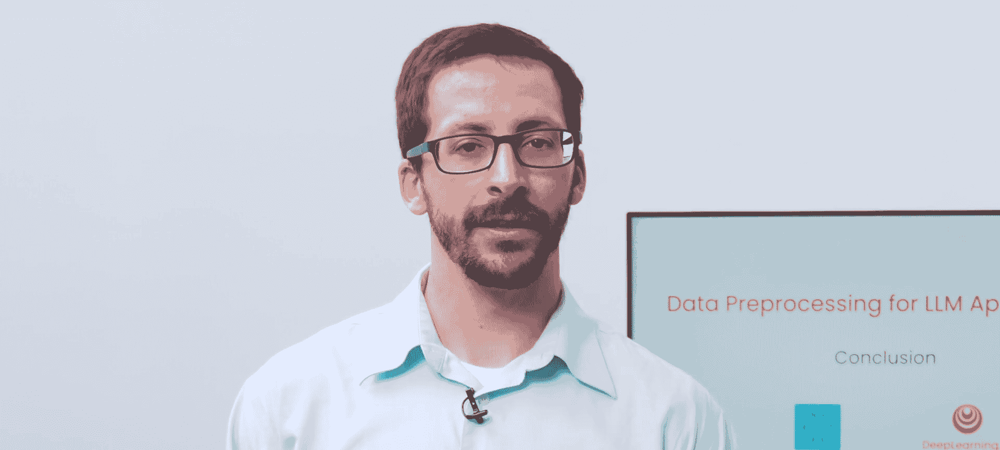

# 吴恩达《为LLM应用程序预处理非结构化数据｜Preprocessing Unstructured Data for LLM Applications》中英字幕 - P8：8.conclusion - GPT中英字幕课程资源 - BV1ji421f7QD

在这门课程中，您学习了如何从各种不同的数据源中摄取，和规范化内容，如何在预处理过程中使用提取的元数据丰，富RAG应用程序，以及用于解锁PDF和图像中内容的高级建，模技术。

您还学会了如何将数据预处理的输出转换为一个功能完善，的RAGBOT。

现在，您已经准备好构建一个了解您项目或组织信息的，RAGBOT。