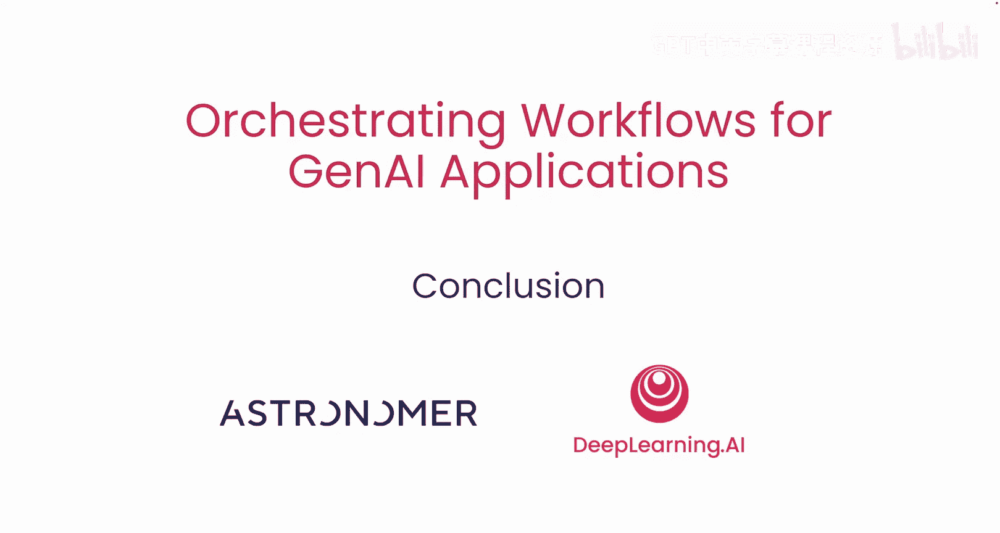

# 吴恩达《为生成式 AI 应用编排工作流｜Orchestrating Workflows for GenAI Applications》中英字幕 - P10：10.conclusion.zh_en - GPT中英字幕课程资源 - BV16BMwzyEVW

Congratulations， you now know how to turn a rack prototype in a notebook into an automated pipeline using Eflow。

 You can apply all the best practices you learned in this course to any Gen AI workflow。😊。

If you'd like to set up FFflow locally to practice writing more GenI DACs。

 make sure to check out the additional resources and the optional video at the end of this course I can't wait to see what you will build with FFL。

