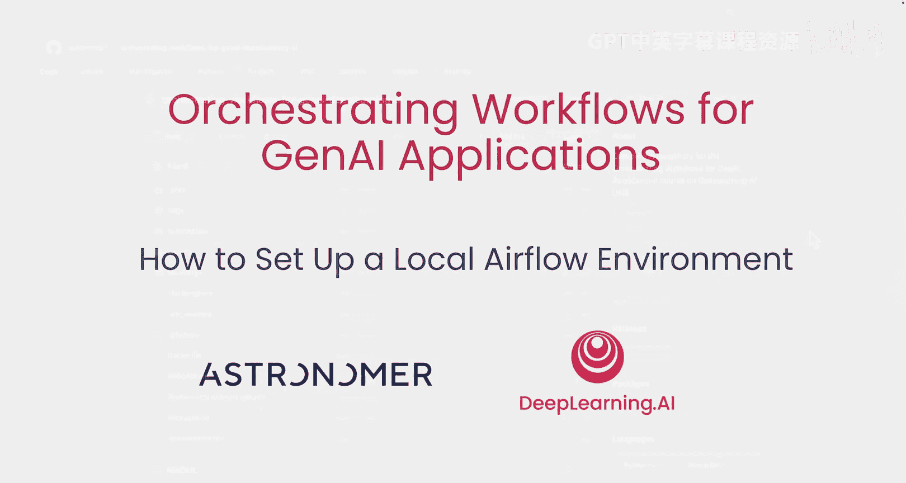
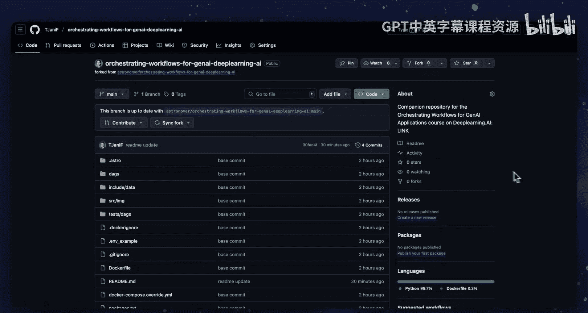
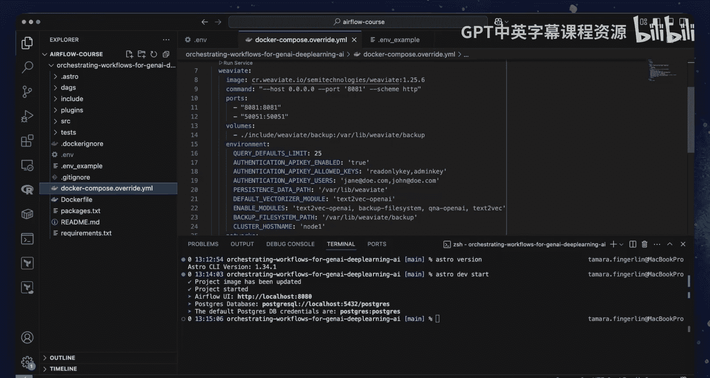
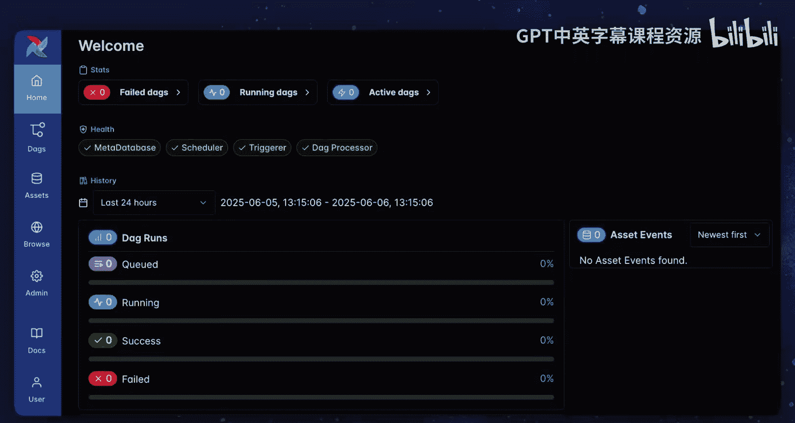
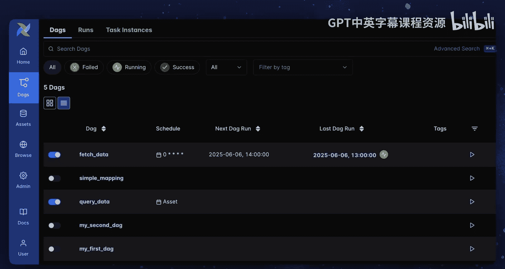
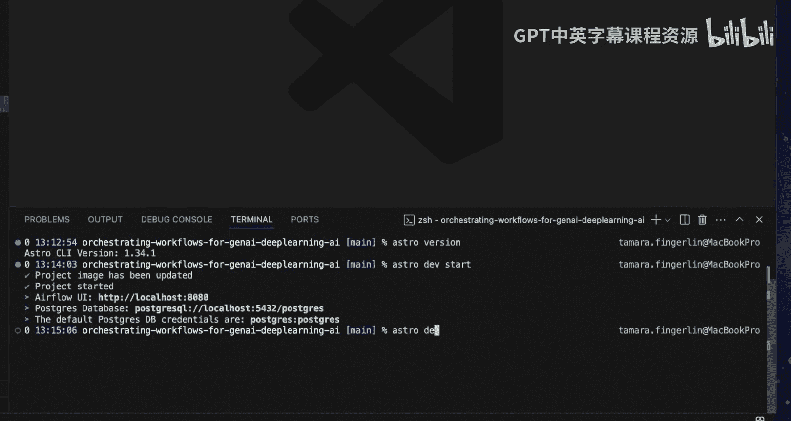

# 吴恩达《为生成式 AI 应用编排工作流｜Orchestrating Workflows for GenAI Applications》中英字幕 - P11：11.optional-how-to-set-up-a-local-airflow-environment.zh_en - GPT中英字幕课程资源 - BV16BMwzyEVW

In this short video， you will learn how to set up airflow and Viviate locally to run the Ds you've built in this course on your local machine。

Go to this repository in the astronomer organization called orchestrating Workflows for GenI。

 Deep Learning AI。Fk the repo into your own GitHub account and then clone it to your local machine and navigate into the directory。

I'm using VS code here to run a terminal and edit my Dg files。

 but you can edit your Dg files and run your commands any way you'd like。

The only package you need to install on your machine to run this project is the S to a CLI。

 a free tool by astronomer developed to run Lflow locally in containers。

Use Bed St Astro to install the package on your Mac if you are on a different operating system。

 check out the AstroCI documentation for install instructions。

If you already have the Astroce installed like me here， then make sure you are at least on version 1。

34。1 by running Astro versionion。Once you have the Astrola installed。

 there is only one small change you need to make to the repo。

 createate a new file in the root directory called dot N。

 This file will contain all environment variables for your Aflow project。

 Copy the contents from dot N example into this file。

This environment variable defines the connection between the airflow instance and the local Vviate environment if you want to connect to a different Vviate environment。

 you can make changes to this variable for example to connect to Vviate cloud。

Note that you can include your own Open AI API key if you'd like。

 but this is not necessary to run the course pipelines。After saving the change to the end file。

 run Astro depth start in the root directory of your project。

 this command will spin up the four containers running the Fflow components you learned about in this course。

 the scheduler， the API server， the DAC processor， and the Fflow metadata database。

The AsF Start command also initializes the trigger component， which we did not cover in the course。

Alongside these five containers running Alflow， a container for a local Viviate instance is created as well based on the definition in the darker compose overrite file。

You do not need to have darker installed on your machine to run this command。

 the AstroCI will set up poman for you to run containers if you do not have darker available。

Once the containers are ready， the FOUI opens at LocalHost 8080。

 you do not need any credentials to log in。

Now you can run the same DAs you built in this course on your computer and start building out your own GenI pipelines。

Once you are ready to deploy your pipeline， you can send those tags to any type of airflow deployment if you have an Astro account which has a free trial available。

 then you can just use the command Astro deploy to send your pipelines to the cloud。

